# Phase 5 — UI Design Contract (Mobile Companion)

> Plan-first visual and interaction contract for the Expo Android companion.  
> Generated by gsd-ui-researcher. **No implementation in this phase** — clarity on screens, flows, and tokens before build.  
> Canonical feature map (keep in sync): [`docs/features/phone-apk-screens.md`](../../../docs/features/phone-apk-screens.md)  
> **Amendment A (2026-10-01):** Screen 1 / Home → **Cursor sidebar-inspired** full-width phone layout.  
> **Amendment B (2026-10-01):** Opened chat / Live chat → **Cursor chat chrome** (message stream + circular `+` sheet + mode chip + Working/Queued + Model panel).  
> **Amendment C (2026-10-01):** Account → **Cursor Settings–format** screen focused on **connect phone ↔ Cursor PC**, **choose one PC**, and **Refresh now** (pull workspace + chat sessions from that Hub).  
> **Amendment D (2026-10-01):** Pair → **primary path = PC shows QR, phone scans with camera** (`cursor-companion://pair` from Hub `qrPayload`). Manual code entry is fallback.  
> **Amendment E (2026-10-01):** **Connectivity + session parity** — phone Home must show the same PC-bound Composer sessions as Cursor on that computer; Sync / Refresh now / focus / WS keep the list honest. Checker must re-verify — see `05-UI-REVIEW.md`.  
> **Amendment F (2026-10-01):** **Away-from-PC comfort** — Hub prerequisites (live transcript stream, real approval detection, Stop), local notifications (no FCM), per-chat status + approvals badge, approval card v2, Changes card + read-only diff, app lock, PC reachability, drafts/send retry. Source: [`mobile-ux-comfort-gap-audit-2026-10-01.md`](../../../docs/reports/mobile-ux-comfort-gap-audit-2026-10-01.md). Checker must re-verify.  
> **Amendment G (2026-10-14):** **Scroll + pair URL discoverability + calm RN motion** — (1) Any screen whose content can exceed the viewport MUST use `ScrollView` / keyboard-aware scroll with safe-area padding — never `flex:1` + `justifyContent:'center'` alone for multi-field forms (**PairScreen** is P0 offender). (2) Primary operator path = open browser on PC to **`http://127.0.0.1:8787/pair`** (loopback-only Hub page); Hub startup console prints this URL prominently; PC `/pair` hero says open on PC / do not type on phone; phone Pair shows numbered steps card above the fold (not 11px footer hint); Account How it works same language; manual Hub URL+code remains fallback. (3) RN motion: 1–2 meaningful micro-interactions per screen max; honor Reduce Motion; transform/opacity only; FlatList for long session lists; no decorative infinite loops. Product locks unchanged (PC-local, Tailscale+pair, CDP localhost, Expo APK client-only, light calm grayscale). Checker must re-verify.

---

## Intent

User asked for a **plan first**: which screens exist, what each does/shows, how navigation and scenarios work, empty/loading/error/offline states, implemented vs planned, and only then a high-level build path. This document is that plan + design contract.

**Home north star (amended):** First paired screen should look and behave like Cursor’s agent sidebar — light calm grayscale, New Chat + Search, Projects / Repositories hierarchy, nested sessions with relative timestamps, subtle selected row, profile + settings footer — adapted to **full-width phone**, not a 250px desktop rail.

**Opened-chat north star (amended):** Live session thread mirrors Cursor desktop chat — gray user bubbles, agent timing/identity, circular `+` mode sheet, mode chips, Working/Queued, Hub-backed Model panel — phone remote UI only.

**Settings / Account north star (amended):** Account tab mirrors **Cursor Settings → General** card layout (section headers + rounded cards + toggles / dropdowns / primary buttons) — but content is **companion connection**, not Cursor billing or cloud agents: pick **one PC Hub** on the Tailscale mesh, see how to connect, and **Refresh now** to reload workspace + chat sessions from that computer immediately.

**Pair north star (amended D + G):** Correct connect path is **optical via a PC browser page**: operator on the **PC** opens **`http://127.0.0.1:8787/pair`** (loopback-only Hub page; same host constraint as `POST /pair/start`). That page starts pairing and **displays a QR** encoding `cursor-companion://pair?host=&port=&code=&pairId=`. Phone Pair screen shows a **numbered steps card above the fold** (1 On PC open URL · 2 On phone Scan QR), then **Scan QR** (camera). Manual Hub URL + code remains fallback. Phone never dials CDP; never instructs the operator to type `127.0.0.1` on the phone.

**Sync / parity north star (amended):** Connectivity is Tailscale → Hub → (live CDP when `cdp_ok`) + local History Index. The **session list on the phone must match the PC-open workspace’s Composer chats** (live + history from Hub), not a cloud catalog. Operator can force **Refresh now** / pull-to-refresh; Home refreshes on focus and on Hub WS health/session events. Stale history index must be visible (parity hint), never silently invent sessions.

**Stack lock:** Expo / React Native (`apps/mobile`). Apply motion/graphics principles conceptually to RN (`Animated` / Reanimated later) — do **not** invent a SwiftUI app.

---

## Design System

| Property | Value |
|----------|-------|
| Tool | none (Expo RN — not web shadcn) |
| Preset | not applicable |
| Component library | React Native core + `@react-navigation/native` / `native-stack` |
| Icon library | Thin-stroke line icons (Lucide/SVG preferred) matching Cursor sidebar density — **no emoji as icons** |
| Font | **System UI** (Roboto / SF via RN default) — locked by reference density (resolves Open Q5) |

**Visual direction (locked):** Calm **light grayscale** companion — soft gray canvas, white/off-white surfaces, medium-gray meta, dark gray primary text, single green accent (avatar / Online / primary CTAs). Source: user Cursor-sidebar reference (2026-10-01) + existing `apps/mobile/src/theme.ts`.

**ui-ux-pro-max note:** OLED dark (`#0F172A` / accent `#22C55E`) remains **Deferred alternate** — not v1. Reference **locks light** (resolves Open Q1).

**Avoid:** Purple-glow AI chrome, dense dashboard tabs, emoji icons, cloud-login UX, Getting Started progress cards, Connect Slack / third-party promo footers.

---

## Label mapping (Cursor sidebar → companion)

| Cursor UI label | Mobile companion meaning | v1 behavior |
|-----------------|--------------------------|-------------|
| **New Chat** | Create Composer session in **PC-open** project | Opens New chat modal (`NewSession`) |
| **Search** | Filter nested session titles under bound workspaces | Local filter; no cloud search |
| **Projects** | PC-bound workspace roots from Hub (`GET /workspace` / `.roots`) | Read-only list of bound projects |
| **+ New Project** / Projects **+** | Cursor cloud/local project create | **Hidden or disabled** — see lock conflict below |
| **Repositories** | Workspace / folder groups with nested chats | Nested list: folder → sessions (live + history) |
| Filter icon | Session / repo filter controls | Opens filter sheet or focuses Search |
| New Folder icon | Create folder in Cursor agent UI | **Hidden** v1 (no phone-side folder invent) |
| Session row + `10m` / `7d` | Live or history session | Tap → Live chat or History read |
| Selected row highlight | Active / last-opened session | Subtle rounded gray well (`#eef0f3`) |
| Avatar + name + gear | Account / identity | Opens **Account** screen |

### Lock conflict: “+ New Project”

**Product lock:** Phone remotes project(s) **already open on the PC** — not arbitrary folder / cloud project creation from the phone.

**Contract resolution (v1):** Do **not** implement phone-side project creation that opens arbitrary folders.

| Option | When to use |
|--------|-------------|
| **A — Hide (default)** | Omit `+ New Project` row and Projects-header `+` entirely |
| **B — Disabled + messaging** | Show row grayed; tap opens sheet: “Open a folder in Cursor on the PC. This app remotes that project only.” CTA **Check Health** |

Executor default: **Option A (hide)**. Option B only if user wants visible Cursor parity with fail-closed copy.

---

## Spacing Scale

Declared values (multiples of 4 only). Migrate away from current `theme.spacing.xs=6` / `sm=10` during implementation.

| Token | Value | Usage |
|-------|-------|-------|
| xs | 4px | Icon gaps, inline padding |
| sm | 8px | Compact gaps; **min gap between touch targets** |
| md | 16px | Default element spacing; home horizontal inset |
| lg | 24px | Section padding |
| xl | 32px | Layout gaps |
| 2xl | 48px | Major section breaks |
| 3xl | 64px | Page-level / empty-state vertical air |

**Exceptions:**

- Primary tap targets **min 44×44px** (New Chat, Search, session rows, tabs, Approve/Deny, Send, avatar, gear).
- Bottom tab bar `paddingBottom` ≥ safe-area inset.
- **Home list density:** Session rows may use **compact vertical padding (8–12px)** inside a ≥44px hit box to match Cursor sidebar density — do not drop below 44px touch height.

---

## Typography

Exactly four sizes, two weights.

| Role | Size | Weight | Line Height |
|------|------|--------|-------------|
| Label / meta | 13px | 400 | 1.4 |
| Body | 16px | 400 | 1.5 |
| Heading | 20px | 600 | 1.2 |
| Display | 28px | 600 | 1.2 |

Weights allowed: **400** and **600** only.  
Home specifics: section headers (“Projects”, “Repositories”) use **Label** + muted color; repo folder names use **Body** 600; session titles **Body** 400; timestamps **Label** muted.

---

## Color

60 / 30 / 10 from current theme (light calm). Hex locked. Reference is grayscale-forward — keep accent sparse.

| Role | Value | Usage |
|------|-------|-------|
| Dominant (60%) | `#f4f5f7` | App background / home canvas |
| Secondary (30%) | `#ffffff` / `#eef0f3` | Surfaces, selected row, tab bar, muted wells |
| Accent (10%) | `#1e6b4a` | Reserved only (see below) |
| Destructive | `#b3261e` | Deny, clear pairing, hard failures |
| Warn | `#9a6700` | Degraded / queue banners |
| Text | `#1a1c1e` | Primary text |
| Muted text | `#5f6368` | Section headers, timestamps, secondary |
| Border | `#e2e5ea` | Hairlines, Search field |
| Bubble user | `#f0f1f3` | Outgoing (opened chat — wide light-gray Cursor-like bubble) |
| Bubble assistant | `#ffffff` | Incoming (flush / soft border; not a green tint wall) |
| Agent identity | `#2563eb` | Bold agent/skill name + timing link accent (opened chat only) |
| Path pill bg | `#eef0f3` | Monospace path/command chips in transcript |
| Mode Plan | `#f5d0c5` | Plan mode chip fill (peach) |
| Mode Debug | `#f5c6cb` | Debug chip (soft red) |
| Mode Multitask | `#e4d4f4` | Multitask chip (soft purple) |
| Mode Ask | `#cfead6` | Ask chip (soft green) |

**Accent reserved for:** New Chat primary emphasis (optional text/icon tint), selected bottom tab, ConnectionChip Online, Approve fill, avatar fill, focus links, Send when idle. **Not** for entire selected session rows (use secondary muted `#eef0f3`). Agent-identity blue is **semantic for transcript identity only** — not a second brand accent for chrome.

**ConnectionChip tones:** Online → accent; Degraded → warn; Offline → destructive; Pair → muted/accent outline.

---

## Copywriting Contract

| Element | Copy |
|---------|------|
| Primary CTA (pair) | **Scan QR** (fallback: **Pair with Hub**) |
| Pair steps card (G) | **1. On PC** — Open `http://127.0.0.1:8787/pair` in a browser on the computer (shows QR). · **2. On phone** — Tap **Scan QR** and aim at that QR. |
| Pair steps a11y (G) | `accessibilityLabel="Pairing steps: open pair page on PC, then scan QR on phone"` |
| PC /pair hero (G) | **Open this page on the PC — do not type this URL on the phone** |
| Hub startup console (G) | Print prominently: `Pair on PC: http://127.0.0.1:8787/pair` (loopback-only; same line family as listen banner) |
| Primary CTA (home top) | **New Chat** |
| Primary CTA (chats empty, bound) | **New Chat** |
| Primary CTA (new session) | **Create chat** |
| Primary CTA (health gate) | **Continue to Chats** |
| Search placeholder | **Search chats** |
| Projects section header | **Projects** |
| Repositories section header | **Repositories** |
| Empty (unbound project) | Title: **No project on PC** · Body: Open a folder in Cursor on the PC. This app remotes that project only. · CTA: **Check Health** |
| Empty (bound, no sessions) | Title: **No chats yet** · Body: Start a new chat to continue in the project open on your PC. · CTA: **New Chat** |
| Empty (search no matches) | Title: **No matching chats** · Body: Try another name, or clear Search. |
| Empty (history, no messages) | Title: **No messages in this chat** · Body: Open on PC to continue this session in Cursor, or go back to Chats. · CTA: **Open on PC** |
| Empty (editor, no files/roots) | Title: **No files to browse** · Body: Open a folder in Cursor on the PC, then pull to refresh. · CTA: **Check Health** |
| Disabled New Project (if Option B) | Title: **Open on PC** · Body: Projects are bound from Cursor on your PC — the phone cannot open arbitrary folders. · CTA: **Check Health** |
| Primary CTA (composer send) | **Send message** |
| Primary CTA (composer stop) | **Stop** (Send morphs while agent working — Designed until Hub stop path exists) |
| Composer placeholder (idle) | **Message…** or **Send follow-up** |
| Composer placeholder (Plan) | **Plan changes** |
| Composer placeholder (Debug) | **Describe the bug** |
| Composer placeholder (Multitask) | **Coordinate tasks** |
| Composer placeholder (Ask) | **Ask a question** |
| Working strip | **Working N** / **1 working** (N = active PC agents when Hub reports; else “Working”) |
| Queued strip | **1 Queued** + message preview thumbnail |
| Model pill | **Model {name} >** (e.g. **Model Auto >**) |
| Model panel search | **Search models** |
| Model empty | **No models from Cursor on PC** · Body: Refresh after Cursor is open, or set `CURSOR_MODELS` on the Hub. · CTA: **Refresh models** |
| Model Auto tooltip | **Balanced quality and speed, recommended for most tasks.** |
| Primary CTA (history) | **Open on PC** |
| Error (Tailscale / mesh) | Cannot reach Hub — open Tailscale on this phone, sign in to the same tailnet as the PC, then retry. |
| Error (Hub down) | Hub unreachable or unhealthy — confirm Tailscale Online, then Hub URL (MagicDNS/IP:8787). |
| Error (Cursor down) | Cursor not detected on the PC — open Cursor with the project. |
| Error (CDP / create queue) | Composer remoting offline on PC — Hub still works; New-session Create queues until Cursor automation is available. |
| Destructive (clear pairing) | **Clear pairing:** Remove this phone’s trust with the PC Hub? You will need a new pair code. |
| Destructive (Deny tool) | **Deny tool** (no second dialog — irreversible for that approval id; label alone is enough) |
| Approval Approve | **Approve tool** |
| Deny undo snackbar (F) | **Tool denied** · action **Undo** (3 s, then sent to Hub) |
| Approval card meta (F) | **Runs in** {cwd} · **Tool** {name} |
| Home waiting pill (F) | **{N} waiting for approval** → |
| Row status a11y (F) | **Working** · **Waiting for approval** · **Finished** · **Failed** |
| Changes card (F) | **{N} files changed** · action **View changes** |
| Changes empty (F) | **No file changes in this turn** |
| Notification — approval (F) | Title: **Approval needed · {project}** · Body: {tool}: {command preview} |
| Notification — finished (F) | Title: **Agent finished · {chat title}** · Body: Tap to read the reply. |
| Notification — failed (F) | Title: **Agent stopped with an error · {chat title}** |
| Ongoing notification (F) | **Agent working · {project}** (low priority, silent) |
| Send failed (F) | **Not sent** · action **Retry** |
| App lock prompt (F) | **Unlock to approve tools on your PC** |
| Offline — open Tailscale (F) | CTA **Open Tailscale** |
| Stop confirm (F) | none — Stop is one tap; transcript shows **Stopped from phone** |

Full connection strings live in `apps/mobile/src/hub/connection-state.ts` (`connectionStateLabel`) — keep UI-SPEC and code aligned.

---

## Visual hierarchy (focal points)

| Screen | Primary visual anchor (eye first) | Secondary |
|--------|-----------------------------------|-----------|
| Pair | Numbered steps card (PC URL → Scan QR) + **Scan QR** CTA | Manual Hub URL/code fallback; Tailscale guide in scroll |
| Health | Health status rows + **Continue to Chats** | Refresh / Re-pair |
| **Home (Chats)** | Nested Repositories → session list | New Chat + Search; profile footer |
| **Opened chat (Live)** | Latest transcript / streaming agent block | ApprovalCard when present; composer (`+` / mode chip / Model / Send·Stop) |
| New chat | Model + Create chat form | Attachments / first prompt |
| History read | Transcript snippet | **Open on PC** CTA |
| **Account / Settings** | **Connected PC** card + **Refresh now** | How to connect / Re-pair / Health details |
| Editor | File list under workspace roots | Preview pane when a file is selected |

**Accessibility:** Prefer text labels on primary actions. Composer **+** must expose `accessibilityLabel="Composer actions"`. Model pill: `accessibilityLabel="Select model"`. Mode chip dismiss: `accessibilityLabel="Clear mode"`. Home Search: `accessibilityLabel="Search chats"`. Avatar/gear: **Account** / **Settings**. Back on opened chat: `accessibilityLabel="Back to chats"`. PC picker: `accessibilityLabel="Choose computer"`. Refresh: `accessibilityLabel="Refresh from computer"`.

---

## Screen — Account / Settings (Cursor Settings format → phone)

Phone **Account** tab is the companion’s Settings surface. Visual format follows Cursor **Settings → General**: large page title, light canvas, **rounded white/gray cards** with row titles + short descriptions + controls (dropdown, toggle, primary button). On phone we use a **single scroll column** (no desktop left category rail) — categories become section headers inside the scroll.

### Purpose

Show **how the phone connects to Cursor on a PC**, let the operator **choose one computer (Hub)**, and **refresh immediately** so Home chat/session lists and workspace info match that PC.

### Structure

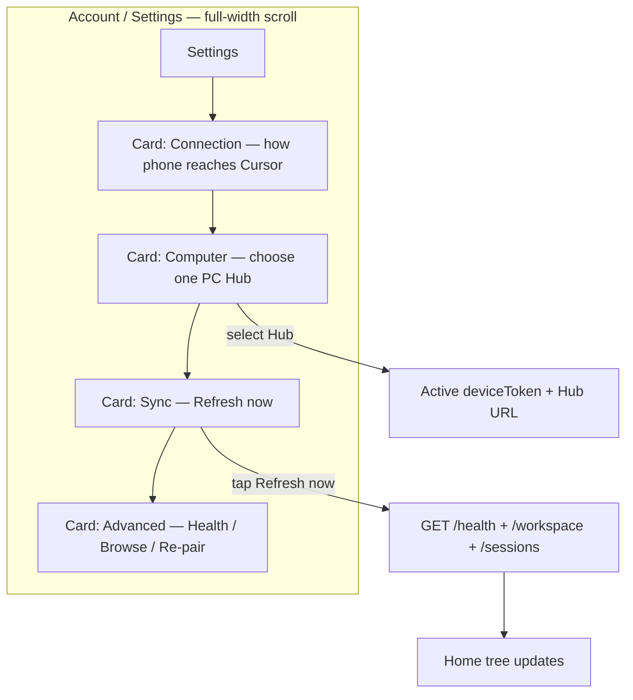

### Layout (map from Cursor Settings reference)

| Cursor Settings pattern | Companion Account |
|-------------------------|-------------------|
| Page title “General” | Page title **Settings** (or **Account**) |
| Rounded cards with rows | Same card chrome / spacing / green toggles where used |
| Dropdown control | **Computer** dropdown / action sheet: list of known PCs |
| “Open” secondary button | **Pair with Hub** / **Open Health** where needed |
| Sidebar categories (Profile, Appearance, …) | **Omitted** on phone v1 — connection-first only |
| Cursor Account / billing / Cloud Agent banners | **Non-goals** — never show |
| Redacted sidebar clutter | Do not port cloud/models/git settings from Cursor desktop |

### Cards (what each shows)

#### 1. Connection — how we connect

| Row | Shows | Control |
|-----|-------|---------|
| **Status** | Online / Degraded / Offline / Pair (same tones as ConnectionChip) | Read-only + optional HealthDot |
| **How it works** | Short copy (Amendment G): On the **PC**, open **`http://127.0.0.1:8787/pair`** in a browser — that page shows the QR. On the **phone**, tap **Scan QR**. Do **not** type that loopback URL on the phone. Phone ↔ **Tailscale** ↔ **Hub** ↔ Cursor (CDP stays on PC). | Static helper text |
| **Pair with Hub** | When unpaired or switching PC | CTA → Pair screen (**Scan QR** primary) |

#### 2. Computer — choose one PC

| Row | Shows | Control |
|-----|-------|---------|
| **Computer** | Active Hub display name (e.g. `Desk PC` / Tailscale hostname) + URL/host:port | Dropdown / bottom sheet: **known PCs** (saved Hub endpoints after successful pairs) |
| **Project on PC** | Bound workspace path(s) from `GET /workspace` | Read-only; empty → “No project on PC” + Check Health |

**Rules:**

- Exactly **one** active PC at a time. Selecting another PC switches Hub base URL + device token for that peer (re-pair if token missing).
- List is **operator’s Tailscale / paired Hubs only** — not a cloud PC catalog, not VPS Hub.
- Changing PC must clear or reload Home session cache, then auto-trigger the same pull as **Refresh now**.

#### 3. Sync — refresh from computer

| Row | Shows | Control |
|-----|-------|---------|
| **Refresh now** | “Reload workspace and chat sessions from the selected computer.” | Primary button **Refresh now** |
| **Last synced** | Relative time of last successful pull | Read-only meta |

**Refresh now does (immediate):**

1. `GET /health` → update connection status  
2. `GET /workspace` → project / roots banner data  
3. `GET /sessions` (live + history index as Hub exposes) → rebuild Home Projects / Repositories tree  
4. Soft-reconnect WS if needed so Live chat stays on the active Hub  

Fail-closed: if Hub/Tailscale down, show Offline error on the Sync card; do not invent sessions.

#### 4. Advanced (secondary)

| Row | Control |
|-----|---------|
| **Health details** | Navigate Health screen |
| **Browse PC files** | Optional Editor |
| **Re-pair / Clear pairing** | Pair flow / clear token |
| **Pending approvals** | Count; deep-link vs count-only still open (Q3) |

### Interaction flow

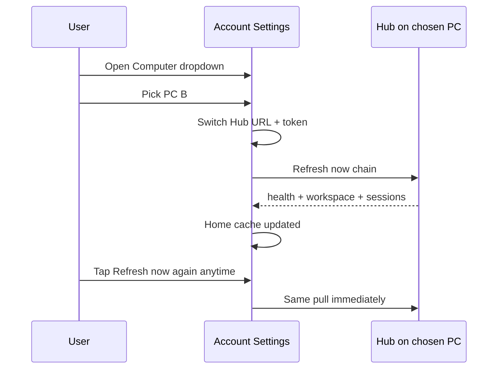

### States

| State | UI |
|-------|-----|
| Unpaired | Connection card → **Pair with Hub**; Computer disabled; Refresh disabled |
| Loading refresh | Disable **Refresh now** + spinner; optional “Syncing…” |
| Ready | Status Online/Degraded; Computer shows active PC; Refresh enabled |
| Offline | Status Offline; Refresh shows Tailscale/Hub error; keep last cached sessions with stale hint |
| Switch PC fail | Inline error on Computer card; stay on previous PC until success |

### Copy (locked for this screen)

| Element | Copy |
|---------|------|
| Page title | **Settings** |
| Computer row | **Computer** · helper: “Sessions and project come from this PC’s Hub.” |
| Refresh CTA | **Refresh now** |
| Refresh helper | **Reload workspace and chat sessions from the selected computer.** |
| How it works | **On the PC, open http://127.0.0.1:8787/pair in a browser — it shows the pairing QR. On this phone, tap Scan QR. Do not type that URL on the phone. Cursor stays on the PC — the phone is remote UI only.** |
| Empty PC list | **No computers saved** · Body: Pair with a Hub on your PC first. · CTA: **Pair with Hub** |

### Non-goals on this screen

- Cursor Account billing / “Open” to cursor.com  
- Cloud Agent approval banners / cloud sync  
- Editing Cursor desktop General toggles (tips, window restore) from the phone  
- Exposing CDP URL or remote-debugging to the phone  
- Multi-PC simultaneous live sync (one active Hub only)

### Implemented vs planned

| Piece | Status |
|-------|--------|
| Account tab shell, Hub name/URL, Health / Re-pair / Browse links | **Implemented** (simpler list today) |
| Cursor Settings card chrome | **Planned** (rebuild Account UI) |
| Multi-PC picker (saved Hubs) + switch | **Planned** (today: single Hub URL) |
| **Refresh now** (health + workspace + sessions) | **Planned** as explicit CTA (pull-to-refresh exists on Home; Settings needs one-tap) |

---

## Screen 1 — Home (Cursor sidebar → phone)

### Structure

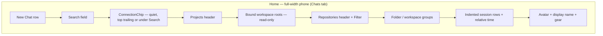

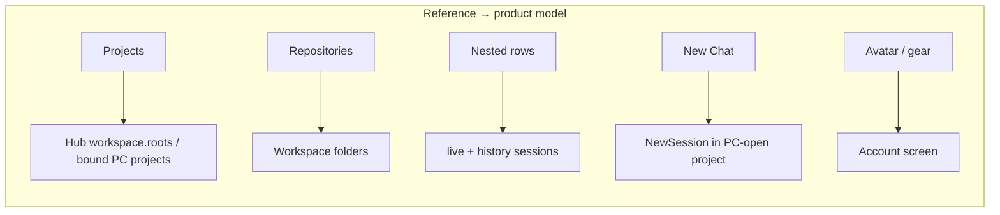

### Component inventory (this screen)

Enumerated by gsd-ui-researcher from locked Home north star + `apps/mobile/src/screens/ChatsHomeScreen.tsx` — 9 components — apps/mobile@local — 2026-10-14.

| Component | Role | Notes |
|-----------|------|-------|
| `NewChatRow` | Top action | Text **New Chat** + thin icon; full-width row ≥44px; opens NewSession |
| `HomeSearchField` | Filter | Magnifier + placeholder **Search chats**; filters nested titles |
| `ConnectionChip` | Mesh/Hub tone | Quiet; not a banner wall |
| `SectionHeader` | Projects / Repositories | Muted Label; Repositories may show Filter icon only (hide New Folder) |
| `ProjectRootRow` | Bound root | Folder/name; read-only; no create |
| `RepoFolderRow` | Expand/collapse workspace group | Folder icon + name; tap toggles children |
| `SessionRow` | Nested chat | Dot + title + relative timestamp (`10m`, `7d`); selected = rounded `#eef0f3` |
| `ProfileFooter` | Identity | Avatar initial, Hub/device display name, gear → Account |
| Bottom tabs | Shell | **Chats** (this home) \| **Account** |

**Do not add:** Getting Started progress card, Connect Slack, promo footers, `+ New Project` (default hide).

### Tap targets / flows

| Control | Action |
|---------|--------|
| **New Chat** | Push/modal `NewSession` for bound PC project |
| **Search** | Focus field; filter tree client-side |
| **Filter** (Repositories) | Same as Search focus, or compact filter sheet (live/history) |
| **Project root row** | Optional: scroll/expand matching repo group — no phone open-folder |
| **Repo folder** | Expand / collapse nested sessions |
| **Session row** | Live → `LiveChat`; history → `HistoryRead` |
| **Avatar / name / gear** | Navigate to **Account** (same screen as Account tab) |
| Pull-to-refresh | `GET /workspace` + live/history sessions merge |

### Mobile adaptation notes

- **Full-width phone layout** — not a slim desktop sidebar. Horizontal padding `md` (16px); list uses entire content width above the tab bar.
- **Bottom tabs stay:** Home **is** the Chats tab content. Account remains the second tab for thumb reach.
- **Profile footer vs Account tab:** Both open the same Account screen. Profile row provides Cursor-familiar chrome; tab provides one-handed reach when scrolled away from footer. Do **not** invent a third Settings stack.
- Replace prior **FAB New chat** with top **New Chat** row (FAB optional remove on implement).
- Relative timestamps: compact (`10m`, `2h`, `7d`) right-aligned — Label / muted.
- Multi-root Hub: each root may appear under Projects and as a Repositories folder group.

### IA decision (locked)

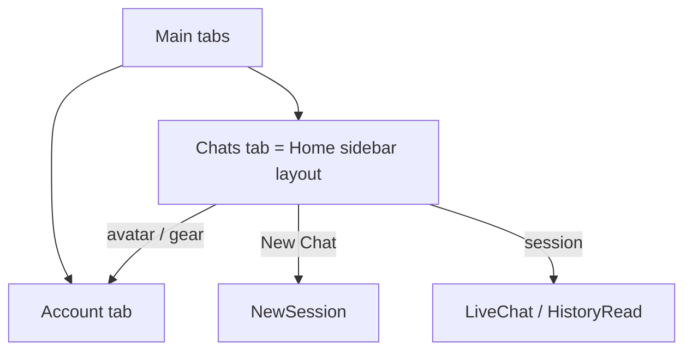

**Verdict:** Keep **Chats | Account** tabs. Home = sidebar-inspired chat list. Profile row → Account (duplicate entry, same destination).

---

## Screen — Opened chat (Live chat) — Cursor chat pattern

> **Amendment B.** North star: opened session looks/behaves like Cursor desktop chat (light calm). Phone simplifies chrome; tools/MCP stay on PC. Nav glue: desktop “sidebar” icon → **back to Home** (Chats tree), not a second rail.

### Layout

```mermaid
flowchart TB
  subgraph opened ["Opened chat — full-width phone"]
    Top["Back · Search · New · Session title"]
    Stream["Message stream"]
    UserBub["User: wide light-gray bubble"]
    AgentMeta["Worked for / Finished · agent identity blue"]
    Content["Text · badges · path pills · lists"]
    Appr["Inline ApprovalCard when pending"]
    Queue["Queued strip — optional"]
    Working["Working N pill — optional"]
    Comp["Composer: + · mode chip · input · Model · mic · Send/Stop"]
    Foot["Optional status: workspace / PC Hub / sync"]
  end
  Top --> Stream
  Stream --> UserBub --> AgentMeta --> Content --> Appr
  Appr --> Queue --> Working --> Comp --> Foot
```

### Top chrome

| Control | Behavior | vs Cursor desktop |
|---------|----------|-------------------|
| Back / sidebar affordance | Pop to **Home** (Chats tree) | Desktop toggles sidebar; phone maps to back-to-list |
| Search | Session-local find **or** designed-only until Hub search exists | Desktop global search — phone may omit v1 |
| **+** (header) | Opens **New Chat** modal (same as Home New Chat) | Desktop new chat |
| Session title | Live session title (Heading/Body 600); ellipsis | Match |

### Message stream — match vs simplify

| Element | Phone contract | Match desktop? | Simplify |
|---------|----------------|----------------|----------|
| User bubble | Wide rounded `#f0f1f3`; body 16/400; avatar optional trailing | Yes | Avatar optional (hide if clutter) |
| Agent timing | Label muted: `Worked for Xm Ys` / `Finished N subagents` | Yes when Hub/WS exposes | Omit if stream lacks duration |
| Agent / skill identity | Icon + **bold blue** name (`#2563eb`) | Yes | One identity line; no nested desktop skill chrome |
| Status badges | Bold `(**N/N PASS**)` style in text | Yes | No separate badge component required |
| Path pills | Monospace on `#eef0f3` rounded pill | Yes | Truncate long paths mid-string |
| Numbered options | Standard ordered list | Yes | — |
| Message footer | Copy + relative time | Partial | Thumbs / branch **Designed** — phone may show Copy + time only |
| “New” separator | Thin accent/blue rule + **New** | Optional | Skip unless WS marks unread boundary |
| Approvals | Inline `ApprovalCard` (Approve tool / Deny tool) | Product-specific | Always phone-explicit; never auto |

### Composer — OUR `+` visual (locked)

| Property | Value |
|----------|-------|
| Shape | Perfect circle, **44×44** tap (visual diameter ≥40) |
| Fill | Off-white / light gray `#f7f8fa` (or `surface`) |
| Border | Thin `#5f6368` at ~30% opacity (or `#c5c9d0`) |
| Icon | Thin dark-gray `+` centered; weight 400 |
| Placement | **Left edge** of composer bar, left of mode chip / input |

### `+` menu (sheet above composer)

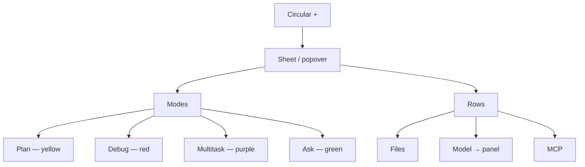

| Item | Icon chroma | Copy subtitle | Hub / adapter mapping | Status |
|------|-------------|---------------|------------------------|--------|
| **Plan** | Yellow | Generate an implementation plan | Map to Cursor Plan mode when LiveCursorAdapter can set it; else UI-only chip | **Designed** (create may pass string later; live switch Designed) |
| **Debug** | Red | Pinpoint the root cause | `agentMode=debug` on `POST /sessions` | **Implemented** on create; live mid-chat switch **Designed** |
| **Multitask** | Purple | Orchestrate multiple subagents | `agentMode=multitask` (also `parallel`) on create | **Implemented** on create; live switch **Designed** |
| **Ask** | Green | Answer without edits | `agentMode=ask` on create (AC-052-04 Pass) | **Implemented** on create; live switch **Designed** |
| **Files** | Neutral | Attach from PC workspace | `FilePickerSheet` → `POST .../attachments` under roots | **Implemented** |
| **Model** | Neutral | Opens Model panel | `GET /workspace/models` + create/live `model_select` | **Implemented** list; live apply when CDP `model_select` VERIFIED |
| **MCP** | Neutral | List PC tools / MCP summary | `GET /workspace/tools` read-only; **never** run MCP on phone | **Designed** UI row → read-only sheet; execution **PC-only** |

Also keep overflow leftovers as secondary rows or nested: `@` / `/` (**partial**), Mic / Camera (**Designed**).

### Composer + how it works (interaction model)

```mermaid
sequenceDiagram
  participant U as User
  participant C as Composer
  participant S as Plus sheet
  participant H as Hub on PC
  participant PC as Cursor Composer

  U->>C: Tap circular +
  C->>S: Open modes + Files/Model/MCP
  U->>S: Choose Plan
  S-->>C: Insert dismissible Plan chip; placeholder Plan changes
  Note over C: State mode-selected
  U->>C: Type + Send
  C->>H: POST message / session (tools stay on PC)
  H->>PC: CDP inject / automation
  PC-->>C: Working N via WS/health
  Note over C: Send morphs to Stop Designed
  U->>C: Send while busy
  C-->>C: Queued strip above input
  PC-->>C: Tool approval needed
  C-->>U: ApprovalCard inline
```

### Composer states

| State | UI | Send control | Notes |
|-------|-----|--------------|-------|
| **idle** | `+` · input · **Model {name} >** · mic · **Send** | Send | No mode chip |
| **mode-selected** | Colored dismissible chip (icon + name + X) inside input; placeholder per mode | Send | Chip X clears mode → idle |
| **working** | **Working N** pill above composer | **Stop** (Designed until Hub stop) | Agent(s) run on PC |
| **queued** | **1 Queued** strip + thumbnail + preview + dismiss X | Stop or Send next | Local outbound queue and/or follow-up while busy |
| **approval** | `ApprovalCard` in stream | Usually disabled send during decide | Approve/Deny → Hub; tools on PC |

### Mode chip behavior

1. Choosing Plan / Debug / Multitask / Ask inserts a **dismissible colored chip** left of the text (peach Plan example).
2. Placeholder updates (Plan → **Plan changes**, Multitask → **Coordinate tasks**, etc.).
3. Chip X removes mode → idle placeholders.
4. **Create path:** mode string sent as `agentMode` on `POST /sessions` when wired.
5. **Live path:** mid-chat mode change is **Designed** until CDP VERIFIED — UI may still show chip locally and send with next message metadata if Hub accepts; do not claim VERIFIED.

### Model panel (composer right + `+` → Model)

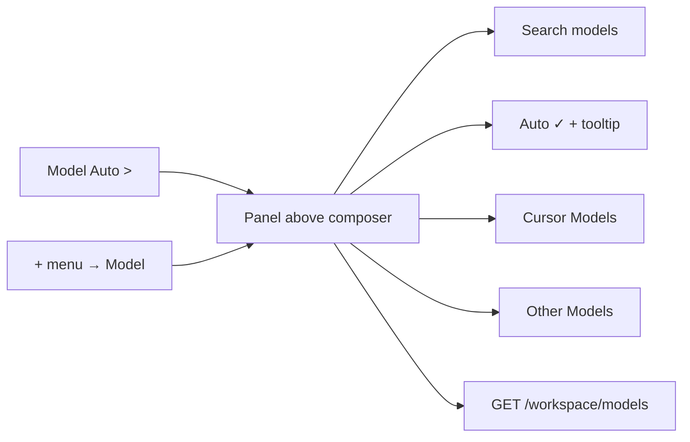

| Element | Contract |
|---------|----------|
| Trigger | Pill **Model {name} >** on composer right; also `+` → **Model** |
| Panel | Rounded sheet above input; search **Search models** |
| Selection | Checkmark on current row; tap applies |
| Sections | Prefer Hub-provided groups; if absent, single flat list (do **not** hard-code cloud catalog names in APK) |
| Row | Name (Body 600) + speed/quality subtitle (Label muted) when Hub/scrape provides; optional **NEW** badge only if Hub flag exists |
| Auto tooltip | Show for Auto: **Balanced quality and speed, recommended for most tasks.** |
| Data source | `GET /workspace/models` — CDP scrape when `model_select` **VERIFIED**, else `CURSOR_MODELS`, else fail-closed empty |
| Empty | Copywriting **No models from Cursor on PC**; disable Send/Create model-dependent actions; UAT `__empty__` |
| Loading | Spinner in panel; keep last selection |
| Error / offline | Inline error + ConnectionChip; cannot invent models |
| Apply | New session: selected id on `POST /sessions`. Live: adapter `model_select` when VERIFIED; else Designed deferral message |

**Product lock:** Model list is Hub/PC Cursor only — never a baked-in cloud model catalog in the APK.

### Optional thin status bar (footer)

| Desktop | Phone mapping |
|---------|---------------|
| Branch (`master`) | Optional bound workspace short name / git branch **if Hub exposes**; else omit |
| This Computer | **PC Hub** / MagicDNS host — ConnectionChip Online/Degraded/Offline |
| Sync spinner | WS reconnect / outbound flush — not cloud sync |

### Opened chat — Desktop match vs phone simplify (summary)

| Match Cursor desktop | Simplify / omit on phone |
|----------------------|--------------------------|
| Light calm chrome, gray user bubbles, agent blue identity, path pills | Multi-column IDE; desktop sidebar inside chat |
| Circular `+`, mode chips, Model pill + searchable panel | Full Multitask orchestration UI; nested skill browsers |
| Working / Queued strips | Rich subagent timeline (collapse to “Working N”) |
| Inline tool approvals (product) | Thumbs/branch footer; mic until Hub path; MCP runtime |

### Nav glue to Home

Opened-chat **Back** / sidebar control → Home tree (Amendment A). Header **+** → New Chat. Do not open a second desktop-style sidebar over Live chat.

---

## Screen — Pair (PC QR → phone camera)

Primary connect path for the companion. Aligns phone to **this PC’s Hub** (and thus the Cursor project open on that PC).

### Happy path

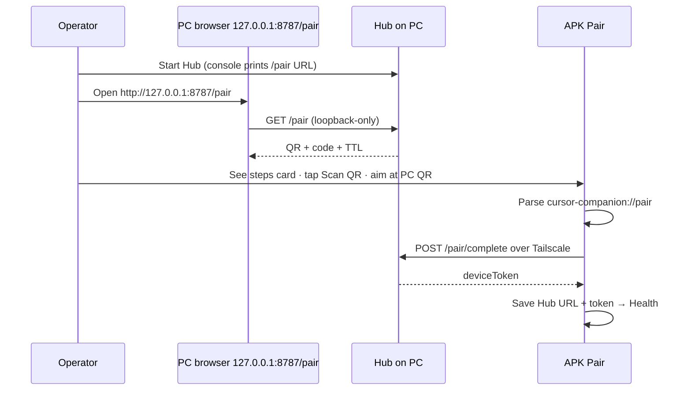

### Locks

| Lock | Meaning |
|------|---------|
| `pair/start` + `GET /pair` | **Loopback-only on PC** — phone must not call start or load `/pair` |
| Operator entry URL | **`http://127.0.0.1:8787/pair`** — open in a **PC** browser; never the phone’s default Hub URL field |
| QR payload | `cursor-companion://pair?host=&port=&code=&pairId=` from Hub `buildQrPayload` |
| Host in QR | Tailscale hostname / mesh IP (`TAILSCALE_HOSTNAME`) — **not** public internet; avoid advertising `127.0.0.1` to the phone as the mesh Hub |
| Complete | Phone → Hub over **Tailscale** with code |
| CDP | Never in QR; never dialed from phone |

### Scroll contract (Amendment G — Pair is P0)

| Rule | Contract |
|------|----------|
| When | Content **can** exceed viewport (Pair form + keyboard, Account with many cards, Tailscale guide, any multi-field form) |
| Required | Outer **`ScrollView`** (or keyboard-aware scroll wrapper) with **safe-area** top/bottom padding; keyboard dismiss on drag where RN supports it |
| Forbidden | Relying on `flex:1` + `justifyContent:'center'` alone for multi-field forms — **P0 offender today:** `PairScreen` (`content` styles) |
| Keyboard | Keep `KeyboardAvoidingView` **or** keyboard-aware scroll; fields near bottom must remain reachable when IME open |
| Account / guides | Same rule: Settings cards column and Tailscale guide expand inside scroll — never clip primary CTAs below the fold without scroll |

### Phone UI (Pair screen)

| Element | Behavior |
|---------|----------|
| **Steps card (G)** | Above the fold, body/label typography (not 11px footer hint): numbered **1. On PC** open `http://127.0.0.1:8787/pair` · **2. On phone** tap **Scan QR**. Card uses secondary surface + border; sits **above** Scan QR |
| **Scan QR** | Primary CTA — opens camera scanner (permission prompt once) |
| Viewfinder | Full-bleed or card; success haptic + auto-advance to complete |
| Manual fallback | Collapsed or below fold: Hub URL + pair code (+ optional pair ID) + **Pair with Hub** — not the primary discoverability path |
| Tailscale guide | When mesh likely down — inside the same ScrollView |
| After success | Navigate **Health** (or skip-to-Home if Q2 resolves that way) |

**Do not:** bury the PC URL in an 11px muted `hint` under Scan QR as the only instruction (current PairScreen anti-pattern).

### PC UI (operator) — Amendment G

| Element | Behavior |
|---------|----------|
| **Hub startup console** | On listen, print **prominently** (own line, hard to miss beside listen banner): `Pair on PC: http://127.0.0.1:8787/pair` (port from config). Optional second line: “Open that URL in a browser on this PC — not on the phone.” |
| **`GET /pair` page hero** | First visible copy must include: **Open this page on the PC — do not type this URL on the phone.** Then short phone instruction: open companion → **Scan QR**. Keep light calm grayscale (match `#f4f5f7` / `#ffffff` / muted text). |
| **Show pairing QR** | Page starts pairing (loopback) and renders QR of `qrPayload` |
| Code + TTL | Human-readable code + expiry under QR |
| Refresh QR | New code via reload / “New code” link invalidates previous |

**Status (metal):** Loopback Hub page `packages/hub/src/pair-page.ts` **exists** with Amendment G hero (“keep this page open on the PC”). Hub CLI prints `PAIR PHONE → …/pair`. Phone PairScreen: ScrollView + steps card + Scan QR (2026-10-14).

### Phone camera / PC page status

| Piece | Status |
|-------|--------|
| Hub `qrPayload` + deep-link parse + manual code PairScreen | **Implemented** |
| In-app **camera QR scanner** on Pair | **Implemented** (verify on device; keep as primary CTA) |
| PC Hub page that **shows** the QR | **Implemented** (`GET /pair` loopback) — **G polish:** hero copy + Hub console URL line |
| Pair **ScrollView** + steps card above fold | **Implemented (G P0, 2026-10-14)** — ScrollView + numbered steps + Scan QR |

### Errors

| Case | Copy / action |
|------|----------------|
| Camera permission denied | Guide to enable camera; offer **Enter code instead** |
| Invalid / expired QR | **Code expired — generate a new QR on the PC** (open `http://127.0.0.1:8787/pair` again) |
| Hub unreachable after scan | Tailscale guide + retry; keep parsed fields |
| `pair/start` or `/pair` from phone | Must never be offered as a phone-navigable URL; steps card clarifies PC-only |

### Link from Settings

Account **Connection** card → **Pair with Hub** / **Re-pair** opens this screen. **How it works** uses the same Amendment G language as the Pair steps card (PC `/pair` URL · phone Scan QR · do not type loopback on phone).

---

## Connectivity + session parity (PC Cursor ↔ phone)

### Goal

When the phone is Online to the chosen PC Hub, **Home’s session tree equals the Composer chats for the project(s) open on that PC** (plus local history index for that bind) — same titles / recency as far as Hub can extract. Not “similar cloud chats.”

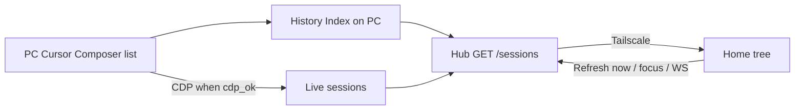

### Connectivity check (what “connected” means)

| Layer | Phone shows | Fail-closed |
|-------|-------------|-------------|
| Tailscale | Offline chip if Hub unreachable | Stay on last cache + guide |
| Hub health | Online / Degraded / Offline | Degraded when `cursor_down` (queue OK) |
| Live CDP | Part of Health / chip | No second CDP profile; phone never dials CDP |
| History index | Parity meta from `GET /sessions.history` | If `extractorStale`, show hint — still list last good rows |

### Session parity rules

1. **Source of truth = PC Hub** for the active Computer (Settings picker).  
2. List = **live** sessions ∪ **history** for bound workspace(s), merged by recency (prefer live when same correlation).  
3. **Refresh now** (Settings) and Home **pull-to-refresh** / **tab focus** run the same pull: `/health` + `/workspace` + `/sessions` (live+history).  
4. Home keeps a **Hub WS** subscription (`health` + session events) and re-pulls the list on `health.changed` / `session.updated` (debounced).  
5. Show **Last synced** relative time under ConnectionChip or Sync card.  
6. If history reports `extractorStale` or scan failed → banner: **PC chat index may be behind — pull to refresh**.  
7. Never invent cloud sessions; never show another machine’s chats without switching Computer.

### Implemented vs remaining (sync metal)

| Piece | Status |
|-------|--------|
| GET live + history sessions; Home pull-to-refresh | **Implemented** |
| Hub `health.changed` WS + mobile reconnect | **Implemented** (2026-10-01 sync diagnosis) |
| Home focus refresh + WS-driven list refresh + last-synced / stale hint | **In progress / this wave** |
| Settings **Refresh now** CTA wiring | **Planned** (Account rebuild) |
| Live transcript streaming from Composer DOM | **Gap** (Hub does not emit message deltas yet) |
| Auto tool-approval scrape from Composer | **Gap** |
| Bit-exact 1:1 with every Cursor sidebar edge case (archived filters, multitask nesting) | **History adapter filters apply** — document differences; do not claim pixel-identical |

### Operator check (manual parity UAT)

1. PC: Hub `cdp_ok`, same project open, Composer sidebar visible.  
2. Phone: Online → Home → **pull to refresh**.  
3. Compare titles of recent chats phone vs PC.  
4. Create new chat on PC → phone Refresh → new row appears.  
5. Create new chat on phone → appears on PC Composer.  
6. Airplane Tailscale → Offline chip; restore → reconnect + refresh.

---

## Amendment F — Away-from-PC comfort

> **Why:** The phone is picked up to answer one question: *is my agent done, stuck, or waiting for me?* A–E define look and navigation; F defines what makes that answer reachable without opening the PC. Source audit: [`mobile-ux-comfort-gap-audit-2026-10-01.md`](../../../docs/reports/mobile-ux-comfort-gap-audit-2026-10-01.md).  
> **Locks:** All logic on the PC Hub or on the phone. **No FCM / cloud push**, no VPS relay, CDP stays `127.0.0.1`, no tools on the phone.

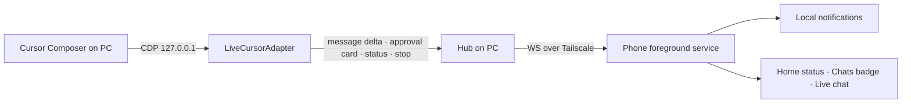

### F1 — Hub / adapter prerequisites (build wave 1, before screen rebuild)

| # | Capability | Hub / adapter contract (designed) | Screens that depend on it | Status |
|---|------------|-----------------------------------|---------------------------|--------|
| F1.1 | **Live transcript stream** | Adapter scrapes Composer message DOM → WS `session.message.appended` / `session.message.delta`; REST `GET /sessions/:id/messages` snapshot populated | Opened chat, notifications (finished) | **Gap** — not VERIFIED |
| F1.2 | **Real approval detection** | Adapter watches Composer tool-approval card → auto `session.approval.requested` with `{tool, command, cwd}`; resolved on PC click too (`approval.resolved` source=`pc`) | Approval card v2, badge, notifications | **Gap** — today only dev/loopback enqueue |
| F1.3 | **Agent status per session** | `session.updated.status ∈ working \| waiting_approval \| finished \| error \| idle` | Home row status, Working strip, notifications | **Gap** |
| F1.4 | **Stop** | Selector pack `stop` + `POST /sessions/:id/stop` | Composer Send→Stop | **Designed** |
| F1.5 | **Turn changes** | `GET /sessions/:id/changes` → `[{path, added, removed}]` (from Composer changes UI or workspace git diff under bound roots); file diff via `GET /workspace/file` + diff | Changes card, Diff screen | **Designed** |

Rule: until a capability is VERIFIED, its UI shows fail-closed copy (e.g. no status mark rather than a guessed one).

### F2 — Notifications (local, no cloud)

| Aspect | Contract |
|--------|----------|
| Transport | Android **foreground service** keeps Hub WS open over Tailscale **only while** any bound session is `working` or `waiting_approval`; stops when all idle |
| Ongoing | Low-priority silent notification **Agent working · {project}** (required by Android for the service) |
| Channels | **Approvals** (high, sound + vibrate) · **Finished / failed** (default) · **Working** (low, silent) — user can tune per channel in Android settings |
| Tap | Deep link `cursor-companion://live/:sessionId` (approval scrolls to card) |
| Approve from notification | **Not in v1** — always open the card (full command visible; app lock applies) |
| When app is open on that chat | Suppress the banner; show in-chat only |
| Settings | Account → **Notifications** card: toggles for Approvals / Finished / Failed; "Keep connection while agents work" (on by default) |
| Optional alt | Self-hosted ntfy **on the PC** — Deferred; never a third-party relay |

### F3 — Home: per-chat status + approvals badge

| Element | Contract |
|---------|----------|
| `SessionRow` status mark | Leading 8px mark replacing the plain dot: **working** = accent pulse (static if reduce-motion) · **waiting_approval** = warn `!` · **finished (unread)** = accent filled dot · **error** = destructive `✕` · idle/history = muted dot |
| Sort | `waiting_approval` rows float to top of their repo group; otherwise recency |
| Waiting pill | Slim pill under Search: **{N} waiting for approval →**; 1 → opens that chat; >1 → filters Home to waiting chats |
| Chats tab badge | Count of pending approvals (warn color); hidden at 0. Still **two tabs** — no Approvals tab |
| Unread | Finished turns not yet opened on phone show bold title until opened |

### F4 — Approval card v2 (Opened chat)

| Element | Contract |
|---------|----------|
| Header | Tool name + session title |
| Command | Full command in monospace, horizontally scrollable, max 6 lines then expand |
| Meta | **Runs in** {cwd} (path pill) |
| Approve | One tap **Approve tool** (accent). If app lock "Require unlock to approve" is on → biometric first |
| Deny | One tap **Deny tool** → snackbar **Tool denied · Undo** for 3 s → then POST to Hub. Replaces any confirm dialog |
| Resolved on PC | Card collapses to "Approved on PC" / "Denied on PC" (from `approval.resolved` source) |
| Stale | If Hub reports approval gone → "No longer pending" |

### F5 — Changes card + read-only Diff screen

| Element | Contract |
|---------|----------|
| Changes card | After an agent turn with edits: **{N} files changed** + up to 3 rows `path +a −r` + **View changes** |
| Diff screen (new route `Diff`) | List of changed files → tap → unified read-only diff, monospace, line wrap toggle; deep link `cursor-companion://diff/:sessionId` |
| Keep / Undo all | **Hidden** unless selectors VERIFIED; phone never edits files directly |
| Empty | **No file changes in this turn** |

### F6 — App lock (phone-only)

| Setting (Account → **Security** card) | Default |
|---------------------------------------|---------|
| Require unlock to approve tools | **On** when device has biometrics/PIN |
| Lock app when opened | Off |
| Re-lock after | 5 min in background |

Uses on-device biometric/PIN API only; no account, no cloud.

### F7 — PC reachability

| Side | Contract |
|------|----------|
| PC | Hub ships a **user service** recipe (autostart at login) and **inhibits sleep while any session is `working`** (released when idle). Never wakes the PC remotely (no WoL relay in v1) |
| Phone | Offline state names the layer: **Tailscale off on phone** (CTA **Open Tailscale**) · **PC unreachable** (asleep/offline) · **Hub not running** · **Cursor not open** — reuse Copywriting error strings |

### F8 — Drafts and send retry

| Element | Contract |
|---------|----------|
| Draft | Per-chat draft persisted on device; restored on reopen |
| Outgoing | Optimistic bubble with **Sending…**; failure → **Not sent · Retry**; never silently dropped |
| Queued strip | Covers both "agent busy" follow-ups and offline sends |

### F9 — Polish (P2, designed now so they fit later)

| Item | Contract |
|------|----------|
| Quick replies | Up to 3 chips above composer after an agent turn: **Continue** · **Run the tests** · **Explain** (static v1; editable later) |
| Code blocks | Monospace, horizontal scroll, **Copy** button per block |
| Share into chat | Android share target "Send to Cursor chat" (text/URL) → New chat or pick existing |
| Haptics | Light on Approve/Deny, Send, pair success |
| Dark theme | Still Deferred — re-evaluate after research (night use) |

### F — Implemented vs planned

| Piece | Status |
|-------|--------|
| F1.1–F1.3 stream / approval detect / status | **Gap** (Hub + adapter) |
| F1.4 Stop, F1.5 changes | **Designed** |
| F2 notifications + foreground service | **Planned** (spike battery on Pixel 7 first) |
| F3 row status, badge, waiting pill | **Planned** (needs F1.3) |
| F4 approval card v2 | **Planned** (needs F1.2 for real data) |
| F5 Changes + Diff screen | **Planned** (needs F1.5) |
| F6 app lock | **Planned** |
| F7 Hub autostart + sleep inhibit | **Planned** |
| F8 drafts / retry | **Planned** |
| F9 polish | **Designed** (P2) |

---

## Amendment G — Scroll, pair URL discoverability, calm RN motion (2026-10-14)

> **Why:** Operators cannot complete pair when PairScreen clips under keyboard/short viewports; they also miss that the QR lives on a **PC loopback** page. Motion must stay calm RN micro-feedback — not SwiftUI kits or dark OLED systems.  
> **Locks unchanged:** PC-local Hub, Tailscale+pair, CDP `127.0.0.1`, Expo APK remote UI only, light calm grayscale Cursor chrome.

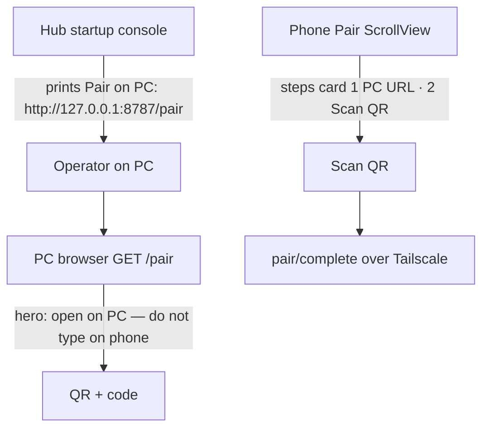

### G1 — Scroll (all overflowing screens)

| Surface | Contract |
|---------|----------|
| Pair (P0) | Replace center-only flex column with ScrollView / keyboard-aware scroll + safe-area; keep Scan QR + steps card reachable |
| Account | Settings cards in a single scroll column (already intended) — enforce when many cards / Security / Notifications |
| Forms + keyboard | New chat, manual pair fields — never rely on centered flex alone |
| Tailscale guide | Lives inside scroll; must not push primary CTA permanently off-screen without scroll |

### G2 — PC pairing URL discoverability

| Surface | Contract |
|---------|----------|
| Hub CLI / listen | Prominent console line with `http://127.0.0.1:{port}/pair` |
| PC `/pair` HTML | Hero: **Open this page on the PC — do not type this URL on the phone** |
| Phone Pair | Numbered steps card **above the fold** (Body/Label — not 11px hint) |
| Account How it works | Same PC-URL → Scan QR language |
| Fallback | Manual Tailscale Hub URL + code still available |

### G3 — Calm RN motion

See **Motion Notes** hard caps. Cap ≤2 motions/screen; Reduce Motion; FlatList for long Home lists; no decorative infinite loops.

### G — Implemented vs planned

| Piece | Status |
|-------|--------|
| Hub `GET /pair` QR page (loopback) | **Implemented** — hero G copy **Planned** |
| Hub startup console `/pair` URL | **Implemented (2026-10-14)** |
| Pair camera Scan QR | **Implemented** |
| Pair ScrollView + steps card | **Implemented (P0, 2026-10-14)** |
| Account How it works G copy | **Planned** (Settings rebuild) |
| Motion hard caps in app chrome | **Planned** |

---

## Screen Inventory

| Screen | Route | Purpose | Primary content | Entry points | Status |
|--------|-------|---------|-----------------|--------------|--------|
| Pair | `Pair` | Trust phone ↔ PC Hub via **PC /pair QR** + phone **Scan QR** (or code) | Steps card, **Scan QR**, ScrollView form, manual Hub URL/code, Tailscale guide | Cold start unpaired; Account → Re-pair; deep link `cursor-companion://pair` | **Implemented (manual/deeplink/camera + PC /pair) — G: scroll + steps card + console/hero polish** |
| Health | `Health` | Prove Hub/Cursor path before chatting | Health rows, Refresh, Continue to Chats, Re-pair | After successful pair; Account → Health | **Implemented** |
| Main tabs | `Main` | Shell: Chats \| Account | Custom bottom tab bar | Health Continue; deep link `main` / `nav/home` | **Implemented** |
| **Home (Chats)** | (Main → Chats) | Cursor-sidebar-inspired projects → sessions | New Chat, Search, Projects, Repositories tree, profile footer | Default Main tab | **Implemented (shell) — IA amend pending rebuild** |
| Account / Settings | (Main → Account) | Connect phone ↔ PC Hub; pick one computer; refresh sessions | Settings cards: Connection, Computer picker, Refresh now, Advanced | Account tab; home profile/gear | **Implemented (shell) — Settings IA amend pending** |
| Live chat | `LiveChat` | Continue live Composer — Cursor chat chrome | Transcript (bubbles/identity/pills), ApprovalCards, composer `+`/mode/Model/Send·Stop | Session row (live); after Create; deep link `live/:id` | **Implemented (shell) — chrome amend pending** |
| History read | `HistoryRead` | Read-only past session + Open on PC | Transcript snippet; Open on PC | Session row (history) | **Implemented** |
| New chat | `NewSession` (modal) | Create session in PC-open project | Bound project, model, mode, attachments, Create | Home **New Chat**; deep link `new` | **Implemented** |
| Diff (F) | `Diff` | Read-only turn changes | Changed files → unified diff | Changes card; notification; deep link `diff/:id` | **Planned** |
| Editor browse | `Editor` | Optional browse/preview of PC workspace files | File list / preview under roots | Account → Browse PC files | **Implemented (Phase 3 optional)** |
| Home (alias) | `Home` | Deprecated alias → Main | — | Older deep links / UAT | **Implemented (shim)** |

**Not screens (in-chat / chrome):** Approval cards; Composer `+` sheet; Mode chip; Model panel; Working/Queued strips; File picker sheet; ConnectionChip; home SectionHeader / SessionRow / ProfileFooter.

---

## Information Architecture / Navigation Map

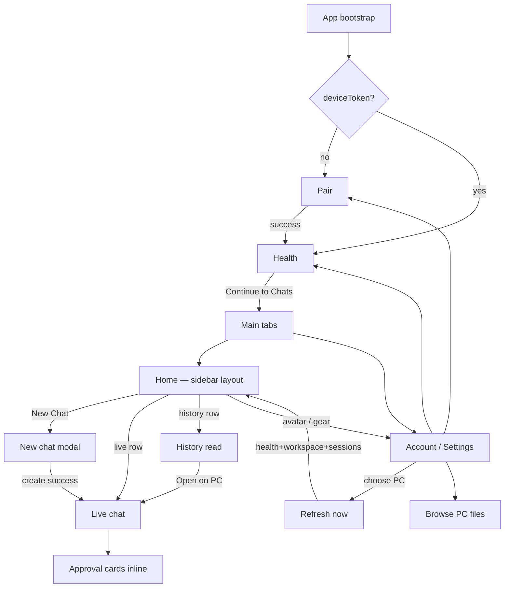

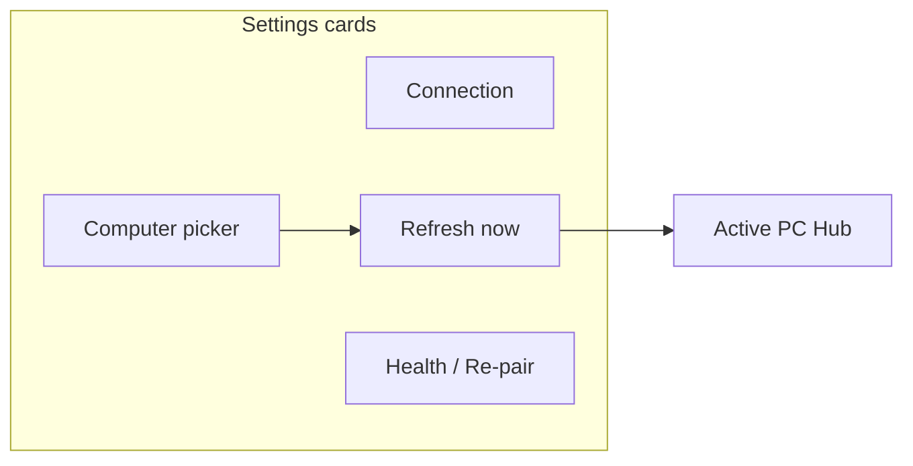

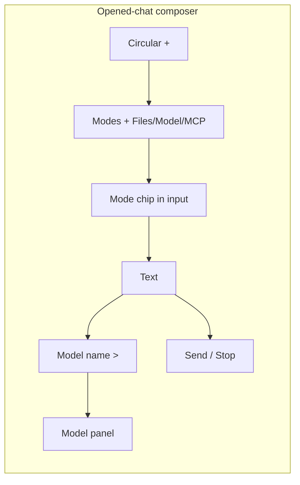

**Deep links (scheme `cursor-companion://`):** `pair`, `health`, `main` / `nav/home`, `live/:sessionId`, `history/:sessionId`, `new`, `editor`, `live-send/:sessionId/:prefill`.

---

## Key User Scenarios

### 1. Pair (QR primary — Amendment G)

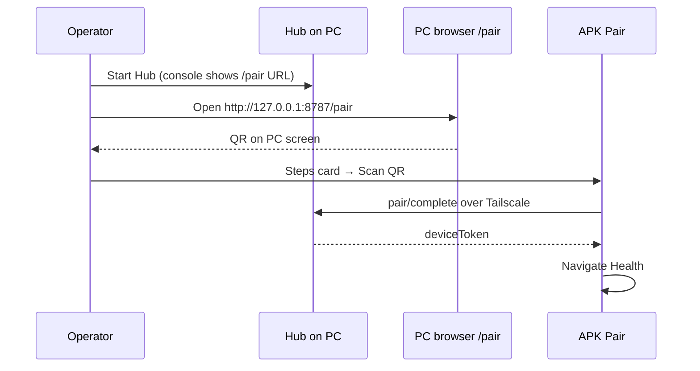

**Fallback:** type Hub **Tailscale** URL + code manually (no camera). Never instruct typing `127.0.0.1` on the phone.
### 2. Health / connection

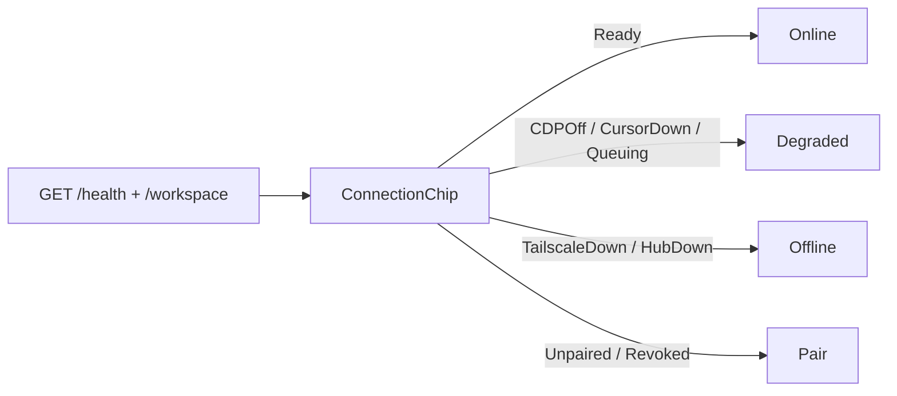

### 2b. Settings — choose PC + Refresh now

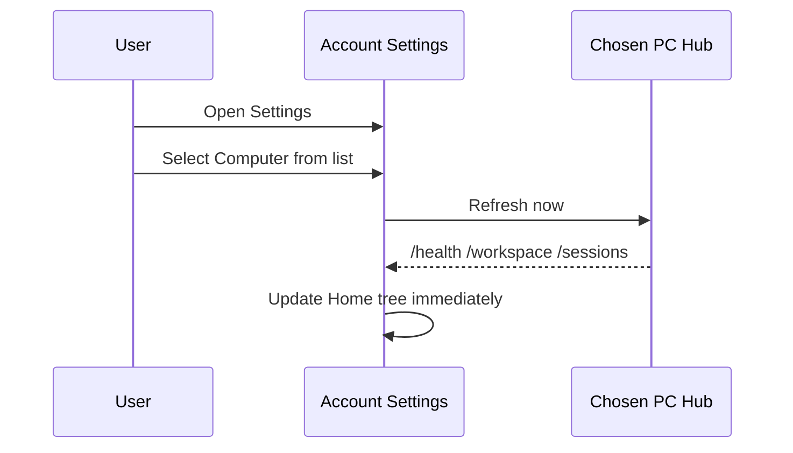

### 3. Home → continue session

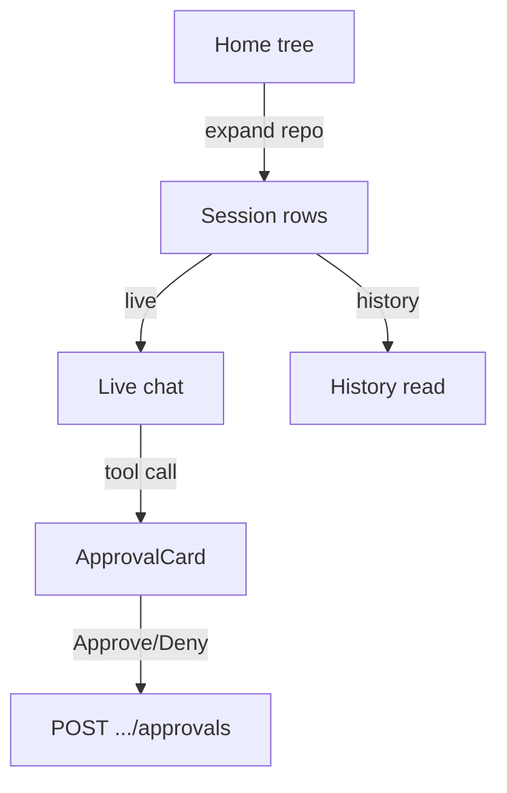

### 4. New session

```mermaid
flowchart LR
  NC["New Chat"] --> Modal["NewSession"]
  Modal --> Models["GET /workspace/models"]
  Modal --> Attach["Attach under roots"]
  Modal --> Create["POST /sessions"]
  Create -->|202 queued| Queue["Show queue banner"]
  Create -->|live id| Chat["Live chat"]
```

### 5. Approvals

Inline only — no Approvals tab. Account may show pending count; tap navigates to the live chat that owns the approval when known.

### 6. History → Open on PC

```mermaid
sequenceDiagram
  participant User
  participant Hist as HistoryRead
  participant Hub
  User->>Hist: Open history row
  User->>Hist: Open on PC
  Hist->>Hub: POST /sessions/:id/open-on-pc
  Hub-->>Hist: live session
  Hist->>User: Navigate LiveChat
```

### 7. File attach

From New chat or Live composer `+` → **Files** → FilePickerSheet → paths under `GET /workspace` roots → `POST .../attachments`. Never arbitrary phone filesystem as workspace source (v1).

### 8. Composer + / mode / queue / model

See **Screen — Opened chat** interaction model. Phone is remote UI; Hub + LiveCursorAdapter execute on PC. Empty models fail-closed (`CURSOR_MODELS=__empty__` UAT).

---

## States Per Critical Screen

| Screen | Empty | Loading | Error | Offline (Tailscale / Hub) |
|--------|-------|---------|-------|---------------------------|
| Pair | ScrollView + steps card + **Scan QR** idle; Tailscale guide if needed | Camera permission / decode spinner; disable Pair + spinner | Inline pair-error; expired QR; camera denied → Enter code | Same error + guide; stay on Pair (scroll) |
| Health | Rows with unknown until first refresh | Refresh spinner | Row-level fail + copy from connection-state | Offline copy; Continue may still open Chats |
| **Home** | Unbound / No chats / No matches (Copywriting) | Initial ActivityIndicator; pull-to-refresh; optional skeleton tree | Banner with message; keep last tree if any | ConnectionChip Offline; tree stale; New Chat may still open (create queues) |
| Live chat | Empty transcript + composer idle | Connecting / Working pill / streaming | Send fail toast; Model panel error; reconnect chip | Queued outbound; no auto-approve |
| New chat | Unbound guidance screen | Models/files loading | models empty / create error | Queue banner when cursor_down; Create still allowed → HTTP 202 fail-closed |
| History | **No messages in this chat** + **Open on PC** | Loading transcript | Open-on-PC fail + retry | Disable **Open on PC** or show Offline |
| Account / Settings | Unpaired: Pair CTA; no saved PCs empty | Refresh spinner on Sync card | Switch-PC / Hub errors inline | Offline on Connection + Sync; stale Home hint |
| Editor | **No files to browse** + **Check Health** | List spinner | Path reject / load fail with retry | Offline: cannot browse |

---

## Implemented vs Planned

| Area | Implemented now | Planned / polish (post-plan) |
|------|-----------------|------------------------------|
| Navigation shell | Stack + Main Chats\|Account | Align spacing tokens to 4pt scale |
| Pair / Health | Manual pair + deeplink + camera scanner + Health; Hub `GET /pair` page | **G P0:** Pair ScrollView + steps card; Hub console `/pair` URL; PC hero “open on PC”; Account How it works language |
| **Home** | Flat Gemini list + FAB + project headers | **Rebuild to sidebar IA:** New Chat row, Search, Projects, Repositories tree, timestamps, selected highlight, profile footer; remove FAB; FlatList |
| Live chat | Messages, approvals, basic ComposerBar + attach | **Cursor chrome:** gray bubbles, agent identity, path pills, circular `+` sheet, mode chips, Working/Queued, Model panel, Send→Stop; mid-chat mode CDP; mic/camera |
| Composer `+` modes | Create `agentMode` ask/debug/multitask/parallel | Plan mode + live mid-chat switch; MCP read-only sheet |
| Model panel | `GET /workspace/models` + create model; `model_select` VERIFIED scrape | Live mid-chat model apply polish; section/NEW/speed metadata when Hub provides |
| New session | Model, mode, attach, create queue | Mic/camera attach; richer model empty UX |
| History / open-on-pc | Screen + Hub path | Optional history-list row metal (non-P0) |
| Editor | Browse/preview | Keep optional; not primary path |
| Motion | Mostly none | **G:** ≤2 micro-interactions/screen; reduce-motion; transform/opacity; no infinite loops |
| Dark mode | Not shipped | Deferred alternate |
| **Away-from-PC (F)** | — | Hub stream/approval/status/stop prerequisites; local notifications; row status + badge; approval v2; Changes/Diff; app lock; drafts; PC reachability |

---

## Non-Goals (UI)

- Cloud Agents / Remote Control / cloud session browsers / cloud login
- Phone dialing CDP or showing remote CDP URLs
- Tools / MCP runtime on the phone
- Opening arbitrary folders from the phone (v1)
- **Phone-side “New Project” that creates/opens arbitrary workspaces** (hide or disabled messaging only)
- **Getting Started** progress / onboarding progress cards (redacted in reference)
- **Connect Slack** or any third-party workspace promo footer (redacted in reference)
- Approvals as a third primary tab
- Dashboard / multi-panel IDE chrome on phone
- SwiftUI rewrite
- Public Hub (ngrok/Funnel) as product path
- Hosting Hub UI or sync on VPS/cloud
- New Folder creation from phone Repositories header
- **FCM / any cloud push relay** for notifications (F2 uses a local foreground service)
- Approving tools directly from a notification without opening the card (v1)
- Phone-side file edits or Keep/Undo before selectors are VERIFIED

---

## Motion Notes (plan-level, RN-appropriate) — Amendment G

Stack: **Expo React Native** (`Animated` / Reanimated later) — **not SwiftUI**. Ignore OLED/dark design-system motion kits.

### Hard caps (locked)

| Rule | Contract |
|------|----------|
| Budget | **1–2 meaningful micro-interactions per screen max** (press feedback counts as one if it is the only motion) |
| Properties | Prefer **`transform` + `opacity` only** — avoid layout thrash animations on lists |
| Scale floor | Enter / press scale **never below ~0.95** (no bounce-from-0; no springy “AI” pops) |
| Sheets | Enter: opacity + `translateY` (~8–16px) and optional scale ≥0.95; exit mirrors or instant |
| Press | Opacity 0.7–0.85 for **80–150ms** on primary buttons / rows (Android ripple OK when native) |
| Reduce Motion | Query `AccessibilityInfo.isReduceMotionEnabled` (and honor OS prefers-reduced-motion). Fallback: **opacity-only** or **instant** — no translate/scale |
| Lists | **FlatList** (or equivalent virtualization) for long Home session trees — do not animate every row mount |
| Forbidden | Decorative **infinite loops**, continuous glow/pulse chrome, parallax wallpaper, Lottie ornament loops. Working-status mark may use a **static** accent when reduce-motion (see F3) |

### Allowed moments (pick ≤2 per screen at implement time)

| Moment | Intent | Suggested feel | Reduced motion |
|--------|--------|----------------|----------------|
| Pair success | Trust established | Opacity fade ~200–300ms then navigate Health | Instant navigate |
| Press / primary CTA | Tactile confirm | Opacity dip 80–150ms | Instant opacity or none |
| Sheet / panel open (`+`, Model, PC picker) | Mode/actions | Opacity + translateY; scale floor 0.95; ~200ms | Opacity-only or instant |
| Approval card appear | Attention without panic | Opacity + slight translateY (~250ms) | Instant appear |
| Mode chip insert | Mode selected | Scale 0.96→1 ~150ms | Instant |
| Selected session / Online chip | Quiet focus | Color/background crossfade ≤200ms | Instant |
| Message send | Optimistic send | Scale 0.96→1 (~150ms) | Instant append |
| New chat modal | Focus create | Native stack modal (OS default) | OS default |

No decorative continuous glow. Motion conveys state, not ornament.

---

## Future Verification (control-ui)

Do **not** verify implementation in this phase. After plan approval and build:

1. **gsd-ui-checker** re-run on this amended UI-SPEC (home IA + opened-chat chrome → prior APPROVED is stale).
2. **Phone UAT:** pair → health → home tree → live deny → new session (AC-X-01 path); mesh-drop → Offline chip; empty models fail-closed.
3. **control-ui / screenshot checks** against Screen 1 structure **and** opened-chat composer (`+` circle, mode chip, Model panel, Working/Queued).
4. Existing scripts: `npm run uat:precheck`, `uat:edges`, `uat:mesh-drop`, mobile unit tests — regression only.

---

## Registry Safety

| Registry | Blocks Used | Safety Gate |
|----------|-------------|-------------|
| none | — | not applicable (no shadcn / no third-party UI registries) |

---

## Locked decisions (plan complete — 2026-10-01)

Open questions closed with product defaults (change only if you disagree before build):

| # | Decision |
|---|----------|
| 1 | **Light calm** theme |
| 2 | After pair: go **Health** once; if Ready, **Continue** → Home. Re-pair / switch PC may land on Health. Daily reopen with token → **Home** (Health from Settings). |
| 3 | Pending approvals: **deep-link** into owning Live chat when known; else count on Settings |
| 4 | Mic/camera: **designed-only** v1 (file attach lives) |
| 5 | **System** fonts |
| 6 | **Hide** `+ New Project` |
| 7 | Keep label **Repositories** (Cursor-familiar) |
| 8 | Show **Stop** in UI; wire when Hub/CDP stop exists |
| 9 | **Omit** message thumbs + in-chat Search in v1 (Search stays on Home) |
| 10 | Show **Plan** in `+` sheet; wire when adapter confirms |
| 11 | Computer list = **paired Hubs only**; add via Pair / Scan QR |
| 12 | **(F)** Hub stream + approval detection + status + Stop are **wave 1 prerequisites** before screen rebuild |
| 13 | **(F)** Notifications = local foreground service while agents work; **no FCM** |
| 14 | **(F)** Approvals stay in chat; add **Chats tab badge** + Home waiting pill (still two tabs) |
| 15 | **(F)** Deny uses **3 s Undo snackbar**, not a confirm dialog |
| 16 | **(F)** App lock: require unlock to approve **on** by default; lock on open **off** |
| 17 | **(F)** Changes are **read-only** on phone until Keep/Undo selectors VERIFIED |
| 18 | **(G)** Overflowing screens use **ScrollView / keyboard-aware** + safe-area — never `flex:1` + center-only multi-field forms (Pair P0) |
| 19 | **(G)** Primary pair discoverability = PC browser **`http://127.0.0.1:8787/pair`**; Hub console prints it; PC hero + phone steps card + Account How it works share language; manual URL+code fallback |
| 20 | **(G)** Calm RN motion: ≤2 micro-interactions/screen; Reduce Motion → opacity/instant; transform/opacity; scale ≥0.95; FlatList for long lists; no decorative infinite loops |

---

## Locked plan summary — all screens

```mermaid
flowchart TB
  Pair["1 Pair — PC /pair → Scan QR"] --> Health["2 Health"]
  Health --> Main["3 Main tabs"]
  Main --> Home["4 Home — sidebar projects→sessions"]
  Main --> Settings["5 Settings — PC + Refresh now"]
  Home --> Live["6 Live chat — Cursor chrome"]
  Home --> Hist["7 History read"]
  Home --> New["8 New chat"]
  Settings --> Editor["9 Editor browse optional"]
  Live --> Appr["Approvals in-chat"]
```

| # | Screen | User gets | Build priority |
|---|--------|-----------|----------------|
| 1 | **Pair** | PC `127.0.0.1:8787/pair` + steps card + **Scan QR**; ScrollView; manual fallback | P0 (G) |
| 2 | **Health** | Prove Hub/Cursor path | P0 (polish) |
| 3 | **Main** | Chats \| Account tabs | P0 |
| 4 | **Home** | Cursor-sidebar tree; sync/parity hints | P0 rebuild |
| 5 | **Settings** | Connection / Computer / Refresh now | P0 rebuild |
| 6 | **Live chat** | Cursor chrome, `+`, modes, Model, Working/Queued | P0 rebuild |
| 7 | **History** | Read + Open on PC | P1 polish |
| 8 | **New chat** | Model + attach + create on PC project | P0 polish |
| 9 | **Editor** | Optional file browse | P2 optional |

**Sync (cross-cutting):** Home focus + pull + WS + Settings Refresh now → same PC session list.  
**Away-from-PC (cross-cutting, F):** notifications + row status + badge + approval v2 + Changes/Diff + app lock; build order Hub wave 1 → screens.  
**Scroll / pair discoverability / motion (cross-cutting, G):** ScrollView on overflowing screens; PC `/pair` URL path; calm RN motion caps.  
**Non-goals:** cloud agents, phone CDP, Getting Started/Slack, full phone IDE, tools-on-phone, dark OLED redesign.

---

## Build best practices (when we implement)

Apply on every screen rebuild (ui-ux-pro-max + RN stack):

| Practice | Rule |
|----------|------|
| Touch | Android **≥48dp** targets; **≥8px** gap; `hitSlop` on small icons |
| Safe area | Respect top/bottom insets; bottom tabs + composer never under gesture bar |
| A11y | `accessibilityLabel` / role on every control (`Scan QR`, `Refresh now`, `Composer actions`, …) |
| Feedback | Press opacity/ripple **80–150ms**; no instant silent taps |
| Scroll (G) | Overflowing screens → ScrollView / keyboard-aware + safe-area; never center-only multi-field forms |
| Motion (G) | ≤2 meaningful motions/screen; transform/opacity; scale ≥0.95; honor Reduce Motion |
| Lists | Virtualized FlatList for long session lists; pull-to-refresh on Home where needed |
| Icons | Vector/Lucide — **no emoji** as chrome |
| Tokens | Spacing 4–64; light calm colors from `theme.ts`; no raw hex in screens |
| Nav | Typed routes; predictable Back from Live → Home |
| Fail-closed | Empty models, offline, stale history — honest copy, no invented data |
| Locks | PC Hub only; CDP localhost; no second Cursor profile |

---

## Next Step After Plan Approval

1. Re-run **gsd-ui-checker** (optional if you approve this lock as-is).
2. `/gsd-plan-phase 5` → executable tasks for Pair QR, Home, Live, Settings, sync.
3. **Implement** in waves with the best-practice table above — say **approve** / **build** to start.
4. Superdesign canvas optional for visuals — this contract stays source of truth.

---

## UI Considerations

> Pre-seeded for researcher completeness. Orchestrator Step 9.5 probe may replace this section after checker approval.

Applicable state considerations resolved: 21 covered, 2 backstop, 0 unresolved

| Category | Element(s) | Status | Resolution / Reason |
|----------|------------|--------|---------------------|
| empty | Home tree | ✅ covered | Unbound / no chats / search no-matches copy per Copywriting |
| empty | New chat form | ✅ covered | Unbound guidance screen with Close |
| empty | History transcript | ✅ covered | Soft empty when no messages |
| empty | Model panel | ✅ covered | No models from Cursor on PC + Refresh; fail-closed |
| empty | Opened chat transcript | ✅ covered | Empty stream + idle composer |
| loading | Home / New chat / Health | ✅ covered | ActivityIndicator + pull-to-refresh / disable primary CTA |
| loading | Live reconnect / Model panel | ✅ covered | ConnectionChip + panel spinner; keep last model |
| loading | Working strip | ✅ covered | Working N while PC agents run |
| error | Pair / New create / Live send | ✅ covered | Inline error + connectionStateLabel paths |
| error | Open on PC | ✅ covered | Inline fail; stay on HistoryRead |
| error | Model panel | ✅ covered | Inline error; no hard-coded catalog fallback |
| populated | Home Repositories tree | ✅ covered | Folder groups + indented sessions + relative timestamps |
| populated | Opened chat stream | ✅ covered | User bubbles + agent blocks + path pills at typical volume |
| partial | New chat / Model list | ✅ covered | Empty models disables Create/Send model apply until refresh |
| partial | Multi-root Projects | ✅ covered | List only Hub-bound roots; never invent folders |
| overflow | Home tree / transcript | ✅ covered | Vertical scroll / FlatList; timestamps stay trailing; path pills truncate |
| overflow | Pair form + keyboard (G) | ✅ covered | ScrollView / keyboard-aware + safe-area; steps card above fold; forbid center-only flex |
| overflow | Account Settings cards (G) | ✅ covered | Single scroll column; many cards remain reachable |
| zero-one-many | Home | ✅ covered | Empty vs one folder vs many; one vs many sessions |
| zero-one-many | Queued strip | ✅ covered | Hide at 0; “1 Queued” at one; count label if many |
| long-text | Session title / project path / queued preview | ✅ covered | Ellipsis; queued preview one line |
| long-text | Pair steps / PC URL (G) | ✅ covered | Steps card wraps Body/Label; monospace URL may wrap — never shrink to 11px-only hint |
| overflow | Bottom tab labels | 🧪 backstop | Visual check at large font scale — tabs remain 44px |
| long-text | Approval tool summary | 🧪 backstop | Card truncates with expand or scroll — verify on Pixel |

---

## Checker Sign-Off

- [ ] Dimension 1 Copywriting: PASS *(re-check after home + opened-chat amend)*
- [ ] Dimension 2 Visuals: PASS *(re-check — Screen 1 + Live chat focal points)*
- [ ] Dimension 3 Color: PASS *(re-check — bubble gray + agent blue + mode chips)*
- [ ] Dimension 4 Typography: PASS
- [ ] Dimension 5 Spacing: PASS
- [ ] Dimension 6 Registry Safety: PASS
- [ ] Dimension 7 Inventory Provenance: PASS (N/A shadcn — Tool: none; RN modules enumerated below)

**Approval:** plan_locked after amendments **A–G** (G = 2026-10-14 scroll / pair URL / RN motion) — prior approval in `05-UI-REVIEW.md`; requires checker re-run for G deltas

**Enumerated UI modules (provenance for plan, not a shadcn inventory):**  
`node` walk of `apps/mobile/src/{components,screens}` — **18 UI modules** — `@cursor-mobile/mobile@0.1.0` — 2026-10-01.  
Screens: Pair, Health, MainTabs, ChatsHome, Account, LiveChat, HistoryRead, NewSession, Editor, Home(shim).  
Components: ApprovalCard, ChatListRow, ComposerBar, ConnectionChip, FilePickerSheet, HealthDot, ProjectBanner, SessionRow.  

**Planned home additions (not yet in tree):** `NewChatRow`, `HomeSearchField`, `SectionHeader`, `ProjectRootRow`, `RepoFolderRow`, `ProfileFooter`.  
**Planned opened-chat additions:** `ComposerPlusButton`, `ComposerModeChip`, `ComposerPlusSheet`, `WorkingStrip`, `QueuedStrip`, `ModelPickerPanel`, agent identity/path-pill transcript bits — extend `ComposerBar` / `LiveChatScreen`; re-enumerate after build.
