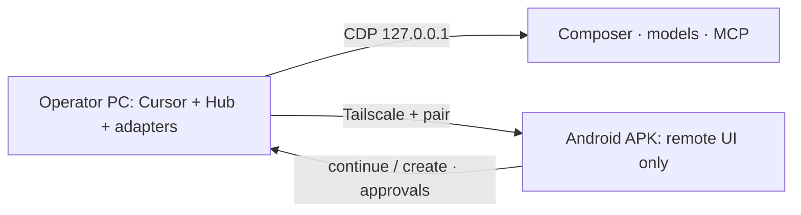

# AGENTS.md — Shared working rules for subagents

**Product:** PC-local Cursor companion Android APK  
**Status:** Design accepted (2026-09-24) · **Phase 0 Hub + Phase 1 live adapter/WS + mobile UI shell + Phase 2 History Index + Phase 3 richer file picker / optional Editor browse-preview / multi-root Hub binding + attach API path** (`packages/hub` health/pair/workspace/sessions/messages/approvals/ws/open-on-pc/`GET /workspace/file` + multi-root roots; `packages/adapters/live-cursor`; `packages/adapters/history`; `apps/mobile`) — selector pack **6/6 VERIFIED** (2026-09-25) · Hub may report `cdp_ok` or `cursor_down` (create-queue HTTP 202 fail-closed) · open-on-pc A→B→C wired (strategy B best-effort after `composer_history_open` VERIFIED) · **TOR-08 P0 Pass sheet GOAL_COMPLETE=yes** (2026-10-01; AC-X-01 fail-closed Hub path; CDP still `127.0.0.1`-only when exposed)  
**Audience:** Every subagent, planner, executor, and reviewer in this repo

---

## Product locks (non-negotiable)

Repeat these in every plan, report, and handoff. Do not “soft-open” cloud paths.

| Lock | Meaning |
|------|---------|
| **PC-local only** | **Hub + all sync run on the operator’s PC only** — not cloud, not VPS, not another machine. No Cursor Cloud Agents, no official Remote Control, no cloud workers, no cloud session catalogs, no off-PC sync server |
| **Open-project remote** | Phone remotes the **project already open** in Cursor on the PC — not arbitrary folders from the phone (v1) |
| **Continue or create** | Continue live/history sessions **or** new session: **model + attach files + tools/plugins on PC** with phone approvals |
| **Tailscale + pairing** | Phone ↔ **Hub on that same PC** over private mesh; device pairing required |
| **CDP localhost** | CDP binds **`127.0.0.1` only** on the PC; phone never dials CDP |
| **Expo sideload APK** | Android via Expo EAS `android.buildType: apk` — **client/UI only**; not a sync host |
| **Docs ≠ code** | Architecture/FRs/TOR accepted; Phase 0 scaffold started — do not invent “done” APIs until code + tests prove them |



---

## Read order (every substantive task)

1. **[`docs/architecture/AGENT-CONTEXT.md`](docs/architecture/AGENT-CONTEXT.md)** — single briefing pack (load first).
2. **[`docs/architecture/AGENT-ROSTER.md`](docs/architecture/AGENT-ROSTER.md)** — named roles (R1–R9), who owns which docs, when to invoke.
3. Task-specific deep dive (pick one primary):
   - System shape → [`docs/architecture/mobile-cursor-companion.md`](docs/architecture/mobile-cursor-companion.md)
   - Requirements → [`docs/architecture/functional-requirements.md`](docs/architecture/functional-requirements.md)
   - Security / mesh → [`docs/architecture/security-tailscale-linking.md`](docs/architecture/security-tailscale-linking.md)
   - Feature UX → [`docs/features/`](docs/features/)
   - Exhaustive TOR → [`docs/reports/tor/README.md`](docs/reports/tor/README.md) (volumes 00–08)
   - Gaps / research → [`docs/reports/`](docs/reports/) · [`research/`](research/)
4. Handoff protocol → [`docs/reports/agent-handoff-protocol.md`](docs/reports/agent-handoff-protocol.md)
5. Doc index → [`docs/README.md`](docs/README.md)

Do **not** start from raw Parallel JSON or OSS landscape “cloud optional” diagrams as active scope — those are historical research; product locks above win.

---

## Documentation map

| Folder | Purpose | When to edit |
|--------|---------|--------------|
| `docs/architecture/` | How the system is structured; FRs; security; **AGENT-CONTEXT**; **AGENT-ROSTER** | Scope, components, phases, API contracts, role ownership change |
| `docs/features/` | Per-feature behavior (sessions, new session, screens) | UX / screen / flow detail changes |
| `docs/reports/tor/` | Exhaustive TOR volumes 00–08 (index + chapters) | Deep specs; promote decisions back to architecture/features |
| `docs/reports/` | Dated jobs, audits, research synthesis, handoffs | After a completed investigation or agent turn |
| `docs/GETTING-STARTED.md` · `CONFIGURATION.md` | Planned operator path / knobs | Operator flow or designed config changes |
| `research/` | Raw / Parallel inputs | New external research dumps only |
| Root `README.md` | Human entry + status | Status or top-level map changes |

**Rule:** Prefer updating an existing doc over adding a parallel conflicting architecture. One coherent set. TOR expands detail; it does not replace architecture locks.

---

## Do / Don't

### Do

- Treat **AGENT-CONTEXT** + this file as source of truth for scope; use **AGENT-ROSTER** to pick the owning role.
- Load the relevant TOR volume from [`docs/reports/tor/`](docs/reports/tor/README.md) when expanding a topic beyond the compact architecture/feature docs.
- Mark designed Hub routes as **designed**, not shipped, until code exists.
- Keep gap coverage explicit in [`docs/reports/gap-closure-hybrid-system-2026-09-24.md`](docs/reports/gap-closure-hybrid-system-2026-09-24.md).
- Use mermaid for flows, sequences, and phase graphs when explaining structure.
- Write handoffs with **done / files / open gaps / next agent** (see protocol); name the next **roster role** when known.
- English only for code, comments, and docs.

### Don't

- Scaffold Hub/APK application code unless the user explicitly asks for implementation.
- Recommend Cloud Agents / Remote Control / ngrok / public CDP as the product path.
- Host Hub, History Index, LiveCursorAdapter, or any sync plane on a VPS, cloud VM, or machine other than the operator’s PC.
- Claim APIs, packages, or install steps are “done” when only docs exist.
- Create a second competing architecture doc.
- Put secrets, Cursor API keys, or remote CDP URLs in the APK design.
- Run tools/MCP on the phone in any design.

---

## Phase priorities (implementation order when coding starts)

| Phase | Focus | Gate |
|-------|--------|------|
| **0** | Pair, Tailscale, `/health`, active workspace banner | Bound to PC-open project only |
| **1** | Live continue + approvals + new session (model + basic attach) + APK shell | Tools on PC; phone approves |
| **2** | Full local History Index + Open on PC | No cloud history |
| **3** | Richer file picker / @-mentions; optional editor tab | Attachments from workspace roots |
| **4** | Harden CDP selectors; offline queue | Still no public CDP; still no cloud |

P0 FRs live in [`functional-requirements.md`](docs/architecture/functional-requirements.md) (FR-001–091). Prefer Phase 0→1 before history polish.

---

## How to hand off to other agents

When finishing a turn that another agent will continue:

1. Write a short report under `docs/reports/` **or** put the same fields in your final reply (protocol defines both).
2. Required fields: **Done** · **Files touched** · **Open gaps** · **Next agent** · **Product locks still true?**
3. Naming: `docs/reports/<topic>-YYYY-MM-DD.md` or `docs/reports/handoff-<topic>-YYYY-MM-DD.md`
4. If architecture/feature truth changed, update the canonical doc in the same turn — do not leave truth only in the report.

Full template: [`docs/reports/agent-handoff-protocol.md`](docs/reports/agent-handoff-protocol.md)

---

## Intended code layout (Phase 0+ — do not invent unfinished APIs as done)

```
apps/mobile/                      # Expo Android APK (sideload via EAS apk)
packages/hub/                     # Local Hub HTTP/WS
packages/adapters/live-cursor/    # LiveCursorAdapter (CDP)
packages/adapters/history/        # History Index
docs/ · research/
```

Scaffold directories exist; treat Hub routes and adapter behaviors as **designed** until code + tests prove them. Docs/TOR remain source of truth for unfinished surfaces.

---

## Learned User Preferences

- Prefer improving existing OSS/landscape approaches and closing weak points over greenfield redesign.
- Prefer parallel specialized subagents (see `docs/architecture/AGENT-ROSTER.md`) for documentation and faster delivery.
- Prefer exhaustive TOR-level detail under `docs/reports/tor/` when expanding specs; update existing architecture/feature docs instead of adding parallel conflicting ones.
- When moving past design, prioritize implementing and testing the documented Phase 0→1 path (not cloud alternatives).
- **CDP on the current main Cursor window only** — quit Cursor → `npm run start:cursor:cdp` → same window/workspace → Composer → `npm run verify:cdp`. **HARD BAN:** never launch Cursor with `--user-data-dir=/tmp/cursor-mobile-cdp-profile` or any alternate `--user-data-dir`; never kill main Cursor from automation. Agents must not `nohup` a second window as a CDP workaround.
- Prefer plan-first mobile UX: agree screen map and UI-SPEC (what each screen shows and how navigation works) before implementing app UI.
- Prefer a clean, phone-first Gemini-like shell: Chats grouped by PC-open projects → sessions, bottom Chats|Account nav, quiet connection indicator, lean composer (extras behind `+`), reduced chrome — not the denser current UI.

## Learned Workspace Facts

- **Hub + adapters + Cursor CDP sync run only on the operator PC**; the phone APK is a **client / remote UI only** (pair, chat, approvals) over Tailscale — no off-PC sync server, no VPS Hub, no cloud workers.
- Phase 0–3 monorepo exists: Expo `apps/mobile`, `packages/hub`, `packages/adapters/live-cursor`, `packages/adapters/history`; History open-on-pc A→B→C (`composer_history_open` **VERIFIED**); multi-root attach/`file_attach` **VERIFIED** (2026-09-25).
- LiveCursorAdapter selector pack **6/6 VERIFIED** (2026-09-25): `send_message`, `approve`, `deny`, `model_select`, `file_attach`, `composer_history_open` · Hub `liveAdapter.state=cdp_ok` when CDP up; create-queue HTTP 202 fail-closed when `cursor_down`.
- Designed Hub routes remain **designed** until code + tests prove them; briefing pack `docs/architecture/AGENT-CONTEXT.md`; roles R1–R9 in `AGENT-ROSTER.md`; TOR 00–08 under `docs/reports/tor/`.
- Root scripts: `test:phase0`, `test:mobile`; UAT: `uat:precheck`, `uat:edges`, `uat:mesh-drop` (see `scripts/`).
- **PC Tailscale is already installed and used** — not a blocker. Pixel 7 has official Tailscale sideloaded; **operator login / join `tail246b3f` still required** before mesh UAT. Active PC node (2026-09-30): `100.108.160.99` / `kingwarpc-1.tail246b3f.ts.net` (do not bake older offline peer IPs into the APK). Hub mesh: `HUB_HOST=0.0.0.0`; `POST /v1/pair/start` remains **loopback-only**.
- **Local release APK exists** (2026-09-25): `apps/mobile/android/app/build/outputs/apk/release/app-release.apk`; companion sideloaded on Pixel (`local.cursor.mobile`).
- TOR-08 P0 Pass sheet **GOAL_COMPLETE=yes** (2026-10-01): all **96** P0 ACs Pass · MANUAL_ONLY **0%** · AC-X-01 Pass under fail-closed Expected (Hub create-queue HTTP 202 when `cursor_down`; Composer/CDP when `cdp_ok`; CDP never public). FR-041 history-list row click remains optional non-P0 metal.
- Phase 5 mobile UX contract: `.planning/phases/05-mobile-ux-contract/05-UI-SPEC.md` + `05-UI-REVIEW.md` (**7/7 PASS**, 2026-10-01); plan-first — no further app UI implementation until user approves the screen plan / plan-phase.
