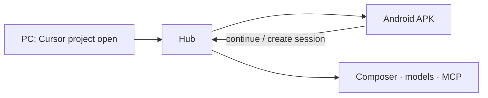

<!-- generated-by: gsd-doc-writer · updated Phase 0 scaffold 2026-09-25 -->
# cursor_mobile

PC-local Android companion that remotes Cursor Composer for the **project already open on your PC** — continue existing sessions or start new ones with model, file attach, and tool/plugin approvals over Tailscale.

## Status

**Not complete.** Phase 0 Hub + Phase 1 live routes/WS/UI + Phase 2 History Index are in-repo and automated-test green. Selector pack mutations remain **CANDIDATE** (fail-closed); live DOM send/approve and TOR-08 operator UAT are **not** verified. Phase 3/4 remain.

| Artifact | Status |
|----------|--------|
| Architecture / FRs / TOR | Accepted design |
| Root workspaces + Hub HTTP/WS | **Phase 0–2 runnable** (pair / health / workspace / live sessions / history / open-on-pc) |
| LiveCursorAdapter | Pack + fail-closed gates; **all actions CANDIDATE** — no live DOM E2E claim |
| History Index | **Phase 2** local scan + Hub `mode=history` (Composer UI reopen best-effort) |
| Expo APK | Pair / Health / Home + Live / New / Approvals / History (`apps/mobile`) |
| Tests | `test:phase0` · `test:phase1` · `test:phase2` · `test:mobile` |
| Operator UAT | [`docs/reports/operator-uat-checklist-2026-09-25.md`](docs/reports/operator-uat-checklist-2026-09-25.md) · progress [`docs/reports/goal-progress-2026-09-25.md`](docs/reports/goal-progress-2026-09-25.md) |

## Scope locks

| In scope | Out of scope |
|----------|--------------|
| Workspace / project **already open** in Cursor on this PC | Cloud Agents / Remote Control / cloud workers |
| Continue live sessions + project history (phased) | Opening arbitrary folders from the phone (v1) |
| New session: model + file attach + tools/plugins **on PC** | Running MCP/tools on the phone |
| Phone approvals for PC tool runs | Exposing CDP publicly |
| Tailscale phone ↔ PC + sideload APK | Cloud credentials or cloud session lists |



## Agent workspace

| Doc | Topic |
|-----|-------|
| [AGENTS.md](AGENTS.md) | Subagent rules: read order, locks, do/don't, handoffs |
| [docs/architecture/AGENT-CONTEXT.md](docs/architecture/AGENT-CONTEXT.md) | **Load first** — briefing pack for every agent |
| [docs/architecture/AGENT-ROSTER.md](docs/architecture/AGENT-ROSTER.md) | Named roles R1–R9 — ownership and when to invoke |
| [docs/reports/tor/README.md](docs/reports/tor/README.md) | TOR master index (volumes 00–08 ↔ phases 0–4) |
| [docs/reports/agent-handoff-protocol.md](docs/reports/agent-handoff-protocol.md) | Done / files / gaps / next-agent protocol |
| [docs/README.md](docs/README.md) | Full documentation index |

## Documentation map

Full index: [docs/README.md](docs/README.md)

### Architecture
| Doc | Topic |
|-----|-------|
| [AGENT-CONTEXT.md](docs/architecture/AGENT-CONTEXT.md) | Single briefing pack (goals, gaps, phases, FR P0) |
| [AGENT-ROSTER.md](docs/architecture/AGENT-ROSTER.md) | Subagent roles R1–R9 |
| [mobile-cursor-companion.md](docs/architecture/mobile-cursor-companion.md) | System design, how we work, phases |
| [functional-requirements.md](docs/architecture/functional-requirements.md) | FR-001–091 (P0/P1/P2) |
| [security-tailscale-linking.md](docs/architecture/security-tailscale-linking.md) | Threat model, Tailscale, pairing |

### Features
| Doc | Topic |
|-----|-------|
| [remote-sessions.md](docs/features/remote-sessions.md) | Continue sessions in PC-open project |
| [new-session-composer.md](docs/features/new-session-composer.md) | Model + files + tools/approvals |
| [phone-apk-screens.md](docs/features/phone-apk-screens.md) | APK screen map |

### TOR set
| Doc | Topic |
|-----|-------|
| [docs/reports/tor/README.md](docs/reports/tor/README.md) | Master index — volumes 00–08, reading order, phase map |
| Volumes 00–08 | Program · FRs · architecture · Hub API · mobile UX · security · live adapter · history · NFR/UAT |

### Operator
| Doc | Topic |
|-----|-------|
| [GETTING-STARTED.md](docs/GETTING-STARTED.md) | Tailscale → Hub → CDP → APK → pair |
| [CONFIGURATION.md](docs/CONFIGURATION.md) | Config knobs (Phase 0 Hub + mobile) |
| [packages/hub/README.md](packages/hub/README.md) | Hub run / test instructions |
| [packages/mcp/README.md](packages/mcp/README.md) | Claude MCP server: drive Cursor chats on this PC through the Hub |
| [apps/mobile/README.md](apps/mobile/README.md) | Expo run / EAS APK notes |

### Reports
| Doc | Topic |
|-----|-------|
| [agent-handoff-protocol.md](docs/reports/agent-handoff-protocol.md) | Agent communication protocol |
| [goal-progress-2026-09-25.md](docs/reports/goal-progress-2026-09-25.md) | Honest built vs blocked vs Phase 3/4 |
| [operator-uat-checklist-2026-09-25.md](docs/reports/operator-uat-checklist-2026-09-25.md) | Operator step-by-step UAT + TOR-08 ACs |
| [handoff-phase0-scaffold.md](docs/reports/handoff-phase0-scaffold.md) | Phase 0 Hub scaffold handoff |
| [handoff-phase0-mobile.md](docs/reports/handoff-phase0-mobile.md) | Phase 0 Expo APK shell handoff |
| [how-we-work-phone-pc-2026-09-24.md](docs/reports/how-we-work-phone-pc-2026-09-24.md) | Day-to-day product narrative |
| [gap-closure-hybrid-system-2026-09-24.md](docs/reports/gap-closure-hybrid-system-2026-09-24.md) | Gaps vs CursorRemote/Paseo |
| [tailscale-linking-research-2026-09-24.md](docs/reports/tailscale-linking-research-2026-09-24.md) | Official Tailscale linking brief |
| [oss-landscape-research-2026-09-24.md](docs/reports/oss-landscape-research-2026-09-24.md) | OSS landscape (cloud notes superseded) |

### Research
| Doc | Topic |
|-----|-------|
| [research/README.md](research/README.md) | Research index + how dumps feed reports |
| [research/cursor-mobile-remote-ide-oss.md](research/cursor-mobile-remote-ide-oss.md) | Parallel deep-research notes |

## Installation / Hub quick start

```bash
npm install
npm run build
npm run start          # Hub on HUB_HOST:HUB_PORT (default 127.0.0.1:8787)
npm run test:hub       # Phase 0 health + pairing tests
```

Configure via env (see [`.env.example`](.env.example) and [docs/CONFIGURATION.md](docs/CONFIGURATION.md)):

- `HUB_HOST` — Tailscale IP for phone reachability; `0.0.0.0` only behind Tailscale ACLs
- `CDP_URL` — default `http://127.0.0.1:9222` (loopback only)
- `CURSOR_WORKSPACE` — absolute path stub when CDP workspace detect is not yet available

Detail: [packages/hub/README.md](packages/hub/README.md).

### Mobile (Phase 0 shell)

```bash
export EXPO_PUBLIC_HUB_URL="http://your-pc.tailnet.ts.net:8787"   # optional
npm run start:mobile      # Expo dev
npm run test:mobile       # typecheck + Hub client unit tests
```

EAS sideload APK: see [apps/mobile/README.md](apps/mobile/README.md) (`eas.json` profile `apk`).

## Quick start (operator path)

1. Install Tailscale on PC and phone; join the same tailnet.
2. Start Cursor on the PC with CDP enabled; open the project folder.
3. Run the Hub (`npm run start`) bound to Tailscale / private interface.
4. Install the sideload APK; pair with the Hub (`POST /pair/start` → `/pair/confirm`).
5. On the phone: continue a session or create one (Phase 1+).

See [docs/GETTING-STARTED.md](docs/GETTING-STARTED.md) for the full planned operator path.

## Usage examples (planned)

Once Hub + APK ship:

- **Continue:** Open the APK → confirm active project banner → pick a live session → chat and approve tool calls on the PC.
- **Create:** New session sheet → pick model → attach files from workspace roots → optional first prompt → Composer runs on the PC.
- **History (Phase 2):** Open a past project session → read → **Open on PC** to resume live.

## Borrowed patterns (design)

| Source | Role in design |
|--------|----------------|
| [CursorRemote](https://github.com/len5ky/CursorRemote) | Live chat, approvals, CDP relay |
| [cursor-session](https://github.com/iksnae/cursor-session) | Local session history index |
| [Paseo](https://github.com/getpaseo/paseo) | Daemon + Expo APK shape |

## License

No `LICENSE` file is present in the repository yet.
