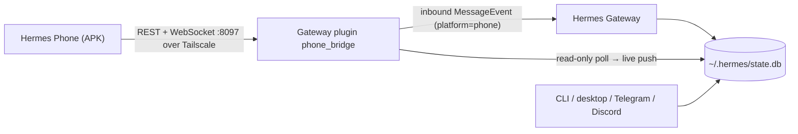

# Hermes Phone

Android client for the **Hermes Gateway** on your PC. Every chat lives in the PC's
`~/.hermes/state.db`, so the same conversation is available from the phone, the terminal
(`hermes --resume <id>`), the desktop app, Telegram and Discord.



| Piece | Where |
|------|------|
| Server (Gateway platform plugin) | `~/.hermes/plugins/phone_bridge/` (`adapter.py`, `plugin.yaml`) |
| App | `apps/mobile` (Expo / React Native) — `src/bridge/` core, screens Pair → Sessions → Chat → Settings |

## What works

- **One history.** Sessions from every source are listed live (working / idle / ended).
- **Write anywhere.** New chats from the phone, and continuing *any* session (PC terminal, desktop,
  Telegram…). The bridge attaches a phone route exactly like gateway `/resume` (the session then
  belongs to the phone route, same as `/resume` does on any platform). While another client is
  mid-turn in that session the phone gets `409 SESSION_BUSY` instead of interleaving.
- **Live + reconnect-safe.** Every message has a monotonically increasing id; after a drop the app
  sends `since` and the bridge replays what it missed. Sends are idempotent (`clientMessageId`).
- Gateway slash commands work from the phone (`/new`, `/stop`, `/model`, …).

## Set up

On the PC:

```bash
echo 'PHONE_BRIDGE_ENABLED=true' >> ~/.hermes/.env      # optional: PHONE_BRIDGE_PORT (8097)
echo 'PHONE_BRIDGE_ALLOW_ALL_USERS=true' >> ~/.hermes/.env
hermes plugins enable phone-bridge
systemctl --user restart hermes-gateway                # or: hermes gateway restart
```

Open `http://127.0.0.1:8097/pair` **on the PC**, then in the app enter the address + 8-digit code
or scan the QR (deep link `hermes-phone://pair?...`).

## Develop

```bash
npm install
npm test                      # typecheck + unit tests (apps/mobile)
npm run e2e                   # live: real bridge + real gateway SessionStore on a COPY of state.db
npm run gate                  # what pre-push and CI run
npm run release:apk           # prebuild --clean → signed release APK → dist-apk/
```

Server tests (gateway venv python): `phone_bridge/smoke_test.py` (REST/WS/pairing) and
`phone_bridge/bind_test.py` (continuing a non-phone session through the real `SessionStore`).

`docs/` describes the earlier Cursor Hub design and is kept for history only.
