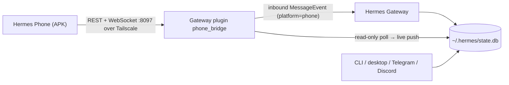

# Hermes Phone

Android client for the **Hermes Gateway** on your PC. Every chat lives in the PC's
`~/.hermes/state.db`, so the same conversation is available from the phone, the terminal
(`hermes --resume <id>`), the desktop app, Telegram and Discord.



| Piece | Where |
|------|------|
| Server (Gateway platform plugin) | `server/phone_bridge/` (installed into `~/.hermes/plugins/phone_bridge` by `scripts/install-bridge.sh`) |
| App | `apps/mobile` (Expo / React Native) — `src/bridge/` core, screens Pair → Sessions → Chat → Settings |

## What works

- **One history.** Sessions from every source are listed live (working / idle / ended).
- **Write anywhere.** New chats from the phone, and continuing *any* session (PC terminal, desktop,
  Telegram…). The bridge attaches a phone route exactly like gateway `/resume` (the session then
  belongs to the phone route, same as `/resume` does on any platform). While another client is
  mid-turn in that session the phone gets `409 SESSION_BUSY` instead of interleaving.
- **Live + reconnect-safe.** Every message has a monotonically increasing id; after a drop the app
  sends `since` and the bridge replays what it missed. Sends are idempotent (`clientMessageId`).
- **Live replies.** Answers stream onto the phone as the model writes them (gateway streaming, `edit`
  transport), plus tool progress and slash-command output that never reaches `state.db`.
- **No addresses to type.** At home the app finds the PC on the Wi-Fi; it remembers every address the PC
  reports (Wi-Fi IP, Tailscale IP, MagicDNS) and uses the best reachable one — Wi-Fi with the VPN off at
  home, Tailscale outside. It re-checks on reconnect and when the app comes to the foreground.
- **One-tap pairing.** Tap the PC in the app → a notification + `http://127.0.0.1:8097/pair` show the
  phone with a 4-digit code → **Allow**. The code/QR flow still works (e.g. over Tailscale only).
  "Disconnect" in the app also revokes the token on the PC.
- Gateway slash commands work from the phone (`/new`, `/stop`, `/model`, …).

## Set up

On the PC:

```bash
bash scripts/install-bridge.sh                         # links ~/.hermes/plugins/phone_bridge -> server/phone_bridge
echo 'PHONE_BRIDGE_ENABLED=true' >> ~/.hermes/.env      # optional: PHONE_BRIDGE_PORT (8097)
echo 'PHONE_BRIDGE_ALLOW_ALL_USERS=true' >> ~/.hermes/.env
hermes plugins enable phone-bridge
hermes config set streaming.enabled true              # live replies; then keep other platforms as they were:
hermes config set streaming.transport edit
# for p in telegram discord slack …: hermes config set display.platforms.$p.streaming false
systemctl --user restart hermes-gateway                # or: hermes gateway restart
```

Streaming in Hermes is one global switch that per-platform settings can only narrow, so enabling it for
the phone means explicitly turning it off for every other platform (done on this PC; backup:
`~/.hermes/config.yaml.bak-phone-stream`).

In the app tap your PC under **On this Wi-Fi** and press **Allow** on the PC. Away from home: open
`http://127.0.0.1:8097/pair` on the PC and scan the QR / type the 8-digit code (deep link `hermes-phone://pair?...`).

## Develop

```bash
npm install
npm test                      # typecheck + unit tests (apps/mobile)
npm run e2e                   # live: real bridge + real gateway SessionStore on a COPY of state.db
npm run gate                  # what pre-push and CI run
npm run release:apk           # prebuild --clean → signed release APK → dist-apk/
```

Server tests (gateway venv python): `server/phone_bridge/smoke_test.py` (REST/WS/pairing) and
`server/phone_bridge/bind_test.py` (continuing a non-phone session through the real `SessionStore`).

`docs/` describes the earlier Cursor Hub design and is kept for history only.
