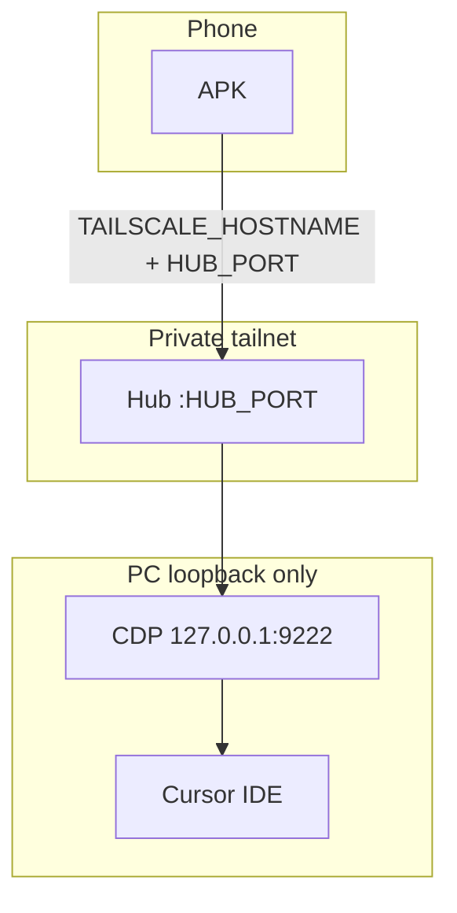
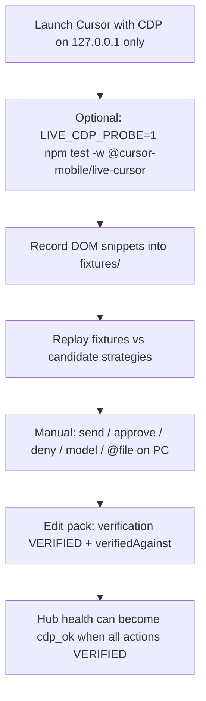

<!-- generated-by: gsd-doc-writer · Phase 0 scaffold update 2026-09-25 -->
# Configuration

**Status:** Phase 0 Hub env knobs are **implemented** in `packages/hub`. Expo/`eas.json` may exist under `apps/mobile` from sibling scaffold — APK pairing UI is not Phase 0 Hub DoD.

## Environment variables

| Variable | Required | Default | Description | Status |
|----------|----------|---------|-------------|--------|
| `TAILSCALE_HOSTNAME` | Ops (QR hint) | — | MagicDNS / Tailscale hostname for pair QR / `baseUrlHint` | Phase 0 |
| `HUB_HOST` | Optional | `127.0.0.1` | Hub bind interface. Use Tailscale IP for phone reachability. `0.0.0.0` **only** behind Tailscale ACLs — never public Hub+CDP. | Phase 0 |
| `HUB_PORT` | Optional | `8787` | TCP port for Hub HTTP | Phase 0 |
| `CDP_URL` | Hub | `http://127.0.0.1:9222` | CDP endpoint — **localhost only**; phone never dials | Phase 0 |
| `CURSOR_WORKSPACE` | Optional | unset | Absolute path stub for bound project when CDP detect unavailable; empty → `NO_FOLDER_OPEN`. May point at a VS Code/Cursor `.code-workspace` file (folders become Hub roots). Phase 2 History Index matches this path to `workspaceStorage` folder URIs. | Phase 0 / 2 / 3 |
| `CURSOR_WORKSPACE_ROOTS` | Optional | unset | Comma-separated extra absolute roots merged with primary bind (Phase 3 multi-root). Attach/list/preview validate under all roots. | Phase 3 |
| `CURSOR_MODELS` | Optional | built-in `composer`,`auto` | New Session model list (`id[:label[:family]]`, `id*` = default). Use `__empty__` / `__none__` to force empty catalog (AC-050-03 UAT). Live CDP scrape still preferred when `cdp_ok` + `model_select` VERIFIED | Phase 1 |
| `CURSOR_MCP_SERVERS` | Optional | unset | Tools summary stub `name[:toolCount][,…]` for `GET /workspace/tools` | Phase 1 |
| `CURSOR_PLUGINS` | Optional | unset | Plugin name list stub for tools summary | Phase 1 |
| `LIVE_SELECTOR_PACK_READY` | Optional | `false` | Ops smoke override: treat **all** selector-pack actions as VERIFIED (`cdp_ok`). Default `false` → actions stay CANDIDATE → `extractor_stale`; mutations fail closed. **Does not prove DOM match** — prefer flipping per-action flags after manual Cursor UI check (see below) | Phase 1 |
| `LIVE_CDP_PROBE` | Optional | unset | When `1`/`true`, live-cursor tests force the optional loopback CDP probe. Auto-runs if `CDP_URL` (default `http://127.0.0.1:9222`) already responds | Phase 1 |
| `PAIRING_CODE_TTL_SEC` | Optional | `300` | Lifetime of pair codes from `/pair/start` | Phase 0 |
| `PAIRING_TOKEN_TTL_SEC` | Optional | unset (non-expiring) | Device token TTL; empty = no expiry (in-memory) | Phase 0 |
| `PAIRING_REQUIRED` | Optional | `true` | Reject unauthenticated `/workspace` | Phase 0 |
| `HUB_DATA_DIR` | Optional | `./data` | Durable pairing store (`devices.json`). Set `none`/`off` for in-memory only | Phase 4 |
| `HUB_RELEASES_DIR` | Optional | `<HUB_DATA_DIR>/releases` | Phone self-update feed (`latest.json` + APK) served on `GET /v1/app/latest` · `/v1/app/apk`. `none`/`off` disables. See [release-gate-and-self-update](features/release-gate-and-self-update.md) | Phase 4 |
| `CM_KEYSTORE_FILE` · `CM_KEYSTORE_PASSWORD` · `CM_KEY_ALIAS` · `CM_KEY_PASSWORD` | Optional (build time) | unset → template debug key | Release APK signing (`apps/mobile/plugins/with-release-signing.js`) | Phase 4 |
| `HUB_DISPLAY_NAME` | Optional | `Desk PC` | Label in pair responses | Phase 0 |
| `WORKSPACE_POLL_MS` | Optional | TBD | Refresh interval for live workspace detect | DESIGNED |
| `EXPO_PUBLIC_HUB_URL` | Optional (APK) | — | **Build-time default only** (baked into `extra.hubUrl`). Pair screen always accepts a runtime Hub URL and persists it in SecureStore — **rebuild not required** to point at Tailscale Hub. This PC (2026-09-30): `http://100.108.160.99:8787` / MagicDNS `http://kingwarpc-1.tail246b3f.ts.net:8787` (legacy `100.91.47.68` / `kingwarpc…` may be offline) | Phase 0 (`apps/mobile`) |

## Desktop Hub (Electron)

Packaged Hub UI (`apps/desktop`). Same env knobs as the CLI Hub. Runs **on the operator PC only**.

| Item | Notes |
|------|--------|
| Linux | `cursor-mobile-hub-<version>-linux-x64.AppImage` |
| Windows | `cursor-mobile-hub-<version>-win-x64.exe` (portable) |
| macOS | `cursor-mobile-hub-<version>-darwin-arm64.zip` / `…-darwin-x64.zip` |
| Checksums | `SHA256SUMS.txt` on the GitHub Release |
| Local package | `node scripts/package-desktop.mjs --platform linux\|win\|mac` → `dist-desktop/` |
| Dev shell | `npm run start:desktop` |
| Defaults | `HUB_HOST=0.0.0.0`, `HUB_PORT=8787`, `CDP_URL=http://127.0.0.1:9222`, `HUB_DATA_DIR=~/.cursor-mobile/hub-data` |
| Signing | Unsigned desktop binaries in v1 (SmartScreen / Gatekeeper may warn) |
| Product locks | Phone downloads APK from Hub over Tailscale (`publish:apk:github`), not from GitHub |

## Config file format

| Artifact | Role | Status |
|----------|------|--------|
| Root [`.env.example`](../.env.example) | Documented Hub knobs | Phase 0 |
| Hub process env | Runtime CDP / bind / pairing | Phase 0 |
| Expo `apps/mobile/app.json` + `eas.json` | APK identity + `android.buildType: apk` | Phase 0 |

## Required vs optional settings

| Setting | If missing |
|---------|------------|
| Active Cursor workspace / `CURSOR_WORKSPACE` | Hub returns `emptyReason: NO_FOLDER_OPEN` — no fake workspace |
| `CDP_URL` reachable | `/health` still `ok: true` for Hub; `cdp.status` disconnected/error; `liveAdapter.state` = `cursor_down` |
| Selector pack unverified | `liveAdapter.state` = `extractor_stale`; POST messages/approvals → `503 EXTRACTOR_STALE` (no fake success) |
| Attachments mid-session | Hub registers validated paths; response `domApplied: false` until Composer @-inject is wired |
| Models / files / tools | Env + FS stubs; responses include DESIGNED `note` — not live CDP inventories |
| Pairing completed | `/workspace` → `401` when `PAIRING_REQUIRED=true` |
| Tailscale connectivity | Phone cannot reach Hub |

## Marking a selector pack VERIFIED (operator)

DOM mutations stay fail-closed until each action in `packages/adapters/live-cursor/src/selector-pack.ts` is flipped from `CANDIDATE` → `VERIFIED` after a **manual Cursor UI check on this PC**. Synthetic fixtures under `packages/adapters/live-cursor/fixtures/selector-pack/` prove replay CI only — they are **not** live verification.

1. Start Cursor with remote debugging bound to **loopback only** (designed: `--remote-debugging-port=9222` on `127.0.0.1`). Confirm nothing listens on `0.0.0.0:9222`.
2. Open the project folder the Hub will bind (`CURSOR_WORKSPACE` / PC-open project).
3. Optional attach smoke: `LIVE_CDP_PROBE=1 npm test -w @cursor-mobile/live-cursor` — expect health `extractor_stale` while actions are still CANDIDATE.
4. For each action (`send_message`, `approve`, `deny`, `model_select`, `file_attach`):
   - In DevTools against the Cursor target, confirm at least one strategy in the pack hits the live DOM (or capture a new fixture via `recordFixture` and replace the synthetic JSON).
   - Exercise the control once manually on the PC (type+send, Approve, Deny, model picker, @file).
   - In `selector-pack.ts`, set that action's `verification: "VERIFIED"`, `verifiedAt` (ISO), and `verifiedAgainst` (Cursor version / UI note).
5. Re-run unit + replay tests. Do **not** set `LIVE_SELECTOR_PACK_READY=true` as a substitute for step 4 in committed defaults.
6. Only when **all five** actions are VERIFIED does `resolveSelectorPackStatus` report `verified: true` and Hub may emit `liveAdapter.state = cdp_ok`.

## Defaults

| Knob | Default | Where |
|------|---------|-------|
| CDP | `http://127.0.0.1:9222` | Hub env |
| CDP bind | Loopback only | Cursor launch flags |
| Hub bind | `127.0.0.1:8787` | `HUB_HOST` / `HUB_PORT` |
| Pairing | Required before workspace | Hub middleware |
| APK distribution | Expo EAS `android.buildType: "apk"` | `apps/mobile` |

## Per-environment overrides

| Environment | Approach |
|-------------|----------|
| Development | Hub on PC; CDP localhost; APK points at Tailscale hostname of same PC |
| Staging | Same topology on dedicated PC/VM on tailnet; separate pairing |
| Production | Still PC-local only — **no cloud mode**; harden Tailscale ACLs and pairing TTL |

Do **not** publish CDP beyond `127.0.0.1`. The phone reaches the **Hub** over Tailscale; the Hub alone talks to CDP on loopback.

## Related design docs

- [architecture/mobile-cursor-companion.md](architecture/mobile-cursor-companion.md) — Hub API surface
- [packages/hub/README.md](../packages/hub/README.md) — run / test
- [GETTING-STARTED.md](GETTING-STARTED.md) — operator order of operations
