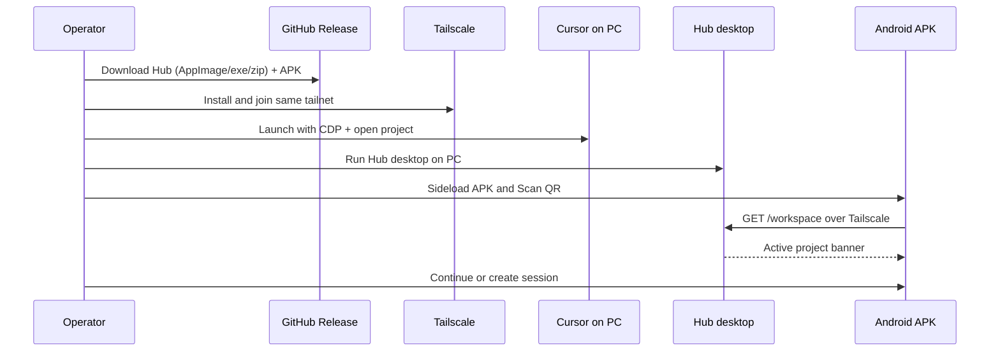
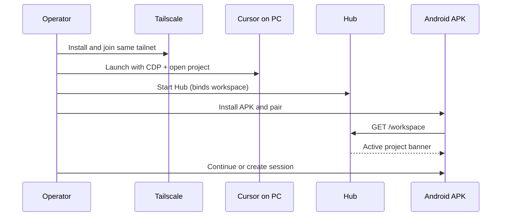

<!-- generated-by: gsd-doc-writer -->
# Getting started

**Status:** Operator path — download Hub desktop (Linux) + APK from GitHub Releases, or build from source. Live E2E still gated on CDP/UAT.

## Prerequisites

| Requirement | Notes |
|-------------|--------|
| Cursor IDE on a PC | Project must be opened on the PC before the phone can work in it |
| Tailscale | PC and phone on the same tailnet; Hub stays private (no public CDP). Already installed on this operator setup |
| Chrome DevTools Protocol (CDP) | Launch via `./scripts/start-cursor-cdp.sh` (default `127.0.0.1:9222`, loopback only) |
| Android device | Sideload APK from GitHub Release or local `assembleRelease` |
| Hub on the PC | Download Hub desktop from GitHub Release: Linux AppImage, Windows portable `.exe`, or macOS zip. Or run from source: `npm run start:hub:tailscale` |

## Installation steps

1. On the **PC**, download the latest GitHub Release for this repo (`v*` tag).
2. Install / run the **Hub desktop** for your OS:
   - Linux: `cursor-mobile-hub-*-linux-x64.AppImage` (`chmod +x`, then run)
   - Windows: `cursor-mobile-hub-*-win-x64.exe` (portable; SmartScreen may warn — unsigned in v1)
   - macOS: `cursor-mobile-hub-*-darwin-arm64.zip` or `…-darwin-x64.zip` (unsigned — right-click Open the first time)
   - Or from source: `npm install && npm run start:hub:tailscale`
3. Launch Cursor with CDP (loopback only) and open your project.
4. On the phone, install the signed **APK** from the same Release (or after `npm run publish:apk:github` so the Hub feed serves it).
5. Join Tailscale on the phone, open the companion app, Scan QR (Hub → Open pair QR).



## First run (operator path)



### 1. Install Tailscale

1. Install Tailscale on the **PC** and the **phone**.
2. Sign in and confirm both devices appear on the same tailnet.
3. Note the PC’s Tailscale hostname or MagicDNS name (used by the APK to reach the Hub).

### 2. Launch Cursor with CDP

CDP must bind **loopback only** (`127.0.0.1:9222`). The Hub dials CDP on the PC; the phone never dials CDP.

1. **Quit Cursor fully** if it is already running (this helper will **not** kill your session):
   - Linux: **Ctrl+Q**, or File → Quit
2. From the repo root, start Cursor with the safe CDP helper (**MAIN profile only** — never `--user-data-dir=/tmp/cursor-mobile-cdp-profile`):

   ```bash
   # One-liner (preferred) — from an EXTERNAL terminal after quit:
   npm run start:cursor:cdp
   # Interactive helper (waits for quit + Enter; never kills Cursor):
   npm run relaunch:cursor:cdp
   # equivalent:
   ./scripts/start-cursor-cdp.sh /data/projects/cursor_mobile
   ./scripts/relaunch-cursor-cdp-external.sh
   ```

   The start script prefers `/usr/share/cursor/cursor`, passes `--remote-debugging-port=9222` and `--remote-debugging-address=127.0.0.1`, warns if port `9222` is already in use, and refuses to start while Cursor is still running. `relaunch:cursor:cdp` is for an **external** terminal: it prompts quit → Enter, then runs the same start path; `notify-send` once if available; never opens a second profile.

   For remaining P0 New-session close **without** Cursor CDP relaunch (preferred when the operator declines quit→`:9222`):

   ```bash
   # CDP down is OK (yellow, not critical):
   npm run uat:precheck
   # Device New-session → Hub create-queue 202 / CURSOR_DOWN attempt (exit 0 PASS_QUEUE_202):
   SKIP_APK_BUILD=1 ATTACH_COUNT=2 npm run uat:adb-new-session
   # Hub unit path (no device): npm run test:phase4
   ```

   Optional metal path only (AC-X-01 still needs CDP per TOR): leave the MAIN-CDP watcher armed — it never starts Cursor; touch `/tmp/cursor-mobile-stop-main-cdp-watch.flag` to disable. When `:9222` appears it runs `verify:cdp` then `SKIP_APK_BUILD=1 ATTACH_COUNT=2 uat:adb-new-session`:

   ```bash
   npm run watch:main-cdp-new-session
   npm run assert:no-second-cdp   # must stay PASS
   ```

3. **Open the project folder** in Cursor on the PC (or pass the path as above). The phone never opens the project by itself in v1.
4. Verify CDP on loopback (metal path only):

   ```bash
   curl -s http://127.0.0.1:9222/json | head
   ss -ltn | grep 9222   # expect 127.0.0.1, not 0.0.0.0
   ```

5. After Cursor + Composer are up, wait for CDP and live-match selectors (marks `send_message` / approve / deny **VERIFIED** only on high-confidence DOM hits — never without live matches):

   ```bash
   ./scripts/wait-cdp-and-verify.sh
   # equivalent: npm run verify:cdp
   ```

   Or leave a long-poll watcher running (polls `127.0.0.1:9222` every ~20s, optional `CDP_WATCH_MAX_HOURS`, Ctrl+C safe) — it runs the same verify path when CDP appears and prints loudly if VERIFIED flips:

   ```bash
   npm run watch:cdp
   # VERIFY_DRY_RUN=1 npm run watch:cdp   # match only, no pack write
   ```

   Then restart the Hub and send a test message.


### 3. Run the Hub

From the repo root (after `npm install`):

```bash
./scripts/start-hub-tailscale.sh
# equivalent: npm run start:hub:tailscale
```

The script runs `npm run build` (live-cursor + history + hub → `dist/`) then `npm run start` (`node dist/cli.js`). Adapter packages export compiled `dist/*.js` — plain Node cannot load their `.ts` sources. For local iteration without a rebuild, `HUB_HOST=0.0.0.0 npm run dev -w @cursor-mobile/hub` still works after a prior build.

Defaults: `HUB_HOST=0.0.0.0`, `HUB_PORT=8787`, `CURSOR_WORKSPACE=<repo root>`, `CDP_URL=http://127.0.0.1:9222`. The script prints your Tailscale IPv4 (when `tailscale ip -4` works), the phone `EXPO_PUBLIC_HUB_URL`, and reminds that **`POST /v1/pair/start` is localhost-only** — generate the code on the PC, then confirm from the phone over Tailscale.

```bash
curl -s http://127.0.0.1:8787/health
# from phone / mesh: http://<tailscale-ip>:8787/health
```

If no folder is open in Cursor and `CURSOR_WORKSPACE` is unset, the APK is designed to show “Open a project in Cursor on the PC” — not a fake empty workspace.

### 4. Install the APK

1. Build with Expo EAS using an **apk** profile (see [CONFIGURATION.md](CONFIGURATION.md)), or install a released sideload artifact.
2. Enable install from unknown sources as required by your Android version.
3. Install the APK on the phone.

### 5. Pair

1. On the phone: open **Tailscale** → sign in → join the **same tailnet** as the PC → wait until the phone is **Online** (Pair/Health screens show these steps when Hub is unreachable).
2. Open the companion APK.
3. Enter the Hub address (Tailscale IP or MagicDNS + Hub port) and complete pairing (`POST /pair/...`).
4. Pairing tokens are issued by the Hub; do not embed Cursor secrets in the APK. No USB reverse / ngrok product path.

### 6. Open project context on the phone

1. After pairing, the APK should show the **active project banner** (name/path from `GET /workspace`).
2. If the banner is empty or errors, open/focus the project in Cursor on the PC and reconnect.

### 7. Continue or create a session

| Action | Planned behavior |
|--------|------------------|
| **Continue** | List sessions for this workspace → open live chat → approve/deny tool calls on the PC |
| **Create** | Pick model → attach files from workspace roots → optional first prompt → Hub creates Composer session on PC |
| **History (Phase 2)** | Read past project sessions → **Open on PC** to go live |

## Common setup issues (expected)

| Symptom | Likely cause | What to check |
|---------|--------------|---------------|
| APK cannot reach Hub | Tailscale down or wrong hostname | Both devices online on same tailnet; MagicDNS/hostname matches [CONFIGURATION.md](CONFIGURATION.md) |
| “Open a project in Cursor on the PC” | No folder open / Hub unbound | Open the project in Cursor; restart Hub after opening |
| Sessions/approvals not updating | CDP not running or Hub cannot attach | Confirm CDP on `127.0.0.1:9222`; Hub not pointing at a public interface |
| Pairing fails | Token expired or Hub not reachable | Re-run pair flow; verify Hub health |

## Next steps

- Planned knobs: [CONFIGURATION.md](CONFIGURATION.md)
- System design: [architecture/mobile-cursor-companion.md](architecture/mobile-cursor-companion.md)
- Session UX: [features/remote-sessions.md](features/remote-sessions.md)
