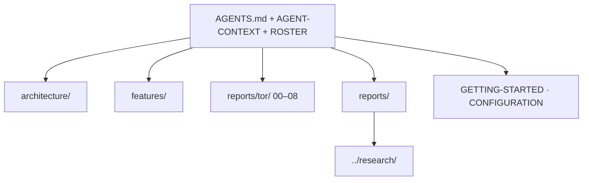

# Documentation index

**Product:** PC-local Cursor companion Android APK  
**Status:** Design accepted · Phase 0–2 code in-repo (not product-complete; live DOM UAT pending)  
**Agent entry:** [`architecture/AGENT-CONTEXT.md`](architecture/AGENT-CONTEXT.md) · [`architecture/AGENT-ROSTER.md`](architecture/AGENT-ROSTER.md) · [`../AGENTS.md`](../AGENTS.md) · [`reports/tor/README.md`](reports/tor/README.md)

---

## Architecture

How the system is structured, requirements, security, and the agent briefing pack.

| Doc | Topic |
|-----|-------|
| [AGENT-CONTEXT.md](architecture/AGENT-CONTEXT.md) | **Load first** — goals, gaps, Hub/APK, phases, FR P0 summary |
| [AGENT-ROSTER.md](architecture/AGENT-ROSTER.md) | Named roles R1–R9 — ownership, handoffs, when to invoke |
| [mobile-cursor-companion.md](architecture/mobile-cursor-companion.md) | Full system design, flows, Hub API, phases 0–4 |
| [functional-requirements.md](architecture/functional-requirements.md) | FR-001–091 (P0/P1/P2), acceptance criteria |
| [security-tailscale-linking.md](architecture/security-tailscale-linking.md) | Threat model, Tailscale, pairing, CDP localhost |

---

## Features

Per-feature behavior for the companion.

| Doc | Topic |
|-----|-------|
| [remote-sessions.md](features/remote-sessions.md) | Continue live + history → Open on PC |
| [new-session-composer.md](features/new-session-composer.md) | Model + file attach + tools/approvals |
| [phone-apk-screens.md](features/phone-apk-screens.md) | APK screen map (pair → health → home → chat) |

---

## TOR set (exhaustive)

Terms of Reference volumes that expand architecture/features into build-ready detail. Index maps volumes to phases 0–4.

| Doc | Topic |
|-----|-------|
| [reports/tor/README.md](reports/tor/README.md) | **Master index** — volumes 00–08, reading order, phase map |
| [TOR-00](reports/tor/TOR-00-program-terms-of-reference.md) | Program TOR |
| [TOR-01](reports/tor/TOR-01-functional-requirements.md) | Functional requirements expanded |
| [TOR-02](reports/tor/TOR-02-system-architecture.md) | System architecture + ADRs |
| [TOR-03](reports/tor/TOR-03-hub-and-api-specification.md) | Hub & API specification |
| [TOR-04](reports/tor/TOR-04-mobile-apk-and-ux.md) | Mobile APK & UX |
| [TOR-05](reports/tor/TOR-05-security-and-tailscale.md) | Security & Tailscale |
| [TOR-06](reports/tor/TOR-06-live-cursor-adapter.md) | LiveCursorAdapter / CDP |
| [TOR-07](reports/tor/TOR-07-history-sessions-data.md) | History Index & session data |
| [TOR-08](reports/tor/TOR-08-nfr-testing-ops-acceptance.md) | NFR, testing, ops, acceptance |

---

## Reports

Dated jobs, research synthesis, gap closure, agent communication.

| Doc | Topic |
|-----|-------|
| [agent-handoff-protocol.md](reports/agent-handoff-protocol.md) | How agents hand off (done / files / gaps / next) |
| [goal-progress-2026-09-25.md](reports/goal-progress-2026-09-25.md) | Honest goal status: built vs manual UAT vs Phase 3/4 |
| [operator-uat-checklist-2026-09-25.md](reports/operator-uat-checklist-2026-09-25.md) | Operator UAT steps mapped to TOR-08 P0 ACs |
| [handoff-agent-workspace-2026-09-25.md](reports/handoff-agent-workspace-2026-09-25.md) | Workspace setup handoff (this milestone) |
| [gap-closure-hybrid-system-2026-09-24.md](reports/gap-closure-hybrid-system-2026-09-24.md) | Needs + weak-point → fix vs CursorRemote/Paseo |
| [how-we-work-phone-pc-2026-09-24.md](reports/how-we-work-phone-pc-2026-09-24.md) | Day-to-day product narrative |
| [tailscale-linking-research-2026-09-24.md](reports/tailscale-linking-research-2026-09-24.md) | Official Tailscale linking brief |
| [oss-landscape-research-2026-09-24.md](reports/oss-landscape-research-2026-09-24.md) | OSS landscape (historical cloud notes superseded) |
| [tor/TOR-08-nfr-testing-ops-acceptance.md](reports/tor/TOR-08-nfr-testing-ops-acceptance.md) | NFR, test strategy, P0 acceptance catalog, ops runbooks, phase DoD, SLOs (designed) |

---

## Operator (planned — not runnable yet)

| Doc | Topic |
|-----|-------|
| [GETTING-STARTED.md](GETTING-STARTED.md) | Tailscale → Hub → CDP → APK → pair |
| [CONFIGURATION.md](CONFIGURATION.md) | Designed config knobs (not implemented) |

---

## Research (raw inputs)

External Parallel / crawl dumps that feed reports — see [`../research/README.md`](../research/README.md).

| Doc | Topic |
|-----|-------|
| [cursor-mobile-remote-ide-oss.md](../research/cursor-mobile-remote-ide-oss.md) | Parallel deep-research notes |
| [cursor-mobile-remote-ide-oss.json](../research/cursor-mobile-remote-ide-oss.json) | Raw Parallel metadata |

---

## Product locks (quick)

| In scope | Out of scope |
|----------|--------------|
| PC-open project remote | Cloud Agents / Remote Control |
| Continue + create (model · files · PC tools) | Tools on phone |
| Tailscale + pairing; CDP `127.0.0.1` | Public CDP / cloud session lists |
| Expo sideload APK | Claiming Hub/APK implemented before scaffold |

---

## Folder rules

| Folder | Use for |
|--------|---------|
| `architecture/` | Structure, FRs, security, agent briefing, agent roster |
| `features/` | Feature UX and contracts |
| `reports/tor/` | Exhaustive TOR volumes (promote decisions to architecture/features) |
| `reports/` | Completed jobs, audits, handoffs |
| `research/` | Raw research inputs only |

Prefer updating existing files over creating conflicting duplicates. English + mermaid where useful.
