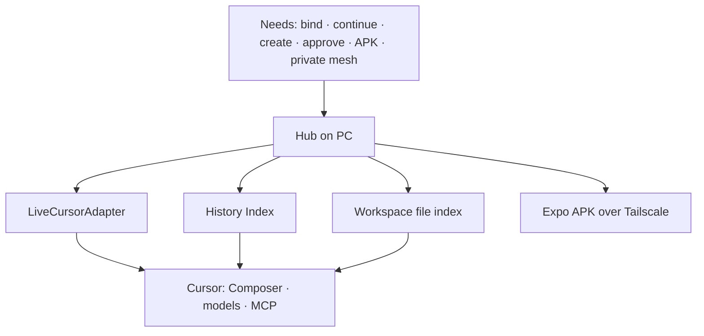
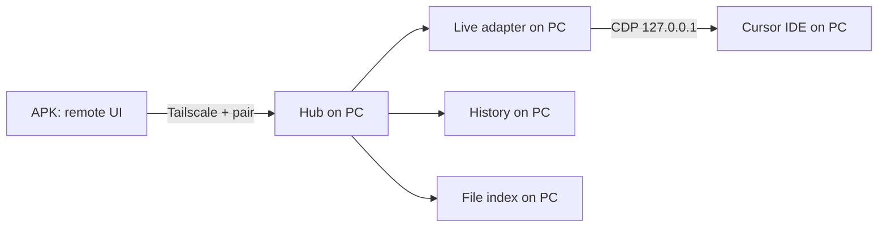
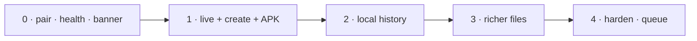

# AGENT-CONTEXT — Single briefing pack

**Load this first** before any other project doc.  
**Status:** Design accepted (2026-09-24) · **Code:** Phase 0 Hub + Phase 1 LiveCursorAdapter / sessions / WS scaffold (`packages/hub`, `packages/adapters/live-cursor`; APK shell at `apps/mobile`)  
**Locks:** PC-local only (**Hub + sync on operator PC** — not cloud/VPS/other machines) · open-project remote · Tailscale + pairing · CDP `127.0.0.1` · Expo APK (remote UI only)

Canonical deep design: [`mobile-cursor-companion.md`](./mobile-cursor-companion.md) · FRs: [`functional-requirements.md`](./functional-requirements.md)  
**TOR set (exhaustive):** [`../reports/tor/README.md`](../reports/tor/README.md) · **Roles:** [`AGENT-ROSTER.md`](./AGENT-ROSTER.md)

---

## 1. One-sentence product

Phone APK remotes **Composer for the project already open in Cursor on the PC** — continue sessions or create new ones (model + files + PC tools with phone approvals) over **Tailscale + device pairing**. No cloud Agents / Remote Control.

---

## 2. Goals / non-goals

### Goals

| ID | Goal |
|----|------|
| G-1 | Remote Composer/agent loop for the **PC-open** project |
| G-2 | **Continue** live sessions + local project history |
| G-3 | **Create** session: model + workspace file attach + chat |
| G-4 | Tools / plugins / MCP run **on PC**; phone Approve/Deny |
| G-5 | **Tailscale** + Hub device pairing; CDP stays localhost |
| G-6 | Sideload **Expo EAS APK** |

### Non-goals

| ID | Non-goal |
|----|----------|
| NG-1 | Cloud Agents / official Remote Control / cloud workers |
| NG-2 | Opening / cloning arbitrary folders from the phone (v1) |
| NG-3 | Running MCP/tools on the phone |
| NG-4 | Exposing CDP beyond `127.0.0.1` |
| NG-5 | Cloud session lists or cloud credentials in the APK |
| NG-6 | Hosting Hub / History / live sync on VPS, cloud VM, or any machine other than the operator’s PC |

---

## 3. Gap → fix (product coverage)

| Gap / weak point | Source pattern | Our fix | Phase |
|------------------|----------------|---------|-------|
| No project banner / workspace bind | CursorRemote web | `GET /workspace` + APK banner | 0 |
| Weak new-session (model/files) | CursorRemote | Create sheet: model + attachments | 1 |
| Tools as opaque DOM only | CursorRemote | Structured approval cards + tools summary | 1 |
| Can’t see all past project chats | CursorRemote | History Index filtered by workspace | 2 |
| Browser only | CursorRemote | Expo sideload APK | 1 |
| Public / LAN exposure risk | Generic tunnels | Tailscale + pair; CDP loopback | 0 |
| Cloud Agents as “the” mobile path | Official Cursor iOS | **Out of scope** — PC-local companion instead | — |

Full matrix: [`../reports/gap-closure-hybrid-system-2026-09-24.md`](../reports/gap-closure-hybrid-system-2026-09-24.md)



---

## 4. Hub / APK shape

**Placement lock:** Hub, LiveCursorAdapter, History Index, and all Composer/CDP sync run **on the operator’s PC only**. The APK is a **remote UI client** over Tailscale — never a sync host, and Hub is never hosted on cloud/VPS/another machine.

| Component | Runs on | Role |
|-----------|---------|------|
| **Android APK** | Phone (`apps/mobile`) | Pair, banner, sessions, chat, new-session, approvals — **no** tool runtime, **no** sync server |
| **Hub** | **Operator PC** (`packages/hub`) | HTTP/WS API; workspace bind; orchestrates create / open-on-pc / messages / approvals |
| **LiveCursorAdapter** | **Operator PC** (`adapters/live-cursor`) | CDP/DOM → Composer (CursorRemote-class) |
| **History Index** | **Operator PC** (`adapters/history`) | Local session store for project (cursor-session-class) |
| **Tailscale** | Phone ↔ **same PC** | Private mesh so phone reaches Hub on PC; CDP never forwarded |



### Designed Hub API (not implemented)

```
GET    /workspace
GET    /workspace/files?q=
GET    /workspace/models
GET    /workspace/tools
GET    /sessions?workspaceId=
POST   /sessions
POST   /sessions/:id/open-on-pc
POST   /sessions/:id/messages
POST   /sessions/:id/attachments
POST   /sessions/:id/approvals
WS     /ws
GET    /health
POST   /pair/...
```

---

## 5. Session modes

| Mode | Meaning | Phone can |
|------|---------|-----------|
| `live` | Open Composer/agent in this workspace | Chat, attach, approve tools, model if UI allows |
| `history` | Past local session for this project | Read; **Open on PC** → `live` |
| `editor` | Optional later | Browse/attach (Phase 3+) |

**New session body (designed):**

```json
{
  "workspaceId": "...",
  "model": "composer-...|...",
  "attachments": ["src/a.ts"],
  "prompt": "optional first message",
  "agentMode": "agent|ask|..."
}
```

`workspaceId` must match the Hub-bound PC-open project or create is rejected.

---

## 6. Security / Tailscale (summary)

| Surface | Rule |
|---------|------|
| CDP | `127.0.0.1` only; Hub-mediated; never in APK as remote URL |
| Hub API | Tailscale IP / MagicDNS + device pairing token |
| Pairing | Short-lived QR/code → rotatable/revocable device token |
| APK secrets | No Cursor/cloud API keys; no remote CDP |
| Forbidden baseline | Hub/CDP on `0.0.0.0`, Funnel, ngrok-as-default |

Detail: [`security-tailscale-linking.md`](./security-tailscale-linking.md)

---

## 7. FR P0 list (summary)

Full table: [`functional-requirements.md`](./functional-requirements.md)

| Group | P0 IDs | Must deliver |
|-------|--------|--------------|
| Connectivity & pairing | FR-001–004 | Private Hub path; pair; errors; `/health` |
| Workspace binding | FR-010–013 | Detect open project; banner; empty state; scope create |
| Sessions | FR-020–022 | List live (+ mode); this project only |
| Continue live | FR-030–033 | Messages; Approve/Deny; attachments; no silent approve |
| New session | FR-050–054 | Model; files; `POST /sessions`; tools summary info |
| Tools | FR-060–062 | Execute on PC; phone approvals only |
| APK | FR-080–081 | Expo sideload APK with P0 screens |

**P1 (Phase 2+):** FR-014 multi-window · FR-020/023 full history · FR-040–041 history read + open-on-pc · FR-090 reconnect  
**P2:** FR-055 richer picker · FR-070–071 editor · FR-091 offline/harden

---

## 8. Phases 0–4

| Phase | Delivers |
|-------|----------|
| **0** | Pair, Tailscale, health, active workspace banner |
| **1** | Live continue + approvals + create (model + basic attach) + APK |
| **2** | Full local history + Open on PC |
| **3** | Richer file picker / optional editor tab |
| **4** | Harden CDP selectors, offline queue |



---

## 9. Implementation status (truth)

| Artifact | Status |
|----------|--------|
| Architecture / FRs / features / security | **Accepted design** |
| Hub package / adapters / root workspaces | **Phase 0 + Phase 1 live scaffold** (`packages/hub`, `packages/adapters/*`) |
| Expo app | **Shell / sibling scaffold** — wire to Hub sessions/WS next |
| Runnable Hub | **`npm run build` · `npm run start`** — health, pair, workspace, models/files/tools (env/FS stubs), live sessions, attachments (Hub registry), messages/approvals (fail-closed), WS |
| Live DOM mutations | **Blocked** — pack `cursor-ui@2026.09-candidate`; all actions `CANDIDATE` → `extractor_stale` until operator marks VERIFIED |
| History Index / open-on-pc | **Phase 2 in progress** — A→B→C path wired; strategy B fail-closed until `composer_history_open` VERIFIED (falls back to C with `strategyB` status) |

Handoff: [`../reports/handoff-phase1-hub-workspace-apis.md`](../reports/handoff-phase1-hub-workspace-apis.md)

Operator path: [`../GETTING-STARTED.md`](../GETTING-STARTED.md) · Hub runbook: [`../../packages/hub/README.md`](../../packages/hub/README.md)

---

## 10. Links — detailed docs

| Topic | Doc |
|-------|-----|
| Full architecture | [mobile-cursor-companion.md](./mobile-cursor-companion.md) |
| Functional requirements | [functional-requirements.md](./functional-requirements.md) |
| Security / Tailscale | [security-tailscale-linking.md](./security-tailscale-linking.md) |
| Agent roster (R1–R9) | [AGENT-ROSTER.md](./AGENT-ROSTER.md) |
| TOR master index (volumes 00–08) | [../reports/tor/README.md](../reports/tor/README.md) |
| Continue / history | [../features/remote-sessions.md](../features/remote-sessions.md) |
| New session | [../features/new-session-composer.md](../features/new-session-composer.md) |
| APK screens | [../features/phone-apk-screens.md](../features/phone-apk-screens.md) |
| Gap closure | [../reports/gap-closure-hybrid-system-2026-09-24.md](../reports/gap-closure-hybrid-system-2026-09-24.md) |
| How we work | [../reports/how-we-work-phone-pc-2026-09-24.md](../reports/how-we-work-phone-pc-2026-09-24.md) |
| Doc index | [../README.md](../README.md) |
| Agent rules | [`../../AGENTS.md`](../../AGENTS.md) |
| Handoff protocol | [../reports/agent-handoff-protocol.md](../reports/agent-handoff-protocol.md) |

---

## Decision line

**Phone = remote Composer for the PC-open project.** Continue or create with model + files + PC tools/approvals. Tailscale + pairing. CDP localhost. Expo APK. **No cloud. Phase 1 Hub live routes + adapter health triad landed — DOM mutations stay fail-closed until selector pack is verified.**
