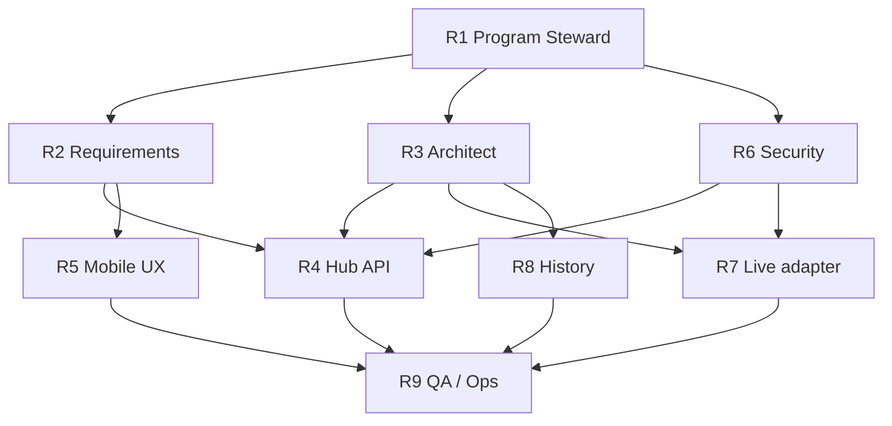
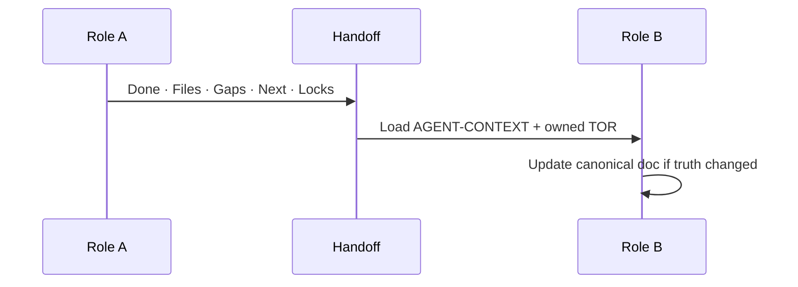

<!-- generated-by: gsd-doc-writer -->
# AGENT-ROSTER — Named subagent roles

**Product:** PC-local Cursor companion Android APK  
**Status:** Design accepted · code not scaffolded  
**Audience:** Planners, executors, reviewers, and TOR authors  
**Locks:** PC-local only · open-project remote · continue/create (model + files + PC tools) · Tailscale + pairing · CDP `127.0.0.1` · Expo APK · docs ≠ code

Load [`AGENT-CONTEXT.md`](./AGENT-CONTEXT.md) first. Shared rules: [`../../AGENTS.md`](../../AGENTS.md). TOR index: [`../reports/tor/README.md`](../reports/tor/README.md). Handoffs: [`../reports/agent-handoff-protocol.md`](../reports/agent-handoff-protocol.md).

---

## Roster summary

| Role ID | Name | Owns (source of truth) | Invoke when |
|---------|------|------------------------|-------------|
| **R1** | Program Steward | TOR-00, AGENT-CONTEXT, AGENTS.md, gap-closure | Scope, locks, phase gates, agent workspace |
| **R2** | Requirements Analyst | TOR-01, functional-requirements.md | FR add/change, acceptance criteria, UC map |
| **R3** | System Architect | TOR-02, mobile-cursor-companion.md | Components, ADRs, repo layout, sequences |
| **R4** | Hub API Designer | TOR-03, Hub routes in architecture | REST/WS schemas, pairing API, versioning |
| **R5** | Mobile UX Designer | TOR-04, docs/features/* | Screens, create/continue UX, Expo/EAS APK |
| **R6** | Security Engineer | TOR-05, security-tailscale-linking.md | Threats, Tailscale, pairing crypto, CDP bans |
| **R7** | Live Adapter Engineer | TOR-06, live adapter sections / gap live rows | CDP attach, selectors, approvals executor |
| **R8** | History Data Engineer | TOR-07, remote-sessions history sections | History Index, open-on-PC, local retention |
| **R9** | QA & Ops Acceptancer | TOR-08, GETTING-STARTED, CONFIGURATION | NFR, UAT catalog, runbooks, phase DoD |

Nine durable roles (≥8). One human/agent may wear multiple hats; do not invent a tenth competing architecture.

---

## R1 — Program Steward

| Field | Content |
|-------|---------|
| **Responsibility** | Keep product locks, phase priorities, agent read order, and program TOR coherent. Prevent cloud / public-CDP drift. Coordinate handoffs across roles. |
| **Source-of-truth docs** | [`../reports/tor/TOR-00-program-terms-of-reference.md`](../reports/tor/TOR-00-program-terms-of-reference.md) · [`AGENT-CONTEXT.md`](./AGENT-CONTEXT.md) · [`../../AGENTS.md`](../../AGENTS.md) · [`../reports/gap-closure-hybrid-system-2026-09-24.md`](../reports/gap-closure-hybrid-system-2026-09-24.md) · this roster · [`../reports/tor/README.md`](../reports/tor/README.md) |
| **Handoff inputs** | User scope decisions; completed specialist TOR/architecture diffs; open gaps from any role |
| **Handoff outputs** | Updated AGENT-CONTEXT / AGENTS / gap-closure; TOR-00 sync; handoff naming next role + phase |
| **When to invoke** | Changing locks or phases; starting a multi-agent TOR/docs wave; resolving conflicts between volumes; docs-only workspace setup |

---

## R2 — Requirements Analyst

| Field | Content |
|-------|---------|
| **Responsibility** | Own FR-001–091 (and future FR-xxx): priority, phase, flows, Given/When/Then acceptance. Map use cases and user stories. Flag non-happy paths (no project, CDP down, Tailscale down). |
| **Source-of-truth docs** | [`../reports/tor/TOR-01-functional-requirements.md`](../reports/tor/TOR-01-functional-requirements.md) · [`functional-requirements.md`](./functional-requirements.md) |
| **Handoff inputs** | Product decisions from R1; UX/API proposals from R4/R5 that need FR coverage; gap matrix rows |
| **Handoff outputs** | Updated FR table + TOR-01 expansions; list of FRs touched; acceptance stubs for R9 |
| **When to invoke** | Adding/changing requirements; clarifying P0 vs P1/P2; writing acceptance criteria before build |

---

## R3 — System Architect

| Field | Content |
|-------|---------|
| **Responsibility** | System shape: Hub, adapters, APK, Tailscale placement; C4 diagrams; ADRs; intended repo layout; failure domains. Keep one architecture — no fork docs. |
| **Source-of-truth docs** | [`../reports/tor/TOR-02-system-architecture.md`](../reports/tor/TOR-02-system-architecture.md) · [`mobile-cursor-companion.md`](./mobile-cursor-companion.md) |
| **Handoff inputs** | Locked scope (R1); FR set (R2); security constraints (R6) |
| **Handoff outputs** | Architecture + ADR updates; component boundaries for R4/R7/R8; mermaid sequences for continue/create/open-on-pc |
| **When to invoke** | New component or adapter; technology choice; deployment topology change; repo layout before scaffold |

---

## R4 — Hub API Designer

| Field | Content |
|-------|---------|
| **Responsibility** | Designed Hub HTTP/WS surface: health, pair, workspace, files, models, tools, sessions, messages, attachments, approvals, open-on-pc. Schemas, errors, idempotency, versioning. Mark all as **designed** until code exists. |
| **Source-of-truth docs** | [`../reports/tor/TOR-03-hub-and-api-specification.md`](../reports/tor/TOR-03-hub-and-api-specification.md) · Hub API sections in [`mobile-cursor-companion.md`](./mobile-cursor-companion.md) / AGENT-CONTEXT |
| **Handoff inputs** | Architecture boundaries (R3); FR touchpoints (R2); pairing/threat rules (R6); UX needs (R5) |
| **Handoff outputs** | Endpoint/event tables; JSON schemas; session state machines; contract notes for implementers |
| **When to invoke** | Any Hub route or WS event change; pairing flow design; phone↔Hub contract disputes |

---

## R5 — Mobile UX Designer

| Field | Content |
|-------|---------|
| **Responsibility** | Expo Android APK UX: navigation, screens, New Session sheet, empty/error/loading, a11y, local token storage only, EAS `android.buildType: apk`. No tools/MCP runtime on phone. |
| **Source-of-truth docs** | [`../reports/tor/TOR-04-mobile-apk-and-ux.md`](../reports/tor/TOR-04-mobile-apk-and-ux.md) · [`../features/phone-apk-screens.md`](../features/phone-apk-screens.md) · [`../features/new-session-composer.md`](../features/new-session-composer.md) · [`../features/remote-sessions.md`](../features/remote-sessions.md) |
| **Handoff inputs** | FRs (R2); Hub contracts (R4); security (no secrets/CDP in APK) from R6 |
| **Handoff outputs** | Screen map updates; copy/state tables; Expo/EAS requirements; handoff to R9 for UAT cases |
| **When to invoke** | Screen/flow/UX change; create-session sheet detail; APK shell before Phase 1 scaffold |

---

## R6 — Security Engineer

| Field | Content |
|-------|---------|
| **Responsibility** | Threat model, Tailscale mesh, device pairing lifecycle, CDP localhost-only bans, secrets handling, revoke, go-live checklist. Forbid Funnel/ngrok-as-default / `0.0.0.0` Hub+CDP. |
| **Source-of-truth docs** | [`../reports/tor/TOR-05-security-and-tailscale.md`](../reports/tor/TOR-05-security-and-tailscale.md) · [`security-tailscale-linking.md`](./security-tailscale-linking.md) · [`../reports/tailscale-linking-research-2026-09-24.md`](../reports/tailscale-linking-research-2026-09-24.md) |
| **Handoff inputs** | Architecture surfaces (R3); Hub auth design (R4); APK storage proposals (R5) |
| **Handoff outputs** | STRIDE updates; ACL/pairing SOPs; banned configs; security acceptance items for R9 |
| **When to invoke** | Any connectivity or auth change; before exposing a port; pairing crypto; incident/revoke design |

---

## R7 — Live Adapter Engineer

| Field | Content |
|-------|---------|
| **Responsibility** | LiveCursorAdapter: CDP attach (`127.0.0.1`), DOM/extractor versioning, command executor (message, approve/deny, model, file attach), health states, resilience to Cursor UI drift. Tools execute on PC; phone only approves. |
| **Source-of-truth docs** | [`../reports/tor/TOR-06-live-cursor-adapter.md`](../reports/tor/TOR-06-live-cursor-adapter.md) · live-adapter / CDP sections in architecture + [`../reports/gap-closure-hybrid-system-2026-09-24.md`](../reports/gap-closure-hybrid-system-2026-09-24.md) |
| **Handoff inputs** | Hub orchestration contracts (R4); security CDP rules (R6); Phase 1 FRs (R2) |
| **Handoff outputs** | Selector/command catalogs; health-state machine; risk list; Phase 4 harden notes |
| **When to invoke** | Live continue/create path design; CDP selector breaks; approval card mapping; Phase 4 hardening |

---

## R8 — History Data Engineer

| Field | Content |
|-------|---------|
| **Responsibility** | Local History Index: live vs history identity, workspace filtering, open-on-PC, retention/privacy (data stays on PC), index refresh/migration. No cloud session catalogs. |
| **Source-of-truth docs** | [`../reports/tor/TOR-07-history-sessions-data.md`](../reports/tor/TOR-07-history-sessions-data.md) · history sections in [`../features/remote-sessions.md`](../features/remote-sessions.md) · History Index rows in architecture |
| **Handoff inputs** | Session modes from R3/R2; Hub `GET /sessions` / open-on-pc from R4; privacy rules from R6 |
| **Handoff outputs** | Entity/ER model; conflict rules (history vs live); Phase 2 DoD inputs for R9 |
| **When to invoke** | Phase 2 history work; session ID model changes; open-on-PC flow; index performance/retention |

---

## R9 — QA & Ops Acceptancer

| Field | Content |
|-------|---------|
| **Responsibility** | NFRs (perf, reliability, offline, battery, observability), test strategy, acceptance catalog mapped to P0 FRs, operator runbooks, APK release checklist, Definition of Done per phase 0–4. |
| **Source-of-truth docs** | [`../reports/tor/TOR-08-nfr-testing-ops-acceptance.md`](../reports/tor/TOR-08-nfr-testing-ops-acceptance.md) · [`../GETTING-STARTED.md`](../GETTING-STARTED.md) · [`../CONFIGURATION.md`](../CONFIGURATION.md) |
| **Handoff inputs** | FR acceptance stubs (R2); contracts from R4–R8; security checklist (R6) |
| **Handoff outputs** | UAT cases; phase DoD; ops runbook updates; “designed vs runnable” status honesty |
| **When to invoke** | Closing a phase; writing acceptance before claiming done; operator path / config knob changes |

---

## Invocation cheat sheet

| Situation | Call |
|-----------|------|
| “What are we building / still locked?” | **R1** |
| “Is this an FR? Which phase?” | **R2** |
| “Where does this component live?” | **R3** |
| “What does the Hub return for X?” | **R4** |
| “How should the phone screen behave?” | **R5** |
| “Is Tailscale/pairing/CDP safe?” | **R6** |
| “How do we drive Composer live?” | **R7** |
| “How does history / Open on PC work?” | **R8** |
| “How do we prove Phase N is done?” | **R9** |

---

## Handoff contract (all roles)

Every cross-role handoff must include **Done · Files · Open gaps · Next agent · Locks check** per [`../reports/agent-handoff-protocol.md`](../reports/agent-handoff-protocol.md).

**Product locks still true?** PC-local · open-project remote · continue/create with PC tools · Tailscale+pair · CDP localhost · Expo APK · do not claim Hub/APK implemented until scaffolded.
