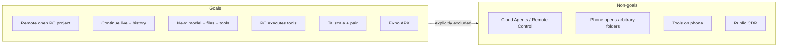
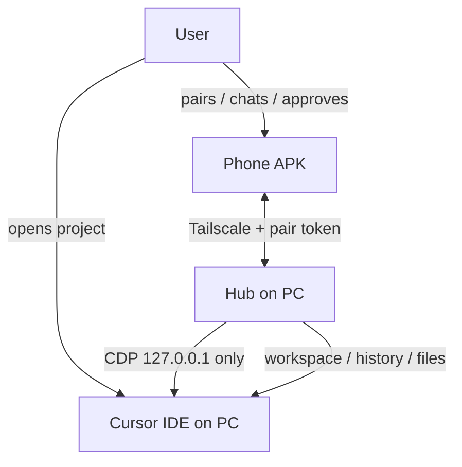
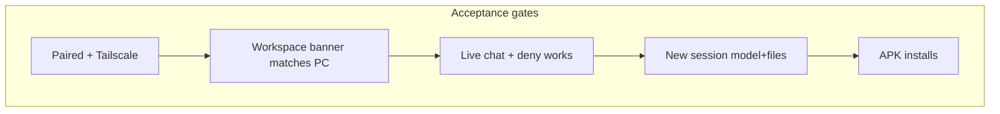
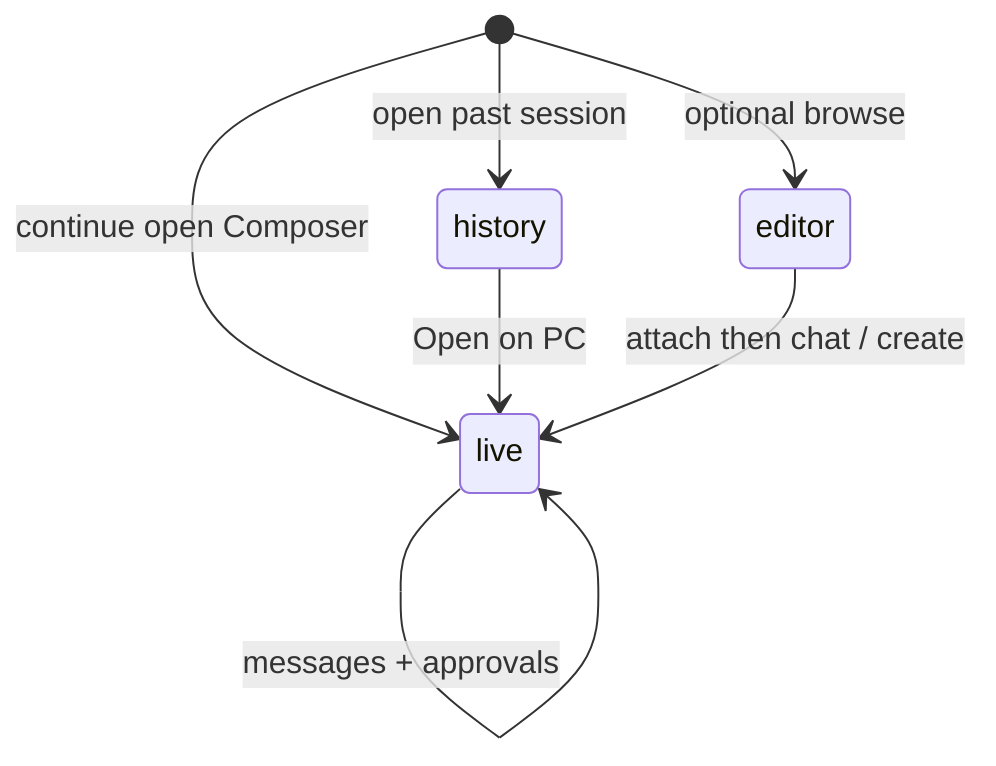
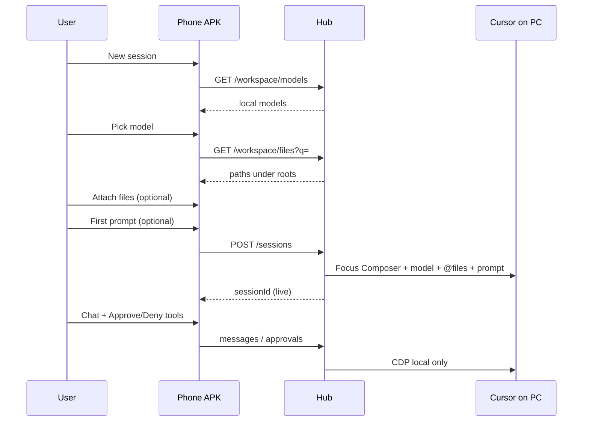
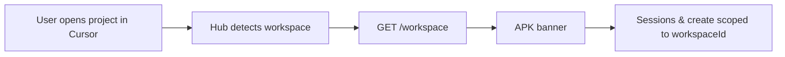

<!-- generated-by: gsd-doc-writer -->
# Functional Requirements — Cursor Mobile Companion

**Status:** accepted requirements (2026-09-24)  
**Scope lock:** PC-local only — **no** Cursor Cloud Agents / Remote Control  
**Related:** [AGENT-CONTEXT.md](./AGENT-CONTEXT.md) · [mobile-cursor-companion.md](./mobile-cursor-companion.md) · [remote-sessions.md](../features/remote-sessions.md)

## 1. Goals / non-goals

### Goals

| ID | Goal |
|----|------|
| G-1 | Let the phone remote the **Composer / agent loop** for the project **already open** in Cursor on the PC. |
| G-2 | **Continue** all existing sessions for that project: live (CDP) and local history. |
| G-3 | **Create** a new session on that project: choose model, attach files from workspace roots, chat, and approve/deny tools. |
| G-4 | Keep tools / plugins / MCP execution **on the PC** inside Cursor; phone is chat + approvals UI. |
| G-5 | Connect phone ↔ Hub over a private link (**Tailscale** + Hub device pairing); CDP remains **127.0.0.1** on the PC. |
| G-6 | Ship an installable **Android APK** via Expo EAS (`android.buildType: apk`). |

### Non-goals

| ID | Non-goal |
|----|----------|
| NG-1 | Cursor Cloud Agents, official Remote Control, or any cloud worker that runs the agent loop off this PC. |
| NG-2 | Using the phone as the primary place to clone, open, or switch arbitrary project folders (v1). |
| NG-3 | Running MCP servers, plugins, or tool runtimes on the phone. |
| NG-4 | Exposing Cursor CDP / DevTools ports beyond localhost on the PC. |
| NG-5 | Browsing or controlling sessions belonging to unrelated machines or workspaces. |



## 2. Actors

| Actor | Role |
|-------|------|
| **User** | Opens a project in Cursor on the PC; pairs the phone; continues or creates sessions; approves/denies tool calls. |
| **Phone APK** | Expo Android app: shows active workspace, lists sessions, chat UI, new-session sheet, approval cards. |
| **Hub** | Local PC daemon: binds to open workspace, exposes HTTP/WS API, drives LiveCursorAdapter + History Index, never publishes CDP. |
| **Cursor on PC** | IDE with project open; owns Composer/agent UI, models, MCP/tools/plugins, and local session store. |



## 3. Functional requirements

Priority: **P0** = v1 must-have · **P1** = next phase · **P2** = later / optional polish.

### FR group: Connectivity & pairing

| ID | Requirement | Priority |
|----|-------------|----------|
| FR-001 | Hub shall listen for phone clients only on the private network path (Tailscale / local LAN as configured); CDP shall bind to `127.0.0.1` on the PC and shall not be reachable from the phone. | P0 |
| FR-002 | Hub shall support device pairing (`POST /pair/...`) so a phone must complete pairing before session or workspace APIs succeed. | P0 |
| FR-003 | Phone shall show clear errors when Tailscale/link is down, Hub unreachable, or pairing missing/invalid. | P0 |
| FR-004 | Hub shall expose `GET /health` with enough status for the APK to show Hub up/down and CDP connectivity. | P0 |

### FR group: Workspace binding

| ID | Requirement | Priority |
|----|-------------|----------|
| FR-010 | Hub shall detect the workspace(s) currently open in Cursor on this PC and expose them via `GET /workspace` (name, path, roots, and related context). | P0 |
| FR-011 | Phone shall display an **active project banner** matching the Hub-reported workspace (name and path). | P0 |
| FR-012 | When Cursor has **no** folder open, Hub shall report empty/unavailable workspace and the phone shall show “Open a project in Cursor on the PC” — no fake empty workspace. | P0 |
| FR-013 | Phone session list and create flows shall be scoped to the bound `workspaceId`; creating a session against a different folder is rejected (v1). | P0 |
| FR-014 | When multiple Cursor windows/workspaces are open, the user shall be able to select which window/workspace the Hub/phone binds to. | P1 |

### FR group: Session listing & modes

| ID | Requirement | Priority |
|----|-------------|----------|
| FR-020 | Hub shall list sessions for the bound workspace via `GET /sessions?workspaceId=` combining **live** and **history** sources. | P0 (live) / P1 (full history) |
| FR-021 | Each listed session shall carry a mode: `live`, `history`, or (optional) `editor`. | P0 |
| FR-022 | Phone shall present sessions for **this project only** (not unrelated PC projects or cloud lists). | P0 |
| FR-023 | Phase 2 shall enumerate **all** local history sessions for the bound project (History Index filtered/grouped by workspace). | P1 |

### FR group: Continue live session

| ID | Requirement | Priority |
|----|-------------|----------|
| FR-030 | User shall open a `live` session on the phone and send/receive Composer messages via Hub (`POST /sessions/:id/messages`, `WS /ws`). | P0 |
| FR-031 | Live stream shall surface tool/plugin/MCP call cards; user shall **Approve** or **Deny** (`POST /sessions/:id/approvals`). Deny must take effect on the PC. | P0 |
| FR-032 | User shall attach additional project files to an existing live session (`POST /sessions/:id/attachments`) from workspace roots. | P0 |
| FR-033 | No silent auto-approval of tool calls from the phone path. | P0 |

### FR group: History session

| ID | Requirement | Priority |
|----|-------------|----------|
| FR-040 | User shall open a `history` session in read-only form on the phone (transcript / metadata for that project). | P1 |
| FR-041 | User shall invoke **Open on PC** (`POST /sessions/:id/open-on-pc`) to reopen that session in Cursor for the same project and transition to `live`. | P1 |

### FR group: New session

| ID | Requirement | Priority |
|----|-------------|----------|
| FR-050 | Phone shall offer a new-session flow that requires a model choice from `GET /workspace/models` (models Cursor exposes locally). | P0 |
| FR-051 | User shall attach zero or more files from open workspace roots via `GET /workspace/files` (search/list under roots). | P0 |
| FR-052 | User may supply an optional first prompt; Hub creates via `POST /sessions` with `{ workspaceId, model, attachments[], prompt?, agentMode? }`. | P0 |
| FR-053 | Hub shall open/focus Composer in the **already open** project, apply model and file refs, and send the optional first prompt. | P0 |
| FR-054 | Phone shall show tools/plugins summary from `GET /workspace/tools` as informational only; execution remains on the PC. | P0 |
| FR-055 | Richer multi-root @-mention picker and polished attach UX. | P2 |

### FR group: Tools, plugins, MCP

| ID | Requirement | Priority |
|----|-------------|----------|
| FR-060 | Tools, plugins, and MCP servers used by sessions shall run **inside Cursor on the PC**. | P0 |
| FR-061 | Phone shall not host MCP servers or execute tool runtimes. | P0 |
| FR-062 | Approval UI shall cover tool/plugin calls observed through the live adapter (CursorRemote-class behavior). | P0 |

### FR group: Optional editor mode

| ID | Requirement | Priority |
|----|-------------|----------|
| FR-070 | Optional `editor` mode: browse project files on the phone for attachment picking / light viewing. | P2 |
| FR-071 | Editor mode shall not replace opening the project on the PC and shall stay read/attach-oriented in v1 scope of this FR. | P2 |

### FR group: APK delivery

| ID | Requirement | Priority |
|----|-------------|----------|
| FR-080 | Android companion shall be an Expo app deliverable as a sideloadable APK via EAS with `android.buildType: apk` (not AAB-only). | P0 |
| FR-081 | APK shall implement pair, workspace banner, session list, live chat, approvals, and new-session sheet for P0 FRs. | P0 |

### FR group: Reliability

| ID | Requirement | Priority |
|----|-------------|----------|
| FR-090 | Phone and Hub shall support reconnect after transient Tailscale/Hub disconnect without requiring re-pairing unless credentials were revoked. | P1 |
| FR-091 | Offline queue / harden CDP selectors against Cursor UI churn. | P2 |

## 4. Acceptance criteria (by FR group)

### Connectivity & pairing (FR-001–004)

- Unpaired phone cannot call workspace/session APIs successfully.
- CDP is not exposed on Tailscale/LAN interfaces; only Hub API is.
- Health endpoint distinguishes Hub process up vs CDP attached.

### Workspace binding (FR-010–014)

- Banner path/name matches the folder open in Cursor on the PC.
- Empty Cursor workspace → blocking empty state on phone; no inventing a project.
- `POST /sessions` with mismatched `workspaceId` fails.

### Session listing & modes (FR-020–023)

- Live sessions for the bound project appear in Phase 1.
- History sessions for the bound project appear by Phase 2; no cloud session list.
- Each row shows mode `live` | `history` | `editor` (if enabled).

### Continue live (FR-030–033)

- Round-trip chat works for an open Composer session on the PC.
- Tool call card appears; Deny prevents the PC from continuing that approval path.
- Attachments from workspace roots appear as refs in the PC Composer context.

### History (FR-040–041)

- History entry is readable on phone; **Open on PC** focuses Cursor in the same project and yields a live session.

### New session (FR-050–055)

- Create sheet requires model; optional files + prompt.
- After create, phone is in live chat against the PC Composer session with chosen model and attachments applied.

### Tools / APK / reliability

- Tools summary is read-only on phone; runs happen on PC with approvals.
- EAS produces an installable `.apk`.
- No cloud credentials required for any P0 path.



## 5. Session modes

| Mode | Meaning | Phone capabilities |
|------|---------|-------------------|
| `live` | Open Composer/agent in Cursor for this workspace | Chat, change model if Cursor UI allows, attach more files, approve/deny tools |
| `history` | Past local session for this project (PC store / History Index) | Read transcript; **Open on PC** → becomes `live` |
| `editor` | Optional later — browse project files | Pick attachments / view; not primary project-open |



## 6. New-session flow requirements

Ordered UX and API contract (must stay aligned with Hub API in the architecture doc):



**Hard rules**

1. `workspaceId` must equal the Hub-bound open project.
2. Model list comes only from what Cursor exposes locally (`GET /workspace/models`).
3. Attachments are paths under workspace roots — not arbitrary phone filesystem paths outside the project index.
4. Tools/plugins/MCP are not started on the phone; after create, approvals follow the live path.
5. Suggested body:

```json
{
  "workspaceId": "...",
  "model": "composer-...|...",
  "attachments": ["src/a.ts", "docs/x.md"],
  "prompt": "optional first message",
  "agentMode": "agent|ask|..."
}
```

## 7. Workspace binding requirements

| Rule | Detail |
|------|--------|
| Source of truth | Cursor’s open folder(s) on this PC, detected by Hub (CDP / VS Code API). |
| Phone scope | All list/create/continue actions use that binding. |
| Empty state | No open folder → instruct user to open a project on the PC. |
| Multi-window | User selects target Cursor window/workspace (P1). |
| Security | Phone never gets raw CDP; only Hub API over paired Tailscale link. |



## 8. Out of scope

- Cursor Cloud Agents / official Remote Control / cloud session catalogs.
- Public or Tailscale-exposed CDP / DevTools ports.
- Phone-hosted MCP, plugin hosts, or tool execution.
- Opening or cloning projects solely from the phone without the folder already open on the PC (v1).
- Controlling other machines’ Cursor instances from this Hub instance.
- Replacing Cursor desktop as the place where the project is opened and tools are configured.

## Decision summary

**Phone = remote Composer for the project already open on the PC.** Continue live + local history for that project, or start new sessions with **model + file attach + PC-side tools** and phone approvals. Link via **Tailscale + pairing**; CDP stays localhost. Deliver **Expo EAS APK**. No cloud.
