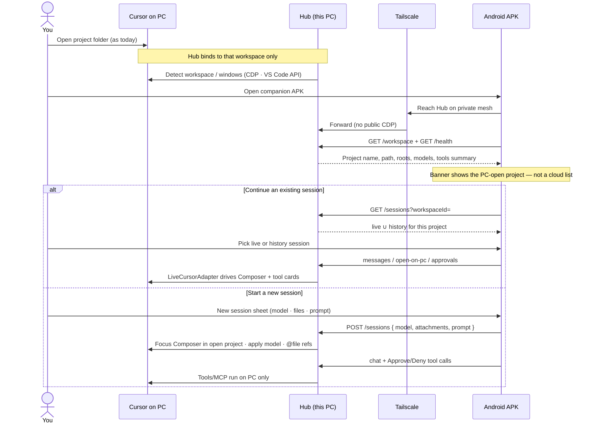
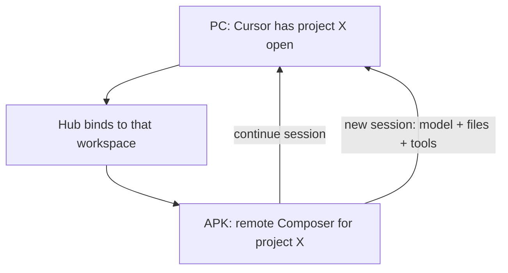
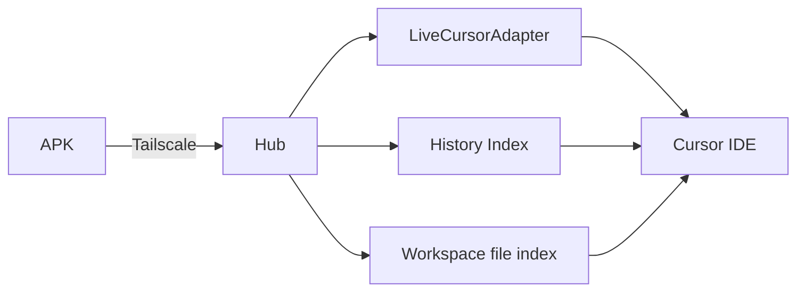
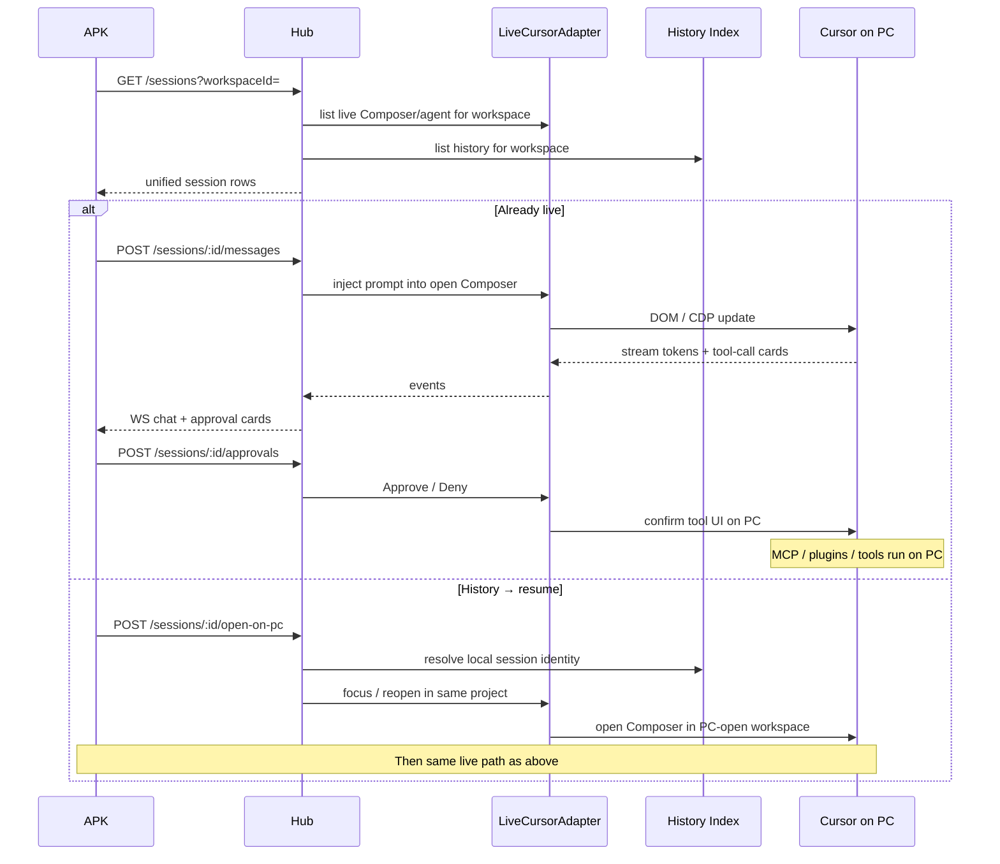
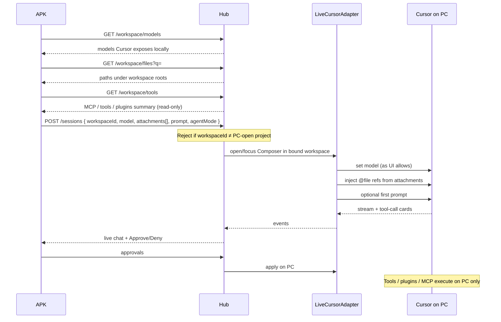
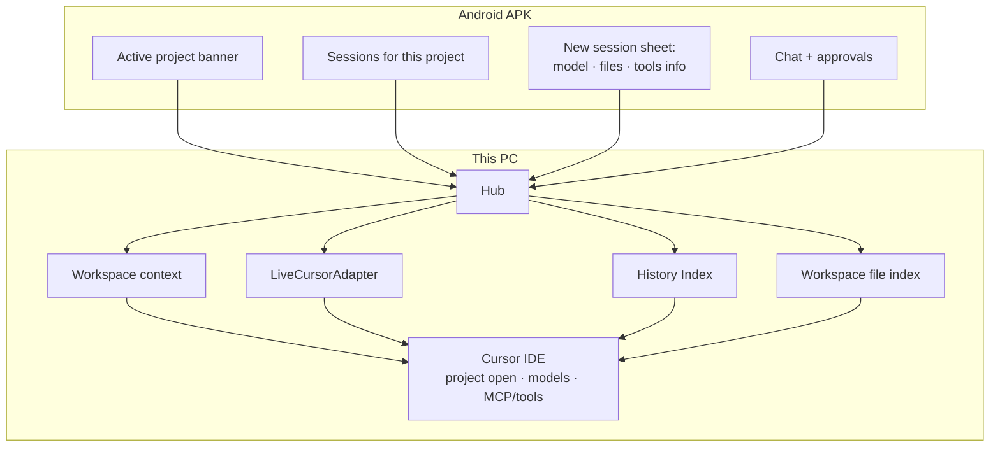
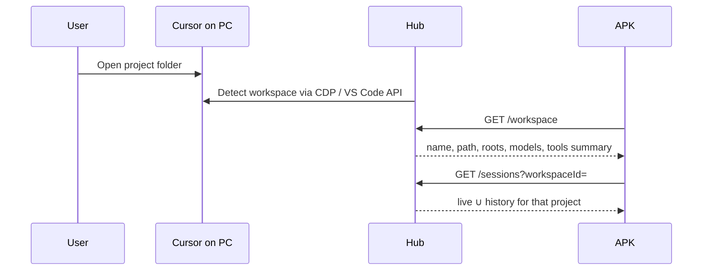
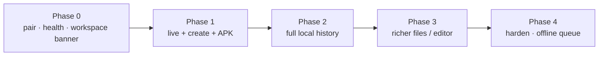

<!-- generated-by: gsd-doc-writer -->
# Architecture — Improved Cursor Mobile System

**Status:** accepted design (2026-09-24) · **Scope lock:** PC-local only — **no cloud mode**  
**Goal:** Phone works **inside the project already open on the PC** — continue existing sessions or start new ones with **model choice, file attach, tools & plugins** — all executed by Cursor on that PC.  
**Agent briefing (load first):** [AGENT-CONTEXT.md](./AGENT-CONTEXT.md) · **Rules:** [`../../AGENTS.md`](../../AGENTS.md)

---

## How we work (day in the life)

End-to-end path from a normal PC morning to phone-side Composer work. Nothing in this loop leaves the machine or Tailscale mesh.



### Step-by-step

1. **Open the project on the PC** — Same as today: open the folder in Cursor. The phone never clones or opens an unrelated tree in v1.
2. **Hub binds** — Local Hub attaches to that workspace (and Cursor windows). If no folder is open, the APK shows “Open a project in Cursor on the PC” and refuses a fake empty workspace.
3. **Phone sees the project** — Over Tailscale, `GET /workspace` paints the active project banner (name, path, roots). Session lists are filtered to that `workspaceId`.
4. **Continue or create**
   - **Continue:** pick a live Composer/agent session or a history row → chat, attach more files, approve tools; history uses **Open on PC** to become `live` in the same project.
   - **New session:** pick **model**, **attach files** from workspace roots, optional first prompt → Hub opens/focuses Composer in the already-open project and applies model + `@file` refs. **Tools / plugins / MCP** stay loaded in Cursor on the PC; the phone only streams cards and Approve / Deny.

The phone does **not** replace opening the project on the PC. It remotes the agent/Composer loop for the project that is already there.

---

## Product model (how the phone is used)



1. You open a **project in Cursor on the PC** (as you do today).
2. The Hub attaches to that workspace (and open windows).
3. On the phone you either:
   - **Continue** a session that already belongs to that project, or
   - **Create** a new session in that same project: pick **model**, **attach files** from the project, use **tools / plugins / MCP** that Cursor already has on the PC.

---

## Scope lock (non-negotiable)

| In scope | Out of scope |
|----------|--------------|
| Workspace / project **already open** on this PC | Cloud Agents / Remote Control / cloud workers |
| **All** local sessions for that project (and PC history) | Browsing unrelated machines’ projects |
| Continue live + history → open-on-PC | Phone as primary place to clone/open folders |
| New session: model + file attach + tools/plugins | Running tools on the phone itself |
| Approvals for tool runs on the PC | Exposing CDP publicly |
| Tailscale phone ↔ PC | |

---

## How we work — component responsibilities

| Component | Runs on | Responsibility |
|-----------|---------|----------------|
| **Android APK** (`apps/mobile`) | Phone | Sideloaded Expo app: project banner, session list, continue / new-session UI, chat, Approve/Deny cards. Never executes MCP/tools locally. |
| **Hub** (`packages/hub`) | PC | Local HTTP + WebSocket API bound to the PC-open workspace. Aggregates workspace context, sessions, file index, models, tools summary; orchestrates create / open-on-pc / messages / approvals. |
| **LiveCursorAdapter** (`adapters/` · live) | PC | CDP / DOM relay into Cursor Composer (CursorRemote-class): send prompts, set model when UI allows, inject file refs, stream tool-call cards, apply approvals. |
| **History Index** (`adapters/` · history) | PC | Indexes local Cursor session store for the open project (cursor-session-class). Powers history list and **Open on PC** → `live`. |
| **Tailscale** | Phone ↔ PC | Private mesh only. Phone reaches Hub; CDP stays off the public internet. |



---

## How we work — data and control flows

### Continue session (live or history → live)

Control stays on the phone; data and tool execution stay on the PC.



### New session (model + files + tools)

Phone chooses **model**, **attachments**, and first **prompt**; Hub and LiveCursorAdapter apply them inside the already-open project. Tools are never reimplemented on the phone.



---

## Needs → coverage

| Need | How we cover it |
|------|-----------------|
| Work on PC-open project | Hub reports `workspace` (path, name, roots); APK UI scoped to it |
| Continue existing sessions | Live CDP + History Index filtered/grouped by workspace |
| New session + **model** | Create flow → LiveCursorAdapter sets model in Composer (as Cursor UI allows) |
| **Attach files** | File picker from workspace roots (Hub lists paths); refs injected into Composer |
| **Tools & plugins** | Tools/MCP already loaded in Cursor on PC; phone sends prompts + **approves** tool calls |
| Create session | `POST /sessions` with `{ model, attachments[], mode }` |
| APK | Expo sideload APK |
| Reliability | Health, reconnect, no silent approvals |

---

## Target architecture



---

## Session modes (PC-only)

| Mode | Meaning | Phone can |
|------|---------|-----------|
| `live` | Open Composer/agent in Cursor for this workspace | Chat, model (if UI allows change), attach more files, approve tools |
| `history` | Past session for this project (or PC store) | Read; **Open on PC** in this project → `live` |
| `editor` | Optional later — browse project files | Pick attachments / view |

---

## New session contract (required)

```
POST /sessions
{
  "workspaceId": "...",          // must match PC-open project
  "model": "composer-..." | "...",
  "attachments": [ "src/a.ts", "docs/x.md" ],
  "prompt": "optional first message",
  "agentMode": "agent" | "ask" | "..."   // as Cursor exposes
}
```

Hub → opens/focuses Composer in the **already open** project → applies model + @file refs → optional first prompt.

**Tools / plugins:** not reimplemented on the phone. Cursor on the PC runs MCP/tools/plugins; the APK streams tool-call cards and **Approve / Deny** (CursorRemote-class).

---

## Workspace binding



If Cursor has **no** folder open: APK shows “Open a project in Cursor on the PC” — no fake empty workspace.

Multi-window: user picks which Cursor window/workspace (same as CursorRemote window switch).

---

## What we borrow

| Source | Use for |
|--------|---------|
| [CursorRemote](https://github.com/len5ky/CursorRemote) | Live chat, approvals, prompts, multi-window |
| [cursor-session](https://github.com/iksnae/cursor-session) | All past local sessions for the project |
| [Paseo](https://github.com/getpaseo/paseo) | Daemon + Expo APK shape |

---

## Hub API (core)

```
GET    /workspace              → active project(s) on PC
GET    /workspace/files?q=     → attach picker (paths under roots)
GET    /workspace/models       → models Cursor exposes locally
GET    /workspace/tools        → MCP/tools/plugins summary (read-only)
GET    /sessions?workspaceId=
POST   /sessions               → new: model + attachments + prompt
POST   /sessions/:id/open-on-pc
POST   /sessions/:id/messages
POST   /sessions/:id/attachments
POST   /sessions/:id/approvals
WS     /ws
GET    /health
POST   /pair/...
```

---

## Phased delivery (PC-only, no cloud)

Every phase stays on **this PC + Tailscale**. No Cloud Agents, no cloud session lists, no remote workers.

| Phase | Delivers | Still true |
|-------|----------|------------|
| **0** | Pair, Tailscale, health, **active workspace** banner | Bound to PC-open project only |
| **1** | Live continue + approve tools + create (model + basic attach) + APK | Tools execute on PC; phone approves |
| **2** | Full project session history + open-on-PC | Local History Index only — no cloud history |
| **3** | Richer file picker / @-mentions; optional editor tab | Attachments from workspace roots on PC |
| **4** | Harden CDP selectors, offline queue | Still no public CDP; still no cloud mode |



---

## Repo layout

Intended monorepo shape (packages land as implementation proceeds):

```
cursor_mobile/
├── apps/
│   └── mobile/          # Expo Android APK — UI, pairing, chat, approvals
├── packages/
│   └── hub/             # Local Hub API (HTTP/WS), workspace binding, orchestration
├── adapters/
│   ├── live/            # LiveCursorAdapter — CDP/Composer control (CursorRemote-class)
│   └── history/         # History Index — local session index (cursor-session-class)
├── docs/
│   ├── architecture/    # This document
│   ├── features/
│   └── reports/
└── research/
```

| Path | Owns |
|------|------|
| `apps/mobile` | APK surfaces only — never hosts tools or Cursor |
| `packages/hub` | Single control plane for phone ↔ PC; enforces workspace bind |
| `adapters/live` | Live control path into Cursor |
| `adapters/history` | Local project session discovery and open-on-PC |

---

## Explicit non-goals

- Cloud mode / cloud agents.
- Opening arbitrary projects from the phone without Cursor having them open on the PC (v1).
- Running MCP servers on the phone.

---

## Decision summary

**Phone = remote Composer for the project already open on the PC.** Continue all existing sessions for that work, or start new ones with **model + files + tools/plugins (on PC)** + approvals. No cloud.
