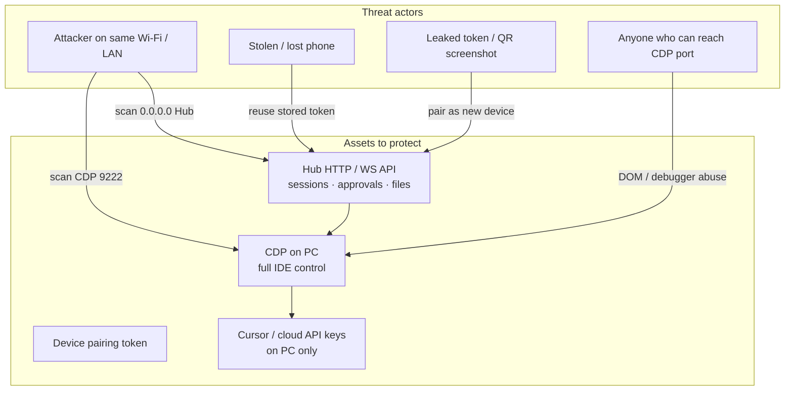
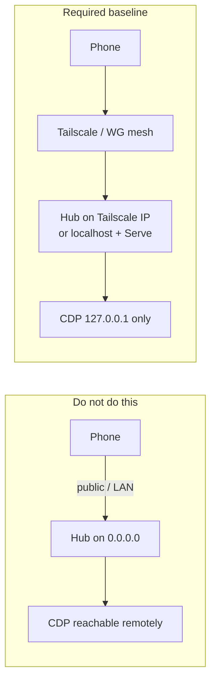
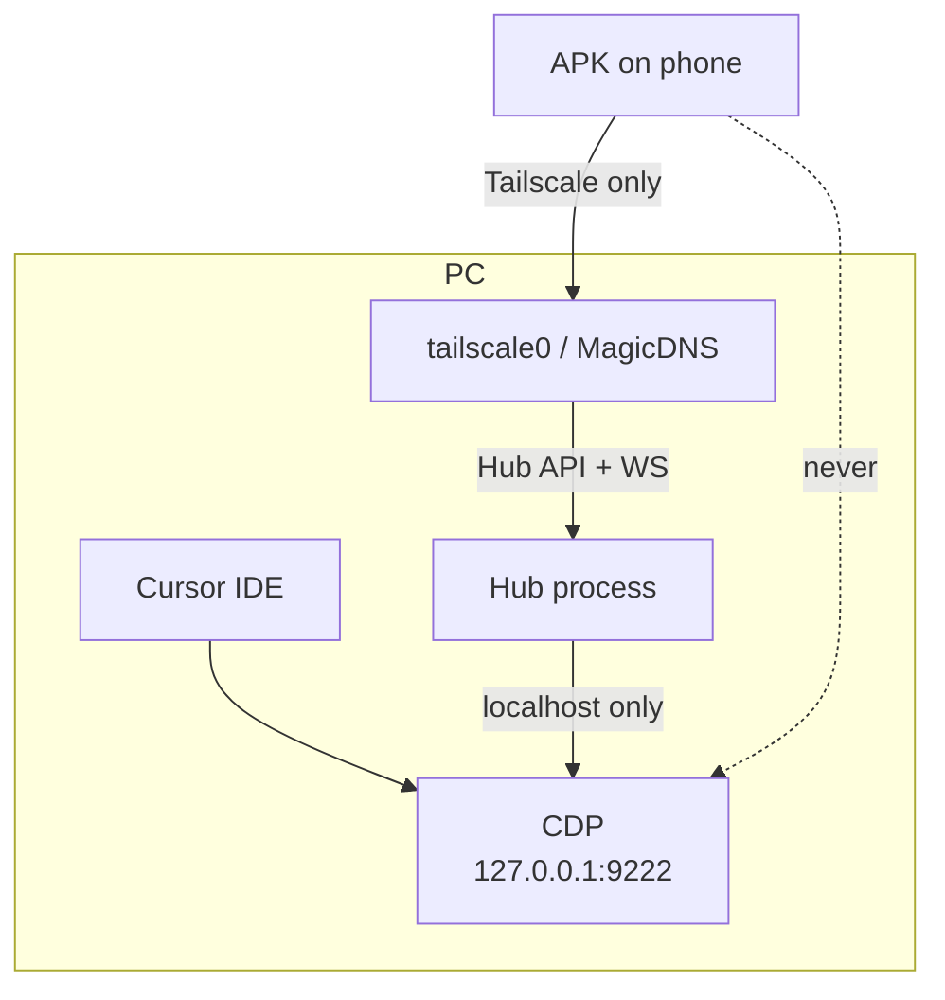
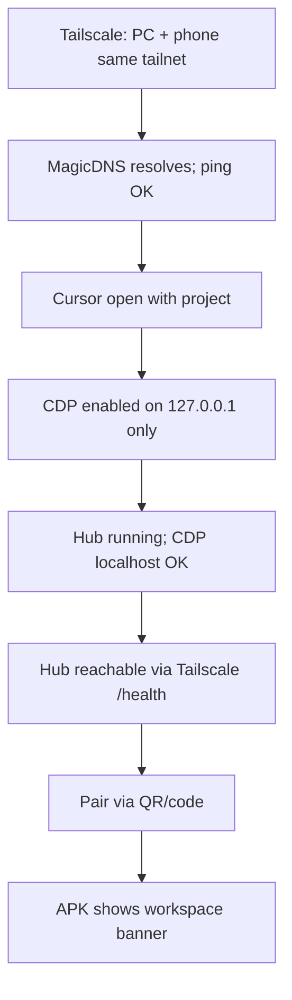
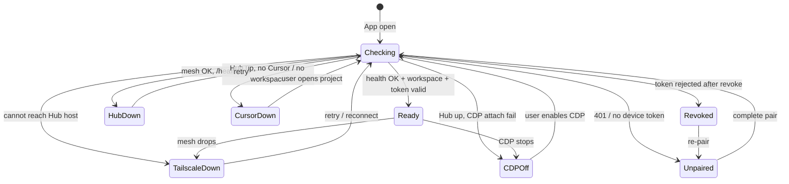

<!-- generated-by: gsd-doc-writer -->
# Architecture — Secure Phone ↔ PC Linking (Tailscale)

**Status:** accepted security design (2026-09-24) · [mobile-cursor-companion.md](./mobile-cursor-companion.md)  
**Scope lock:** PC-local companion only — **no cloud mode**, **no public Hub/CDP**

This document defines how the Android APK must reach the Hub on the PC without exposing Cursor, CDP, or Hub APIs to the LAN or the public internet.

## 1. Threat model



| Threat | Impact if unchecked | Primary control |
|--------|---------------------|-----------------|
| Attacker on LAN | Reads/controls Composer, approves tools, reads workspace files | Tailscale (or WireGuard mesh) only; Hub not on `0.0.0.0` |
| Stolen phone | Continues sessions as the paired device | Short-lived / rotatable device tokens; Hub revoke; OS screen lock |
| Leaked token / QR | Impersonates a paired phone | One-time pairing codes; rotate on use; revoke list |
| CDP exposure | Full browser/IDE remote debugging of Cursor | CDP bound to `127.0.0.1` only; never forwarded; never in APK config as a remote URL |

**Non-goals for this layer:** defending a compromised PC OS, or making the APK work without a private mesh. Public tunnels (ngrok-style) and binding Hub to `0.0.0.0` are out of scope for the secure baseline.

## 2. Why Tailscale (or WireGuard mesh) first



| Approach | Verdict |
|----------|---------|
| Hub / CDP on `0.0.0.0` or LAN IP | **Forbidden** — any device on the network can attack CDP and Hub |
| Cloudflare Tunnel / ngrok to Hub | Not the baseline — adds a public front door; only consider with extra auth and never for CDP |
| Same Wi‑Fi without mesh | Insufficient — café/hotel/guest Wi‑Fi is hostile |
| **Tailscale (or equivalent WireGuard mesh)** | **Required first hop** — phone and PC share a private overlay; MagicDNS hostname; optional ACLs |

The companion architecture already locks **Tailscale phone ↔ PC** and forbids **exposing CDP publicly** ([mobile-cursor-companion.md](./mobile-cursor-companion.md)). Connectivity is Phase 0 with pairing and health.

## 3. Tailscale setup (correct order)

Do this **before** installing or pairing the APK.

1. **Install Tailscale on the PC** and sign in to your account / SSO.
2. **Install Tailscale on the phone** and sign in to the **same tailnet**.
3. Confirm both devices appear in the Tailscale admin console as online.
4. Prefer **MagicDNS** hostnames (e.g. `dev-pc.tailnet-name.ts.net`) over raw IPs so the APK config stays stable.
5. Optionally tighten **ACLs** so only the phone identity (or a `tag:companion-phone`) can reach Hub ports on the PC; deny Hub ports from other tags by default.
6. **Verify reachability** from the phone (or from another machine on the tailnet):

```bash
# On phone (Termux / network tools) or from another tailnet node
ping <pc-magicdns-or-tailscale-ip>
# Then only after Hub is running:
curl -sS http://<pc-magicdns-or-tailscale-ip>:<hub-port>/health
```

7. Do **not** enable Tailscale Funnel / public exposure for Hub or CDP.

```mermaid
sequenceDiagram
  participant Admin
  participant PC as PC Tailscale
  participant Phone as Phone Tailscale
  participant Console as Tailnet admin

  Admin->>PC: Install + login
  Admin->>Phone: Install + login same account
  PC->>Console: Join tailnet
  Phone->>Console: Join tailnet
  Admin->>Console: MagicDNS on; optional ACL phone→Hub
  Phone->>PC: ping / MagicDNS resolve
  Note over Phone,PC: Only then configure APK Hub URL
```

WireGuard self-hosted mesh is acceptable if it provides the same properties: authenticated peer membership, no Hub/CDP on the public internet, and stable private addressing.

## 4. Hub and CDP bind rules



| Surface | Bind / reachability | Who may connect |
|---------|---------------------|-----------------|
| **CDP** (`--remote-debugging-port`) | **`127.0.0.1` only** | Hub on the same PC |
| **Hub API + `/ws`** | Tailscale IP / MagicDNS hostname (or loopback if using Tailscale Serve to that loopback) | Paired phone over the mesh |
| **Hub → CDP** | `http://127.0.0.1:<cdp-port>` | Hub only |

Rules:

- The APK talks to **Hub** (`GET /health`, `GET /workspace`, `POST /sessions`, `WS /ws`, `POST /pair/...`) — never directly to CDP.
- Hub is the only process allowed to open CDP.
- Do not port-forward CDP through Tailscale Serve, SSH `-L` to other hosts, or Docker `0.0.0.0` publishes.
- If Hub listens on a Tailscale interface address, still keep CDP on loopback.

## 5. Device pairing (QR / code), tokens, revoke

Pairing is Phase 0 (`POST /pair/...` in the companion Hub API). Tokens prove “this phone was approved at the PC,” not “anyone on the tailnet.”

```mermaid
sequenceDiagram
  participant User
  participant Hub
  participant App as APK

  User->>Hub: Start pair (shows QR / short code)
  Hub-->>Hub: Create one-time code + pending device id
  User->>App: Scan QR or enter code
  App->>Hub: POST /pair/... over Tailscale
  Hub-->>App: Device token (store in OS secure storage)
  Note over Hub: Code expires; cannot be reused
  App->>Hub: API calls with Authorization: Bearer <device-token>
  User->>Hub: Revoke device → token rejected
```

| Control | Requirement |
|---------|-------------|
| Pairing channel | Only over Tailscale to Hub (same as normal API) |
| Code / QR | Short-lived (minutes), single-use |
| Device token | Issued by Hub; stored in Android Keystore / EncryptedSharedPreferences — not in source, not in logs |
| Lifetime | Short-lived **or** long-lived but **rotatable**; Hub must support rotation without reinstall |
| Revoke | Hub UI/CLI lists paired devices; revoke invalidates token immediately; APK shows “re-pair required” |
| Stolen phone | Revoke that device on the PC; optionally rotate all tokens |

Tailscale membership is necessary but **not** sufficient: a compromised guest on your tailnet must still fail Hub auth without a valid device token.

## 6. What never goes in the APK

| Never ship in the APK / repo client config | Why |
|-------------------------------------------|-----|
| Cursor API keys, cloud agent keys, CLI auth tokens | Belong on the PC / Cursor login; phone must not hold them |
| CDP URL or port as a remote endpoint | CDP is localhost-only; phone must not know or dial it |
| Hub bind address `0.0.0.0` defaults “for convenience” | Encourages LAN exposure |
| Hard-coded pairing secrets shared across installs | One leak owns every user |
| Production device tokens in git, CI logs, or crash reports | Treat as credentials |

Allowed on the phone: Tailscale connectivity, Hub **MagicDNS URL**, user-entered / QR pairing material (ephemeral), and the **device token** Hub issues after pair (in secure storage only).

## 7. Operational checklist — before first connect

Use this every time you set up a new PC or phone.



- [ ] Tailscale installed and logged in on **PC** and **phone** (same tailnet).
- [ ] MagicDNS (or stable Tailscale IP) recorded for the Hub base URL.
- [ ] Optional ACL: only companion phone tag → Hub port.
- [ ] `ping` (or equivalent) from phone to PC succeeds.
- [ ] Cursor is running with the intended **project open**.
- [ ] CDP listening on **`127.0.0.1` only** (confirm with local tooling; not reachable from another host).
- [ ] Hub started; Hub can attach to CDP on localhost.
- [ ] `GET /health` succeeds from the phone over Tailscale (not via LAN IP).
- [ ] Pairing completed; device appears in Hub’s paired-device list.
- [ ] APK shows **active workspace** banner matching the PC project.
- [ ] Confirmed: no Funnel / no public URL / no CDP in APK settings.

## 8. Failure modes — user-visible states

Aligns with clear errors for Tailscale down, Cursor down, and CDP off ([remote-sessions.md](../features/remote-sessions.md)).



| Condition | Detection | User-visible state (APK) |
|-----------|-----------|---------------------------|
| Tailscale down / wrong tailnet | DNS/TCP to Hub MagicDNS fails | “Private network offline — open Tailscale and join the same network as your PC” |
| Hub process down | Mesh OK; `/health` fails | “Companion Hub is not running on the PC” |
| Cursor down / quit | Hub up; workspace/CDP attach fails | “Open Cursor on the PC” |
| No project open | Hub up; `GET /workspace` empty | “Open a project in Cursor on the PC” (no fake workspace) |
| CDP off or not on localhost | Hub cannot attach to CDP | “Enable remote debugging on this PC (localhost only)” |
| Unpaired / bad token | `401` on API | “Pair this phone” → QR/code flow |
| Revoked device | Hub rejects token after revoke | “Access revoked on PC — pair again” |
| Ready | `/health` + workspace + auth OK | Active project banner + sessions |

Never fail **silently** on approvals or reconnect: if the mesh or CDP drops mid-session, surface the state above and queue or block tool approvals until `Ready` again ([mobile-cursor-companion.md](./mobile-cursor-companion.md) reliability needs).

## Decision summary

| Decision | Choice |
|----------|--------|
| First hop | Tailscale (or WireGuard mesh) — not public / not raw LAN |
| CDP | `127.0.0.1` only; Hub-mediated |
| Hub API | Reachable via Tailscale IP / MagicDNS + device token |
| Auth | Pair (QR/code) → rotatable/revocable device token |
| APK secrets | No Cursor keys; no remote CDP |
| UX | Explicit states for Tailscale / Hub / Cursor / CDP / pair failures |

**Phone = remote Composer for the PC-open project, over a private mesh, with Hub as the only remote API and CDP never leaving localhost.**
