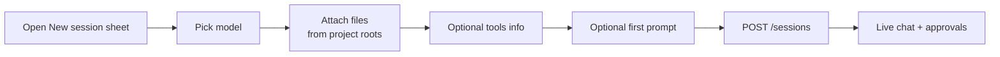
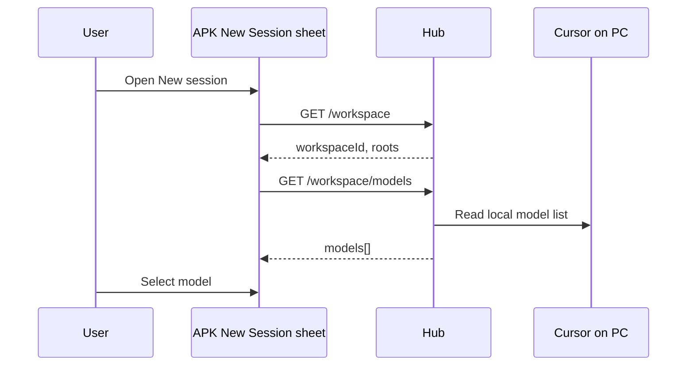
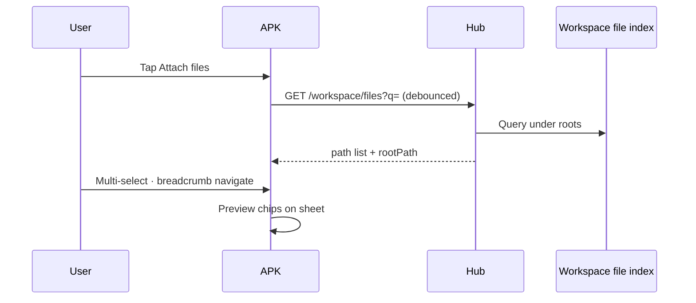
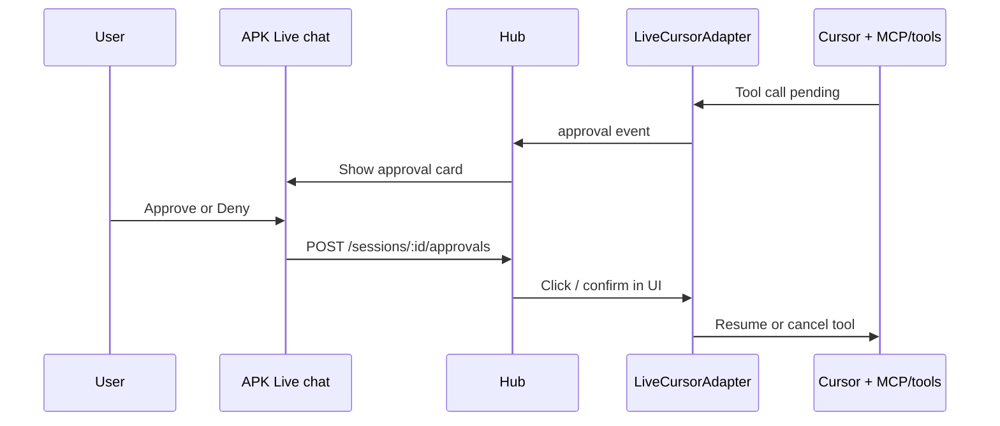
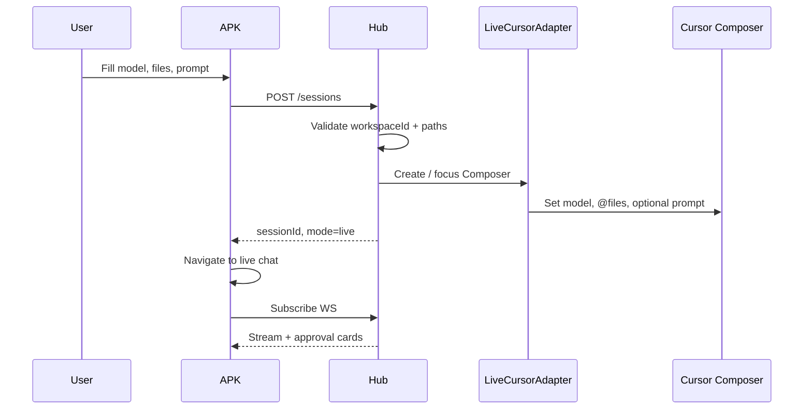

<!-- generated-by: gsd-doc-writer -->
# Feature — New Session Composer (Phone)

## Overview

**New Session** on the phone creates a Composer/agent session **inside the project already open in Cursor on the PC**. The user picks a **model** (from what Cursor exposes locally), **attaches files** under the workspace roots, optionally sends a **first prompt**, and then works in live chat with **tool / plugin / MCP approvals** — all executed on the PC. No cloud workers, no phone-side tool runtime.

Related: [remote-sessions.md](./remote-sessions.md) · [phone-apk-screens.md](./phone-apk-screens.md) · [architecture](../architecture/mobile-cursor-companion.md)

## Scope lock

| In scope | Out of scope |
|----------|--------------|
| Create against **PC-open** `workspaceId` only | Creating sessions for arbitrary folders |
| Model list from local Cursor | Cloud model catalog / cloud billing UI |
| Attach paths under workspace roots | Uploading phone camera roll as workspace files (v1) |
| Tools/plugins/MCP info + Approve/Deny on PC | Running MCP servers on the phone |
| Optional first prompt at create time | Multi-agent fan-out to remote machines |

## User flow (high level)



## Controls and data sources

| Control | Source | Notes |
|---------|--------|-------|
| Model picker | `GET /workspace/models` | Only models Cursor exposes locally on this PC |
| File attach | `GET /workspace/files?q=` | Paths under open workspace roots; multi-select → `attachments[]` |
| Tools / plugins / MCP | `GET /workspace/tools` | Read-only summary; runs happen on PC |
| Agent mode | As Cursor exposes (`agent` / `ask` / …) | Sent as `agentMode` when available |
| First prompt | Composer text field | Optional; empty create still opens Composer |
| Create | `POST /sessions` | Must include matching `workspaceId` |
| Approvals | Live stream via LiveCursorAdapter + `POST /sessions/:id/approvals` | Approve / Deny cards |

## Create contract

```
POST /sessions
{
  "workspaceId": "...",          // must match PC-open project
  "model": "composer-..." | "...",
  "attachments": [ "src/a.ts", "docs/x.md" ],
  "prompt": "optional first message",
  "agentMode": "agent" | "ask" | "..."   // as Cursor exposes
}
```

Hub behavior:

1. Verify `workspaceId` matches the active PC workspace (reject otherwise).
2. Focus Cursor window / Composer for that project.
3. Apply selected model (as far as Cursor UI allows).
4. Inject `@file` / attachment refs for each path under roots.
5. Optionally send the first prompt.
6. Return session id in `live` mode; APK navigates to live chat.

## Model picker (from PC Cursor)

- List is **not** a hardcoded phone catalog — it mirrors `GET /workspace/models`.
- If the list is empty or stale, show “No models available from Cursor on PC” and disable Create until refresh succeeds.
- Changing model after create (if supported) is a live-session concern, not the create sheet.



## Attach files from workspace roots

- Picker searches/lists via `GET /workspace/files?q=` (**Phase 3:** debounced `q=`, ~300ms).
- Multi-root chips when Hub reports multiple `roots`; optional `root=` filter (root **name**, absolute root path, or nested relative under primary).
- Hub binds multiple roots via `CURSOR_WORKSPACE` + `CURSOR_WORKSPACE_ROOTS` and/or a `.code-workspace` file.
- Path breadcrumbs for directory browse; root label on rows when multi-root.
- Only paths under Hub-reported roots are selectable; sibling-root selections use `rootName:relative/path` for Hub validation.
- Selected paths become `attachments[]` on create (and can be added later via `POST /sessions/:id/attachments`).
- Hub registers validated paths; Composer DOM `@`-inject stays **fail-closed** until `file_attach` selector is VERIFIED (`domApplied: false`).
- Display short path relative to root; show root label when multi-root.



## Optional Editor (Phase 3 · FR-070)

- Home **Editor** tab → browse screen: list via `GET /workspace/files`, read-only text via `GET /workspace/file?path=`.
- Not a code-server / full IDE; FR-071 — project open remains on the PC.
- Optional WebView/code-server is out of scope unless added later; list+preview is the shipped optional path.

## Tools / plugins / MCP info + approval UX

**Before create (info only):**

- Sheet shows a compact summary from `GET /workspace/tools` (names / counts / enabled MCP servers as Hub can detect).
- Copy clarifies: tools run **on the PC inside Cursor**; the phone only approves.

**After create (approvals):**

- Tool calls appear as structured cards in live chat (CursorRemote-class adapter).
- User taps **Approve** or **Deny** → `POST /sessions/:id/approvals`.
- No silent auto-approve in v1.



## First prompt

- Optional multiline field on the sheet.
- If present: Hub sends it after model + attachments are applied.
- If absent: session opens live with empty input; user types on the chat screen.
- Do not invent a second “system prompt” channel beyond what Cursor Composer supports.

## End-to-end create sequence



## Edge cases

| Case | Expected behavior |
|------|-------------------|
| **No project open** on PC | New session CTA disabled or sheet blocked; message: open a project in Cursor on the PC. No create call. |
| **Model unavailable** | Selected model missing after refresh / create fails → toast + force re-pick from current `GET /workspace/models`. Do not fall back to a cloud model. |
| **File outside roots** | Reject at picker and again at Hub validation; error lists illegal paths. Never rewrite to absolute phone paths. |
| **workspaceId mismatch** | `POST /sessions` returns error; APK refreshes `/workspace` and aborts create. |
| **CDP / Cursor UI down** | Create fails with actionable health error; pair/health screens remain reachable. |
| **Empty attachments + empty prompt** | Allowed: opens live Composer with chosen model only. |
| **Tools summary empty** | Still allow create; show “No tool summary from PC” — approvals still appear if tools fire later. |
| **Multi-window** | User must have selected the correct Cursor window/workspace before create; create binds to that selection. |

## Success criteria

- Create always targets the **PC-open** workspace only.
- Chosen model and file refs are applied in Cursor on the PC.
- First prompt (when set) appears as the opening user message in live chat.
- Tool/plugin runs surface as approval cards; deny works.
- Edge cases above produce clear UI errors — no cloud fallback.

## Delivery

| Capability | Phase |
|------------|-------|
| Model + basic attach + first prompt | 1 |
| Structured tools summary on sheet | 1 |
| Richer @-file / multi-root picker (debounce · breadcrumbs) | 3 |
| Optional Editor browse/preview | 3 |
| Harden CDP selectors for model/attach | 4 |

## Implementation notes

- Live create / approvals: [CursorRemote](https://github.com/len5ky/CursorRemote)-class adapter
- Hub endpoints: `/workspace`, `/workspace/models`, `/workspace/files`, `/workspace/tools`, `POST /sessions`
- APK UI: New session sheet — see [phone-apk-screens.md](./phone-apk-screens.md)
