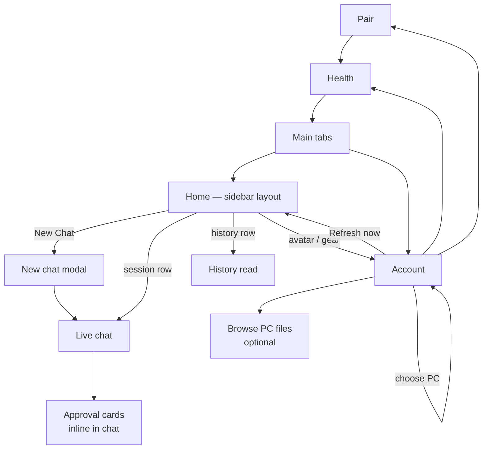
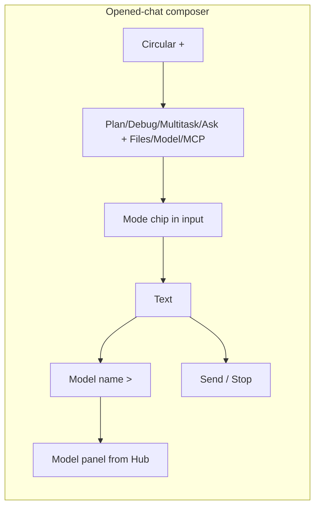
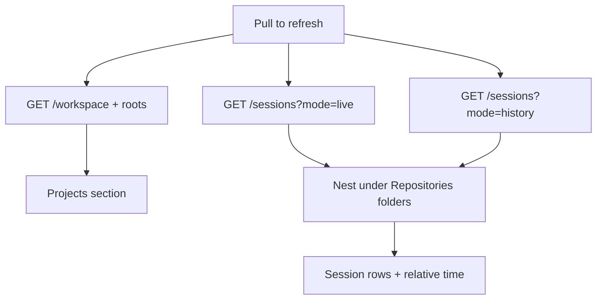

<!-- generated-by: gsd-doc-writer -->
# Feature — Phone APK Screens

## Overview

Screen-by-screen specification for the **Android APK** companion. The app remotes Composer for the **project already open in Cursor on the PC** over Tailscale → local Hub. PC-only — **no cloud mode**, no cloud session browser.

**UX north star (2026-10-01, amended):** First screen mirrors **Cursor agent sidebar** — light calm grayscale, **New Chat** + **Search**, **Projects** (PC-bound roots) + **Repositories** (nested sessions with relative timestamps), profile + settings footer. Full-width phone (not a slim desktop rail). Bottom tabs **Chats | Account** only. Approvals stay in chat, not a third tab. **Account** mirrors Cursor **Settings** cards: connect phone ↔ PC Hub, choose one computer, **Refresh now** for sessions.

Related: [remote-sessions.md](./remote-sessions.md) · [new-session-composer.md](./new-session-composer.md) · [architecture](../architecture/mobile-cursor-companion.md)

**Amendment F (2026-10-01):** away-from-PC comfort — see UI-SPEC § Amendment F and [comfort gap audit](../reports/mobile-ux-comfort-gap-audit-2026-10-01.md).

**UI design contract (plan locked 2026-10-01):** [`.planning/phases/05-mobile-ux-contract/05-UI-SPEC.md`](../../.planning/phases/05-mobile-ux-contract/05-UI-SPEC.md) — all screens + Pair QR + Settings PC/Refresh + sync parity + build best practices. Prefer that file for visual/IA locks; keep this feature doc for screen behavior.

## Implemented vs planned (shell)

| Surface | Status |
|---------|--------|
| Pair, Health, Main (Chats \| Account), Account, Live chat, New chat, History read, Editor browse | **Implemented** in `apps/mobile` |
| Pair — PC shows QR + phone **camera Scan QR** | **Designed** — Hub `qrPayload` + deeplink/manual **Implemented**; camera scanner + PC QR page **Planned** |
| Home / Chats — Cursor sidebar layout (New Chat, Search, Projects, Repositories tree, profile footer) | **Designed** in UI-SPEC — current shell is flat Gemini list + FAB; rebuild on implement |
| Live chat — Cursor chat chrome (gray bubbles, agent identity, circular `+` sheet, mode chip, Working/Queued, Model panel) | **Designed** in UI-SPEC — shell implemented; chrome rebuild on implement |
| Account — Cursor Settings cards (Connection, Computer picker, Refresh now, Advanced) | **Designed** in UI-SPEC — current Account is simpler list; rebuild on implement |
| Connectivity + session parity (Home = PC Composer chats for bound project) | **Partial** — Home focus/WS refresh + sync hint **in code**; Settings Refresh now + bit-exact DOM parity **Planned/gap** |
| Mid-chat agent mode switch; Hub-backed @ / slash menus; mic / camera; Stop; Plan live | **Designed** |
| Model list from Hub (`GET /workspace/models` / `model_select` VERIFIED scrape) | **Implemented** data path — Cursor-like panel chrome **Designed** |
| Dark OLED alternate (ui-ux-pro-max) | **Deferred** — light calm locked by sidebar reference |
| Getting Started / Connect Slack footers | **Non-goal** (explicitly excluded) |
| **Away-from-PC comfort (UI-SPEC Amendment F)** — local notifications (no FCM), per-chat status + Chats badge, approval card v2 with Deny undo, Changes card + read-only Diff screen, app lock, drafts/send retry | **Planned** — depends on Hub wave 1 (transcript stream, real approval detection, session status, Stop: **Gap/Designed**) |
| Intentional motion (pair success, repo expand, selected row, approval appear, send, reconnect, `+` sheet) | **Planned** in UI-SPEC |

## Navigation map

## 1. Pair

**Purpose:** One-time (or re-pair) trust between the phone and **one PC Hub**. A phone can pair with several PCs; each PC is paired once and the active one is chosen in **Account → Computer**.

**Primary path (correct connect):**

1. On the **PC**: open `http://127.0.0.1:8787/pair` (loopback-only Hub page) → QR for **that PC** (`qrPayload` = `cursor-companion://pair?host=&port=&code=&pairId=&name=&hub=` with the Tailscale host, the PC's display name and its stable `hubId`).
2. On the **phone**: **Scan QR** → `pair/complete` over Tailscale → device token → Health. The phone shows "Pairing with `<PC name>`…" while it waits.

**Multi-PC rules (2026-10-21):**

- The QR host is used as-is. A QR that points at `127.0.0.1` (the PC found no Tailscale address) is an **error on the phone**, never silently replaced with the previously paired PC — that substitution is how a code from PC A used to reach PC B's Hub and fail with `PAIR_CODE_INVALID`.
- `PAIR_CODE_INVALID` now says why (`details.reason`): `unknown_pair` (Hub restarted after the QR was shown, or the QR belongs to another PC), `code_mismatch`, `unknown_code` (manual typo / wrong PC address). The phone shows the Hub's sentence, which names the PC that answered.
- **Saved computers** card on Pair: a phone sent to Pair by a 401 from one PC can tap another saved PC and go straight to Chats (after an authenticated reachability probe).
- Manual entry asks for the **PC address shown on that PC's pair page** (never prefilled with the old PC); saved PCs are one-tap chips. The PC pair page prints the address + code in a "Type it on the phone instead" block.
- Wrong codes are throttled per caller address (`429 RATE_LIMITED`, bucket `pair`, `Retry-After`).

**Shows (phone):** Back (when opened from Account), 3-step card, **Scan QR**, Saved computers, Tailscale steps (collapsed), **Enter code manually** (collapsed).

**Shows (PC operator):** PC name, QR, countdown, manual address + code, status (waiting / paired / expired / **Hub restarted — new code** / Hub not responding), warning when no Tailscale address was found.

**Does not show:** Cloud login, Cursor account OAuth, remote worker regions, CDP URL.

**Empty / error:** Camera denied → Enter code; expired / used QR → New code on PC; Hub unreachable / Tailscale down → actionable error, stay on Pair.

**Status:** QR scan, PC pair page, multi-PC Saved computers, reason-specific errors **Implemented** (2026-10-21).

## 2. Health

**Purpose:** Prove the phone can reach Hub and Cursor automation is alive before chatting. Advanced / debug detail — also reachable from **Account**.

**Shows:** Hub / CDP / adapter / Cursor / workspace rows, Tailscale guide when needed, **Continue to Chats** → Main tabs.

## 3. Main tabs (Chats | Account)

**Purpose:** Primary shell. Two tabs only. **Chats tab = Home** (sidebar-inspired full-width list).

| Tab | Job |
|-----|-----|
| **Chats** | Home: Projects → Repositories → nested sessions for PC-bound workspace(s) |
| **Account** | Hub identity, connection, Health, re-pair, optional file browse, pending-approval hint |

**IA:** Home profile row (avatar + name + gear) opens the same Account screen as the Account tab — Cursor-familiar footer + thumb-reachable tab. No Approvals tab. No hamburger-heavy chrome.

## 4. Home (Chats) — Cursor sidebar pattern

**Purpose:** Full-width phone adaptation of Cursor’s agent sidebar — navigate PC-bound projects and continue/create sessions. Not a cloud project browser; not a developer dashboard.

**Shows:**

- Top: **New Chat** action row (opens New chat modal in the PC-open project).
- **Search** field — local filter of nested session titles (`Search chats`).
- Quiet **ConnectionChip** (Online / Degraded / Offline / Pair).
- **Projects** section — read-only list of Hub-bound workspace roots (`GET /workspace` / `.roots`).
- **Repositories** section — expandable folder/workspace groups with **indented** session rows; each row: title + relative timestamp (`10m`, `7d`); selected row = subtle rounded gray highlight.
- Bottom of list: **profile footer** — avatar, display name, settings gear → Account.

**Label mapping:**

| Cursor label | Companion meaning |
|--------------|-------------------|
| Projects | PC-bound workspace roots only |
| Repositories | Workspace groups → nested live + history sessions |
| New Chat | New session in PC-open project |
| + New Project | **Hidden** v1 (or disabled “Open on PC” messaging) — no phone-side arbitrary folder create |

**Does not show:** Getting Started progress card, Connect Slack, Cloud Agents, phone-created projects/folders, FAB (replaced by top New Chat), dense Live/History/Editor mode tabs as primary chrome.

**Data:** `GET /workspace` (+ roots) + `GET /sessions` (live + history nested under workspace groups).

## 5. Live chat (Opened chat) — Cursor chat pattern

**Purpose:** Continue a `live` Composer session on the PC — phone UI mirrors Cursor chat chrome; tools/MCP execute on PC only.

**Shows:**

- Top: **Back → Home** (sidebar affordance maps to chats list), optional search, header **+** → New Chat, session title.
- Transcript: wide light-gray user bubbles; agent timing + blue skill/identity; status badges; monospace path pills; inline **ApprovalCard**.
- Above composer: optional **Queued** strip; **Working N** pill while PC agents run.
- Composer: circular bordered **+** (left) → sheet (Plan / Debug / Multitask / Ask / Files / Model / MCP); dismissible **mode chip** in input; **Model {name} >** pill → searchable Hub model panel; mic (**Designed**); Send morphs to **Stop** (**Designed** until Hub stop).
- Optional thin footer: workspace / PC Hub connection (not cloud “This Computer” invent).

**`+` menu → Hub capability:**

| Item | Status |
|------|--------|
| Files / attach | **Implemented** — workspace roots + `POST .../attachments` |
| Model panel | **Implemented** list via `GET /workspace/models` (`model_select` VERIFIED scrape or `CURSOR_MODELS`); empty fail-closed |
| Ask / Debug / Multitask on **create** | **Implemented** — `agentMode` on `POST /sessions` |
| Plan; live mid-chat mode switch; MCP run; Stop | **Designed** — MCP row may open read-only `GET /workspace/tools`; never phone-side MCP |
| Mic / camera / @ menu / slash menu | **partial** or **Designed** |

**Interaction (short):** Tap `+` → pick mode → colored chip + placeholder → Send runs on PC → Working strip → further Send may show Queued → approvals inline. Phone selects; PC executes.

**Does not show:** Cloud Agents UI, public CDP, phone MCP runtime, second desktop sidebar over the thread.

## 6. Approvals

**Purpose:** Explicit Approve / Deny for tool/MCP calls on the PC — cards in Live chat; Account may show a pending count. Not a primary tab.

## 7. New chat (modal)

**Purpose:** Create a new Composer session in the **same PC-open project**. See [new-session-composer.md](./new-session-composer.md).

**Shows:** Bound project name, model list, agent mode chips, attachments, optional first prompt, **Create**.

## 8. Account / Settings

**Purpose:** Cursor **Settings–format** surface for **connecting the phone to Cursor on a PC** — without crowding Chats.

**Layout:** Single scroll (phone). Large **Settings** title + rounded cards (like Cursor General). No desktop settings sidebar; no Cursor billing / cloud agent rows.

**Shows:**

1. **Connection** — status (Online/Degraded/Offline/Pair); short “how it works” (Phone ↔ Tailscale ↔ Hub on PC ↔ Cursor; CDP stays on PC).
2. **Computer** — list of **saved PCs** (name from the Hub = hostname by default, address, live reachability: Online / Unreachable / Needs re-pair), tap to switch (only after that PC answers an authenticated call), **×** to forget a non-active PC, **Add another PC** → Pair. One active PC at a time; same PC matched by `hubId` when its Tailscale address changes. Bound project path from that Hub.
3. **Sync** — **Refresh now** immediately reloads `/health` + `/workspace` + `/sessions` so Home chats/projects match that computer; shows last synced time.
4. **Advanced** — Health details, Browse PC files, Re-pair / Clear pairing, optional pending-approvals note.

**Non-goals:** Cloud sync, public CDP, editing Cursor desktop General toggles from the phone.

### 8a. App update (Account → Update, modal)

Account shows **Update ready · x.y.z** when the PC Hub offers a newer build; the Update modal lists
the checks it passed and what's new, then downloads over Tailscale, verifies size + md5 and opens
Android's installer. Spec: [release-gate-and-self-update.md](release-gate-and-self-update.md).

## 9. Editor (optional) — Phase 3 · FR-070

Browse/preview of the **PC-open** workspace — reachable from Account (and New chat). Not a phone IDE.

## Screen → API cheat sheet

| Screen | Primary APIs |
|--------|----------------|
| Pair | `POST /pair/...` |
| Health | `GET /health`, `GET /workspace` |
| Chats home / Home | `GET /workspace`, `GET /sessions` |
| Live chat | `WS /ws`, `POST .../messages`, `POST .../attachments`, `POST .../approvals`, `GET /workspace/models` (panel) |
| New chat | `GET /workspace/models`, `/files`, `/tools`, `POST /sessions` |
| Account / Settings | Active Hub select (saved peers); **Refresh now** → `GET /health` + `/workspace` + `/sessions`; Health / Re-pair / Browse nav |
| Editor | `GET /workspace/files`, `GET /workspace/file?path=` |
| History → live | `POST /sessions/:id/open-on-pc` |

## Success criteria

- Home feels like Cursor’s sidebar on a phone: New Chat, Search, Projects, nested Repositories, profile footer — calm grayscale, large taps.
- Opened chat feels like Cursor chat: circular `+`, mode chip, Model panel from Hub, Working/Queued — phone selects, PC executes.
- Account feels like Cursor Settings cards: pick **one PC**, see how connect works, **Refresh now** pulls sessions immediately.
- PC project binding is obvious via Projects / folder groups — without a banner wall or phone-side project create.
- No Getting Started / Connect Slack / cloud agents / cloud session resume / phone MCP runtime.
- Approvals require an explicit tap; tools run on PC.
- New Chat cannot create against a non-open workspace.
- Model list never hard-coded in APK; empty models fail-closed.
