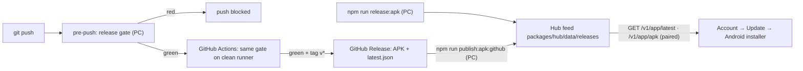

# Feature — Release gate + phone self-update

**Status:** implemented 2026-10-01 (gate, CI workflow, Hub feed, Account → Update screen).
On-device install not yet exercised on the Pixel — see the handoff report.
**Design:** canvas "Release & Self-Update" (pipeline + 3 phone screens + blocked-push terminal).

Product locks still hold: the **phone only downloads from the Hub on the operator PC**, over
Tailscale, with its paired device token. GitHub is build/test infrastructure, never a sync plane.

## 1. Release gate (`npm run gate`)

`scripts/release-gate.sh` — stops at the first red step, log in `.gate/last-run.log`,
passed-test count in `.gate/tests-passed`.

| Step | Command | Where |
|------|---------|-------|
| build:packages | `npm run build` | PC + CI |
| test:hub+adapters | `npm test` (Hub test/ + tests/phase0–4 + TOR-08, both adapters) | PC + CI |
| test:mobile | `npm run test:mobile` (tsc + node:test) | PC + CI |
| test:release-scripts | `node --test scripts/release-scripts.test.mjs` | PC + CI |
| assert:no-second-cdp | HARD BAN check | PC only |
| verify:cdp | live main-Cursor CDP | PC, only with `GATE_FULL=1` / `npm run gate:full` |

`.githooks/pre-push` runs the gate on every push (delete-only pushes skip). Enabled by
`npm install` (`prepare`) or `npm run hooks:install` (`core.hooksPath=.githooks`).
Bypass: `git push --no-verify` — CI still blocks merge/release.

Note: the hook tests the **working tree**; CI tests the pushed commit only.

## 2. CI (`.github/workflows/ci.yml`)

`gate` → `android-apk` (`needs: gate`; prebuild --clean + `assembleRelease`, `latest.json` via
`publish-apk-to-hub.mjs --manifest-only`) → `release` (tags `v*` only; tag must equal
`apps/mobile/app.json` version).

**Runner: node1** (self-hosted, labels `node1`, `android`; every job has `runs-on: [self-hosted, node1]`).
Provisioned without sudo by `bash scripts/ci/install-node1-runner.sh` from the PC: JDK 17 +
Android cmdline-tools under `~/ci`, `gh` in `~/.local/bin`, runner in `~/actions-runner` as the
`github-runner` systemd --user service (linger on). node1 only builds and tests — the Hub and
all sync stay on the operator PC.

Repo setup the operator does once:

1. Done 2026-10-02: private repo `KingEGame/cursor-mobile` (`origin`), runner node1 online.
2. Branch protection on `main`: require `gate` and `android-apk`.
3. Optional signing secrets: `CM_KEYSTORE_BASE64`, `CM_KEYSTORE_PASSWORD`, `CM_KEY_ALIAS`, `CM_KEY_PASSWORD`.

## 3. Versioning + signing

- `apps/mobile/app.json` `expo.version` is the only version to bump.
  `versionCode = major*10000 + minor*100 + patch` (`app.config.ts`, mirrored in the publish script).
- `plugins/with-release-signing.js` signs release builds with `CM_KEYSTORE_*` when set, else the
  RN template debug key. **The APK on the Pixel today uses that public debug key**, so updates
  install over it. Switching to a private key requires one uninstall → install → re-pair.

## 4. Hub feed (PC-local)

| Route | Auth | Response |
|-------|------|----------|
| `GET /v1/app/latest` | paired | `200 {available:false, reason}` or `{available:true, versionName, versionCode, sizeBytes, sha256, md5, notes, testsPassed, ciRunUrl, gitSha, downloadPath}` |
| `GET /v1/app/apk` | paired | APK stream (`application/vnd.android.package-archive`), 404 when none |

Served from `HUB_RELEASES_DIR` (default `<HUB_DATA_DIR>/releases`). Only a complete release is
offered: valid manifest, bare `.apk` file name, size matches. `publish-apk-to-hub.mjs` copies the
APK first and renames `latest.json` into place last, so the Hub never sees a half-copied file.

## 5. Phone

- **Account:** `UpdateCard` — green "Update ready · x.y.z" when the Hub's `versionCode` is higher
  than the installed one; otherwise a quiet App/version row. Never offers a downgrade.
- **Update (modal):** checks the build passed, release notes → **Download and install** →
  progress → size + md5 verified (mismatch deletes the file) → Android installer.
  First time, Android asks to allow installs from this app ("Open that setting").
- Android always requires the final **Install** tap for sideloaded apps; it cannot be silent.
