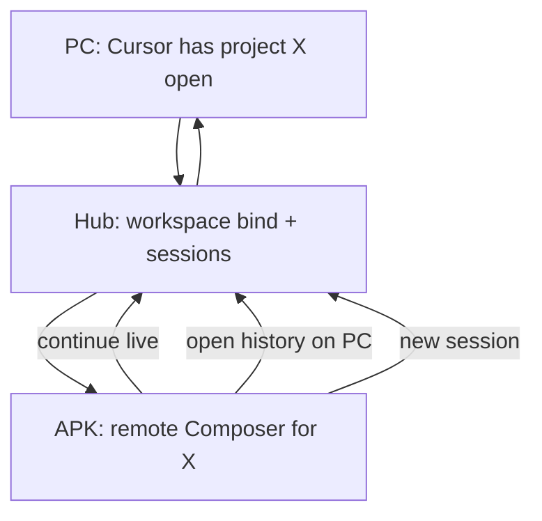
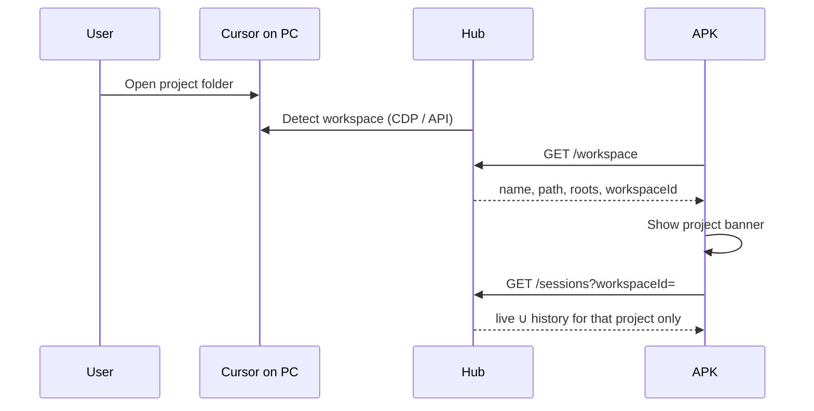
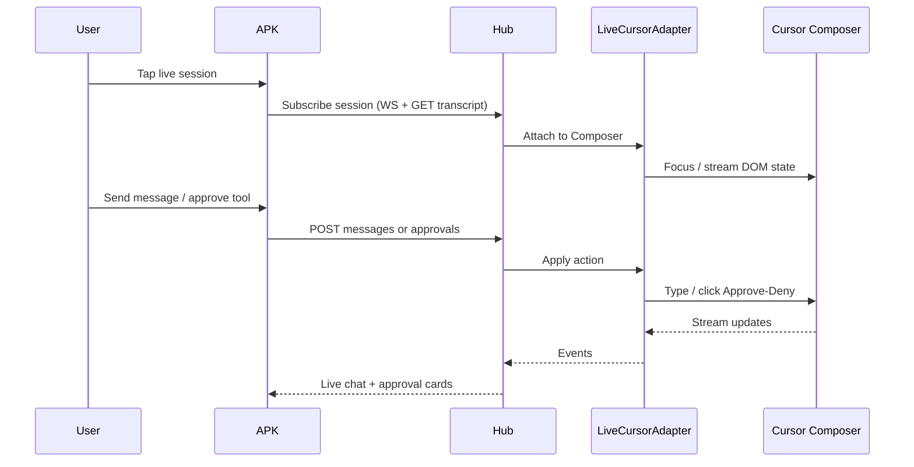
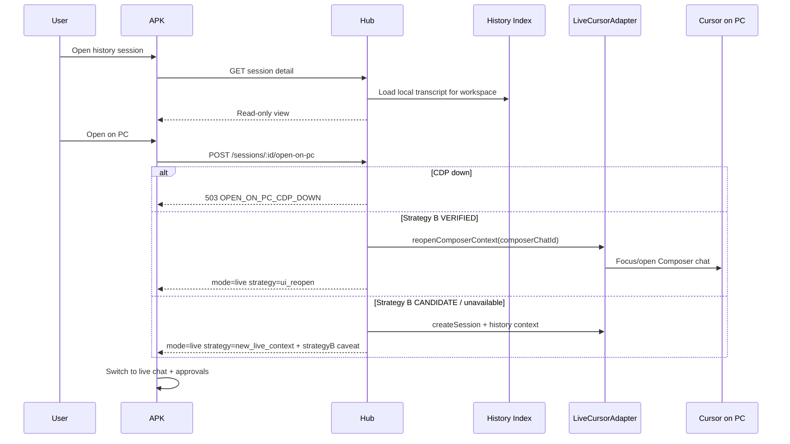
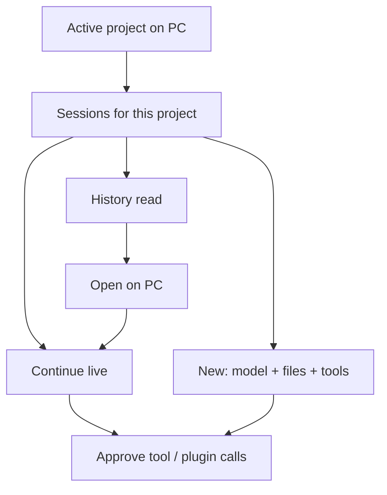

<!-- generated-by: gsd-doc-writer -->
# Feature — Remote Sessions (Phone ↔ open PC project)

## Overview

The phone is a **remote Composer** for the project **already open in Cursor on the PC**. It does not open folders on its own and does not talk to cloud agents. The Hub on the PC binds the APK to that workspace; everything the user sees and does on the phone is scoped to that project.

You use the phone to:

1. **Continue** a live session already running in that project (chat, tools, approvals).
2. **Resume from history** — read a past session for that project, then **Open on PC** to bring it live again in the same workspace.
3. **Start a new session** in that same project (model, attachments, first prompt) — see [New Session Composer](./new-session-composer.md).



## Scope lock

| In scope | Out of scope |
|----------|--------------|
| Workspace / project **already open** on this PC | Cloud Agents / Remote Control / cloud workers |
| Live + history sessions **for that project** | Browsing other machines’ projects |
| Continue live; history → **Open on PC** | Phone as the place to clone/open folders |
| Chat, attachments, tool/plugin **approvals** on PC | Running tools or MCP on the phone |
| Tailscale phone ↔ PC | Public CDP / internet-exposed Hub |

## Working inside the PC-open project

### Binding

1. User opens a project folder in Cursor on the PC (normal IDE workflow).
2. Hub detects the active workspace via CDP / VS Code APIs (name, path, roots, open windows).
3. APK calls `GET /workspace` and shows an **active project banner** (name + path).
4. All session list, create, and open-on-PC calls carry or imply that `workspaceId` — they must match the PC-open project.

If Cursor has **no** folder open, the APK shows a blocking empty state: “Open a project in Cursor on the PC.” No fake workspace, no cloud fallback.

Multi-window: user picks which Cursor window/workspace (same pattern as CursorRemote window switch).



### What “inside the project” means on the phone

| Surface | Behavior |
|---------|----------|
| Project banner | Always shows PC-open project name/path; refreshes with Hub health |
| Session list | Filtered/grouped by `workspaceId` — not a global PC dump mixed with other folders |
| Live chat | Messages and tool calls run in Cursor Composer for that workspace |
| File attach | Paths must fall under reported workspace roots |
| Tools / MCP | Already configured in Cursor on the PC; phone only prompts + Approve/Deny |
| New session | Created only against the bound workspace — see [new-session-composer.md](./new-session-composer.md) |

## Continue existing sessions

### Live sessions

A session in `live` mode is an open Composer/agent loop in Cursor for this workspace.

On the phone the user can:

- Open the session from the list and see transcript + streaming replies.
- Send further messages (`POST /sessions/:id/messages`).
- Attach more project files (`POST /sessions/:id/attachments`).
- See tool/plugin/MCP call cards and **Approve** or **Deny** (`POST /sessions/:id/approvals`).
- Stay connected over Hub WebSocket (`WS /ws`) with reconnect when Tailscale/CDP blips.



### History sessions → Open on PC

A session in `history` mode is a past transcript for this project (local PC store / History Index — not cloud).

On the phone the user can:

- Open and **read** the transcript (and metadata: model used, timestamps, workspace path).
- Tap **Open on PC** → Hub runs `POST /sessions/:id/open-on-pc`.
- Hub follows TOR-07 reopen order **A → B → C** (never cloud):

| Strategy | When | Phone/Hub result |
|----------|------|------------------|
| **A** Focus existing live | Same session already `live` | Idempotent `mode=live` |
| **B** Composer UI reopen | Desktop `hist_<composerId>` + `composer_history_open` **VERIFIED** + CDP up | `strategy=ui_reopen`, `domApplied=true` |
| **C** New live + context | B blocked (CANDIDATE / no chat id / CDP input miss) | `strategy=new_live_context` + `strategyB` status; UX caveat in `note` |
| **D** Fail closed | CDP down | `503 OPEN_ON_PC_CDP_DOWN` |

While `composer_history_open` remains **CANDIDATE**, B does **not** click the DOM — Hub falls back to C and reports `strategyB.status=selector_candidate` / `OPEN_ON_PC_SELECTOR_CANDIDATE`. Agent-cli rows (`hist_cli_…`) have no Composer chat id → C with `no_composer_chat_id`.



If open-on-PC cannot restore a given history id (unsupported export shape, window gone), show a clear error — do not invent a cloud resume path.

## Session modes

| Mode | Meaning | Phone can |
|------|---------|-----------|
| `live` | Open Composer/agent in Cursor for this workspace | Chat, attach files, approve tools, change model if UI allows |
| `history` | Past local session for this project | Read; **Open on PC** → `live` |
| `editor` | Optional later — browse project files | Pick attachments / view (Phase 3+) |

## User stories

1. Open project in Cursor on PC → phone shows that project name/path.
2. See sessions for **this project** (live + history).
3. Resume a live session → chat, see tool calls, approve/deny, attach more files.
4. Open a past session → read; **Open on PC** → continue live in same project.
5. **New session:** pick model → attach project files → send first prompt → tools/plugins as configured on PC.
6. Clear errors if no project open, CDP down, or Tailscale down.

## Capability map



## Hub API (sessions slice)

```
GET    /workspace
GET    /sessions?workspaceId=
POST   /sessions/:id/open-on-pc
POST   /sessions/:id/messages
POST   /sessions/:id/attachments
POST   /sessions/:id/approvals
WS     /ws
GET    /health
```

Related create/list endpoints for new Composer flow: see [new-session-composer.md](./new-session-composer.md). Screen layout: [phone-apk-screens.md](./phone-apk-screens.md).

## Delivery

| Feature | Phase |
|---------|-------|
| Active workspace banner + health | 0 |
| Continue live + tool approvals | 1 |
| New session: model + attach + prompt | 1 |
| APK shell | 1 |
| Full project history + open-on-PC | 2 |
| Richer @-file / multi-root picker | 3 |
| Harden CDP / offline queue | 4 |

## Success criteria

- Phone always shows **which project** it is bound to (matches PC).
- Cannot create or open-on-PC against a different folder than the open workspace (v1).
- Live continue streams chat and approval cards; deny works.
- History sessions for that project are listable; **Open on PC** returns a live session in the same project (Phase 2 completes “all”).
- No cloud credentials or cloud session list.

## Implementation notes

- Live control / approvals: [CursorRemote](https://github.com/len5ky/CursorRemote)
- History for project sessions: [cursor-session](https://github.com/iksnae/cursor-session)
- App shell: Expo (Paseo-style)
- Architecture: [mobile-cursor-companion.md](../architecture/mobile-cursor-companion.md)
