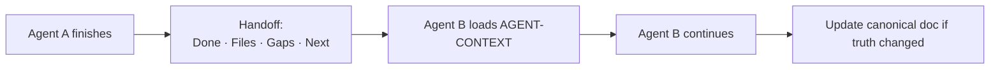
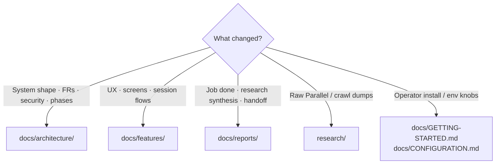

# Report — Agent handoff protocol

**Date:** 2026-09-25  
**Purpose:** How subagents communicate so the next agent can continue from one source of truth  
**Related:** [`../../AGENTS.md`](../../AGENTS.md) · [`../architecture/AGENT-CONTEXT.md`](../architecture/AGENT-CONTEXT.md)

---

## When to write a handoff

Write a handoff (report file **and/or** structured final reply) when:

- You finish a multi-step investigation or doc update another agent will continue.
- You change product truth (scope, FRs, phases, API contracts).
- You stop mid-phase with open gaps.
- The user asks for a summary for another agent / parallel worker.

Skip a formal handoff file for trivial one-line replies; still respect product locks in any summary.

---

## Required handoff fields

Every handoff must include these sections (markdown headings or labeled bullets):

| Field | Required content |
|-------|------------------|
| **Done** | What was completed this turn (outcomes, not process theater) |
| **Files** | Paths created or updated (absolute or repo-relative) |
| **Open gaps** | Unresolved product/tech gaps; link FR or gap-closure rows if known |
| **Next agent** | Who should act next and the single recommended next action |
| **Locks check** | Explicit: PC-local only? Open-project remote? No fake “code done”? |

Optional but useful:

| Field | Content |
|-------|---------|
| **Phase** | Which delivery phase (0–4) this work targeted |
| **Do not** | Explicit anti-goals for the next agent this turn |
| **Doc sync** | Which architecture / features / reports were updated for consistency |



---

## Copy-paste template

```markdown
# Handoff — <short topic>

**Date:** YYYY-MM-DD  
**Phase focus:** 0 | 1 | 2 | 3 | 4 | docs-only  
**Locks check:** PC-local only · open-project remote · CDP localhost · no scaffold claimed as done

## Done
- …

## Files
- path/one.md (created|updated) — why
- path/two.md (updated) — why

## Open gaps
- … (link FR-xxx or gap-closure row if applicable)

## Next agent
- Role: …
- Next action: …

## Do not
- …
```

---

## Report naming

| Kind | Pattern | Example |
|------|---------|---------|
| Research / audit | `docs/reports/<topic>-YYYY-MM-DD.md` | `gap-closure-hybrid-system-2026-09-24.md` |
| Agent handoff | `docs/reports/handoff-<topic>-YYYY-MM-DD.md` | `handoff-agent-workspace-2026-09-25.md` |
| Narrative / how-we-work | `docs/reports/<narrative>-YYYY-MM-DD.md` | `how-we-work-phone-pc-2026-09-24.md` |

- Use **English** kebab-case topics.
- Prefer **one dated report per job**; update the same file if the same job continues the same day.
- Do not create parallel “v2 architecture” reports that contradict `docs/architecture/`.

---

## Which folder to update



| Change type | Update |
|-------------|--------|
| Goals, Hub/APK shape, phases, API contracts, scope locks | `docs/architecture/` (+ `AGENT-CONTEXT.md` if briefing summary changes) |
| Continue / create / screens behavior | Matching file under `docs/features/` |
| Completed investigation, OSS brief, gap matrix, handoff | `docs/reports/` |
| External research dump (JSON/md from Parallel, etc.) | `research/` + short pointer in `research/README.md` |
| Planned install / config knobs | `docs/GETTING-STARTED.md` / `docs/CONFIGURATION.md` |
| Agent read order / do-don't | Root `AGENTS.md` |

**Consistency rule:** If a report decides something new, **promote** it into architecture or features in the same turn. Reports are not a second source of conflicting truth.

---

## Communication norms between agents

1. **Load first:** `docs/architecture/AGENT-CONTEXT.md` then this protocol when handing off.
2. **Product locks win** over older OSS research that mentions Cloud Agents / Remote Control as recommendations.
3. **Designed ≠ done:** Hub routes and Expo profiles are contracts until packages exist.
4. **One architecture:** Edit `mobile-cursor-companion.md` / FRs; do not fork a new top-level design.
5. **Gap coverage:** Keep [`gap-closure-hybrid-system-2026-09-24.md`](./gap-closure-hybrid-system-2026-09-24.md) aligned with AGENT-CONTEXT and FRs when gaps change.
6. **Summaries for humans:** Lead with outcome; list files; list open gaps; name next step.

---

## Minimal inline handoff (chat-only)

If you cannot write a file, end the reply with:

```text
HANDOFF
Done: …
Files: …
Open gaps: …
Next agent: …
Locks check: PC-local · open-project · no false “implemented”
```

---

## Decision summary

Agents stay aligned by **reading AGENT-CONTEXT first**, writing **structured handoffs**, and updating the **correct docs folder** so architecture / features / reports stay one coherent set — never a second competing design.
