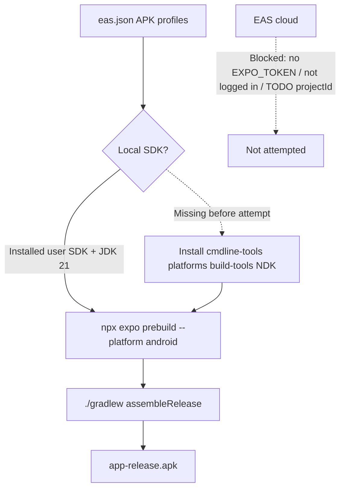

# APK build attempt — 2026-09-25

**Status:** Local release APK **succeeded** (debug-signed sideload artifact).  
**Product locks:** PC-local only · open-project remote · CDP localhost · Tailscale + pairing · Expo `android.buildType: apk` · no EAS tokens invented.

## Verdict

| Path | Result |
|------|--------|
| Local `expo prebuild` + `./gradlew assembleRelease` | **SUCCESS** |
| EAS cloud (`eas build`) | **Not run** — no login / no `EXPO_TOKEN` / placeholder `projectId` |
| EAS local (`eas build --local`) | **Not required** — Gradle path produced APK; Docker available if EAS local is needed later |

## APK artifact

| Field | Value |
|-------|--------|
| **Path** | `/data/projects/cursor_mobile/apps/mobile/android/app/build/outputs/apk/release/app-release.apk` |
| **Size** | 77,780,758 bytes (~74.2 MiB) — rebuild 2026-09-25T21:28Z (`sendMessageVerified` sender gate) |
| **SHA-256** | `2b990d6f89e00a630e308f92aed4bc9864ff4feac0aa2024ceab46a92c62b023` |
| **Prior SHA-256** | `1702be493e9c9b027d562bb218e318763c63a7326ff4491f6e1ca57a26019aca` (approvals UX) · `4350f952dc6763691724ed9fb446f33ad3514ed1b7aceb1ce94e79ea6f688ed6` (History UI) · `26bda7d46b43f83a02b9196000f887440487c5893a913ea8ae6a95d8e3e807a1` (Tailscale-first Pair/Health UX) · `e537a6832cb13bc9918e51e99177953497182fd6d4b45d24997f315535d862b7` (Hub URL prefill) · `8ea912646d1fdf5a0d70cbec4cc765e1f638e1dba0333e4d3ed61d3a7827929c` (first; empty `hubUrl`) |
| **Type** | Android package (APK) |
| **Signing** | Android **Debug** keystore (`CN=Android Debug`) — sideload-ok for operator UAT; not Play Store / production signing |
| **Embedded `extra.hubUrl`** | `http://100.91.47.68:8787` (via `EXPO_PUBLIC_HUB_URL` at assemble; confirmed in `assets/app.config`) |
| **Sideload** | `adb -s 33080DLH20007Y install -r` → **Success** 2026-09-25T21:28Z (`lastUpdateTime=2026-09-25 17:28:04`) |
| **Git** | `apps/mobile/android/` is **gitignored** (`apps/mobile/.gitignore:/android`) — artifact is local evidence only |

### Rebuild note — 2026-10-01T15:30Z (Gemini-style UI)

Local `./gradlew assembleRelease` with `EXPO_PUBLIC_HUB_URL=http://100.108.160.99:8787` after Gemini-inspired redesign (MainTabs Chats|Account, ChatsHome, ComposerBar, ConnectionChip, calm light theme).  
| Field | Value |
|-------|--------|
| **Path** | `apps/mobile/android/app/build/outputs/apk/release/app-release.apk` |
| **Size** | 77,828,042 bytes (~74.2 MiB) |
| **SHA-256** | `e0164b9828a6d3546bea739586a73d0928d5700a772c0aa5ad405db25499eaeb` |
| **Sideload** | `adb -s 33080DLH20007Y install -r` → **Success** (`lastUpdateTime=2026-10-01 15:30:55`) |
| **Smoke** | Cold launch → Health (paired). `cursor-companion://nav/home` → **Chats \| Account** tabs + New chat FAB + Connection Online. |

### Rebuild note — 2026-09-25T21:28Z

Local `./gradlew assembleRelease` with `EXPO_PUBLIC_HUB_URL=http://100.91.47.68:8787` after mobile `sendMessageVerified` sender gate (send not false-blocked while approve/deny CANDIDATE). Pixel USB authorized; install **-r** Success. **Goal not complete** — phone Tailscale peer still absent (mesh UAT blocked).

### Rebuild note — 2026-09-25T21:18Z

Local `./gradlew assembleRelease` with `EXPO_PUBLIC_HUB_URL=http://100.91.47.68:8787` after mobile approvals UX. Pixel USB authorized; install **-r** Success.

### Hub URL path (runtime vs rebuild)

| Path | Role |
|------|------|
| **Runtime (primary)** | Pair screen Hub URL field → SecureStore (`hub_base_url`). “Check Hub health without pairing” now **persists** the typed URL before navigating Health. |
| **Build-time (default only)** | `EXPO_PUBLIC_HUB_URL` → `app.config.ts` → `extra.hubUrl` → `getDefaultHubUrl()` when SecureStore empty. |

First sideload APK had `"hubUrl":""`. Latest rebuild + `adb install -r` (Pixel `33080DLH20007Y`, Success 2026-09-25T21:28Z) embeds `sendMessageVerified` gate + Tailscale Hub prefill; operator can still edit URL without another rebuild.



## Config checked

### `apps/mobile/eas.json`

Profiles `development`, `preview`, `apk`, and `production` all set `"android": { "buildType": "apk" }` (sideload-oriented). No secrets required in this file.

### `apps/mobile/package.json` scripts (after prebuild)

| Script | Command |
|--------|---------|
| `start` | `expo start` |
| `android` | `expo run:android` (updated by prebuild; was `expo start --android`) |
| `ios` | `expo run:ios` |
| `test` / `typecheck` / `smoke` | unchanged |

No dedicated `eas:build` / `apk` npm script. Designed operator command remains:

`cd apps/mobile && npx eas build -p android --profile apk`

### `app.json` EAS project

`extra.eas.projectId` is still `"TODO-create-eas-project"` — cloud EAS cannot be completed until a real Expo project is created and the id is filled (operator action; no token invented here).

## What was done (local path)

1. **Toolchain probe**
   - Present: OpenJDK 21, Gradle (snap + wrapper 9.3.1), Docker daemon, `adb`, root workspace `node_modules` (Expo hoisted).
   - Missing initially: full Android SDK (`ANDROID_HOME` unset; `/usr/lib/android-sdk` had only `platform-tools`), `eas` binary (available via `npx eas-cli`), EAS login.
2. **User-local Android SDK** installed under `~/Android/Sdk` (no sudo):
   - cmdline-tools, platform-tools, platforms `android-35` / `android-36`, build-tools `35.0.0` / `36.0.0`, NDK `27.1.12297006`.
3. **`npx expo prebuild --platform android --no-install`** → generated gitignored `apps/mobile/android/`.
4. **Dependency alignment** (blocked first `assembleRelease`):
   - `expo-constants` was `18.0.14` (wrong for SDK 57); fixed to `~57.0.19`.
   - `expo-secure-store` → `~57.0.4`.
   - `react-native-safe-area-context` / `react-native-screens` aligned via `npx expo install`.
5. **`./gradlew assembleRelease`** → **BUILD SUCCESSFUL in 1m 47s**.

## EAS cloud — configured without secrets / remaining blockers

**Already in repo (no secrets):**

- `eas.json` APK `buildType` profiles.
- App identity: `android.package` / iOS bundle `local.cursor.mobile`.

**Blockers for cloud EAS (checklist):**

- [ ] Operator: `npx eas-cli login` **or** set real `EXPO_TOKEN` in the environment (do not commit).
- [ ] Operator: `npx eas init` / create Expo project; replace `app.json` → `extra.eas.projectId` (`TODO-create-eas-project`).
- [ ] Optional: production/upload keystore via EAS credentials (debug signing used for this local APK).
- [ ] Optional npm script wrapper if desired (not required for delivery).

**Available but unused:** Docker 29.x — suitable for `eas build --local` after login/projectId.

## Reproducible local commands

```bash
export ANDROID_HOME="$HOME/Android/Sdk"
export ANDROID_SDK_ROOT="$ANDROID_HOME"
export JAVA_HOME=/usr/lib/jvm/java-21-openjdk-amd64
export PATH="$ANDROID_HOME/cmdline-tools/latest/bin:$ANDROID_HOME/platform-tools:$JAVA_HOME/bin:$PATH"
# Optional prefill for Pair screen when SecureStore empty:
export EXPO_PUBLIC_HUB_URL="http://100.91.47.68:8787"
# or: export EXPO_PUBLIC_HUB_URL="http://kingwarpc.tail246b3f.ts.net:8787"

cd /data/projects/cursor_mobile/apps/mobile
npx expo prebuild --platform android --no-install
cd android && ./gradlew assembleRelease --no-daemon
# APK: app/build/outputs/apk/release/app-release.apk
adb -s 33080DLH20007Y install -r app/build/outputs/apk/release/app-release.apk
```

## Open gaps / next agent

| Gap | Owner |
|-----|--------|
| Commit dependency version bumps in `apps/mobile/package.json` (+ lockfile) if desired | R8 / implementer (user must request commit) |
| EAS projectId + login for cloud/CI APK | Operator |
| Production signing (non-debug) for wider distribution | Operator / EAS credentials |
| Full live E2E on device still separate from APK existence | R5 / UAT |

**Product locks still true?** Yes.

**Next agent:** Operator UAT sideload of the APK above, or Expo account holder for EAS cloud profile `apk`.
