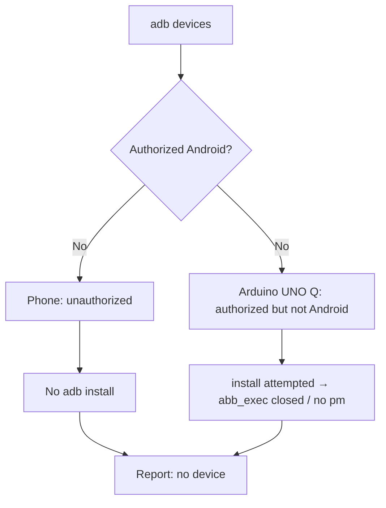

# APK sideload attempt — 2026-09-25

**Status:** **No install** — phone present but **unauthorized**; no authorized Android device available.  
**Product locks:** PC-local only · Expo sideload APK · Tailscale + pairing (unchanged).

## Verdict

| Result | Detail |
|--------|--------|
| **Outcome** | **no device** (usable Android) |
| **Install** | Not completed |
| **APK** | Present and unchanged from build report |



## Commands run

### 1. `adb devices -l`

```
List of devices attached
1903411938             device usb:1-2 transport_id:2
33080DLH20007Y         unauthorized usb:5-1 transport_id:1
```

| Serial | adb state | What it actually is |
|--------|-----------|---------------------|
| `1903411938` | `device` | **Arduino SA UNO Q** (`gardenstation`, Debian aarch64) — adb shell works; **not Android** (`pm` / `getprop` absent) |
| `33080DLH20007Y` | `unauthorized` | USB Google/Pixel-class device (`lsusb`: `18d1:4ee7 Nexus/Pixel Device (charging + debug)`) — **cannot install until USB debugging is allowed** |

### 2. Install attempt

Tried on the only authorized serial (mistaken candidate until diagnosed):

```bash
adb -s 1903411938 install -r apps/mobile/android/app/build/outputs/apk/release/app-release.apk
```

**Result:** Failed (`adb: failed to run abb_exec. Error: closed` / streamed install aborted). Expected: target is not an Android package manager.

**Not run against** `33080DLH20007Y` — adb rejects with:

```
error: device unauthorized.
This adb server's $ADB_VENDOR_KEYS is not set
Try 'adb kill-server' if that seems wrong.
Otherwise check for a confirmation dialog on your device.
```

## APK artifact (unchanged)

| Field | Value |
|-------|--------|
| **Path** | `apps/mobile/android/app/build/outputs/apk/release/app-release.apk` |
| **Size** | ~75 MiB |
| **SHA-256** | `8ea912646d1fdf5a0d70cbec4cc765e1f638e1dba0333e4d3ed61d3a7827929c` |

## Open gaps / next step for operator

1. On the phone (`33080DLH20007Y`): unlock screen → accept **Allow USB debugging** (and “always allow” if offered).
2. Re-run: `adb devices` until that serial shows `device` (not `unauthorized`).
3. Then: `adb -s 33080DLH20007Y install -r apps/mobile/android/app/build/outputs/apk/release/app-release.apk`

Do **not** treat `1903411938` (Arduino gardenstation) as the mobile target.

## Product locks still true?

Yes — PC-local Hub/adapters; APK is client/UI only; no cloud sideload path claimed.
