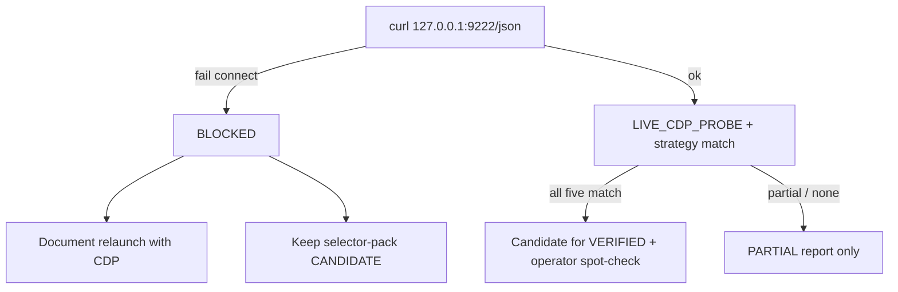

# CDP live probe — 2026-09-25

**Phase focus:** 1 (LiveCursorAdapter / selector pack)  
**Outcome:** **BLOCKED** — no live DOM selector evidence  
**Locks check:** PC-local only · CDP `127.0.0.1` only · open-project remote · selector pack remains **CANDIDATE** (not VERIFIED)

---

## Verdict

`http://127.0.0.1:9222/json` is **not reachable**. Cursor is running on this PC **without** `--remote-debugging-port=9222`. No live selector match evidence for `send_message` / `approve` / `deny` / `model_select` / `file_attach`.

**Do not mark any action VERIFIED.** Prefer this PARTIAL/BLOCKED report over a false VERIFIED flip. Operator spot-check remains required even after a future successful probe.



---

## 1. Reachability check

| Check | Result |
|-------|--------|
| `GET http://127.0.0.1:9222/json` | **Failed** — `curl: (7) Failed to connect` |
| `GET http://127.0.0.1:9222/json/version` | **Failed** — same |
| Alternate ports `9223` / `9229` / `9333` | No listener |
| `ss` for CDP-like ports | No `9222` (or sibling) listen |
| Non-loopback CDP | Not attempted (product lock: Hub only dials `127.0.0.1`) |

---

## 2. Live Cursor process (this PC)

| Item | Value |
|------|--------|
| OS | Linux (Ubuntu 26.04.1 LTS), x64 |
| Binary | `/usr/bin/cursor` → `/usr/share/cursor/bin/cursor` |
| ELF / app | `/usr/share/cursor/cursor` |
| Version | **3.19.19** (`6496ea8a068aebfcd21990e70ff522e9abf10c80`) |
| Running? | **Yes** (main PID observed with GPU flags) |
| Cmdline | `/usr/share/cursor/cursor --disable-gpu --disable-gpu-compositing --use-gl=swiftshader` |
| `--remote-debugging-port` | **Absent** on running instance |

Desktop entries found:

- `/usr/share/applications/cursor.desktop` → `Exec=/usr/share/cursor/cursor %F`
- `/home/kingwar/.local/share/applications/cursor.desktop` → same binary with swiftshader flags

Common paths checked (not present unless noted): `~/.local/bin/cursor`, `/opt/Cursor/*`, AppImage under `~/Applications`, snap — **system package at `/usr/share/cursor` is the install**.

---

## 3. Probe / test runs

| Command | Result |
|---------|--------|
| `npm test -w @cursor-mobile/live-cursor -- src/cdp-probe.test.ts` | **Pass** — 1 ran (skip documentation) · 3 skipped (honest no-CDP path) |
| `LIVE_CDP_PROBE=1 npm test -w @cursor-mobile/live-cursor -- src/cdp-probe.test.ts` | **Fail** (expected) — forced live suite; `/json/version` and target list assert `ok: true` but CDP is down |

No DOM strategy evaluation was possible. Match table for the five mutation actions:

| Action | Matching strategy on live DOM | Status |
|--------|-------------------------------|--------|
| `send_message` | **n/a** (no CDP) | BLOCKED |
| `approve` | **n/a** | BLOCKED |
| `deny` | **n/a** | BLOCKED |
| `model_select` | **n/a** | BLOCKED |
| `file_attach` | **n/a** | BLOCKED |

`packages/adapters/live-cursor/src/selector-pack.ts` — **unchanged**; all actions remain `CANDIDATE` (`verifiedAt` / `verifiedAgainst` null).

---

## 4. How to unblock (Linux — this host)

CDP must bind **loopback only**. The helper **does not** kill a running Cursor — quit first, then relaunch.

### Preferred: safe launcher

```bash
# 1) Quit Cursor fully (Ctrl+Q / File → Quit). Script refuses if still running.
# 2) Start with loopback CDP only:
cd /data/projects/cursor_mobile
./scripts/start-cursor-cdp.sh /data/projects/cursor_mobile
```

Script path: [`scripts/start-cursor-cdp.sh`](../../scripts/start-cursor-cdp.sh) — uses `/usr/share/cursor/cursor` when present, passes `--remote-debugging-port=9222` + `--remote-debugging-address=127.0.0.1`, warns if `9222` is already in use.

Optional GPU flags (this host’s desktop entry) can be forwarded:

```bash
./scripts/start-cursor-cdp.sh \
  --disable-gpu --disable-gpu-compositing --use-gl=swiftshader \
  /data/projects/cursor_mobile
```

### Manual equivalent

```bash
/usr/share/cursor/cursor \
  --remote-debugging-port=9222 \
  --remote-debugging-address=127.0.0.1 \
  /data/projects/cursor_mobile
```

Confirm **before** probing:

```bash
# Must succeed and return JSON
curl -s http://127.0.0.1:9222/json | head

# Must show 127.0.0.1 (not 0.0.0.0)
ss -ltn | grep 9222
```

Then gather selector evidence:

```bash
cd /data/projects/cursor_mobile
LIVE_CDP_PROBE=1 npm test -w @cursor-mobile/live-cursor -- src/cdp-probe.test.ts
# Plus a DOM strategy probe against the pack (Composer open; tool card visible for approve/deny)
```

**Security:** Never publish CDP on Tailscale/LAN. Phone never dials CDP; only Hub on the same PC uses `CDP_URL=http://127.0.0.1:9222`.

**Note:** Relaunch was **not** performed in this probe turn (would interrupt the operator’s open Cursor session). Operator must relaunch when ready. Operator handoff: [`handoff-cdp-launcher.md`](handoff-cdp-launcher.md).

---

## 5. VERIFIED gate (not met)

Update `selector-pack.ts` to `VERIFIED` **only if**:

1. Live CDP on `127.0.0.1:9222` is up.
2. **All five** actions have at least one matching strategy on the live DOM.
3. Notes record `verifiedAt` / `verifiedAgainst` (Cursor build) and state that the probe matched.
4. Docs still say **operator should spot-check** before trusting mutations in production use.

This run: **0/5** — gate failed → no pack edit.

---

## Done

- Confirmed CDP `127.0.0.1:9222` unreachable.
- Identified running Cursor **3.19.19** without remote debugging.
- Documented Linux launch paths and verify commands.
- Added safe launcher `scripts/start-cursor-cdp.sh` (no auto-kill); linked from this unblock section + Getting Started.
- Ran default + forced `cdp-probe` tests; recorded skip vs fail.
- Left selector pack **CANDIDATE**.

## Files

- `docs/reports/cdp-probe-2026-09-25.md` (this file)
- `scripts/start-cursor-cdp.sh` (launcher)
- `docs/GETTING-STARTED.md` · `docs/reports/handoff-cdp-launcher.md`

## Open gaps

- Live CDP not enabled on operator Cursor → no selector match evidence (operator must quit + run launcher).
- DOM mutation path stays fail-closed (`extractor_stale` / `EXTRACTOR_STALE`) until pack VERIFIED after live proof + operator confirmation.

## Next agent

**R4 LiveCursor / Phase 1** (or operator): quit Cursor, run `./scripts/start-cursor-cdp.sh`, re-run this probe, evaluate pack strategies against live Composer DOM, write PARTIAL or full match table; only then consider VERIFIED with spot-check caveat.

## Product locks still true?

Yes — PC-local only · open-project remote · Tailscale + pair · CDP `127.0.0.1` · Expo APK · docs ≠ unverified “done”.
