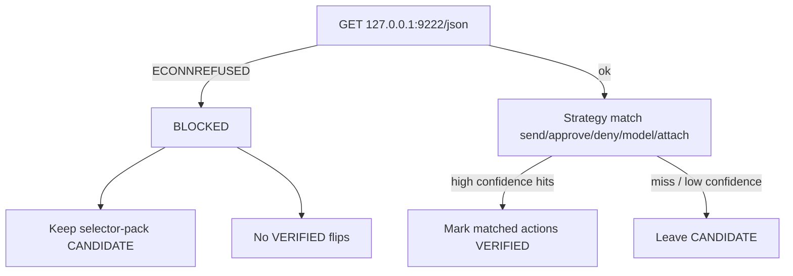

# CDP live probe recheck — 2026-09-25

**Phase focus:** 1 (LiveCursorAdapter / selector pack)  
**Outcome:** **BLOCKED** — CDP still unreachable; no live DOM selector evidence  
**Prior report:** [`cdp-probe-2026-09-25.md`](cdp-probe-2026-09-25.md)  
**Locks check:** PC-local only · CDP `127.0.0.1` only · open-project remote · selector pack remains **CANDIDATE** (not VERIFIED)

---

## Verdict

Recheck of `http://127.0.0.1:9222/json` at ~2026-09-25 15:41 EDT: **still down** (`ECONNREFUSED`). Cursor **3.19.19** is running **without** `--remote-debugging-port=9222`.

**No action marked VERIFIED.** Selector match against live DOM was not possible. Pack source unchanged.

---

## 1. Reachability

| Check | Result |
|-------|--------|
| `GET http://127.0.0.1:9222/json` | **Failed** — `connect ECONNREFUSED 127.0.0.1:9222` |
| Listeners on `9222` / `9223` / `9229` / `9333` | **None** (`ss -ltn`) |
| Non-loopback CDP | Not attempted (product lock) |

---

## 2. Live Cursor process

| Item | Value |
|------|--------|
| Binary | `/usr/share/cursor/cursor` |
| Version | **3.19.19** (crashpad annotation) |
| Running? | **Yes** (main PID ~3879485) |
| Cmdline | `--disable-gpu --disable-gpu-compositing --use-gl=swiftshader` |
| `--remote-debugging-port` | **Absent** |

Same blocker as the earlier probe: operator must quit Cursor and relaunch with loopback CDP (see prior report §4 / `scripts/start-cursor-cdp.sh`). Relaunch was **not** performed this turn.

---

## 3. Selector match (not run)

| Action | Matching strategy on live DOM | Status |
|--------|-------------------------------|--------|
| `send_message` | **n/a** (no CDP) | BLOCKED → stays **CANDIDATE** |
| `approve` | **n/a** | BLOCKED → stays **CANDIDATE** |
| `deny` | **n/a** | BLOCKED → stays **CANDIDATE** |
| `model_select` | **n/a** | BLOCKED → stays **CANDIDATE** |
| `file_attach` | **n/a** | BLOCKED → stays **CANDIDATE** |

`packages/adapters/live-cursor/src/selector-pack.ts` — **unchanged**; all five actions `verification: "CANDIDATE"`, `verifiedAt` / `verifiedAgainst` null.

---

## 4. Tests

No pack change → no pack-related test rerun required for a VERIFIED flip.

Default (honest no-CDP) path: `cdp-probe.test.ts` skips live suite when `/json/version` is unreachable — consistent with this recheck.

---

## 5. VERIFIED gate (not met)

Flip an action to `VERIFIED` **only** when CDP is up **and** that action’s strategies match live Composer DOM with high confidence (plus `verifiedAt` / `verifiedAgainst`). This recheck: **0/5**.

---

## Done

- Rechecked CDP `127.0.0.1:9222` — still refused.
- Confirmed Cursor 3.19.19 running without remote debugging; no sibling CDP ports listening.
- Documented match table as BLOCKED; left pack **CANDIDATE**.

## Files

- `docs/reports/cdp-probe-recheck-2026-09-25.md` (this file)

## Open gaps

- Live CDP not enabled → Composer send still fail-closed (`extractor_stale` / `EXTRACTOR_STALE`).
- Operator: quit Cursor → `./scripts/start-cursor-cdp.sh` → re-probe + DOM strategy match before any VERIFIED.

## Next agent

**R4 LiveCursor / Phase 1** (or operator): enable loopback CDP, re-run selector match for the five actions, mark only high-confidence hits VERIFIED, run live-cursor tests after pack edits.

## Product locks still true?

Yes — PC-local only · open-project remote · Tailscale + pair · CDP `127.0.0.1` · Expo APK · docs ≠ unverified “done”.
