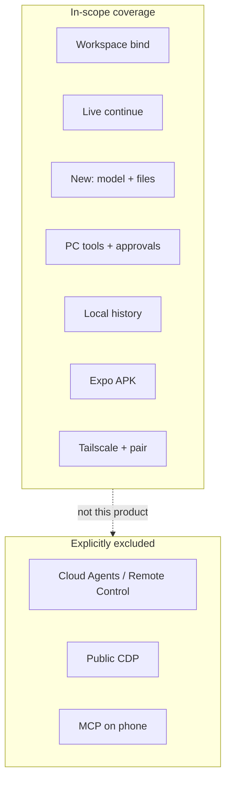

# Report — Gap closure vs existing systems

**Date:** 2026-09-24 · **Updated:** 2026-09-25 (aligned with AGENT-CONTEXT + FRs)  
**Decision:** Hybrid Hub — **PC-local only**. Phone remotes the **project already open on the PC**. Continue existing sessions or **new session with model + file attach + tools/plugins (on PC)**. No cloud.  
**Briefing:** [`../architecture/AGENT-CONTEXT.md`](../architecture/AGENT-CONTEXT.md) · FRs: [`../architecture/functional-requirements.md`](../architecture/functional-requirements.md)

---

## Product locks (must stay true)

| Lock | Status in design |
|------|------------------|
| PC-local only — no Cloud Agents / Remote Control | Locked |
| Phone remotes PC-open project only (v1) | Locked |
| Continue live/history **or** create (model + files + PC tools + phone approvals) | Locked |
| Tailscale + device pairing; CDP `127.0.0.1` only | Locked |
| Expo sideload APK | Locked |
| Hub / APK application code | **Not scaffolded** |

---

## Needs checklist (gap coverage)

| Need | Covered by | FR (P0 unless noted) | Phase |
|------|------------|----------------------|-------|
| Bound to PC-open project | `GET /workspace` + APK banner | FR-010–013 | 0 |
| Pair + private mesh + health | Tailscale + `POST /pair/...` + `GET /health` | FR-001–004 | 0 |
| Continue live sessions | LiveCursorAdapter + messages/WS | FR-020, FR-030–033 | 1 |
| New session + model | Create sheet → `GET /workspace/models` + `POST /sessions` | FR-050–053 | 1 |
| Attach project files | Workspace file index → `@` refs | FR-051–052, FR-032 | 1–3 |
| Tools / plugins / MCP | Cursor on PC + phone Approve/Deny | FR-054, FR-060–062 | 1 |
| APK | Expo EAS `buildType: apk` | FR-080–081 | 1 |
| All project sessions (local history) | History Index + Open on PC | FR-023, FR-040–041 (P1) | 2 |
| Multi-window bind | Window/workspace picker | FR-014 (P1) | 1–2 |
| Reconnect / harden | Reconnect without re-pair; CDP harden; offline queue | FR-090 (P1), FR-091 (P2) | 4 |
| Cloud Agents / cloud session lists | — | NG-1 · **Out of scope** | — |

---

## Weak-point → fix matrix

| Existing weak point | Source | Our fix | FR / phase |
|---------------------|--------|---------|------------|
| No project banner / workspace bind | CursorRemote web | `/workspace` + APK header | FR-010–012 · 0 |
| Weak new-session (model/files) | CursorRemote | Explicit create sheet: model + attachments | FR-050–053 · 1 |
| Tools only as opaque DOM | CursorRemote | Structured approval cards + tools summary | FR-031, FR-054, FR-062 · 1 |
| Can’t see all past project chats | CursorRemote | History Index filtered by workspace | FR-023, FR-040–041 · 2 |
| Browser only | CursorRemote | Expo APK | FR-080–081 · 1 |
| Official mobile = cloud agent loop | Cursor iOS / Remote Control | **Reject as product path**; PC-local Hub instead | NG-1 |
| LAN / public exposure | Generic tunnels | Tailscale + pairing; CDP loopback only | FR-001 · 0 |
| Daemon + mobile shell patterns | Paseo | Borrow shape only (Hub + Expo APK); not Cursor Composer import | Phase 0–1 |

---

## FR ↔ phase map (quick)

| Phase | Primary FRs | Outcome |
|-------|-------------|---------|
| **0** | FR-001–004, FR-010–013 | Paired phone sees real PC-open project |
| **1** | FR-020–022, FR-030–033, FR-050–054, FR-060–062, FR-080–081 | Live continue + create + APK |
| **2** | FR-023, FR-040–041, FR-014 | Full local history + multi-window |
| **3** | FR-055, FR-070–071 | Richer files / optional editor |
| **4** | FR-090–091 | Reconnect harden / offline queue |

---

## Architecture pointers

- [`../architecture/AGENT-CONTEXT.md`](../architecture/AGENT-CONTEXT.md) — briefing pack
- [`../architecture/mobile-cursor-companion.md`](../architecture/mobile-cursor-companion.md) — system design
- [`../architecture/functional-requirements.md`](../architecture/functional-requirements.md) — full FR list
- [`../architecture/security-tailscale-linking.md`](../architecture/security-tailscale-linking.md) — mesh + CDP rules
- [`../features/remote-sessions.md`](../features/remote-sessions.md)
- [`../features/new-session-composer.md`](../features/new-session-composer.md)

---

## Sources (borrow patterns — not product scope)

- [CursorRemote](https://github.com/len5ky/CursorRemote) — live chat, approvals, CDP relay
- [cursor-session](https://github.com/iksnae/cursor-session) — local session history index
- [Paseo architecture](https://github.com/getpaseo/paseo/blob/main/docs/ARCHITECTURE.md) — daemon + Expo APK shape

---

## Decision summary

Every product need above is **explicitly covered** by a designed Hub/APK path and FR, or marked **out of scope** (cloud). Implementation has **not** started; gap closure is design completeness, not code completeness.
