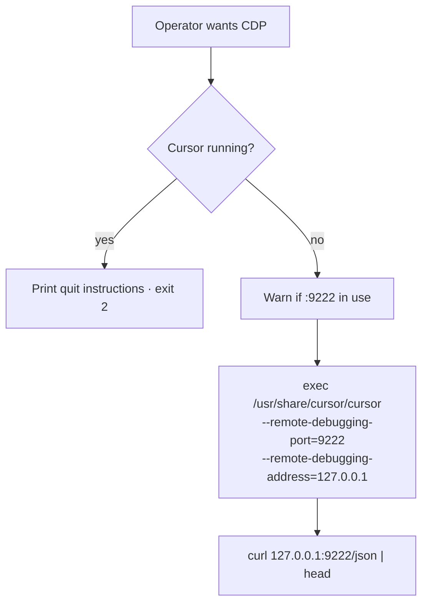

# Handoff — CDP launcher helper

**Date:** 2026-09-25  
**Phase focus:** 1 (LiveCursor / selector probe unblock)  
**Locks check:** PC-local only · open-project remote · CDP `127.0.0.1` only · Tailscale + pair · Expo APK · docs ≠ unverified “done”

## Done

- Added safe operator helper to relaunch Cursor with CDP on **loopback only**.
- Script **does not** kill a running Cursor; prints quit instructions (Ctrl+Q / File → Quit) and exits if Cursor is still running.
- Documented in Getting Started and the CDP probe unblock section.



## Files

| Path | Change |
|------|--------|
| `scripts/start-cursor-cdp.sh` | **created** — CDP launcher (executable) |
| `docs/GETTING-STARTED.md` | **updated** — §2 Launch Cursor with CDP |
| `docs/reports/cdp-probe-2026-09-25.md` | **updated** — §4 How to unblock |
| `docs/reports/handoff-cdp-launcher.md` | **created** — this handoff |

## Exact commands for operator

```bash
# Quit Cursor first (Ctrl+Q). Then:
cd /data/projects/cursor_mobile
./scripts/start-cursor-cdp.sh /data/projects/cursor_mobile

# Wait for CDP + live-match selectors (VERIFIED only on high-confidence hits):
./scripts/wait-cdp-and-verify.sh

# Or manual checks:
curl -s http://127.0.0.1:9222/json | head
ss -ltn | grep 9222   # expect 127.0.0.1

LIVE_CDP_PROBE=1 npm test -w @cursor-mobile/live-cursor -- src/cdp-probe.test.ts
```

Full unlock path: [`sender-unlock-path-2026-09-25.md`](./sender-unlock-path-2026-09-25.md).

## Open gaps

- Live CDP still **BLOCKED** until the operator quits and relaunches with the helper (or equivalent flags).
- Selector pack remains **CANDIDATE** until live probe + operator spot-check.
- Composer UI reopen / full live E2E still open (unchanged product gaps).

## Next agent

- **Role:** R4 LiveCursor / Phase 1 (or operator after relaunch)
- **Next action:** After `curl http://127.0.0.1:9222/json` succeeds, re-run live CDP probe + DOM strategy match for the five mutation actions; only then consider VERIFIED with spot-check caveat.

## Do not

- Do not kill the operator’s Cursor from automation.
- Do not bind CDP to `0.0.0.0` or publish `:9222` on Tailscale/LAN.
- Do not flip selector-pack actions to VERIFIED without live evidence.

## Product locks still true?

Yes — PC-local only · open-project remote · Tailscale + pair · CDP `127.0.0.1` · Expo APK · docs ≠ unverified “done”.
