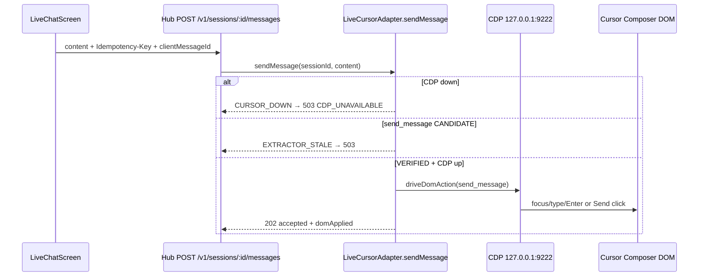

# Handoff — Fix Composer sender path

**Date:** 2026-09-25  
**Phase focus:** 1 (live send) + 4 (queue / UX)  
**Locks check:** PC-local only · open-project remote · CDP `127.0.0.1` only · selector pack remains **CANDIDATE** (not VERIFIED)

## Scope note (no misread)

“Sender” here means **phone → Hub → LiveCursorAdapter → Composer `send_message`**.  
Repo grep found **no** email / Telegram / SMTP sender surfaces — primary fix is Composer message send.

## Path traced

## Root cause (why send fails today)

| Layer | Status | Effect |
|-------|--------|--------|
| CDP `127.0.0.1:9222` | **Down** (curl connect refused, 2026-09-25) | Adapter returns `CURSOR_DOWN` → Hub `CDP_UNAVAILABLE` |
| Selector pack `send_message` | **CANDIDATE** (`cursor-ui@2026.09-candidate`) | Even with CDP up → `EXTRACTOR_STALE` fail-closed (correct) |
| Mobile UX (pre-fix) | Input disabled whenever health “degraded” | Offline/CDP-down **queue could not be filled** — only queued if NETWORK_ERROR while CDP looked healthy |
| Health typing | Mobile ignored Hub `liveAdapter` | `extractor_stale` looked like Ready in connection state |

**Not marked VERIFIED:** no live DOM strategy matches — CDP was unreachable, so no probe evidence.

## Done

- Confirmed sender = Composer send path (not email/telegram).
- Probed CDP: **still down** — no strategy match table; pack stays CANDIDATE.
- Fixed mobile sender UX + queue gating:
  - Composer stays editable when Hub session allows messaging (so queue can fill on mesh/CDP-down).
  - Clear **“Sender blocked: enable CDP / verify selectors”** copy via health + API errors.
  - Queue on `NETWORK_ERROR` / `CDP_UNAVAILABLE` / `CURSOR_DOWN`; **do not** queue `EXTRACTOR_STALE`.
  - Flush only when connection state is truly `Ready` (not `SenderBlocked` / `CDPOff`).
  - Surface Hub `liveAdapter` on Health; parse error `details`.
- Hub: reject empty `content` with `400 VALIDATION_ERROR` before adapter call.
- Adapter: clearer CDP / EXTRACTOR_STALE send_message messages.
- Tests: mobile 37 pass; hub `sessions-live` 8 pass; live-cursor `adapter` 11 pass.

## Files

- `apps/mobile/src/hub/types.ts` — `liveAdapter` on health; `HubApiError.details` / `isSenderBlocked`; `domApplied` on post message
- `apps/mobile/src/hub/client.ts` — `isSenderMutationsBlocked`, `formatSenderError`, `shouldQueueSenderFailure`; richer degrade reasons; parse details
- `apps/mobile/src/hub/connection-state.ts` — `SenderBlocked` state; flush gated on Ready only
- `apps/mobile/src/screens/LiveChatScreen.tsx` — sender banners, queue rules, error copy
- `apps/mobile/src/screens/HealthScreen.tsx` — live adapter row
- `apps/mobile/src/hub/client.test.ts` · `apps/mobile/src/queue/outbound-queue.test.ts` — coverage
- `packages/hub/src/routes/api.ts` — empty content validation
- `packages/adapters/live-cursor/src/adapter.ts` — sender error copy
- `docs/reports/handoff-fix-sender-2026-09-25.md` — this handoff

## Open gaps

- **Operator:** relaunch Cursor with `--remote-debugging-port=9222` (bind `127.0.0.1` only).
- **Operator + R6:** live-prove `send_message` strategies in DevTools; flip pack action to **VERIFIED** only with DOM evidence (see [`operator-uat-checklist-2026-09-25.md`](./operator-uat-checklist-2026-09-25.md) §7).
- Optional: `LIVE_CDP_PROBE=1 npm test -w @cursor-mobile/live-cursor` after CDP is up (attach only — still not VERIFIED).
- Full live E2E send still blocked until both CDP up **and** `send_message` VERIFIED.

## Next agent

- **Role:** R6 LiveCursor / operator UAT  
- **Next action:** After CDP relaunch, probe `send_message` strategy hits on live Composer; only then mark VERIFIED and re-run metal send smoke.

## Do not

- Flip selector pack to VERIFIED without live DOM proof.
- Expose CDP off-loopback or move Hub off the operator PC.
- Claim live Composer send E2E is green while CDP is down / pack is CANDIDATE.
