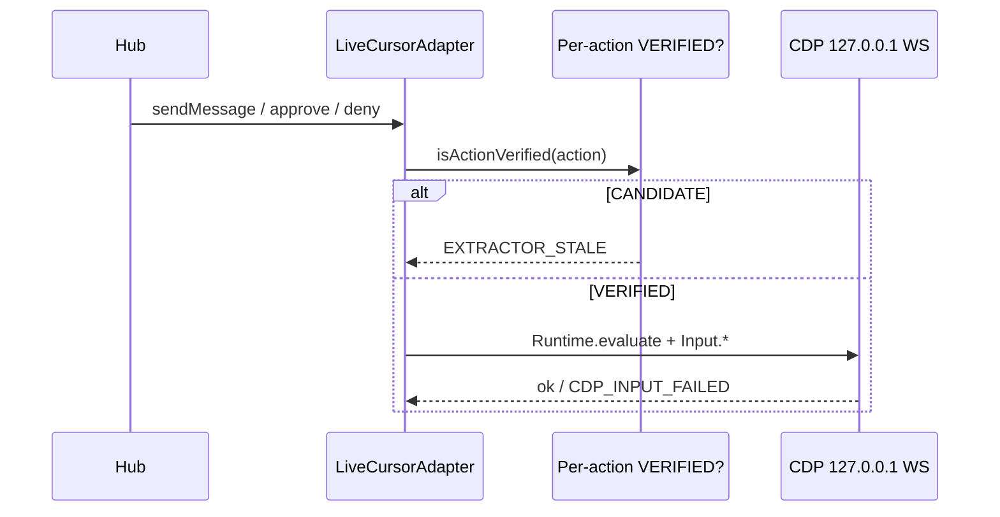

# Handoff — Phase 1 CDP Input executor (gated)

**Date:** 2026-09-25  
**Phase focus:** 1  
**Locks check:** PC-local only · open-project remote · CDP `127.0.0.1` only · Tailscale + pairing · Expo APK · **no fake DOM success** · **no action marked VERIFIED**

## Done

- CDP Input executor in `@cursor-mobile/live-cursor`:
  - `Input.dispatchMouseEvent` (press/release click)
  - `Input.insertText` + `Runtime.evaluate` editable fallback + `Input.dispatchKeyEvent` Enter
  - Element resolve via `Runtime.evaluate` + selector strategies / textMatch
- **Per-action VERIFIED gate** — CANDIDATE / unverified → `EXTRACTOR_STALE` and **no** CDP session open
- Mock-VERIFIED inject (tests only) → opens loopback debugger factory and attempts CDP path
- Loopback guards on HTTP CDP base **and** `ws://` debugger URLs
- Default selector pack remains **all CANDIDATE** (nothing flipped VERIFIED this turn)



## Files

| Path | Change |
|------|--------|
| `packages/adapters/live-cursor/src/cdp-client.ts` | WS CDP client + mock factory + loopback debugger assert |
| `packages/adapters/live-cursor/src/cdp-input.ts` | Click / type / Enter executor |
| `packages/adapters/live-cursor/src/cdp-input.test.ts` | CANDIDATE reject · mock VERIFIED CDP path |
| `packages/adapters/live-cursor/src/adapter.ts` | Wire `driveDomAction` behind verification gates |
| `packages/adapters/live-cursor/src/types.ts` | `CDP_INPUT_FAILED` · window `webSocketDebuggerUrl` |
| `packages/adapters/live-cursor/src/index.ts` | Exports |
| `docs/reports/goal-progress-2026-09-25.md` | Blocker #2 status |
| `docs/reports/handoff-phase1-cdp-input.md` | This handoff |

## How to test

```bash
cd /data/projects/cursor_mobile
npm test -w @cursor-mobile/live-cursor
# Optional live attach (still fail-closed while CANDIDATE):
LIVE_CDP_PROBE=1 npm test -w @cursor-mobile/live-cursor
```

Expect: `cdp-input.test.ts` covers CANDIDATE → no CDP calls; mock VERIFIED → `Input.dispatchMouseEvent` / `Input.insertText`.

## Open gaps

- **All five actions still CANDIDATE on live Cursor** — operator must verify DOM before flipping flags ([`CONFIGURATION.md`](../CONFIGURATION.md))
- Live Composer E2E (real CDP Input on metal) not run this turn
- `model_select` / `file_attach` use click path when VERIFIED but Hub create still mostly registry + gate
- TOR-08 UAT / Tailscale mesh still pending

## Next agent

- **Role:** **R6 Live Adapter Engineer** (or operator + R6)
- **Next action:** With Cursor CDP on `127.0.0.1` only, manually prove strategies → mark actions VERIFIED one-by-one in `selector-pack.ts` → smoke send/approve on metal

## Do not

- Mark actions VERIFIED without live Cursor UI proof
- Expose CDP beyond `127.0.0.1`
- Treat unit-test mock VERIFIED as DOM verification
- Claim full live E2E

## Product locks still true?

Yes — PC-local · open-project remote · continue/create with PC tools · Tailscale+pair · CDP localhost · Expo APK · docs ≠ full live DOM.
