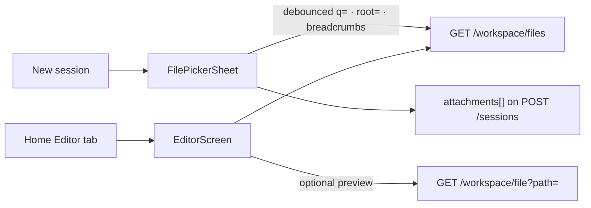

# Handoff — Phase 3 richer files / optional editor

**Date:** 2026-09-25  
**Phase focus:** 3  
**Locks check:** PC-local only · open-project remote · CDP localhost · Tailscale + pairing · Expo APK · no cloud · Editor is attach/browse only (FR-071)

## Done

- Phase 3 **richer file picker** on New Session: debounced Hub `q=` (~300ms), multi-root chips + `root=` filter, path breadcrumbs, root labels on rows.
- **Optional Editor** tab on Home + `Editor` screen: list via `/workspace/files`, read-only text preview via new Hub `GET /workspace/file?path=` (64KB cap, roots-only). Documented as optional Phase 3 — **not** code-server / full IDE.
- Pure **picker helpers** + unit tests; Hub preview route + tests; feature docs updated (no parallel architecture).
- **Multi-root Hub binding (2026-09-25 follow-up):** `resolveWorkspace` merges `CURSOR_WORKSPACE_ROOTS` and/or `.code-workspace` folders; `GET /workspace` + `/workspace/files` expose `roots[]`; attach validation under all roots (`rootName:path` for siblings); mobile `attachmentPathForItem` + `rootQueryForHub` name/abs filters.
- **Attach inject path:** `LiveCursorAdapter.attachFiles` + Hub `POST .../attachments` — Hub registers always when paths valid; `domApplied` only when `file_attach` VERIFIED + CDP click succeeds (else fail-closed note).

## Files

| Path | Change |
|------|--------|
| `apps/mobile/src/picker/helpers.ts` | debounce, breadcrumbs, root labels, toggle |
| `apps/mobile/src/picker/helpers.test.ts` | unit tests |
| `apps/mobile/src/components/FilePickerSheet.tsx` | Phase 3 picker UI |
| `apps/mobile/src/screens/NewSessionScreen.tsx` | uses FilePickerSheet |
| `apps/mobile/src/screens/EditorScreen.tsx` | optional browse/preview |
| `apps/mobile/src/screens/HomeScreen.tsx` | Editor tab |
| `apps/mobile/App.tsx` · `src/navigation/types.ts` | Editor route |
| `apps/mobile/src/hub/client.ts` · `types.ts` | `getWorkspaceFile` |
| `apps/mobile/package.json` | include helpers.test.ts |
| `packages/hub/src/workspace/files.ts` | `readWorkspaceFilePreview` |
| `packages/hub/src/routes/api.ts` | `GET /workspace/file` |
| `packages/hub/tests/phase1/workspace-apis.test.ts` | preview + path escape |
| `packages/hub/README.md` | route table |
| `docs/features/new-session-composer.md` | Phase 3 attach + editor |
| `docs/features/phone-apk-screens.md` | Editor screen |
| `docs/reports/handoff-phase3-files-editor.md` | this handoff |

## Open gaps

- Live create / attach still **fail-closed** on CANDIDATE selector pack (`file_attach` / model DOM) — Hub registers paths with `domApplied: false` until `file_attach` is VERIFIED; CDP inject stays gated.
- No syntax highlighting / WebView code-server (intentionally deferred; list+preview is enough for FR-070).
- Editor does not yet pre-seed New session attachments from a selected path (user re-picks or uses sheet).
- Full metal UAT of multi-root picker against a running Hub + phone still open.

## Closed this follow-up (2026-09-25)

- **Multi-root Hub binding:** `CURSOR_WORKSPACE_ROOTS` + `.code-workspace` folders → `GET /workspace.roots[]`; file search/preview/attach validate under all roots.
- **Attach inject API path:** `LiveCursorAdapter.attachFiles` — soft-gate when CANDIDATE (`domApplied: false`); CDP click only when VERIFIED.
- **Mobile wiring:** sibling roots use `root=` name filter + `rootName:path` attachment keys.

## Next agent

- **Role:** R6 selector verify / R8 TOR-08 UAT.
- **Next action:** Operator: CDP up → `verify:cdp` for `file_attach`; phone Tailscale online → multi-root picker UAT — do **not** add cloud paths.

## Do not

- Do not wire phone camera roll as workspace files.
- Do not dial CDP from the APK or store remote CDP URLs.
- Do not claim code-server / full IDE as shipped.

## Doc sync

- Updated: `docs/features/new-session-composer.md`, `docs/features/phone-apk-screens.md`, Hub README.
- TOR-04 §6.8 / §6.10 remain authoritative design; implementation matches optional list+preview path.
