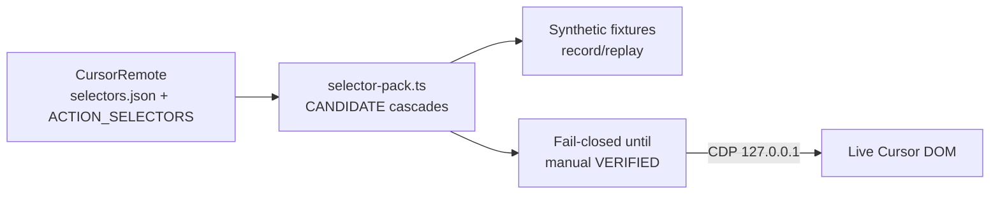

# Handoff — Phase 3 selector candidates (expand CANDIDATE strategies)

**Date:** 2026-09-25  
**Phase focus:** 3 (richer attach UX prep) · selector harden input for Phase 4  
**Locks check:** PC-local only · open-project remote · CDP `127.0.0.1` only · all actions remain **CANDIDATE** (not VERIFIED)

## Done

- Inspected public [CursorRemote](https://github.com/len5ky/CursorRemote) DOM strategy sources (again for 2026.09.3):
  - `selectors.json` (chatInput, approve/reject, modelDropdown, chatContainer, **chatTabList**)
  - `ACTION_SELECTORS` in `src/server/transports/telegram/commands.ts` (ui-shell + legacy `.composer-*` + allowlist/build)
  - `command-executor.ts` model menu lookup + glass-sidebar / agent-sidebar tab switch
  - CHANGELOG notes for Cursor 3.5+ model picker and 3.8+ questionnaire `data-click-ready`
- Expanded default pack strategies in `selector-pack.ts` (version **2026.09.3-candidate**); **verification still CANDIDATE** for all six actions (incl. `composer_history_open`).
- Fixture matcher now handles multi-class (`div.composer-bar.editor`) and child combinators (`>`).
- Added pack-structure unit tests (unique strategies, CursorRemote-inspired fallbacks, fail-closed, no comma-joined cascades).
- Updated synthetic fixtures / manifest version for replay CI.

## Strategies added (by action) — refresh 2026.09.3-candidate

All remain `verification: "CANDIDATE"`. Existing strategies kept; new ones appended / reordered for ARIA-first where safe. **Still fail-closed — no VERIFIED flips.**

### `send_message`

| Added / emphasized | Why |
|--------------------|-----|
| `div.composer-bar.editor [role/contenteditable/textarea]` | CursorRemote chatContainer preferred scope |
| Scoped Send under `div.composer-bar.editor` / auxiliarybar | Click-send when ⌘+Enter-only |

### `approve`

| Added | Why |
|-------|-----|
| `.composer-tool-call-status-row .anysphere-button/.anysphere-secondary-button.composer-run-button` | CursorRemote ACTION_SELECTORS apr/all legacy |
| `.composer-create-plan-build-button` | ACTION_SELECTORS `bld` |
| Questionnaire `div[data-click-ready]` + `span.truncate` | Cursor 3.8+ Continue label path |
| Scoped `[data-find-row-key*='tool-placeholder']` / activity row run btn | Cursor 3.8+ tool cards |

### `deny`

| Added | Why |
|-------|-----|
| `Skip All` ARIA + role | Broader deny surface |
| `.anysphere-button.composer-skip-button` | Legacy |
| Questionnaire `div[data-click-ready]` + truncate | Cursor 3.8+ Skip (disambiguate via textMatch) |
| Scoped tool-row skip btn | Cursor 3.8+ activity rows |

### `model_select`

| Added | Why |
|-------|-----|
| `[role='menu']:not([hidden])` | command-executor menu fallback after testid removed |
| `.composer-bar-input-buttons [aria-label*='Model']` | Input-chrome scope |

### `file_attach`

| Added | Why |
|-------|-----|
| `Add files` ARIA · `composer-bar.editor` / `composer-bar-input-buttons` scopes | Higher hit rate near Composer |
| `[data-command-id*='composer.addContext']` · mention/context-chip classes | Structural fallbacks |

### `composer_history_open`

| Added | Why |
|-------|-----|
| CursorRemote `chatTabList`: glass-sidebar-agent-menu-btn / agent-sidebar-cell | Live Agents window tab switch |
| `data-composer-status` · auxiliary-bar-chat-title | Title / status chrome |

## Files

| Path | Change |
|------|--------|
| `packages/adapters/live-cursor/src/selector-pack.ts` | Expanded CANDIDATE strategies; version `2026.09.3-candidate` |
| `packages/adapters/live-cursor/src/selector-pack.test.ts` | Pack structure + CursorRemote fallback + fail-closed assertions |
| `packages/adapters/live-cursor/fixtures/selector-pack/*` | Manifest `2026.09.3` + `composer_history_open-sidebar` fixture |
| `docs/reports/handoff-phase3-selector-candidates.md` | This handoff |

## Open gaps

- **No action marked VERIFIED** — live Cursor DevTools proof still required ([`CONFIGURATION.md`](../CONFIGURATION.md) § Marking a selector pack VERIFIED).
- Questionnaire `data-click-ready` hits both Continue and Skip — executor must disambiguate by label/textMatch (not selector alone).
- `file_attach` strategies are hypothesized (no CursorRemote reference) — highest risk of miss on live UI.
- CDP still binds **`127.0.0.1` only**; phone never dials CDP.
- Full live E2E (send / approve on metal) still blocked by CANDIDATE gate.

## Next agent

- **Role:** R7 Live Adapter Engineer (operator assist)
- **Next action:** With Cursor CDP on `127.0.0.1` only, manually prove each action’s first-hit strategy in DevTools → flip per-action `VERIFIED` + `verifiedAt` / `verifiedAgainst` one-by-one → smoke send/approve. Do **not** set `LIVE_SELECTOR_PACK_READY` as a substitute for DOM proof.

## Do not

- Mark any action VERIFIED without a live Cursor UI check on this PC.
- Expose CDP beyond localhost / recommend cloud Remote Control.
- Treat synthetic fixture replay as live verification.

## Product locks still true?

Yes — PC-local only · open-project remote · Tailscale + pairing · CDP `127.0.0.1` · Expo APK · docs ≠ code for unfinished live E2E.
