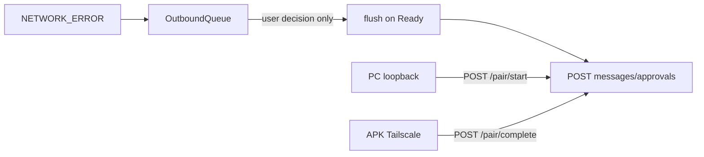

# Handoff — Phase 4 harden (pair persist + offline queue)

**Date:** 2026-09-25  
**Phase focus:** 4  
**Locks check:** PC-local only · open-project remote · CDP `127.0.0.1` · Tailscale + pairing · Expo APK · docs≠full product (selector harden still open)

## Done

- **Hub pairing persist (NFR-REL-06)**
  - `PairingStore` writes/loads `HUB_DATA_DIR/devices.json` (default `./data/devices.json`)
  - Revoke persists; Hub restart re-authenticates stored tokens
  - `HUB_DATA_DIR=none|off` → in-memory only (tests default via vitest env)
- **Local-only `POST /pair/start` (TOR-03 `local`)**
  - `requireLocal()` → `403 FORBIDDEN` for non-loopback clients
  - Phone still uses `POST /pair/complete` (public) over Tailscale
- **Mobile offline outbound queue (FR-091 / NFR-OFF-03)**
  - Queue messages + *user-decided* approvals with stable Idempotency-Key
  - Flush on Ready (WS open / healthy health) — **never invent Approve**
  - SecureStore durability (`outbound_queue_v1`); cleared on unpair
- **Distinct connection states (NFR-OFF-01)**
  - `Ready | TailscaleDown | HubDown | CursorDown | CDPOff | Unpaired | Revoked | Queuing | Unknown`
  - Shown on Live chat + Health
- **Tests:** Hub `tests/phase4/pair-persist.test.ts`; mobile `src/queue/outbound-queue.test.ts`
- **Config:** `HUB_DATA_DIR` in `docs/CONFIGURATION.md` + `.env.example`



## Files

| Path | Change |
|------|--------|
| `packages/hub/src/pairing-persist.ts` | `devices.json` load/save |
| `packages/hub/src/local-guard.ts` | Loopback check + `requireLocal` |
| `packages/hub/src/config.ts` | Persist-aware `PairingStore`, `hubDataDir` |
| `packages/hub/src/routes/api.ts` | `requireLocal` on `/pair/start` |
| `packages/hub/src/cli.ts` · `index.ts` | Log dataDir; export guards |
| `packages/hub/tests/phase4/pair-persist.test.ts` | Persist + local guard tests |
| `packages/hub/vitest.config.ts` · `package.json` | `HUB_DATA_DIR=none`; `test:phase4` |
| `apps/mobile/src/queue/outbound-queue.ts` | Queue helpers + flush |
| `apps/mobile/src/queue/secure-storage.ts` | SecureStore adapter |
| `apps/mobile/src/queue/outbound-queue.test.ts` | Queue + connection-state tests |
| `apps/mobile/src/hub/connection-state.ts` | NFR-OFF-01 states |
| `apps/mobile/src/screens/LiveChatScreen.tsx` | Queue on offline; flush; state banner |
| `apps/mobile/src/screens/HealthScreen.tsx` | Connection state copy |
| `apps/mobile/src/session/AppSessionContext.tsx` | Shared queue; clear on unpair |
| `docs/CONFIGURATION.md` · `.env.example` | `HUB_DATA_DIR` |
| `.gitignore` | `/data/` · `packages/hub/data/` |
| `docs/reports/handoff-phase4-harden.md` | This handoff |
| Root `package.json` | `test:phase4` |

## How to test

```bash
# Hub Phase 4 (persist + local guard)
npm run test:phase4 -w @cursor-mobile/hub

# Mobile queue + connection-state helpers (+ existing client/picker)
npm run test:mobile

# Combined
npm run test:phase4

# Manual Hub persist smoke
HUB_DATA_DIR=./data npm run start -w @cursor-mobile/hub
# On PC loopback: curl -X POST http://127.0.0.1:8787/v1/pair/start -H 'content-type: application/json' -d '{}'
# Restart Hub → previous device tokens still authenticate
# From a Tailscale peer IP, pair/start should 403 FORBIDDEN (loopback only)
```

## Open gaps

- **FR-091 selector harden** — LiveCursorAdapter selector packs still CANDIDATE / fail-closed; not in this handoff
- **pair/start remote spoof** — Express+supertest cannot forge `remoteAddress`; covered by unit middleware test
- **Queue flush after CDP recover** — flush gated on health Ready; Live chat relies on session health snapshot (refresh Health if stale)
- **GET/DELETE `/pair/devices` local routes** — still designed, not implemented
- Phase 3 richer picker polish may still be in flight alongside this

## Next agent

- **Role:** R7 Live Adapter Engineer — FR-091 selector pack harden / verified actions
- **Also:** R9 — operator UAT: airplane-mode queue → reconnect flush; Hub restart keeps pair
- **Next action:** Verify selector packs against live Cursor UI; keep mutations fail-closed until VERIFIED

## Do not

- Allow `pair/start` over Tailscale / public bind
- Silent auto-approve from queue (only flush decisions the user already tapped)
- Claim full live E2E or selector harden done
- Commit `data/devices.json` (gitignored secrets)

## Product locks still true?

Yes — PC-local · open-project remote · continue/create with PC tools · Tailscale+pair · CDP localhost · Expo APK · docs≠full product for selector harden.
