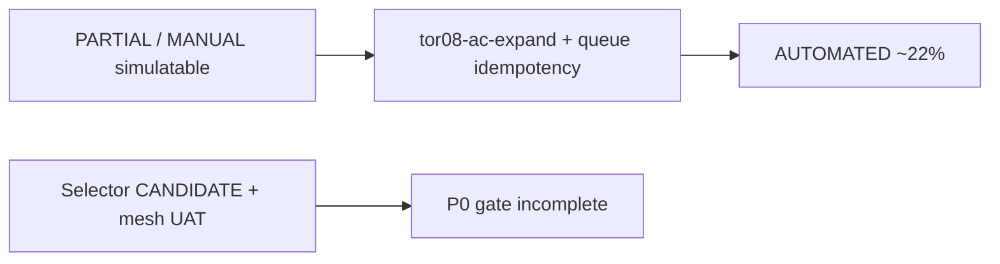

# Handoff — TOR-08 AC expand (simulated P0 automation)

**Date:** 2026-09-25  
**Phase focus:** docs + tests (TOR-08 P0 coverage; no full UAT claim)  
**Locks check:** PC-local only · open-project remote · CDP localhost · fail-closed · docs ≠ Pass sheet

## Done

- Added Hub suite `packages/hub/tests/tor08-ac-expand.test.ts` (**9** tests) covering simulatable PARTIAL gaps without live Cursor:
  - `POST /pair/start` → **403 FORBIDDEN** for forged Tailscale peer (`100.64.1.2`)
  - Paired device token survives Hub `PairingStore` restart from disk (NFR-REL-06)
  - `GET /workspace/files?q=` + `root=` scope + escape → empty (fail-closed)
  - `GET /sessions?mode=history` empty index
  - `GET /health` `liveAdapter.state=extractor_stale` with mock CDP + CANDIDATE pack
  - `POST …/open-on-pc` → **503 OPEN_ON_PC_CDP_DOWN**
- Extended mobile `outbound-queue.test.ts` (**+2**): flush idempotency (no re-POST; stable Idempotency-Key on retry).
- Re-tallied [`tor08-p0-coverage-matrix-2026-09-25.md`](./tor08-p0-coverage-matrix-2026-09-25.md): **AUTOMATED 18→21 (~22%)**; flipped AC-030-03, AC-051-01, AC-051-04.

## Files

| Path | Change |
|------|--------|
| `packages/hub/tests/tor08-ac-expand.test.ts` | created — expand suite |
| `apps/mobile/src/queue/outbound-queue.test.ts` | +2 flush idempotency cases |
| `docs/reports/tor08-p0-coverage-matrix-2026-09-25.md` | updated counts / evidence / % |
| `docs/reports/handoff-tor08-ac-expand.md` | this handoff |

## Test counts (green)

| Suite | Pass | Skip |
|-------|-----:|-----:|
| Hub (`npm run test -w @cursor-mobile/hub`) | **65** | 0 |
| live-cursor | **31** | 3 |
| history | **6** | 0 |
| mobile (`npm run test:mobile`) | **36** | 0 |
| **`npm test` (packages)** | **102** | **3** |

**New tests this turn:** Hub **+9** · mobile **+2** → **+11** cases.

## Automation %

| Metric | Before | After |
|--------|-------:|------:|
| P0 AUTOMATED (of 96) | ~19% (18) | **~22% (21)** |
| AUTOMATED + PARTIAL | ~47% | **~47%** (24 PARTIAL) |
| MANUAL_ONLY + BLOCKED | ~53% | **~53%** |

**Do not claim:** TOR-08 Pass, Phase 1 DoD, or full live E2E.

## Open gaps

- Selector pack still all CANDIDATE → AC-030/031/053/060/062 happy paths BLOCKED.
- Mesh / phone / APK UAT still MANUAL_ONLY (AC-001-01/02, AC-003-*, AC-011-*, AC-080/081).
- AC-X-02 remains PARTIAL until CDP-on-Tailscale negative probe on metal.
- Deferred history/open-on-pc/queue now have API auto evidence but are **not** P0 Pass.

## Next agent

- **Role:** R6 (selector pack) → then R8 (operator Pass/Fail/Blocked sheet)
- **Next action:** Verify pack actions against real Cursor DOM; do **not** flip CANDIDATE via env-only smoke without DOM proof.

## Do not

- Claim full UAT or raise AUTOMATED % by treating PARTIAL as Pass.
- Soft-open cloud Agents / Remote Control / public CDP.
- Depend on live Cursor in CI for these expand cases (mock CDP + in-process Hub only).
