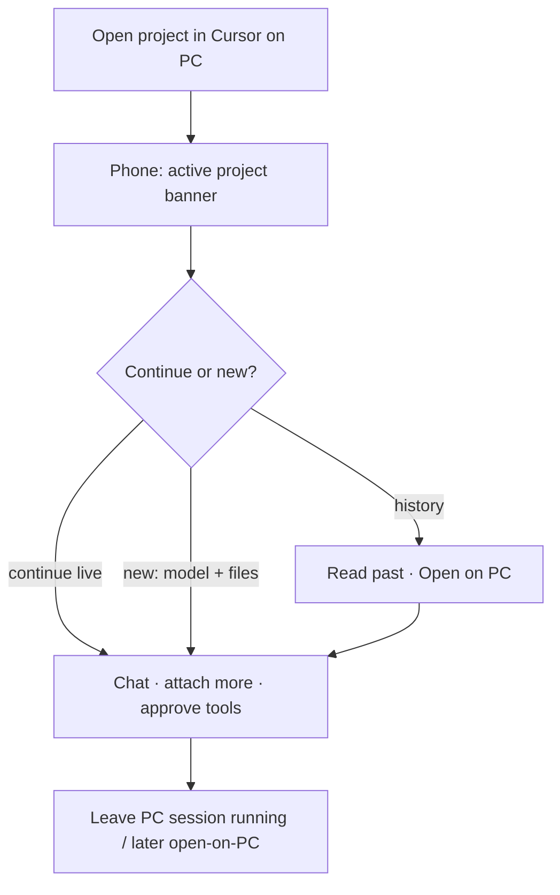
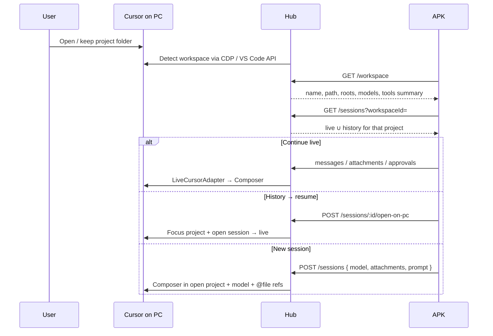
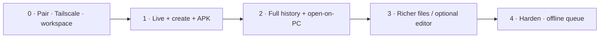
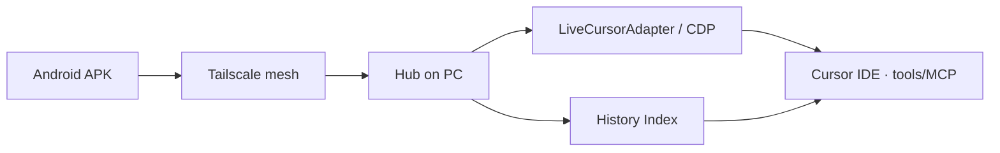
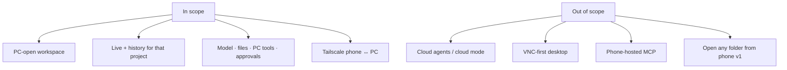

<!-- generated-by: gsd-doc-writer -->
# Report — How we work: phone ↔ PC (operator narrative)

**Date:** 2026-09-24  
**Audience:** operators and product owners  
**Decision lock:** PC-local only — no cloud mode  
**Canonical design:** [`docs/architecture/mobile-cursor-companion.md`](../architecture/mobile-cursor-companion.md) · [`docs/features/remote-sessions.md`](../features/remote-sessions.md) · [`docs/reports/gap-closure-hybrid-system-2026-09-24.md`](./gap-closure-hybrid-system-2026-09-24.md)

## 1. What the phone should feel like day-to-day

The phone is a **remote Composer for the project already open on the PC** — not a second IDE, not a cloud agent console, and not a place to clone or open folders.

Day-to-day loop:

1. On the PC, open a project in Cursor the way you already do.
2. On the phone, the APK shows that **same project** (name/path banner) — always obvious what you are bound to.
3. You either **continue** a session that already belongs to that project, or **create** a new one: pick **model**, **attach files** from the project roots, send a prompt.
4. While the agent runs, you **chat**, see tool/plugin/MCP calls as cards, and **Approve / Deny** — tools execute on the PC inside Cursor, never on the phone.
5. If Cursor has no folder open, CDP is down, or Tailscale is down, the phone shows a **clear error** — never a fake empty workspace or silent approvals.

**Product feel in one line:** pocket remote for the agent loop on *this* machine’s open work — continue what you started at the desk, or start the next Composer turn without sitting down.

## 2. How PC sessions and phone stay in sync

Sync is **workspace-bound**, not “all chats everywhere.” The Hub reports the active workspace; the APK lists and acts only on sessions for that project.

| Mode | Meaning | Phone can |
|------|---------|-----------|
| `live` | Open Composer/agent in Cursor for this workspace | Chat, change model if Cursor UI allows, attach more files, approve tools |
| `history` | Past session for this project (PC local store) | Read; **Open on PC** in this project → becomes `live` |
| `editor` | Optional later — browse project files | Pick attachments / view (Phase 3+) |

**Rules that keep sync honest:**

- Phone cannot create a session against a different folder than the open workspace (v1).
- Live state comes from CDP/Composer control; history comes from a local History Index filtered by workspace.
- Multi-window: user picks which Cursor window/workspace (same idea as CursorRemote window switch).
- No cloud credentials and no cloud session list — “all sessions” means **all local sessions for this PC-open project**.

## 3. What we build in what order (and why)

Phasing follows **trust first, then live control, then completeness, then polish**. Pairing and workspace truth before chat; live continue before full history; richer files only after the agent loop works.

| Phase | Delivers | Why this order |
|-------|----------|----------------|
| **0** | Pair, Tailscale path, health, **active workspace** banner | Without bind + connectivity, every later feature lies about context |
| **1** | Live continue + tool approvals + create (model + basic attach) + Expo APK | Day-to-day value: pocket Composer for the open project |
| **2** | Full project session history + open-on-PC | Completes “all existing sessions for this project” |
| **3** | Richer file picker / @-mentions; optional editor tab | Attachment UX depth once create/continue is solid |
| **4** | Harden CDP selectors, offline queue | Reliability after the surface area is real |

Cross-check with feature map: workspace banner + health → Phase 0; continue live, approvals, new session, APK → Phase 1; full history → Phase 2; multi-root/@-file → Phase 3; harden → Phase 4. See [`docs/features/remote-sessions.md`](../features/remote-sessions.md).

## 4. How security and Tailscale fit the workflow

The Hub and CDP stay on the PC. The phone reaches them only over a **private mesh** (Tailscale preferred). We do not expose CDP or the Hub on the public internet.

| Layer | Role in the workflow |
|-------|----------------------|
| Tailscale | Phone ↔ PC path; pairing assumes this private reachability |
| Pair / auth | Device pairing endpoints (`POST /pair/...`); Hub not a public API |
| Approvals | Tool runs never auto-approve silently; deny is first-class |
| Workspace bind | Limits blast radius to the project Cursor already has open |
| Health | Surface Tailscale/CDP/workspace failures before the user trusts a session |

Operational habit: start Tailscale on phone and PC → Hub healthy → open project in Cursor → use APK. If Tailscale is down, the product should say so rather than hang or invent state.

## 5. Why this is better than forking CursorRemote or Paseo alone

We **borrow**, we do not bet the product on a single upstream clone.

| Source | We take | Alone it lacks for us |
|--------|---------|------------------------|
| [CursorRemote](https://github.com/len5ky/CursorRemote) | Live chat, approvals, prompts, multi-window CDP patterns | No strong project banner/workspace bind; weak new-session (model/files); tools often opaque DOM; browser-first, not our Expo APK; no full project history |
| [cursor-session](https://github.com/iksnae/cursor-session) | Local past-session extract for the project | Not a live control surface or mobile app |
| [Paseo](https://github.com/getpaseo/paseo) | Daemon + Expo/APK companion shape | Agent-daemon oriented; not verified Cursor Composer import / PC-open workspace bind |

**Hybrid Hub advantage** (from gap closure):

- `/workspace` + APK header → always know the PC-open project.
- Explicit create sheet: **model + attachments** → not a thin “send prompt” mirror.
- Structured approval cards + tools summary → tools/plugins/MCP stay on PC, phone decides.
- History Index filtered by workspace → list *this* project’s past chats, then open-on-PC.
- Expo APK → sideload companion, not browser-only.

Forking CursorRemote alone leaves history and product binding half-done. Forking Paseo alone leaves Cursor Composer continuity unverified. The hybrid is the gap closure: **Cursor-specific live + local history + mobile shell**, scoped to the open PC project.

## 6. Explicit non-goals

| Non-goal | Why |
|----------|-----|
| **Cloud mode / Cloud Agents / Remote Control as product path** | Scope lock: PC-local only; no cloud credentials or cloud session lists |
| **VNC-first / full remote desktop** | Valuable gap is session identity, transcript, and approvals — not mirroring the whole IDE screen |
| Opening arbitrary projects from the phone without Cursor having them open on the PC (v1) | Phone remotes the open project; it does not replace opening folders on the PC |
| Running MCP / tools / plugins on the phone | Execution stays in Cursor on the PC; phone approves |
| Browsing unrelated machines’ projects | Bound to this PC’s open workspace |
| Exposing CDP publicly | Private Tailscale (or equivalent) only |

## Decision one-liner

**Phone = remote Composer for the project already open on the PC.** Continue live or history → open-on-PC, or start new sessions with model + files + PC-side tools/plugins and approvals — over Tailscale, without cloud and without VNC-first.
