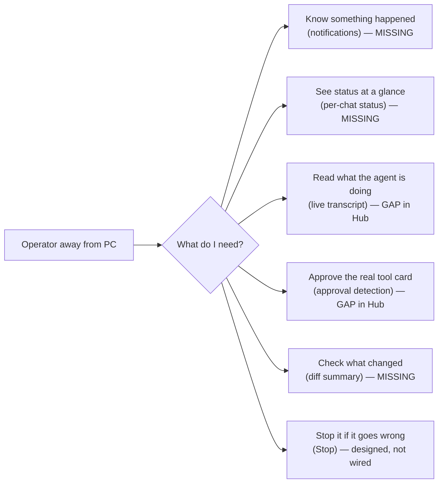

# Mobile UX — Comfort Gap Audit (Phase 5 plan vs real use)

**Date:** 2026-10-01 · **Scope:** [`05-UI-SPEC.md`](../../.planning/phases/05-mobile-ux-contract/05-UI-SPEC.md) (Amendments A–E) checked against current code (`apps/mobile`, `packages/hub`, `packages/adapters/live-cursor`)  
**Question:** What do the screens or the functionality behind them still need so the app is comfortable to use, beyond the plan we've already prepared?

> **Product locks still true:** everything below runs on the operator PC (Hub) or is phone UI only. No cloud push service, no VPS, no public CDP, no tools on the phone.

---

## Verdict

The plan is solid on **look and navigation** (Home tree, Cursor chat look, Settings cards, QR pairing). It is thin on **the reason people pick up the phone at all**: *"Is my agent done, stuck, or waiting for me?"* Three things the screens assume don't exist yet in code, and four things the plan doesn't cover at all.

---

## P0 — Without these, the redesigned screens are a nice shell over thin data

| # | Gap | Evidence in code | Why it hurts comfort | Fix (inside locks) | Screens touched |
|---|-----|------------------|----------------------|--------------------|-----------------|
| 1 | **Live transcript doesn't stream** | Hub WS has `session.updated`, `approval.*`, `message.failed` — no message/delta event; `api.ts` notes "REST snapshot not populated" | Opened chat is the screen we redesigned most, but it can't show what the agent is writing. The user has to go back to the PC to read it. | LiveCursorAdapter scrapes Composer message DOM over CDP → Hub emits `session.message.appended` / `.delta` over WS + REST snapshot | Opened chat |
| 2 | **Real tool approvals aren't detected** | Approvals reach the phone only via the dev/loopback enqueue route; UI-SPEC lists "Auto tool-approval scrape" as **Gap** | The core promise "phone approves tools" only works in UAT. In real use the agent waits on the PC and the phone never knows. | Adapter watches for the Composer approval card (selector pack already has `approve`/`deny` VERIFIED) → Hub emits `session.approval.requested` automatically | Opened chat, Home row status |
| 3 | **No notifications** | No notification library in `apps/mobile/package.json`; nothing in `src/` | The phone is useful *when you're not looking at it*. Without a buzz for "needs approval" / "finished" / "failed", the user has to keep opening the app to check. | **No FCM (that's Google cloud).** Use local notifications fired by the app itself: an Android foreground service keeps the Hub WS open over Tailscale while any agent is working, and shows a quiet ongoing notification ("Agent working · api"). Optional alternative: self-hosted ntfy **on the PC**. | New: notification channel settings in Account |
| 4 | **Stop isn't wired** | UI-SPEC: "Show Stop; wire when Hub/CDP stop exists"; no stop route in Hub | If an agent goes in the wrong direction while you're away, there's nothing you can do. That's the moment remote control matters most. | Add `stop` to the selector pack (Composer stop button) + `POST /sessions/:id/stop` | Opened chat |

> Items 1–2 are Hub/adapter work, not screen work, but the Phase 5 screens depend on them. The build plan should treat them as **prerequisites**, not polish.

---

## P1 — Not in the plan; adds real comfort

| # | Addition | Why | Shape (fits current IA, still two tabs) |
|---|----------|-----|------------------------------------------|
| 5 | **Per-chat status on Home rows** | The Cursor sidebar look shows title + time only. Away from the PC, the one thing you want from the list is *which chat needs me*. | Small status mark on `SessionRow`: ● working · ! waiting for approval · ✓ done · ✕ error. Sort "waiting for approval" to the top of its repo. |
| 6 | **Approvals badge on the Chats tab** | Approvals live only inside chats (locked: no third tab). With several chats you can't see that one is blocked. | Badge count on **Chats** tab + a slim "1 waiting for approval →" pill at top of Home that deep-links to the chat. Keeps the two-tab lock. |
| 7 | **Changes summary (what the agent edited)** | You can approve a tool, but you can't see what the agent already changed before you say "continue". | Read-only "Changed files" card at the end of an agent turn (file name, +/−). Tap → read-only diff using the existing `GET /workspace/file` path. **Keep / Undo all** only if a selector can be VERIFIED; otherwise view-only. |
| 8 | **Richer approval card** | Card is designed as Approve/Deny with no confirm. Deny is irreversible, and the user can't see enough to judge. | Show the full command (scrollable mono), working directory and the tool name. Approve stays one tap. Add a short **Undo** snackbar on Deny (3 s) before sending, instead of a confirm dialog. |
| 9 | **App lock (biometric / PIN)** | This phone can approve shell commands on your PC. A lost or borrowed unlocked phone = remote shell approver. | Optional fingerprint/PIN on open and before **Approve tool** (setting in Account → Security). Phone-only, no cloud. |
| 10 | **PC stays reachable** | If the PC sleeps or the Hub/Cursor isn't running after a reboot, every screen just shows Offline. | PC side: Hub as a user service (autostart) + inhibit sleep while an agent is working. Phone side: Offline state says *which* layer is down and offers "Open Tailscale" deep link. |
| 11 | **Draft + send survives bad network** | Phone networks drop. Losing a typed message is the most annoying failure on mobile. | Keep per-chat draft locally; outgoing messages show "Sending… / Not sent — Retry". UI-SPEC has a Queued strip; make it cover send failures too. |

---

## P2 — Polish worth planning now (cheap if designed in)

| # | Item | Note |
|---|------|------|
| 12 | **Quick replies** | Chips above composer after an agent turn: "Continue", "Run the tests", "Explain". Saves typing on a phone. |
| 13 | **Code blocks that work on a phone** | Horizontal scroll, monospace, **Copy** button per block. Not in the message stream table today. |
| 14 | **Share into a chat** | Android share sheet → "Send to Cursor chat" (text/URL, e.g. an error from another app). Images later, once camera attach is real. |
| 15 | **Dark theme** | Deferred in the plan. Most phone checking happens at night; consider pulling it to P1 after the light build. |
| 16 | **Large font check** | UI-SPEC flags tab labels and approval card as "backstop" at large font scale. Add timestamps and the Model pill to that check. |
| 17 | **Haptics** | Light haptic on Approve/Deny and on "agent finished" when the app is open. |
| 18 | **Rename / pin chats from phone** | Only if Hub can mirror it to Cursor; otherwise skip, so the phone never disagrees with the PC. |

---

## What the plan already covers well (no change needed)

- QR pairing with manual fallback and clear expiry/permission errors.
- Fail-closed states: no invented sessions or models; honest offline/stale hints.
- Session parity rules (Refresh now, focus refresh, WS-driven refresh, Last synced).
- Touch targets, safe areas, reduce-motion, accessibility labels.
- Keeping the phone as remote UI only (no MCP/tools on phone, no phone-side folders).

---

## Suggested next steps

1. **Decide P0 scope:** treat items 1–4 as prerequisites for the Phase 5 build (Hub/adapter wave first, then screens).
2. **Amend UI-SPEC (Amendment F)** for items 5, 6, 7, 8, 9, 11: they change Home rows, the tab bar, the approval card, the message stream and Account.
3. **Add to the research plan:** tasks for "you got a notification, what do you do?" and "check what the agent changed" ([research plan](mobile-ux-user-research-plan-2026-10-01.md)).
4. Spike: Android foreground service + local notifications in Expo (sideload APK, no FCM) to confirm battery cost and background limits on the Pixel 7.

---

## Handoff

- **Done:** Gap audit of Phase 5 plan vs code and real away-from-PC use; prioritised P0/P1/P2.
- **Files touched:** this report (new) · **follow-up same day:** user approved → `05-UI-SPEC.md` **Amendment F** added; `phone-apk-screens.md` synced; research plan updated (RQ12–RQ17, T9–T13).
- **Open gaps:** Items 1–4 need Hub/adapter work and new CDP selectors (stream scrape, approval-card watch, stop), all **not VERIFIED**.
- **Next agent:** Planner → `/gsd-plan-phase 5` with P0 as wave 1; UX role → UI-SPEC Amendment F.
- **Product locks still true?** Yes.
