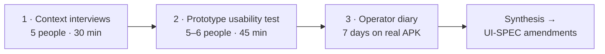

# Mobile UX — User Research Plan (Phase 5 screens)

**Date:** 2026-10-01 · **Owner role:** UX / mobile (see [`AGENT-ROSTER.md`](../architecture/AGENT-ROSTER.md)) · **Status:** Plan — not yet run  
**Subject:** The screens locked in [`05-UI-SPEC.md`](../../.planning/phases/05-mobile-ux-contract/05-UI-SPEC.md) (Amendments A–F; F added after the [comfort gap audit](mobile-ux-comfort-gap-audit-2026-10-01.md)) and mapped in [`phone-apk-screens.md`](../features/phone-apk-screens.md)

> **Product locks still true:** PC-local Hub only · phone remotes the project already open in Cursor · continue or create (tools run on PC, phone approves) · Tailscale + pairing · CDP `127.0.0.1` only · Expo sideload APK is remote UI only. Research must not test or propose cloud paths, phone-side folder opening, or public CDP.

---

## 1. Why research now

The UI-SPEC is **plan-locked but not built**: the APK still runs the older flat Gemini-style shell, while Home, Opened chat, Account and Pair were redesigned on paper to mirror Cursor's desktop sidebar, chat and Settings. Those redesigns rest on assumptions that haven't been checked with anyone holding a phone. This study checks them **before** the build, while changes are cheap.

## 2. Research questions

Each question maps to a decision in the UI-SPEC that could be wrong.

| # | Question | UI-SPEC decision at risk | Screen |
|---|----------|--------------------------|--------|
| RQ1 | Do people find the session they want faster with a Projects → Repositories → sessions tree than with a flat recent list? | Amendment A — Cursor sidebar on Home | Home |
| RQ2 | Does Cursor-desktop familiarity help on a phone, or does sidebar density feel cramped at full width? | Amendment A density (8–12px rows in a 44px hit box) | Home |
| RQ3 | Can people tell **live** sessions from **history** sessions, and do they expect history to open read-only + "Open on PC"? | Session row tap → Live vs History read | Home · History |
| RQ4 | Do people trust that the phone list matches the PC? What makes them doubt it, and do they find **Refresh now**? | Amendment E — session parity, sync hint | Home · Account |
| RQ5 | Is the circular `+` sheet (mode + Files + Model + MCP) discoverable, or do people look for extras elsewhere? | Amendment B — lean composer, extras behind `+` | Opened chat |
| RQ6 | Do mode chips (Plan / Debug / Multitask / Ask) and the Model pill make sense to phone users, or are they noise? | Amendment B mode chips + Model panel | Opened chat |
| RQ7 | Do people notice an inline tool approval card while away from the PC, and approve/deny with confidence (no second dialog)? | Approvals inline in chat, not a third tab; Deny has no confirm | Opened chat |
| RQ8 | Is QR pairing (PC shows QR → phone scans) obvious end to end, including Tailscale prerequisites? | Amendment D — QR primary, manual fallback | Pair |
| RQ9 | Do the error states (mesh down / Hub down / Cursor down / CDP queue) lead people to the right fix? | Copywriting contract error strings | Health · all |
| RQ10 | Does hiding **+ New Project** confuse people who know Cursor's sidebar? | Lock conflict, Option A (hide) | Home |
| RQ11 | Are two bottom tabs (Chats \| Account) enough, or do people want a dedicated approvals/notifications place? | IA lock — two tabs only + F3 Chats badge / waiting pill | Global |
| RQ12 | Which events deserve a notification, and how noisy is too noisy? Is the ongoing "Agent working" notification acceptable? | F2 — local notifications, channels, ongoing service | Notifications |
| RQ13 | From a notification, do people land where they expect and act without hunting? | F2 tap → deep link to chat / card | Notifications · Opened chat |
| RQ14 | Can people tell at a glance which chat needs them from the status marks alone? | F3 — row status marks, waiting sort | Home |
| RQ15 | Does approval card v2 give enough to judge a command, and is the 3 s Undo on Deny noticed and enough? | F4 — command/cwd, Deny undo instead of confirm | Opened chat |
| RQ16 | Do people want to check what the agent changed before continuing, and is a read-only diff enough on a phone? | F5 — Changes card + Diff screen, no Keep/Undo | Opened chat · Diff |
| RQ17 | Is "unlock to approve" reassuring or annoying? Should the whole app lock instead? | F6 — app lock defaults | Approval · Account |

**Out of scope:** pricing, cloud features, iOS, dark OLED theme (deferred), editor tab polish.

## 3. Who to talk to

This is a personal, PC-local tool. The core user is the **operator** (one Cursor power user who leaves agents running on their PC and checks them from a phone). Research should still go beyond the operator, because one person's habits bias every answer.

| Segment | n | Why |
|---------|---|-----|
| **Operator** (primary owner) | 1 | Real setup, real projects; runs the diary study |
| **Cursor daily users** who run long agent tasks | 4–5 | Core target; know the desktop sidebar, so they test the "Cursor familiarity" bet |
| **Agentic-IDE users not on Cursor** (Claude Code, Windsurf, Copilot agent) | 1–2 | Checks whether the UI only makes sense if you already know Cursor |

**Screener (all must be yes):** Android phone daily · uses an AI coding agent at least 3 days/week · has stepped away from the PC while an agent ran in the last month.  
**Nice to have:** has Tailscale or another mesh VPN; has hit an agent approval prompt while away.

## 4. Methods

Three methods, sized for a solo project. Total is about 2 weeks elapsed.



### 4.1 Context interviews (week 1, remote, 30 min)

Purpose: learn what people actually do on the phone while an agent runs, before showing any screens. Covers RQ4, RQ7, RQ11. Can be the first half of the usability session (see guide below) to save recruiting.

### 4.2 Moderated usability test of designed screens (week 1–2, 45 min)

**Stimulus:** a clickable phone-size prototype of the **designed** screens (Home sidebar, Opened chat with `+` sheet, Account cards, Pair QR). Build it as throwaway HTML via `/gsd-sketch` — no app code. Use the copy strings from the UI-SPEC word for word so the copy gets tested too.  
**Baseline:** for RQ1/RQ2 only, show half the participants the **current APK shell** (flat list) first and half the prototype first, then the other. This counterbalances order effects.  
**Format:** think-aloud on the participant's own phone (or Android emulator over screen share). Record screen and audio with consent.

### 4.3 Operator diary study (week 2, 7 days)

Operator uses the **current real APK** against their real Hub for a week and logs every phone session in a short template (below). Grounds the prototype findings in real mesh drops, real `cursor_down`, and real approvals. Covers RQ4, RQ7, RQ9, and RQ12–RQ13 once F2 notifications ship (run a second diary week after that build to compare "minutes until I noticed").

**Diary entry (copy per use):**

```
When / where:        (e.g. kitchen, 21:10, phone on Wi-Fi)
Why I opened it:     (check progress / approve / start a chat / curiosity)
What I did:
Did it work?         yes / partly / no — what blocked me
Did the list match the PC?   yes / no / didn't check
How I found out:     notification / opened app to check / never noticed
Minutes until I noticed:     (approval or finish → me reacting)
Approved/denied anything?    what, and was the card enough to judge?
Felt like:           1 (annoying) – 5 (great)
One thing I wanted:
```

## 5. Usability test script (45 min)

**Warm-up — 5 min**
- Explain: testing the design, not you. Think aloud. No wrong answers. Recording consent.
- "What do you use for AI coding, and how long do agent tasks usually run?"

**Context — 10 min**
- "Tell me about the last time an agent was running and you walked away from the PC. What happened next?"
- "How did you know when it was done or stuck?" *(probe: notifications, coming back to check, waiting)*
- "Has an agent ever been blocked waiting for your approval while you were away? What did that cost you?"
- "If you could do one thing about your PC agent from your phone, what would it be?"

**Tasks — 25 min** (prototype; read the scenario, don't name UI elements). If time runs short, keep T2, T4, T6, T9–T12 and drop T3, T7, T8.

| # | Scenario read aloud | Success = | RQ |
|---|---------------------|-----------|----|
| T1 | "You're setting this up for the first time. Your PC is showing a pairing screen. Connect your phone." | Taps **Scan QR**, understands the code comes from the PC | RQ8 |
| T2 | "You started a chat about fixing the login bug in the *api* project an hour ago. Open it." | Finds it under the right repository in ≤ 30 s, no wrong taps into another project | RQ1, RQ2 |
| T3 | "Open an older chat from last week and continue it." | Recognises history is read-only and uses **Open on PC**, or says why not | RQ3 |
| T4 | "The agent wants to run `npm install` and is waiting for you. Deal with it." | Finds the approval card, chooses Approve/Deny with stated confidence | RQ7 |
| T5 | "Start a new chat in Plan mode, using a different model, and attach a file." | Opens `+`, picks Plan, changes model, attaches — without hunting outside the composer | RQ5, RQ6 |
| T6 | "You just started a chat on the PC, but it's not on your phone. Fix that." | Pull-to-refresh or **Refresh now** in Account | RQ4 |
| T7 | (Show the *Cursor not detected* error) "What's going on, and what would you do?" | Correctly says the fix is on the PC (open Cursor with the project) | RQ9 |
| T8 | "You want to work on a different folder from your phone." | Understands it must be opened in Cursor on the PC; note any search for **New Project** | RQ10 |
| T9 | (Phone locked, show an **Approval needed** notification) "Your phone just buzzed. Handle it." | Taps notification → lands on card → decides; app lock prompt understood | RQ12, RQ13, RQ17 |
| T10 | (Home with 6 chats, mixed status) "Which chats need you right now, and which are done?" | Names the waiting and finished chats from marks/badge alone in ≤ 10 s | RQ14, RQ11 |
| T11 | (Card shows `rm -rf build && npm run build` in `~/api`) "Decide. Then change your mind." | States what it does and where; uses **Undo** within 3 s after Deny | RQ15 |
| T12 | "The agent says it fixed the bug. Check what it changed before you tell it to continue." | Opens **View changes** → a file diff; says whether it's enough to judge | RQ16 |
| T13 | (Offline: phone Tailscale off) "Nothing is loading. Get it working." | Reads the layer-specific message and taps **Open Tailscale** | RQ9 |

For each task, capture: success (yes / with help / no), time, wrong taps, quotes, and a 1–5 ease rating.

**Reaction — 5 min** *(session now runs ~50 min)*
- "Show me where you'd expect to see everything that's waiting for you." *(RQ11)*
- "Does this feel like Cursor? Is that good or bad here?" *(RQ2)*
- "How sure are you that what you see is what's on your PC right now? What would make you surer?" *(RQ4)*
- Notification sort: show a list of 8 possible notifications (approval needed, finished, failed, working, model changed, new chat on PC, sync stale, Hub restarted). "Which would you want on your lock screen, which in-app only, which never?" *(RQ12)*
- Single Ease Question per task already captured; end with SUS (10 items) for the whole prototype.

**Wrap-up — 3 min**
- "Anything confusing we didn't cover?" · "Would you install this?" · Thank you.

## 6. What we measure

| Metric | Target to keep the UI-SPEC decision as-is |
|--------|-------------------------------------------|
| T2 task success (find session) | ≥ 5/6 unaided, median ≤ 30 s, and not slower than the flat-list baseline |
| T4 approval handled correctly | 6/6, and no one says "I wasn't sure what Deny would do" |
| T5 extras found via `+` | ≥ 4/6 unaided |
| T6 refresh found | ≥ 4/6 unaided |
| T7 correct diagnosis | ≥ 5/6 |
| SUS | ≥ 75 |
| Diary: "list matched PC" | ≥ 90% of entries where it was checked |
| T9 notification → correct action | ≥ 5/6, no one lands on the wrong chat |
| T10 status read correctly | ≥ 5/6 within 10 s |
| T11 command understood + Undo used | ≥ 5/6 explain the command; ≥ 4/6 find Undo in time |
| T12 changes found and judged | ≥ 4/6 unaided; note who asks for Keep/Undo on phone |
| Diary: "found out in time" (approval/finish noticed within 5 min) | ≥ 80% of events, once F2 notifications exist |
| Diary: battery complaint from foreground service | 0 days rated ≤ 2 for battery |

If a target is missed, open a UI-SPEC amendment for that decision instead of shipping it unchanged.

## 7. Synthesis

1. **Observation log:** one row per observation: participant · task · what happened · quote · RQ.
2. **Affinity map:** group by theme (navigation, trust/parity, approvals, composer, setup/errors), not by screen.
3. **Severity:** 0 cosmetic · 1 minor · 2 major (slows or causes errors) · 3 blocker (can't finish / approves the wrong thing).
4. **Impact × effort** grid to pick what changes before the build.
5. **Output:** `docs/reports/mobile-ux-research-findings-YYYY-MM-DD.md`. Promote decisions back into `05-UI-SPEC.md` (new amendment letter) and `phone-apk-screens.md` in the same turn, per the docs ≠ code rule.

Possible decision outcomes to watch for (hypotheses, not findings):

- Flat recent list beats the tree for "open what I was just doing" → add a **Recent** section above Projects.
- Approvals missed while scrolling → add an approvals badge on the Chats tab (still two tabs) or a sticky "1 waiting" pill.
- `+` sheet not found → put the Model pill outside `+` (already is) and test a visible mode chip by default.
- Parity doubt → show "Synced with *PC name* · 2 min ago" on Home rather than only in Account.
- Notifications too noisy → default **Finished** off, keep **Approvals** only.
- Undo on Deny missed → fall back to a confirm dialog for destructive-looking commands only.
- Read-only diff felt useless → push Keep/Undo selector verification earlier.

## 8. Timeline

| Day | Activity |
|-----|----------|
| 1–2 | Recruit 5–6 people · build `/gsd-sketch` prototype from UI-SPEC copy |
| 3 | Pilot session with the operator; fix the script |
| 4–7 | 5–6 sessions (interview + usability) |
| 6–12 | Operator diary on the real APK |
| 13–14 | Synthesis, findings report, UI-SPEC amendment proposal |

## 9. Ethics and data

- Written or recorded consent; recordings stay on the operator PC, deleted after synthesis.
- Use a **fake project and fake chats** in the prototype — no participant code, no real repo names, no tokens.
- Do not ask participants to pair with the operator's real Hub or join the operator's tailnet.

---

## Handoff

- **Done:** Research plan, questions tied to UI-SPEC decisions (A–F), screener, test script with 13 tasks, notification card sort, diary template, success metrics, synthesis method. Updated 2026-10-01 for Amendment F (RQ12–RQ17, T9–T13).
- **Files touched:** `docs/reports/mobile-ux-user-research-plan-2026-10-01.md` (new).
- **Open gaps:** Prototype not built · participants not recruited · no data yet. Build approval for Phase 5 UI is still pending, so running this study before approval is recommended.
- **Next agent:** UX/mobile role → build the throwaway prototype (`/gsd-sketch`) from `05-UI-SPEC.md`, including F screens (status marks, waiting pill, approval v2, Changes/Diff, a fake lock-screen notification); then operator runs sessions; then `/design:research-synthesis` on the notes.
- **Product locks still true?** Yes — no cloud, no phone-side folder open, CDP localhost only, APK is remote UI only.
