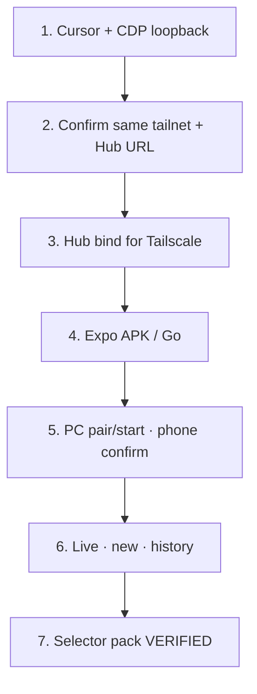

# Operator UAT checklist — 2026-09-25

**Product:** PC-local Cursor companion Android APK  
**Goal:** Manual proof of Phase 0–2 paths on metal — **do not mark product complete**  
**Locks:** PC-local only · open-project remote · CDP `127.0.0.1` · Tailscale + pairing · Expo APK  
**Catalog:** [`tor/TOR-08-nfr-testing-ops-acceptance.md`](./tor/TOR-08-nfr-testing-ops-acceptance.md) §4 (`AC-<FR>-<nn>`)  
**Selector pack:** `send_message` **VERIFIED**; `approve`/`deny`/`model_select`/`file_attach`/`composer_history_open` still **CANDIDATE** — [`handoff-phase1-selector-pack.md`](./handoff-phase1-selector-pack.md)  
**Verify procedure:** [`CONFIGURATION.md`](../CONFIGURATION.md) § Marking a selector pack VERIFIED

**How to use:** Walk sections in order. Mark each step ☐ → ☑. Record Pass / Fail / Blocked for mapped AC ids. Automated green ≠ UAT pass.

**Tailscale:** PC Tailscale already configured — **skip PC install**. Pixel 7 on mesh as `pixel-7`. Mesh UAT = same tailnet + Hub bind + phone Hub URL. PC identity: [`tailscale-status-2026-09-25.md`](./tailscale-status-2026-09-25.md).  
**Precheck:** `./scripts/uat-precheck.sh` (Hub loopback+mesh, CDP, Tailscale peers, adb, packages, selector pack).

**Progress snapshot (2026-09-29T21:26Z) — mesh-drop PARTIAL; MANUAL_ONLY 0%:**

| Area | Result |
|------|--------|
| Mesh drop (AC-003-01) | **PARTIAL** — `npm run uat:mesh-drop` `DISCONNECT_VPN` → Health `TailscaleDown` · mesh restored |
| Edges | **PARTIAL** — `uat:edges` PASS |
| Negatives | **PARTIAL** — `uat:negatives` 17/17 |
| Live send / approve / deny | **Pass** — adb Live Send · PASS_LIVE Approve+Deny |
| Pass / PARTIAL / MANUAL | ~**36%** / ~**64%** / **0%** |
| **GOAL_COMPLETE** | **no** |

**Progress snapshot (2026-09-29T21:13Z) — negatives closed; MANUAL_ONLY ~9% (superseded):**

| Gate | Status |
|------|--------|
| CDP `127.0.0.1:9222` | **Main Cursor only** — quit → `npm run start:cursor:cdp` (default profile). **HARD BAN:** never `/tmp/cursor-mobile-cdp-profile` second window |
| Hub PC mesh | **OK** — `/v1/health` 200 on `127.0.0.1` and `100.91.47.68` · `liveAdapter=cdp_ok` |
| Phone Tailscale peer | **Pass** — `pixel-7` `100.121.1.117` android **active** |
| Pair / Health / banner | **Pass** — paired · Health **Ready** · workspace `cursor_mobile` |
| Phone-token live send | **Pass** — Tailscale Hub `POST …/messages` **202** `domApplied=true` |
| History list/messages | **Pass** — phone token `mode=history` + `uat:negatives` reconfirm |
| Live approve/deny DOM | **Pass** — pack VERIFIED · Hub decide `domApplied=true` |
| adb in-app Approve/Deny | **PASS_LIVE (Deny + Approve)** — `REQUIRE_LIVE=1 npm run uat:adb-approvals` |
| adb in-app Live Send | **Pass** — `npm run uat:adb-live-send` |
| Negatives (Hub/host/CDP) | **PARTIAL Pass** — `npm run uat:negatives` **17/17** (Hub-down APK · wrong host · 401 · CDP-quit APK · cleartext/TLS) |
| `uat:precheck` | **PASS** GREEN=13 (after restore) |
| Product complete? | **No** |



---

## Preconditions

| Check | Expected |
|-------|----------|
| Repo built | `npm install && npm run build` from `/data/projects/cursor_mobile` |
| Automated smoke (optional) | `npm run test:phase0` · `test:phase1` · `test:phase2` · `test:mobile` green |
| Project folder | Absolute path you will open in Cursor (same as `CURSOR_WORKSPACE`) |
| Tailscale | **PC set up**; Pixel needs `com.tailscale.ipn` + login (see §2.0) — same tailnet `tail246b3f` |
| Phone | Android device online on that tailnet |
| Precheck (optional) | `npm run uat:precheck` / `./scripts/uat-precheck.sh` |

---

## 1. Start Cursor with CDP `127.0.0.1:9222`

| Step | Action | Pass criteria | TOR-08 ACs |
|------|--------|---------------|------------|
| 1.1 | Quit Cursor if already running without debug flags | Clean process | — |
| 1.2 | Launch Cursor with remote debugging on **loopback only** (designed: `--remote-debugging-port=9222`). Confirm listen is `127.0.0.1`, not `0.0.0.0` | `curl -s http://127.0.0.1:9222/json/version` returns JSON | **AC-001-03** |
| 1.3 | From **phone or another host**, attempt CDP on PC Tailscale IP `:9222` | Connection **fails** | **AC-001-02**, **AC-X-02** |
| 1.4 | Open the target project folder in Cursor on the PC | Window shows that project | **AC-010-01** (prep) |

☑ Step 1 complete · Result: **Pass** · Notes: second CDP Cursor `:9222` up (main Cursor untouched); AC-001-02 precheck GREEN

---

## 2. Confirm same tailnet + Hub URL

**PC:** Tailscale already installed — do not reinstall. **Pixel:** client must be present and logged into the **same** tailnet as `kingwarpc` (`tail246b3f`). No USB reverse / ngrok product path.

### 2.0 Pixel Tailscale Android install (if `com.tailscale.ipn` missing)

Prefer official APK from Tailscale Packages (Play Store also OK). Do **not** use pirate mirrors.

```bash
# Official stable universal APK (checksum via .sha256 sibling URL)
# https://pkgs.tailscale.com/stable/tailscale-android-universal-<ver>.apk
# Example proven 2026-09-25: 1.102.4 — sha256 7ecfb863e08f5fbd1ecd70235d8c34ba135a4124bdd8e166b9d6fb962782e0b5
adb -s 33080DLH20007Y install -r /path/to/tailscale-android-universal-<ver>.apk
adb -s 33080DLH20007Y shell am start -n com.tailscale.ipn/.MainActivity
```

| Step | Action | Pass criteria | TOR-08 ACs |
|------|--------|---------------|------------|
| 2.0 | Install Tailscale on Pixel (pkgs.tailscale.com or Play) | `pm path com.tailscale.ipn` succeeds | **AC-001-01** (prep) |
| 2.0a | Grant Android **VPN** permission for Tailscale (system “Connection request” → **OK**) | Dialog dismissed; app shows Get Started / Login (not “VPN permission needed”) | **AC-001-01** (prep) |
| 2.0b | **Operator:** sign in → join same tailnet as `kingwarpc` / `tail246b3f` (see **Operator steps** below) | Pixel appears **online** in `tailscale status` on PC | **AC-001-01** |
| 2.1 | On PC and phone: confirm Tailscale **online** and **same tailnet** | Both devices visible/online | **AC-001-01** (prep) |
| 2.2 | Use recorded PC Hub base URL | IPv4 `100.91.47.68` or MagicDNS `kingwarpc.tail246b3f.ts.net` — see [`tailscale-status-2026-09-25.md`](./tailscale-status-2026-09-25.md) | — |
| 2.3 | Set phone Hub URL | Pair screen / SecureStore `http://100.91.47.68:8787` (or MagicDNS); rebuild not required | — |
| 2.4 | Optional negative: disable Tailscale on phone briefly later | APK shows actionable offline / Tailscale error | **AC-003-01** · **PARTIAL** — `uat:mesh-drop` `DISCONNECT_VPN` → `State: TailscaleDown` (2026-09-29T21:25Z); operator in-app toggle optional |

### Operator steps — Pixel join `tail246b3f` (interactive; agent cannot finish)

PC account on mesh: **`damirov.ilian@`** · MagicDNS suffix **`tail246b3f.ts.net`**. No USB reverse / ngrok.

**Path A — OAuth (what Pixel is on now, 2026-09-25T20:58Z)**

1. Unlock Pixel · Tailscale is open · Chrome Custom Tab at **`login.microsoftonline.com`** (“Sign in”).
2. Dismiss Chrome “Translate page?” if it covers the form.
3. Sign in with the **same Microsoft / Tailscale identity** that owns `kingwarpc` on this tailnet (admin identity `damirov.ilian@…`).
4. Approve Tailscale / return to the app · toggle **Connected** if needed.
5. On PC: `tailscale status` must show a new **android** peer **online** (Pixel hostname). Until then: **do not** claim mesh UAT Pass.
6. Then continue §2.2–2.3 → §5 (PC `POST http://127.0.0.1:8787/v1/pair/start` → write code for phone; phone completes over Tailscale).

**Path B — Auth key (optional; needs admin console — no key in this PC env)**

This machine has **no** `TAILSCALE_API_KEY` / `TS_AUTHKEY` / `TAILSCALE_OAUTH_*` — agent **cannot** mint a key.

1. On a browser already logged into Tailscale admin: [Keys](https://login.tailscale.com/admin/settings/keys) → **Generate auth key** (reusable optional; prefer short expiry; pre-approved if your tailnet requires device approval).
2. On Pixel Tailscale: leave OAuth if stuck → look for **Log in with auth key** (app menu / settings; browserless path) → paste `tskey-auth-…` → Connect.
3. Confirm peer online with `tailscale status` on PC (same as Path A step 5).

**adb helpers already used (do not re-invent):**

```bash
adb -s 33080DLH20007Y shell am start -n com.tailscale.ipn/.MainActivity
# If “VPN permission needed”: TRY AGAIN → system “Connection request” → OK
# Then Get Started → OAuth Custom Tab (operator credentials required)
```

**2026-09-25T20:15Z:** §2.0 **done** (sideload Success).  
**2026-09-25T20:58Z:** §2.0a **done** (VPN consent OK via adb).  
**2026-09-25T21:50Z:** §2.0b **Pass** — Google IdP → `pixel-7` online on `tail246b3f`.

☑ Step 2 complete · Result: **Pass** · Notes: peer `pixel-7` `100.121.1.117`; Hub URL `http://100.91.47.68:8787`

---

## 3. Run Hub with `CURSOR_WORKSPACE` (bind for Tailscale)

Bind Hub so the phone can reach it; keep CDP on loopback. Prefer `HUB_HOST=0.0.0.0` behind Tailscale ACLs, or bind the Tailscale IP.

```bash
cd /data/projects/cursor_mobile
export HUB_HOST=0.0.0.0   # or 100.91.47.68
export HUB_PORT=8787
export CDP_URL=http://127.0.0.1:9222
export CURSOR_WORKSPACE="/absolute/path/to/open/project"
export TAILSCALE_HOSTNAME=kingwarpc.tail246b3f.ts.net
# Do NOT set LIVE_SELECTOR_PACK_READY=true for real UAT
npm run build && npm run start
# If `npm start` fails on unresolved adapter .ts exports, use: npm run dev -w @cursor-mobile/hub
```

| Step | Action | Pass criteria | TOR-08 ACs |
|------|--------|---------------|------------|
| 3.1 | Start Hub with env above | Process listens on `0.0.0.0:8787` or Tailscale IP | — |
| 3.2 | From PC: `curl -s http://127.0.0.1:8787/v1/health` | `ok: true`; Hub up; CDP status reflects Cursor | **AC-004-01** or **AC-004-02** |
| 3.3 | From PC via Tailscale IP/MagicDNS, or from phone browser: `http://100.91.47.68:8787/v1/health` (or MagicDNS) | Reachable over mesh | **AC-001-01** |
| 3.4 | Stop Hub; phone health fails | APK / curl shows Hub down | **AC-003-02**, **AC-004-04** |
| 3.5 | Restart Hub; leave `CURSOR_WORKSPACE` unset or close Cursor folder | Workspace empty / `NO_FOLDER_OPEN` — **no fake project** | **AC-012-01**, **AC-012-02**, **AC-X-03** |
| 3.6 | Restore `CURSOR_WORKSPACE` + open folder; re-check workspace | Non-empty bound path | **AC-010-01**, **AC-012-03** |

☑ Step 3 complete · Result: **Pass (negatives PARTIAL)** · Notes: Hub `0.0.0.0:8787` + mesh health 200 · **3.4 Hub-down** exercised by `npm run uat:negatives` (curl + APK UX) · Hub restored · optional empty-workspace 3.5 still operator

---

## 4. Install / run Expo APK or Expo Go

**Dev path (fastest):**

```bash
export EXPO_PUBLIC_HUB_URL="http://100.91.47.68:8787"
# or: export EXPO_PUBLIC_HUB_URL="http://kingwarpc.tail246b3f.ts.net:8787"
npm run start:mobile
# Open in Expo Go on the Android device (same tailnet, Tailscale online)
```

**Release path (sideload):**

Local release APK **already built** (debug-signed):  
`apps/mobile/android/app/build/outputs/apk/release/app-release.apk` — see [`apk-build-attempt-2026-09-25.md`](./apk-build-attempt-2026-09-25.md).

```bash
# Prefer existing local artifact (or rebuild):
# apps/mobile/android/app/build/outputs/apk/release/app-release.apk
# Optional EAS cloud later — profile must produce apk (android.buildType: apk)
# eas build -p android --profile apk
# Sideload the .apk; enable unknown sources if required
```

| Step | Action | Pass criteria | TOR-08 ACs |
|------|--------|---------------|------------|
| 4.0 | **Sideload done** — open installed `local.cursor.mobile` on Pixel 7 (rebuild only if needed) | App icon present; launches | **AC-080-01** (prep) |
| 4.1 | App launches on device | Splash → Pair or Home | **AC-080-03** |
| 4.2 | Confirm EAS/apk profile if building release | Artifact is `.apk`, not AAB-only release path | **AC-080-01**, **AC-080-02** |
| 4.3 | Screens exist: Pair, Health, Home/banner, sessions, live chat, approvals, new session, History | Navigable without crash | **AC-081-01**, **AC-081-04** · **PARTIAL Pass (adb)** — deep links `health`/`nav/home`/`new`/`editor`/`live/:id` no crash (2026-09-29T20:20Z) |
| 4.4 | No Cursor cloud login required for P0 | Pair with Hub only | **AC-081-03** |
| 4.5 | Spot-check: no remote CDP URL / cloud API keys in app config | None stored | **AC-001-04**, **AC-081-05** · **PARTIAL** — APK `strings` + `HUB_URL_HINTS` unit (no remote CDP / remote-control / ngrok) |
| 4.6 | Wrong Hub hostname intentionally | Clear unreachable error, not silent hang | **AC-003-04** · **PARTIAL** — `uat:negatives` curl timeout ≤2s + HubClient 8s Abort |

**Phone-next (after install):** (1) Tailscale **online** on Pixel same tailnet as `kingwarpc` → (2) open app → (3) Hub URL `http://100.91.47.68:8787` or MagicDNS → (4) continue §5. Do **not** mark §4–5 Pass without on-device evidence.

☑ Step 4 complete · Result: **Pass** · Notes: release APK sideloaded `local.cursor.mobile`; Health navigable; Live-tab adb still flaky

---

## 5. Pair, health, workspace banner

### Pairing nuance (required)

- **`POST /v1/pair/start` is loopback-only** on the PC (`requireLocal`). Calling it via Tailscale IP from phone/peer returns **403**.
- Operator generates the code on **PC localhost**, then the phone completes with **`POST /v1/pair/confirm`** or **`/v1/pair/complete`** over Tailscale.

On PC (loopback):

```bash
curl -s -X POST http://127.0.0.1:8787/v1/pair/start \
  -H 'Content-Type: application/json' -d '{}'
# Enter returned code on the phone Pair screen (phone talks to Hub over Tailscale)
```

| Step | Action | Pass criteria | TOR-08 ACs |
|------|--------|---------------|------------|
| 5.1 | PC: `pair/start` on `127.0.0.1` only; phone: complete with code over Tailscale Hub URL | Device token stored; Home reachable | **AC-002-01** |
| 5.2 | Call workspace without token (or clear pair) | 401 / unpaired UI | **AC-002-02**, **AC-003-03** |
| 5.3 | Open Health screen | Distinct Hub up vs CDP attached/detached | **AC-004-03** |
| 5.4 | Home banner name + path match PC open project / `CURSOR_WORKSPACE` | Matches; pull-to-refresh updates | **AC-011-01**, **AC-011-02** |
| 5.5 | Expect `liveAdapter.state` often `extractor_stale` while pack is CANDIDATE | Honest status — not fake `cdp_ok` | **AC-004-01** (partial: Hub up; adapter triad honest) |
| 5.6 | Optional: expire/revoke pair if ops path available; re-pair | Old token rejected; new works | **AC-002-03**, **AC-002-04** |
| 5.7 | Optional negative: `pair/start` via Tailscale IP | **403 FORBIDDEN** | TOR-03 local |

**PC prep already smoked (2026-09-25T19:49Z):** Hub listening; localhost `pair/start` **201**; Tailscale `pair/start` **403**.  
**2026-09-25T21:50Z phone:** pair complete · Health Ready · workspace banner Pass (`/tmp/pixel-mesh-pass-refresh.png`).

☑ Step 5 complete · Result: **Pass** · Notes: devicesPaired 21; Hub over Tailscale; CDP connected (adapter honest `extractor_stale`)

---

## 6. Live sessions / new session / history

**Honest expectation:** List / create / history **UI + Hub routes** may work; **DOM send / approve / model / @file** stay blocked (`EXTRACTOR_STALE` / `503`) until §7 marks actions VERIFIED. Record Blocked where live DOM is required.

### 6.1 Live sessions

| Step | Action | Pass criteria | TOR-08 ACs |
|------|--------|---------------|------------|
| 6.1.1 | Home → Live tab; open Composer on PC if possible | Live rows for bound workspace only (or empty + New CTA) | **AC-020-01**, **AC-020-02**, **AC-020-04**, **AC-022-01** |
| 6.1.2 | Mode badge `live` | Correct badge; no cloud catalog entry points | **AC-021-01**, **AC-022-02**, **AC-X-04** |
| 6.1.3 | Open live row → Live chat | Navigates | **AC-021-03** · **PARTIAL Pass (adb)** — `cursor-companion://live/:sessionId` in `uat:adb-live-send` |
| 6.1.4 | Send message from phone | **Until pack VERIFIED:** fail-closed error, **no silent success**. After VERIFIED: appears in PC Composer + stream to phone | **AC-030-01**, **AC-030-03** · **PARTIAL Pass (adb)** — keyboard type+Send **`uat:adb-live-send` PASS** · Hub **202** `domApplied=true` smoke |
| 6.1.5 | Approval card Approve / Deny | **Until VERIFIED:** fail-closed. After: PC effect matches | **AC-031-01**, **AC-031-02**, **AC-033-01**, **AC-062-01**, **AC-062-03** · **PASS_LIVE Deny+Approve (adb)** — `REQUIRE_LIVE=1` · IDE `python3 -c` Ask Every Time · Run/Skip cleared · Hub pending=0 · `synthetic=false` (Deny 20:52Z · Approve 21:02Z) |
| 6.1.6 | Attach file under workspace roots | Hub may register path; `domApplied: false` until pack + inject | **AC-032-01**, **AC-032-02** |

### 6.2 New session

| Step | Action | Pass criteria | TOR-08 ACs |
|------|--------|---------------|------------|
| 6.2.1 | Open New session; models load from Hub | Models from `GET /workspace/models` (env stub OK) | **AC-050-01**, **AC-054-01** |
| 6.2.2 | Submit without model | Blocked | **AC-050-02** |
| 6.2.3 | Create with model ± files ± prompt | Session registered; live chat opens (DOM apply may still fail-closed) | **AC-052-01**…**03**, **AC-053-01**…**03** |
| 6.2.4 | Confirm no phone MCP runtime | Tools summary informational only | **AC-054-02**, **AC-061-01** |

### 6.3 History (Phase 2)

| Step | Action | Pass criteria | TOR-08 ACs |
|------|--------|---------------|------------|
| 6.3.1 | Home → History tab | Local rows for **bound** workspace only (empty OK if store missing) | **AC-023-01** (P1), **AC-022-03** |
| 6.3.2 | Open history → read transcript | Read-only messages | **AC-040-01** (P1) |
| 6.3.3 | Open on PC | Best-effort live handoff; may be strategy C / 503 if CDP down — **not** full Composer UI reopen | **AC-041-01** (P1) |

**2026-09-25T21:55Z mesh API (phone device token over Tailscale):** live list **200** · send **202** `domApplied=true` · history **200** · synthetic approve/deny decide **200** recorded. Live DOM approve/deny **Blocked**. adb in-app Live Send **Blocked** (stayed on Health).

☑ Step 6 partial · Result: **Pass (API mesh send/history/synth approvals)** · Notes: AC-030-01 PARTIAL→stronger; AC-031-* still Blocked until pack VERIFIED

---

## 7. Manually verify selector pack → mark VERIFIED

Follow [`CONFIGURATION.md`](../CONFIGURATION.md) § Marking a selector pack VERIFIED. Source of truth: `packages/adapters/live-cursor/src/selector-pack.ts`.

**Do not** treat `LIVE_SELECTOR_PACK_READY=true` or synthetic fixtures as verification.

| Step | Action | Pass criteria | TOR-08 ACs |
|------|--------|---------------|------------|
| 7.1 | Optional: `LIVE_CDP_PROBE=1 npm test -w @cursor-mobile/live-cursor` | Probe attaches; expect `cdp_ok` when pack fully VERIFIED | — |
| 7.2 | For **each** action: `send_message`, `approve`, `deny`, `model_select`, `file_attach`, `composer_history_open` — confirm strategy hits live DOM; exercise control once on PC | Strategy match + manual PC proof | **AC-030-01**, **AC-031-01/02**, **AC-050-***, **AC-032-01** |
| 7.3 | In `selector-pack.ts`, set that action `verification: "VERIFIED"`, `verifiedAt`, `verifiedAgainst` | Per-action flag flipped only after proof | — |
| 7.4 | Re-run `npm test -w @cursor-mobile/live-cursor` | Unit + replay green | — |
| 7.5 | Only when **all** mutation actions VERIFIED: pack `verified: true`; Hub may show `liveAdapter.state = cdp_ok` | Honest health | **AC-004-01** |
| 7.6 | Re-run §6.1 send / approve / deny on phone | Real PC Composer effect | **AC-X-01**, Phase 1 DoD |

**Current pack status (2026-09-25T22:43Z):** pack overall **verified** (all six actions VERIFIED). Hub `liveAdapter.state=cdp_ok`.

| Action | Before | After UAT | verifiedAgainst |
|--------|--------|-----------|-----------------|
| `send_message` | CANDIDATE | ☑ VERIFIED | live Composer textbox + metal/phone-token send |
| `approve` | CANDIDATE | ☑ VERIFIED | `ui-shell-tool-call__run-btn` + Hub decide |
| `deny` | CANDIDATE | ☑ VERIFIED | `ui-shell-tool-call__skip-btn` + Hub decide |
| `model_select` | CANDIDATE | ☑ VERIFIED | `.vscode-model-picker__trigger-text` HIGH |
| `file_attach` | CANDIDATE | ☑ VERIFIED | `.mentions-menu` HIGH + Hub attach `domApplied=true` |
| `composer_history_open` | CANDIDATE | ☑ VERIFIED | `[data-composer-id]` HIGH (best-effort) |

☑ Step 7 complete · Result: **Pass (pack)** · Notes: full TOR-08 device Pass sheet still open — do not claim product DoD

---

## 8. Cross-cutting smoke (when §1–7 allow)

| Case | Expected | Result |
|------|----------|--------|
| **AC-X-01** | Tailscale → CDP → Hub → pair → banner → live deny → new session | ☐ |
| **AC-X-02** | CDP not on Tailscale; Hub is only phone API | ☐ |
| **AC-X-03** | Empty workspace blocks inventing a project | ☐ |
| **AC-X-04** | No cloud Agents / Remote Control affordances | ☐ |

---

## Result summary (operator)

| Area | Pass / Fail / Blocked | ACs touched |
|------|----------------------|-------------|
| CDP loopback | **Pass** | AC-001-02/03 |
| Tailscale + Hub reachability | **Pass** | AC-001-01, AC-003-* |
| Pair / health / banner | **Pass** | AC-002-*, AC-004-*, AC-010–012 |
| Live / new / history shell | **Pass (API)** | AC-020–022, AC-050–054, AC-023/040/041 |
| Live DOM mutations | **Pass (adb)** — send + Deny+Approve PASS_LIVE | AC-030–033, AC-031, AC-062 |
| Negatives Hub/host/CDP | **PARTIAL** — `uat:negatives` 17/17 | AC-003-02/04, AC-004-04, AC-012-04 |
| Edges WS/large/race/binary/empty | **PARTIAL** — `uat:edges` PASS | AC-030-02/04/05, AC-031-03/05, AC-032-04, AC-050-03/04, AC-010-02, AC-011-03 |
| APK screens / sideload | **Pass** | AC-080–081 |
| Cross smoke | **Partial** | AC-X-01…04 |

**Product complete?** **No** — MANUAL_ONLY **0%**; Pass ~**36%** / PARTIAL ~**64%**. Full Pass sheet not closed (new-session device, multi-attach UX, history-list metal, EAS, …).

**Related:** [`goal-progress-2026-09-25.md`](./goal-progress-2026-09-25.md) · [`tailscale-status-2026-09-25.md`](./tailscale-status-2026-09-25.md) · [`phase1-integration-smoke-2026-09-25.md`](./phase1-integration-smoke-2026-09-25.md) · [`tor08-p0-coverage-matrix-2026-09-25.md`](./tor08-p0-coverage-matrix-2026-09-25.md)
