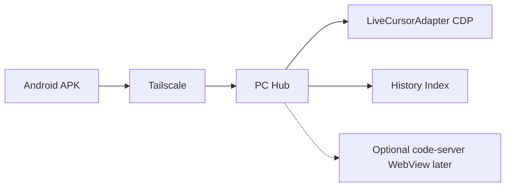
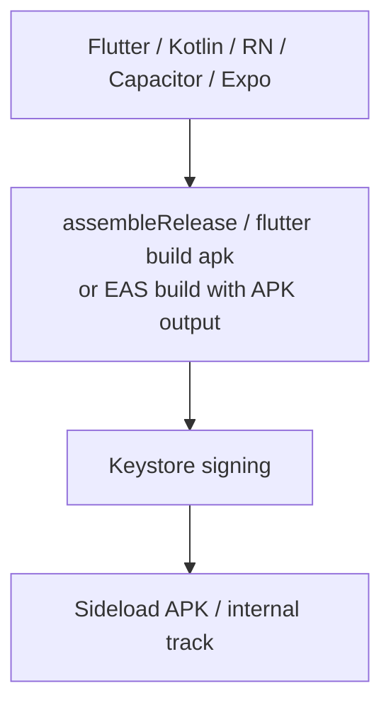

# Report — OSS / GitHub landscape for Cursor mobile companion

**Date:** 2026-09-24  
**Methods:** Tavily Research (pro) + Parallel Deep Research (pro-fast)  
**Project:** `cursor_mobile` — Android APK linked to PC Cursor IDE

> **Project decision (supersedes cloud recommendations below):** PC-local only — **no cloud mode**. The APK must access **all sessions already on this PC** (live + full local history). Cloud Agents / official Remote Control are **out of scope** for this product. See [`gap-closure-hybrid-system-2026-09-24.md`](./gap-closure-hybrid-system-2026-09-24.md) · [`../architecture/AGENT-CONTEXT.md`](../architecture/AGENT-CONTEXT.md).

## Executive summary

**Build a self-hosted Android companion (APK)** for local Cursor Composer/chat continuity on Android over Tailscale. Official **Cursor for iOS** + Remote Control is landscape context only (cloud agent loop) — **not** this repo’s implementation path.

Closest OSS patterns from Parallel + Tavily:

- **Paseo** — multi-client agent companion (iOS/Android/web/desktop/CLI) + local daemon; strong for agent sessions, not verified Cursor Composer import.
- **Happy** — mobile/web control of Claude Code / Codex with E2E encrypted session handoff (terminal-first).
- **CursorRemote** + **cursor-session** — Cursor-specific: live agent UI control (CDP/browser relay) and local chat extract/export; **not** a supported two-way sync API for all historical chats.
- **code-server / OpenVSCode / VS Code Tunnels** — remote editing product; pair with an agent companion if you need both files and sessions.

Recommended product split: **agent companion APK** (sessions/approvals) + optional **editor WebView** (code-server) + **Tailscale/SSH** (private path). Ship a **signed APK** (Expo EAS can emit APK; or Flutter / RN / Capacitor / Kotlin release builds).

## Findings by theme

### 1. Agent companions (cross-device, OSS-adjacent)

| Project | Role | Notes |
|---------|------|-------|
| Paseo | iOS/Android/web/desktop/CLI + local agent daemon | ~18k★ Apache-2.0 (as checked); agent sessions ≠ Cursor Composer import |
| Happy | Mobile/web steer Claude Code / Codex | ~23.8k★; E2E encrypted; terminal-first handoff |
| Cursor iOS + Remote Control | Official agent start/sync + desktop worker | Cloud agent loop — **out of scope** for this product (landscape only) |

### 2. Cursor-specific open source

| Project | Role | URL |
|---------|------|-----|
| CursorRemote | Remote control local Cursor agent from phone/Telegram (CDP/browser relay) | https://github.com/len5ky/cursorremote |
| cursor-session | CLI extract/export Cursor chat sessions | https://github.com/iksnae/cursor-session |
| CursorMCPMonitor | Real-time MCP interaction monitoring | https://github.com/willibrandon/CursorMCPMonitor |
| cursor-api topic | Related API experiments | https://github.com/topics/cursor-api |

### 3. Official Cursor surfaces (partial)

| Surface | Use for companion | URL |
|---------|-------------------|-----|
| Extension API | Hook desktop Cursor | https://cursor.com/docs/extension-api |
| Cloud Agents API | Create/manage cloud agents (**out of scope**) | https://cursor.com/docs/cloud-agent/api/endpoints |
| Python SDK | Agent tooling | https://cursor.com/docs/sdk/python |
| CLI auth | API keys / browser login patterns | https://cursor.com/docs/cli/reference/authentication |
| APIs overview | Auth styles | https://cursor.com/docs/api |

**Gap:** No documented official REST for full local session list + live editor context aimed at mobile. Proxy/extension required.

### 4. Generic remote IDE (WebView path)

| Project | License note | URL |
|---------|--------------|-----|
| code-server | MIT; mature VS Code server | https://github.com/coder/code-server |
| Eclipse Theia | EPL family | https://github.com/eclipse-theia/theia |
| Eclipse Che | Kubernetes workspaces | https://github.com/eclipse-che/che |
| Gitpod | AGPL — redistribution caution | https://github.com/gitpod-io/gitpod |

### 5. Connectivity

| Tool | Role | URL |
|------|------|-----|
| Tailscale | Preferred private mesh | https://tailscale.com/docs/reference/connection-types |
| Cloudflare Tunnel / ngrok | Managed public relays | Cloudflare Tunnel / ngrok docs |
| mosh | Low-latency shell | https://mosh.org/ |
| ZeroTier | Alternate mesh | https://zerotier.com/blog/the-state-of-nat-traversal |

### 6. Architecture recommendation (from research → project lock)

**Active product path:** Hub + native Expo APK + Tailscale + CDP localhost (see AGENT-CONTEXT).  
**Historical research only:** Cloud Agents API / Remote Control — **not** in the diagram as a live branch.  
**Optional later (P2+):** WebView on code-server for file browse — not v1.  
**Do not rely on:** plain VNC as the main UX; public tunnels as baseline.

## APK delivery path

- Parallel finding: **Expo EAS can be configured to produce an installable APK** (not only the default Android App Bundle).
- **Kotlin Compose** or **Flutter** preferred for sockets + background reliability.
- Never embed Cursor secrets in the client binary; use device pairing tokens issued by the PC proxy.
- Keep host private: Tailscale/SSH; Cursor self-hosted worker uses **outbound HTTPS** rather than inbound public ports.

## Comparison — product approaches

| Approach | Cursor sessions | Mobile UX | Effort | Verdict |
|----------|-----------------|-----------|--------|---------|
| Fork/extend CursorRemote | Strong for agent control | App or Telegram | Medium | Best Cursor-native start |
| cursor-session + custom proxy | Strong for list/export | Custom APK | Medium–High | Needed for session library |
| code-server WebView | Weak (not Cursor chat) | Full editor | Low–Medium | Good secondary feature |
| SSH / mosh only | Weak | Terminal | Low | Support tool only |
| Cloud Agents API only | Cloud agents, not local IDE | Custom | Medium | **Out of scope** (do not build) |

## Implications for this repo

1. **Do not** adopt official Cursor iOS / Remote Control / Cloud Agents as the product path — PC-local Hub only.
2. When coding starts: scaffold **PC Hub** for local Cursor (session list + WS + create/approve); use CursorRemote / cursor-session as references.
3. Study **Paseo** / **Happy** for multi-client agent UX and APK packaging patterns (Expo APK).
4. Scaffold **Android APK** that talks only to the Hub over Tailscale + pairing.
5. Optional later (not Phase 0–1): **code-server WebView** for file editing — separate from Cursor chat identity.
6. Document pairing and APK signing when implementation starts; keep CDP on `127.0.0.1` only.

## Sources

- [Cursor Extension API](https://cursor.com/docs/extension-api)
- [Cloud Agents API](https://cursor.com/docs/cloud-agent/api/endpoints)
- [Cursor Python SDK](https://cursor.com/docs/sdk/python)
- [Cursor APIs Overview](https://cursor.com/docs/api)
- [CLI Authentication](https://cursor.com/docs/cli/reference/authentication)
- [CursorRemote](https://github.com/len5ky/cursorremote)
- [cursor-session](https://github.com/iksnae/cursor-session)
- [CursorMCPMonitor](https://github.com/willibrandon/CursorMCPMonitor)
- [code-server](https://github.com/coder/code-server)
- [code-server install docs](https://coder.com/docs/code-server/install)
- [Eclipse Theia](https://github.com/eclipse-theia/theia)
- [Eclipse Che](https://github.com/eclipse-che/che)
- [Tailscale connection types](https://tailscale.com/docs/reference/connection-types)
- [cursor-api topic](https://github.com/topics/cursor-api)
- [Peeking under the hood of Cursor](https://speedscale.com/blog/peeking-under-the-hood-of-cursor)
