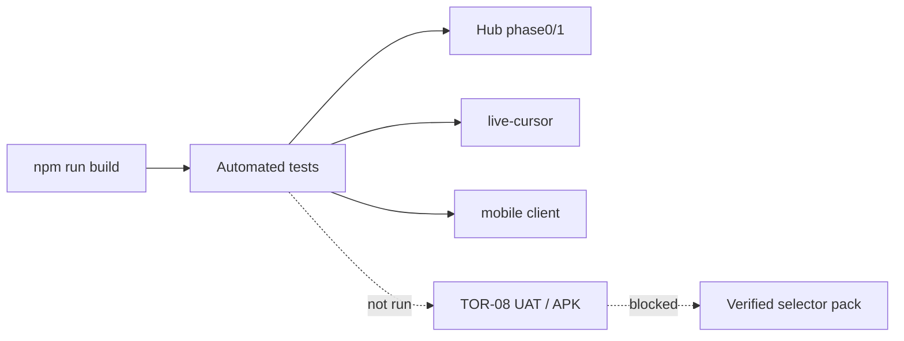
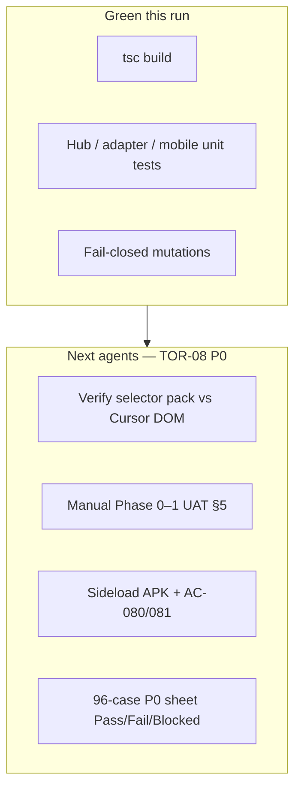

# Phase 0–1 integration smoke — 2026-09-25

**Repo:** `/data/projects/cursor_mobile`  
**Node:** v26.8.1 · **npm:** 11.19.0  
**Product locks still true?** Yes — PC-local only · open-project remote · CDP `127.0.0.1` · Tailscale + pair · Expo APK · docs ≠ full live E2E  
**Verdict:** Automated build + unit/integration suites **PASS**. TOR-08 Phase 0–1 **DoD / ~96 P0 ACs not claimed** — selector pack unverified; no device/Tailscale/manual UAT in this run.

---

## Commands run

| Step | Command | Result |
|------|---------|--------|
| Deps | `node_modules` already present — **`npm install` skipped** | OK |
| Build | `npm run build` | **PASS** (`live-cursor` → `history` → `hub` `tsc`) |
| All | `npm test` | **PASS** |
| Phase 0 | `npm run test:phase0` | **PASS** |
| Phase 1 | `npm run test:phase1` | **PASS** |
| Hub | `npm run test:hub` | **PASS** |
| Mobile | `npm run test:mobile` | **PASS** (typecheck + node:test) |

No install/path/script breakages found; no code fixes required this turn.

---

## Pass / fail counts (automated)

| Suite | Scope | Files | Tests | Fail | Skip |
|-------|--------|------:|------:|-----:|-----:|
| `npm test` | Hub + live-cursor | 6 | **39** | 0 | 0 |
| └ Hub | vitest | 5 | 29 | 0 | 0 |
| └ live-cursor | vitest | 1 | 10 | 0 | 0 |
| `test:phase0` | Hub `tests/phase0` | 3 | **16** | 0 | 0 |
| `test:phase1` | Hub `tests/phase1` + live-cursor | 2 | **18** | 0 | 0 |
| `test:hub` | Hub all | 5 | **29** | 0 | 0 |
| `test:mobile` | Expo client | 1 suite | **14** | 0 | 0 |

**Unique automated cases this smoke:** ~**53** (29 Hub + 10 adapter + 14 mobile). Overlap exists across root scripts (`test` ⊃ hub; `test:phase1` re-runs adapter).

### What the green tests actually prove

| Area | Covered |
|------|---------|
| Phase 0 Hub | `/health`, pair start/confirm, unpaired reject, workspace empty / banner stub via env |
| Phase 1 Hub | Live session list (mock adapter), foreign/empty workspace, messages/approvals **fail-closed** (`EXTRACTOR_STALE`), idempotency key required, `liveAdapter` on health |
| live-cursor | Loopback CDP URL guard, health triad (`cursor_down` / `extractor_stale` / `cdp_ok`), mock CDP HTTP, mutations blocked when pack unverified |
| Mobile | `HubClient` HTTP mapping, WS URL helper, degraded-path helpers — **not** device UI or real Hub mesh |

---

## TOR-08 P0 honesty map

Source: [`TOR-08-nfr-testing-ops-acceptance.md`](./tor/TOR-08-nfr-testing-ops-acceptance.md) §4 (~**96** P0 ACs), §5 UAT, §8 DoD.

| Gate | Status | Notes |
|------|--------|-------|
| **Phase 0 DoD** (§8.1) | **Partial** | Automated health/pair/workspace stubs green. **Not evidenced:** Tailscale phone→Hub, banner vs real PC-open folder, CDP negative probe from phone, GETTING-STARTED operator path on metal. |
| **Phase 1 DoD** (§8.2) | **Not met** | Routes + fail-closed adapter wired and unit-tested. **Missing:** live messages/WS on real Composer, Approve/Deny on PC, attachments, new-session model+files E2E, sideload APK §7, full **96** AC Pass/Fail/Blocked sheet. |
| **P0 catalog (~96)** | **Not executed** | This smoke ≠ UAT catalog. Treat automated ~53 as **regression smoke**, not acceptance completion. |
| **Selector / DOM** | **Blocked by design** | Pack `cursor-ui@stub-unverified`; mutations return `EXTRACTOR_STALE` — correct fail-closed, so **full live E2E cannot pass** until a verified pack exists. |
| **APK release checklist** (§7) | **Not run** | No EAS/sideload artifact or device install in this job. |
| **History** | Out of Phase 0–1 | `@cursor-mobile/history` builds; no test script (Phase 2). |

---

## Remaining blockers (for next agents)

1. **R6 Live Adapter** — Real selector pack verification; lift fail-closed only when Composer DOM matched; add live CDP attach smoke against local Cursor.  
2. **R8 QA / Ops** — Run TOR-08 §5.1–5.2 manual UAT (Tailscale + pair + banner + continue/create + Approve/Deny); produce 96-case status sheet.  
3. **R4 Mobile** — Device/emulator smoke of Phase 1 screens against a running Hub; EAS APK sideload path (§7).  
4. **R3 Hub** — Optional: WS message-stream integration test beyond hello/health; real-adapter (non-mock) Hub tests behind a local CDP fixture.  
5. Do **not** claim Phase 1 complete or “full live E2E” until items 1–3 land.

---

## Handoff fields

| Field | Value |
|-------|--------|
| **Done** | Build + all available npm test scripts green; smoke report written |
| **Files touched** | `docs/reports/phase1-integration-smoke-2026-09-25.md` (this file) |
| **Open gaps** | Selector pack unverified; no metal/Tailscale/APK UAT; TOR-08 96 ACs unrun |
| **Next agent** | **R6 Live Adapter Engineer** (selectors) then **R8 QA & Ops Acceptancer** (UAT sheet) |
| **Product locks still true?** | Yes |

---

*Smoke only. Architecture/FRs/TOR remain source of truth for unfinished surfaces.*
