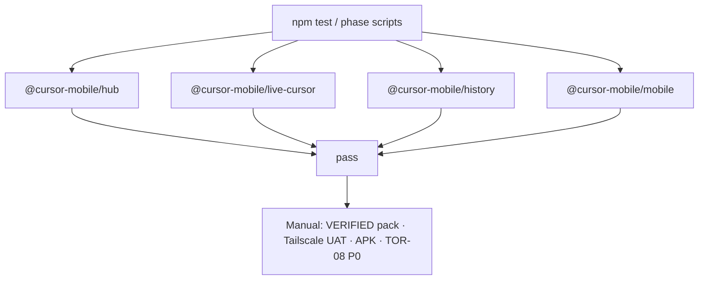

# Phase 3/4 regression — 2026-09-25

**When:** 2026-09-25T19:13Z (UTC)  
**Host:** Node `v26.8.1` · npm `11.19.0` · workspace `/data/projects/cursor_mobile`  
**Scope:** Full automated suite after Phase 3/4 merge — unit/integration only  
**Result:** **All available scripts green.** No merge-conflict breakages found; no code fixes required.  
**Goal:** Still **not complete** — does not prove VERIFIED selectors, Tailscale/phone UAT, APK sideload, or TOR-08 P0.

---

## Command results

| Script | Pass | Skip | Fail | Notes |
|--------|-----:|-----:|-----:|-------|
| `npm test` | **93** | **3** | **0** | hub 56 + live-cursor 31 + history 6; skips = live CDP probe (no live Chrome) |
| `npm run test:phase0` | **16** | 0 | 0 | `packages/hub/tests/phase0` |
| `npm run test:phase1` | **53** | **3** | 0 | hub phase1 22 + live-cursor 31; same 3 CDP skips |
| `npm run test:phase2` | **11** | 0 | 0 | hub phase2 5 + history 6 |
| `npm run test:phase4` | **42** | 0 | 0 | hub phase4 8 + mobile 34 (typecheck + node:test) |
| `npm run test:mobile` | **34** | 0 | 0 | HubClient, picker helpers, outbound queue, connection states |
| `npm run test:hub` | **56** | 0 | 0 | all hub vitest files (phase0–4 + legacy health-pair) |

**Fix applied:** none (trivial Phase 3/4 merge breakages: none observed).

---

## Package breakdown (`npm test`)

| Workspace | Files | Pass | Skip | Fail |
|-----------|------:|-----:|-----:|-----:|
| `@cursor-mobile/hub` | 8 | 56 | 0 | 0 |
| `@cursor-mobile/live-cursor` | 4 | 31 | 3 | 0 |
| `@cursor-mobile/history` | 1 | 6 | 0 | 0 |
| **Sum** | **13** | **93** | **3** | **0** |

### Hub file map (56)

| File | Pass |
|------|-----:|
| `tests/phase0/health.test.ts` | 4 |
| `tests/phase0/pair.test.ts` | 5 |
| `tests/phase0/workspace-empty.test.ts` | 7 |
| `test/health-pair.test.ts` | 5 |
| `tests/phase1/sessions-live.test.ts` | 8 |
| `tests/phase1/workspace-apis.test.ts` | 14 |
| `tests/phase2/sessions-history.test.ts` | 5 |
| `tests/phase4/pair-persist.test.ts` | 8 |

### Live-cursor (31 pass / 3 skip)

| File | Pass | Skip |
|------|-----:|-----:|
| `src/selector-pack.test.ts` | 10 | 0 |
| `src/adapter.test.ts` | 11 | 0 |
| `src/cdp-input.test.ts` | 9 | 0 |
| `src/cdp-probe.test.ts` | 1 | 3 |

### Mobile (34 pass)

| Suite | Pass |
|-------|-----:|
| HubClient | 9 |
| helpers | 5 |
| pathBreadcrumbs | 3 |
| root helpers | 5 |
| toggleAttachment / joinRelative | 2 |
| debounce | 2 |
| outbound queue helpers | 6 |
| connection states (NFR-OFF-01) | 2 |

---

## What this does **not** prove

- Selector pack actions marked **VERIFIED** on live Cursor (shipped pack remains all **CANDIDATE**)
- Tailscale phone ↔ Hub mesh UAT
- Expo EAS APK build / sideload on device
- TOR-08 P0 catalog (~96 ACs) operator Pass/Fail
- Live Composer send / approve / deny / model / @file DOM E2E

---

## Related

| Doc | Role |
|-----|------|
| [`goal-progress-2026-09-25.md`](./goal-progress-2026-09-25.md) | Honest goal status (not complete) |
| [`handoff-phase3-files-editor.md`](./handoff-phase3-files-editor.md) | Phase 3 implementation handoff |
| [`handoff-phase4-harden.md`](./handoff-phase4-harden.md) | Phase 4 implementation handoff |
| [`operator-uat-checklist-2026-09-25.md`](./operator-uat-checklist-2026-09-25.md) | Manual next steps |
