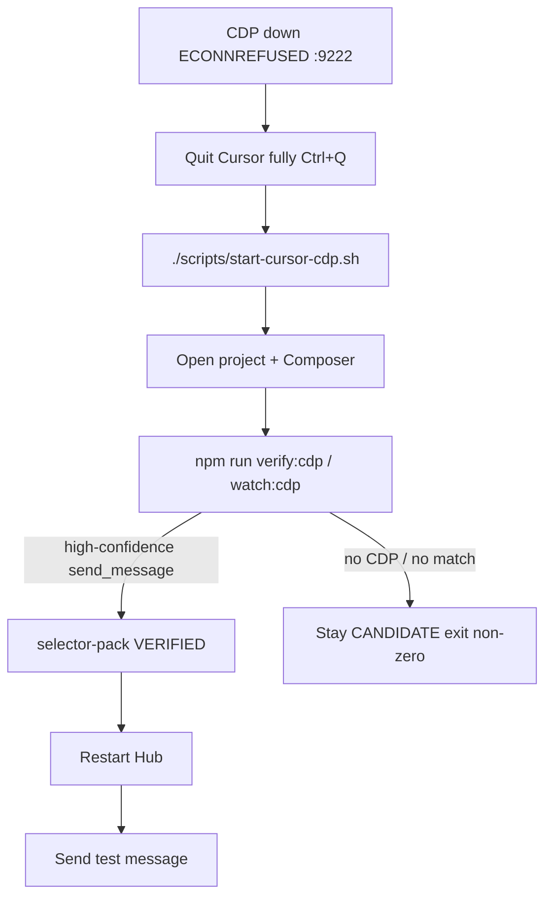

# Sender unlock path — 2026-09-25

**Phase focus:** 1 (live Composer `send_message`)  
**Locks check:** PC-local only · CDP `127.0.0.1` only · open-project remote · no VERIFIED without live DOM matches  
**Status now:** CDP **DOWN** (`ECONNREFUSED 127.0.0.1:9222`) · Cursor running **without** `--remote-debugging-port` · **no actions VERIFIED**

---

## Unlock sequence

| Step | Command / action | Notes |
|------|------------------|-------|
| 0 | CDP down | Do **not** kill Cursor from automation |
| 1 | Quit Cursor | File → Quit / Ctrl+Q |
| 2 | `./scripts/start-cursor-cdp.sh /data/projects/cursor_mobile` | Loopback CDP only (`127.0.0.1:9222`) |
| 3 | Open Composer in that window | Needed for `send_message` match |
| 4 | `npm run verify:cdp` or `npm run watch:cdp` | Short wait (~5 min) or long-poll (~20s) → same attach probe + live DOM match → VERIFIED only on high-confidence hits |
| 5 | `./scripts/start-hub-tailscale.sh` | Reload pack |
| 6 | Phone / Hub send test message | Sender works when CDP up + `send_message` VERIFIED |

---

## Scripts

| Path | Role |
|------|------|
| [`scripts/start-cursor-cdp.sh`](../../scripts/start-cursor-cdp.sh) | Relaunch Cursor with CDP (refuses if Cursor still running) |
| [`scripts/wait-cdp-and-verify.sh`](../../scripts/wait-cdp-and-verify.sh) | Wait for CDP + verify selectors (`npm run verify:cdp`) |
| [`scripts/watch-cdp-and-verify.sh`](../../scripts/watch-cdp-and-verify.sh) | Long-poll CDP then same verify path; loud VERIFIED flip (`npm run watch:cdp`) |
| [`scripts/cdp-selector-verify.mts`](../../scripts/cdp-selector-verify.mts) | Live `querySelector` match; writes pack only with `--write` |

Dry run (no pack write): `VERIFY_DRY_RUN=1 npm run verify:cdp` or `VERIFY_DRY_RUN=1 npm run watch:cdp`

---

## Guardrails

- Do **not** mark VERIFIED without live high-confidence matches.
- Do **not** kill the operator’s Cursor.
- Approve/Deny flip only if those strategies also match (tool card visible).
- `model_select` / `file_attach` stay CANDIDATE until separately proven.

## Product locks still true?

Yes — Hub + CDP on operator PC only · phone never dials CDP · Tailscale + pair · Expo APK client only.
