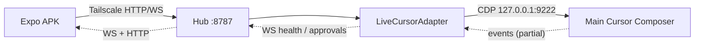

# Sync diagnosis — Phone ↔ Hub ↔ LiveCursorAdapter ↔ CDP ↔ Cursor

**Date:** 2026-10-01  
**Scope:** Correct synchronization across CDP / LiveCursorAdapter, main Cursor window, and Expo APK  
**Product locks still true?** Yes — PC-local Hub · phone never dials CDP · CDP `127.0.0.1` only · no second `--user-data-dir` profile · Tailscale mesh · pair/start loopback-only

---

## Live status (2026-10-01T19:52Z probe)

| Check | Result |
|-------|--------|
| Hub `GET /health` (loopback + mesh `100.108.160.99:8787`) | **ok** |
| `liveAdapter.state` | **`cdp_ok`** |
| CDP `:9222` | **LISTEN `127.0.0.1` only** (main Cursor PID with `--remote-debugging-port=9222`) |
| Selector pack | **6/6 VERIFIED** |
| `sessionCreateQueue.pending` | **0** |
| Workspace bind | `cursor_mobile` / `ws_63692edb52f8` |
| `assert:no-second-cdp` | **PASS** |
| Pixel Tailscale | **active** (`pixel-7`) |



---

## Root causes

### A. Operator procedure (when `cursor_down`) — not a code bug

If Cursor was started **without** CDP, Hub correctly reports `cursor_down` and fail-closes live DOM (New-session → HTTP **202** queue). Fix is operator-only:

1. Quit main Cursor fully (Ctrl+Q) — agents must **not** kill it  
2. `npm run start:cursor:cdp` (MAIN profile only — **HARD BAN** `/tmp/cursor-mobile-cdp-profile`)  
3. Open same project → Composer  
4. `npm run verify:cdp`  
5. Restart Hub if needed: `npm run start:hub:tailscale`  
6. Phone: Tailscale Online → Hub URL `http://100.108.160.99:8787` (or MagicDNS) → Health shows **Ready** / `cdp_ok`

**Today:** main window already CDP-up → sync path metal is green.

### B. Sync gaps found in code (fixed this turn)

| Gap | Effect | Fix |
|-----|--------|-----|
| Hub poller drained create-queue but **never pushed `health.changed`** on `cdp_ok` ↔ `cursor_down` | Phone connection chip stayed stale until manual Health refresh / WS re-hello | Poller broadcasts `health.changed` on state flip (`packages/hub/src/server.ts`) |
| Mobile `HubWebSocket` had **no auto-reconnect** | Mesh flap left Live chat WS dead until leaving the screen | Exponential backoff reconnect (`apps/mobile/src/hub/ws.ts`) |
| Live chat ignored `health.changed`; approvals only on initial load | Missed Hub approval pushes after flap; stale health | Refresh health + approvals on reconnect / `health.changed` + 15s poll |
| WS session subscription filter was a no-op | Dead code; risk of wrong filtering later | Filter by `sessionId` / `session.id`; empty set = all |

### C. Designed / remaining gaps (not fixed — need DOM extractor work)

| Gap | Status |
|-----|--------|
| **Assistant streaming** (`session.message.delta` / `.completed`) | Mobile listens; **Hub never emits** — send path types into Composer only; no transcript scrape |
| **Auto-surface Cursor tool cards** | Approvals are Hub-enqueued (synthetic/live UAT) or HTTP list — **no DOM observer** pushing real tool cards to phone |
| **Model select reflection on phone** | Create/scrape path exists when `cdp_ok`; live session model chip not continuously synced |
| **Chats list live updates** | **Partial (2026-10-01):** Home focus refresh + WS re-pull + last-synced / stale parity hint — still no push of full list payload |

---

## Session parity (phone list vs PC Composer)

**Goal:** Home shows the same PC-bound Composer chats the operator sees in Cursor for the open project (via Hub live ∪ history index).

| Check | How |
|-------|-----|
| Connectivity | Tailscale → Hub; chip Online/Degraded/Offline; CDP never from phone |
| List source | `GET /sessions?mode=live` + `mode=history` for bound workspace |
| Force sync | Pull-to-refresh; tab focus; Settings **Refresh now** (planned UI); WS `health.changed` / `session.updated` |
| Stale index | `history.extractorStale` → parity hint on Home |
| Manual UAT | Create chat on PC → phone refresh → row; create on phone → PC Composer |

**Still open for bit-exact parity:** DOM transcript streaming, auto approval scrape, every Cursor sidebar filter edge case (archived / nested multitask) — History adapter rules apply.

---

## What changed (files)

| File | Change |
|------|--------|
| `packages/hub/src/server.ts` | Live poller pushes `health.changed`; `HUB_LIVE_POLL_MS` override for tests |
| `packages/hub/src/ws.ts` | Session filter + `healthChangedFromLive` helper |
| `packages/hub/src/routes/api.ts` | `sessionId` on `session.updated` broadcasts |
| `packages/hub/tests/tor08-edges.test.ts` | health.changed push test |
| `apps/mobile/src/hub/ws.ts` | Auto-reconnect + numeric ping `ts` |
| `apps/mobile/src/hub/ws.test.ts` | Reconnect unit tests |
| `apps/mobile/src/screens/LiveChatScreen.tsx` | health.changed + approval refresh |
| `apps/mobile/src/screens/ChatsHomeScreen.tsx` | Focus refresh; Hub WS → list re-pull; last-synced + parity hint |
| `apps/mobile/package.json` | Include `ws.test.ts` in test script |

**Tests:** Hub `tor08-edges` 12/12 · Mobile suite 99/99 (incl. WS reconnect).

**Apply Hub fix on PC:** rebuild (`npm run build -w @cursor-mobile/hub`) and restart `npm run start:hub:tailscale`. APK needs rebuild/sideload for WS reconnect + Live refresh + Home sync chrome.

---

## Correct sync runbook (operator)

```bash
# 1) CDP on MAIN Cursor only
# Quit Cursor → then:
npm run start:cursor:cdp
# Open project + Composer
npm run verify:cdp
npm run assert:no-second-cdp   # must PASS

# 2) Hub on Tailscale bind
npm run start:hub:tailscale
curl -s http://127.0.0.1:8787/health | jq '.liveAdapter.state,.cdp.status'
# expect: "cdp_ok" / "connected"
# mesh: http://100.108.160.99:8787/health

# 3) Phone
# Tailscale Online on pixel-7 → Companion Hub URL mesh IP:8787 → Pair if needed → Health Ready
```

When CDP is intentionally down: phone still pairs / lists history / New-session **queues (202)**; Composer apply waits for `cdp_ok` drain.

---

## Remaining gaps / next agent

- **R7 LiveCursorAdapter:** DOM transcript extractor → emit `session.message.delta` / `.completed`; optional tool-card scrape → `session.approval.requested` without synthetic enqueue  
- **R5 Mobile:** optional Chats-home WS subscribe for `session.updated`  
- Sideload APK with WS reconnect (this turn’s client changes)

## Product locks still true?

**Yes.**
