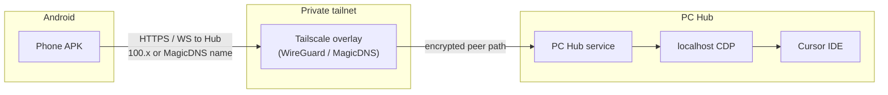

# Report — Secure phone ↔ PC linking with Tailscale

**Date:** 2026-09-24  
**Audience:** Project architecture / Hub networking  
**Scope:** Link an Android APK client to a Linux/Windows/Mac PC Hub over a private Tailscale network (tailnet), with **no public inbound ports**. Hub services (e.g. localhost CDP → Cursor) stay on the PC; the phone reaches them only via Tailscale.

**Project fit:** Phone remotes the PC-local Cursor session; keep the host private (see architecture / OSS landscape reports).

---

## Verdict

Install Tailscale on **both** the Android phone and the PC Hub, join the **same tailnet**, enable **MagicDNS**, bind the Hub API to a Tailscale IP or `localhost` reachable only from the Hub process path the companion uses, and tighten **ACLs/grants** so only the phone (or tagged devices) can reach Hub ports. **Subnet routers are usually not needed** when both ends run Tailscale. **Exit nodes are not required** for this design and hurt mobile battery if used.



---

## 1. Install both ends

Create or use a Tailscale account, then install the client on every device that participates.

| Platform | Official path |
|----------|----------------|
| Downloads hub | [tailscale.com/download](https://tailscale.com/download) |
| Linux | Install script then authenticate: `curl -fsSL https://tailscale.com/install.sh \| sh` then `sudo tailscale up` — [Access NAS / install clients](https://tailscale.com/docs/use-cases/personal-or-at-home-use/access-nas-media-file-servers) |
| Windows / macOS | Install from [Download](https://tailscale.com/download), sign in; menu bar / tray shows connection |
| Android | Install from Play Store / [Download](https://tailscale.com/download), sign in; once connected, apps on the device can reach tailnet services |

Sign in with the **same identity / tailnet** on phone and PC. Approve devices in the [Machines](https://login.tailscale.com/admin/machines) admin console if approval is required.

---

## 2. Tailnet (private overlay, no public ports)

A **tailnet** is your private Tailscale network. By default Tailscale is an **overlay**: it routes traffic between Tailscale peers and does **not** expose services to the public internet. You do **not** open router port-forwards for Hub ↔ phone.

- Hub listens on Tailscale IP (`100.x.y.z`) and/or localhost; phone dials the Hub via Tailscale IP or MagicDNS hostname.
- Do not publish Hub/CDP ports on `0.0.0.0` to the WAN; no cloud ingress required for this path.

Official framing of overlay vs full-tunnel: [Exit nodes](https://tailscale.com/kb/1103/exit-nodes) (default = overlay only).

---

## 3. MagicDNS

[MagicDNS](https://tailscale.com/kb/1081/magicdns) registers DNS names for devices. Prefer `hub-machine-name` (or `hub-machine-name.<tailnet>.ts.net`) over raw `100.x` addresses in the APK config.

- Tailnets created on/after 2022-10-20 have MagicDNS **on by default**; otherwise enable it on the [DNS admin page](https://login.tailscale.com/admin/dns).
- Keep **Use Tailscale DNS** / `--accept-dns=true` on clients that should resolve MagicDNS ([manage preferences](https://tailscale.com/docs/features/client/manage-preferences)).
- On macOS, prefer OS DNS tools (`ping`, `dscacheutil`) over `nslookup`/`host` for MagicDNS checks ([DNS in Tailscale](https://tailscale.com/docs/reference/dns-in-tailscale)).

---

## 4. Subnet routers — usually NOT needed

[Subnet routers](https://tailscale.com/kb/1019/subnets) advertise LAN/VPC CIDRs so **devices that do not run Tailscale** become reachable through a gateway.

| Scenario | Need subnet router? |
|----------|---------------------|
| Android + PC both run Tailscale; Hub listens on Tailscale IP | **No** |
| Phone must reach other LAN hosts that cannot run Tailscale | Yes (optional) |
| Phone must reach cloud VPC without per-host clients | Yes |

For this project’s Phone APK → PC Hub → localhost CDP → Cursor path, **install Tailscale on both ends and skip subnet routing**.

---

## 5. ACLs / grants (least privilege)

[ACLs](https://tailscale.com/kb/1018/acls) and [grants](https://tailscale.com/docs/features/grants) are deny-by-default once you replace the default allow-all policy. Prefer **grants** with tags or users so only the phone can reach Hub ports.

Example grant shape (illustrative — replace tags/ports with Hub API port):

```json
{
  "grants": [
    {
      "src": ["tag:phone"],
      "dst": ["tag:hub"],
      "ip": ["8080"]
    }
  ],
  "tagOwners": {
    "tag:phone": ["autogroup:admin"],
    "tag:hub": ["autogroup:admin"]
  }
}
```

Notes from official docs:

- Default policy allows all devices to talk; tighten before production.
- ACLs are directional and enforced on each device ([Manage permissions using ACLs](https://tailscale.com/kb/1018/acls)).
- Routes and ACLs are separate layers: both route *and* allow rule must exist for traffic to flow ([route injection](https://tailscale.com/docs/reference/route-injection)).

Edit policy via [Access controls](https://login.tailscale.com/admin/acls).

---

## 6. Exit nodes — NOT required

[Exit nodes](https://tailscale.com/kb/1103/exit-nodes) send **all** (or default) internet traffic through another device. That is unrelated to reaching a private Hub API on the same tailnet.

- Leave Exit Node set to **None** on the phone for this use case.
- Mobile battery drain is commonly tied to using an exit node ([mobile battery drains](https://tailscale.com/docs/reference/troubleshooting/mobile/battery-drains)).

---

## 7. Verifying connectivity

On the PC Hub:

```bash
tailscale status
tailscale ip -4
# optional: tailscale ping <phone-name-or-ip>
```

On Android: confirm Connected in the Tailscale app; open Hub URL `http(s)://<hub-magicdns>:<port>/` or use the APK’s health check.

Cross-checks:

- Ping MagicDNS name of Hub from a second client (`ping hub-name`).
- Confirm Hub process listens on Tailscale IP or is reachable via localhost relay on Hub only.
- If DNS fails, verify Quad100 / MagicDNS ([reserved IPs / CGNAT](https://tailscale.com/docs/reference/reserved-ip-addresses), [can’t resolve domain names](https://tailscale.com/docs/reference/troubleshooting/resolve-domain-names-failure)).

Pattern for private service access without public exposure: [Access NAS, media, or file shares](https://tailscale.com/docs/use-cases/personal-or-at-home-use/access-nas-media-file-servers).

---

## 8. Common Android / mobile pitfalls

| Pitfall | Mitigation |
|---------|------------|
| Exit node left enabled | Set Exit Node → **None**; overlay-only is enough for Hub API |
| Battery drain | Avoid exit nodes; known mobile issue when tunneling all traffic ([docs](https://tailscale.com/docs/reference/troubleshooting/mobile/battery-drains)) |
| MagicDNS / DNS not resolving | Ensure Tailscale DNS accepted; test with app HTTP client, not only `nslookup` |
| CGNAT `100.64.0.0/10` conflicts | ISP/other VPN overlap with Tailscale IPs — see [CGNAT conflicts](https://tailscale.com/docs/reference/reserved-ip-addresses) |
| Always-on VPN / battery optimizers | OS may kill or restrict VPN; whitelist Tailscale; keep VPN permission granted |
| Hub bound only to `127.0.0.1` on PC without a local proxy | Phone cannot hit pure localhost on another machine — Hub must listen on Tailscale IP **or** a on-Hub proxy forwards Tailscale → localhost CDP |
| Duplicate `100.x` after clone/restore | Re-auth / remove stale machine ([duplicate IP](https://tailscale.com/docs/reference/reserved-ip-addresses)) |
| ACL too tight or default replaced without Hub grant | Phone appears “connected” but TCP to Hub fails — check Access controls |

---

## Official citations (bookmark set)

- [Download / install](https://tailscale.com/download)
- [MagicDNS](https://tailscale.com/kb/1081/magicdns)
- [ACLs](https://tailscale.com/kb/1018/acls)
- [Grants](https://tailscale.com/docs/features/grants)
- [Subnet routers](https://tailscale.com/kb/1019/subnets)
- [Exit nodes](https://tailscale.com/kb/1103/exit-nodes)
- [Private service pattern (NAS guide)](https://tailscale.com/docs/use-cases/personal-or-at-home-use/access-nas-media-file-servers)
- [Mobile battery / exit node](https://tailscale.com/docs/reference/troubleshooting/mobile/battery-drains)
- [DNS troubleshooting](https://tailscale.com/docs/reference/troubleshooting/resolve-domain-names-failure)

---

## Five key recommendations

1. **Run Tailscale on phone and PC only** — same tailnet; no public ports, no cloud tunnel for Hub.
2. **Prefer MagicDNS hostnames** in the APK; keep Tailscale DNS accepted on both ends.
3. **Skip subnet routers and exit nodes** for Phone → Hub → localhost CDP → Cursor.
4. **Lock ACLs/grants** to phone→Hub API ports (tags); do not leave production on default allow-all.
5. **Bind Hub carefully** — listen on Tailscale IP or proxy Tailscale→localhost; never expose CDP/Hub on the WAN; verify with `tailscale status` / ping / APK health before relying on Cursor CDP.
