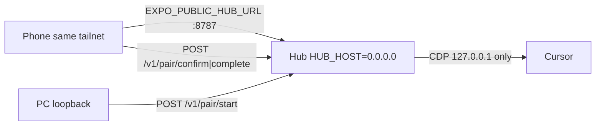

# Tailscale status — 2026-09-25

**Product:** PC-local Cursor companion Android APK  
**Locks:** PC-local only · Tailscale + pairing · CDP `127.0.0.1` only · phone never dials CDP  
**Secrets:** None recorded (no auth keys, tokens, or live pairing codes)

---

## Operator fact

**Tailscale is already installed and configured** on this PC and is the intended phone↔PC mesh. Do **not** treat Tailscale install/setup as a remaining blocker. Remaining verification is: Hub reachable on Tailscale IP/MagicDNS from the phone + pair / health / workspace over that link.



---

## PC identity (this host)

| Field | Value |
|-------|--------|
| Backend | Running / Online |
| Tailscale IPv4 | `100.91.47.68` |
| MagicDNS | `kingwarpc.tail246b3f.ts.net` |
| Short hostname | `kingwarpc` / `KINGWARPC` |
| Observed peers (no secrets) | `node1` (linux, active); `s-s26-ultra` (android — **offline**, last seen ~4d); **Pixel 7 not listed** as a Tailscale peer at 2026-09-25T20:58Z (USB adb only; VPN consented; Microsoft OAuth pending) |

Commands used (read-only): `tailscale status`, `tailscale ip -4`, `tailscale status --json` (Self DNSName / TailscaleIPs only).

---

## Hub bind for Tailscale access

| Knob | Smoke value | Notes |
|------|-------------|--------|
| `HUB_HOST` | `0.0.0.0` | Required so phone can reach Hub on the Tailscale interface. Prefer Tailscale ACLs; do not publish CDP. |
| `HUB_PORT` | `8787` | Default |
| `TAILSCALE_HOSTNAME` | `kingwarpc.tail246b3f.ts.net` | Pair QR / baseUrl hint |
| `CDP_URL` | `http://127.0.0.1:9222` | Loopback only — never Tailscale |

Alternative: bind `HUB_HOST=100.91.47.68` (Tailscale IP only) instead of `0.0.0.0` if you want a narrower listen address.

---

## Hub smoke (2026-09-25, this PC)

Hub started with `HUB_HOST=0.0.0.0` (`npm run dev -w @cursor-mobile/hub`). Note: `npm run start:hub:tailscale` → `npm start` currently fails (`ERR_MODULE_NOT_FOUND` on live-cursor `.ts` exports); prefer **`npm run dev -w @cursor-mobile/hub`** until build path is fixed.

| Probe | Result |
|-------|--------|
| `GET http://127.0.0.1:8787/health` (and `/v1/health`) | **200** · `ok: true` · hub `up` (reconfirmed 19:49Z) |
| `GET http://100.91.47.68:8787/health` | **200** · `ok: true` · hub `up` (reconfirmed 19:49Z) |
| `GET http://kingwarpc.tail246b3f.ts.net:8787/v1/health` | **200** · `ok: true` · hub `up` (earlier smoke) |
| CDP attach in health | `error` / fetch failed · `liveAdapter.state=cursor_down` — Cursor debug port not up |
| `POST http://127.0.0.1:8787/v1/pair/start` | **201** (loopback allowed; do not record live codes) |
| `POST http://100.91.47.68:8787/v1/pair/start` | **403 FORBIDDEN** (loopback-only — correct) |

---

## Phone steps (skip Tailscale install)

1. On phone: open Tailscale → confirm **same tailnet** as PC and device **online** (bring `s-s26-ultra` or your phone online if offline).
2. Set Hub URL (build-time or Pair screen override):

```bash
export EXPO_PUBLIC_HUB_URL="http://100.91.47.68:8787"
# or MagicDNS:
# export EXPO_PUBLIC_HUB_URL="http://kingwarpc.tail246b3f.ts.net:8787"
```

3. On PC: start Hub with Tailscale-reachable bind (`HUB_HOST=0.0.0.0` or `100.91.47.68`).
4. On PC **localhost only**, generate a pairing code:

```bash
curl -s -X POST http://127.0.0.1:8787/v1/pair/start \
  -H 'Content-Type: application/json' -d '{}'
```

5. On phone: open Expo / APK → Pair → enter code → Hub calls `POST /v1/pair/confirm` or `/v1/pair/complete` **over Tailscale** (not loopback).
6. Confirm Health + workspace banner against the PC-open project.

### Pairing nuance (do not soft-open)

- **`POST /v1/pair/start` is loopback-only** (`requireLocal`). Generating a code from the phone or via Tailscale IP returns **403**.
- Operator generates the code on the **PC** (`127.0.0.1`), then the phone completes pairing remotely over Tailscale.

---

## Related

- [`operator-uat-checklist-2026-09-25.md`](./operator-uat-checklist-2026-09-25.md) — UAT starts at same-tailnet confirm (install skipped)
- [`goal-progress-2026-09-25.md`](./goal-progress-2026-09-25.md)
- [`CONFIGURATION.md`](../CONFIGURATION.md) — `HUB_HOST` / `EXPO_PUBLIC_HUB_URL`
