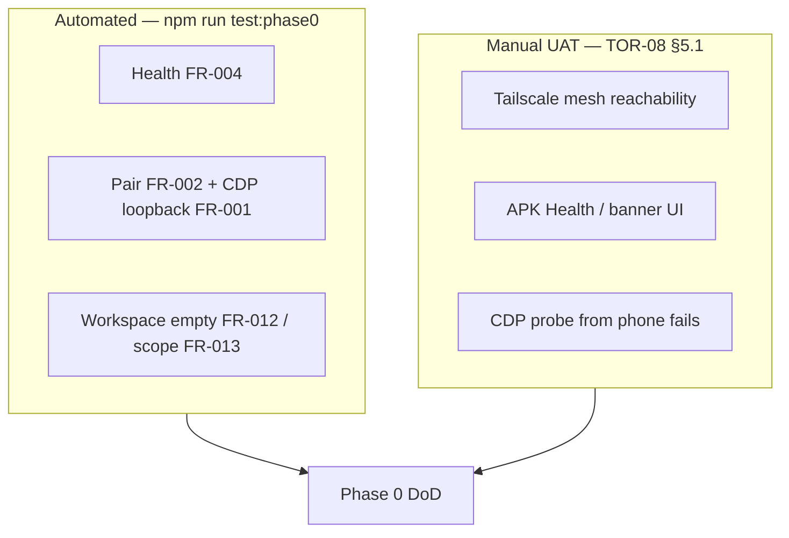

# Test plan — Phase 0 (connectivity / pairing / workspace)

**Date:** 2026-09-25  
**Phase:** 0 — Pair, Tailscale, health, active workspace banner  
**Canonical catalog:** [`tor/TOR-08-nfr-testing-ops-acceptance.md`](tor/TOR-08-nfr-testing-ops-acceptance.md) §§4.1–4.2  
**FR summary:** TOR-01 FR-001–014 (Phase 0 gate: FR-001–004, FR-010–013; FR-014 is P1)  
**Runner:** `npm run test:phase0` (root) → `@cursor-mobile/hub` vitest suite  
**Status:** 21 automated tests green against Hub Express routes

---

## Product locks (still true)

| Lock | Test implication |
|------|------------------|
| PC-local only | No cloud Agents / Remote Control cases |
| Open-project remote | Empty workspace must not invent a project (`emptyReason: NO_FOLDER_OPEN`) |
| Tailscale + pairing | Unpaired → 401 on `/workspace` |
| CDP localhost | `createLiveCursorAdapter` rejects non-loopback CDP URL |
| Docs ≠ full product | Mesh/APK UAT still manual; CDP attach uses stub probe in unit tests |



---

## How to run

```bash
cd /data/projects/cursor_mobile
npm install
npm run test:phase0
```

Suite location: `packages/hub/tests/phase0/{health,pair,workspace-empty}.test.ts`

---

## Automation coverage (Phase 0 slice of TOR-08 P0)

### Connectivity & pairing — §4.1

| Case ID | Mode | Where |
|---------|------|-------|
| AC-001-01 | **Manual** | Phone reaches Hub over Tailscale / MagicDNS |
| AC-001-02 | **Manual** | Probe CDP on PC Tailscale IP from another host |
| AC-001-03 | **Automated** | `health.test.ts` — non-loopback CDP URL rejected |
| AC-001-04 | **Manual** | APK settings — no remote CDP URL (needs APK) |
| AC-002-01 | **Automated** | `pair.test.ts` — `POST /pair/start` + `/pair/confirm` |
| AC-002-02 | **Automated** | `pair.test.ts` — `GET /workspace` without token → 401 |
| AC-002-03 | **Automated** | `pair.test.ts` — expired code → 410 |
| AC-002-04 | **Automated** | `pair.test.ts` — revoke + re-pair |
| AC-003-01 | **Manual** | Tailscale down → APK actionable error |
| AC-003-02 | **Manual** | Hub stopped, mesh up → Hub-not-running copy |
| AC-003-03 | **Automated** (API) | Invalid/missing token → 401; APK Pair UI still manual |
| AC-003-04 | **Manual** | Wrong hostname — unreachable, no silent hang |
| AC-004-01 | **Automated** | `health.test.ts` — Hub up + CDP connected |
| AC-004-02 | **Automated** | `health.test.ts` — CDP disconnected |
| AC-004-03 | **Manual** | APK Health screen mirrors payload |
| AC-004-04 | **Manual** | Hub down → APK HubDown |

### Workspace binding — §4.2

| Case ID | Mode | Where |
|---------|------|-------|
| AC-010-01 | **Automated** | Bound `CURSOR_WORKSPACE` → name/path/roots |
| AC-010-02 | **Manual** | Switch folder on PC; refresh payload |
| AC-010-03 | **Automated** | Empty before Cursor open — no crash |
| AC-011-01 | **Manual** | APK Home banner matches PC |
| AC-011-02 | **Manual** | Pull-to-refresh on APK |
| AC-011-03 | **Manual** | Long path truncate/wrap UI |
| AC-012-01 | **Automated** | Empty Hub payload + HTTP empty `/workspace` |
| AC-012-02 | **Automated** | No fake project / no cloud string |
| AC-012-03 | **Automated** | Binding path restores workspace fields |
| AC-012-04 | **Manual** | Cursor quit → CursorDown messaging |
| AC-013-01 | **Automated** (stub) | Bound `POST /sessions` → 201 (Composer create is Phase 1) |
| AC-013-02 | **Automated** | Foreign `workspaceId` → 400 |
| AC-013-03 | **Deferred** | Session list scoping — Phase 1 |
| AC-013-04 | **Automated** | Same as AC-013-02 |

### Cross-cutting

| Case ID | Mode | Notes |
|---------|------|-------|
| AC-X-02 | **Manual** + AC-001-03 | CDP not on Tailscale |
| AC-X-03 | **Automated** | Empty workspace; no invented project |
| AC-X-01 / AC-X-04 | **Manual / Phase 1** | Full path + cloud lock UI need APK |

---

## Counts (§§4.1–4.2 = 30 cases)

| Mode | Count |
|------|-------|
| Automated in `test:phase0` | **21** tests (phase0 suite + hub `test/health-pair.test.ts`) covering ~18 AC IDs |
| Manual UAT (mesh / APK / live Cursor) | **~12** |
| Deferred to Phase 1 sessions list | **1** (AC-013-03) |

FR-014 (multi-window) remains **out of Phase 0 automation** (P1).
