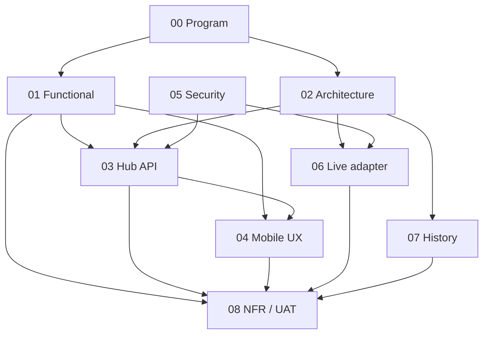
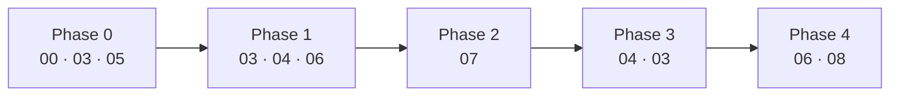

<!-- generated-by: gsd-doc-writer -->
# TOR set — Master index

**Product:** PC-local Cursor companion Android APK  
**Status:** Design accepted · code not scaffolded · TOR volumes = **designed** specs  
**Locks:** PC-local only · open-project remote · continue/create (model + files + PC tools) · Tailscale + pairing · CDP `127.0.0.1` · Expo APK · docs ≠ code

Exhaustive Terms of Reference (TOR) for everything needed to build the system. Each volume is owned by a named role in [`../../architecture/AGENT-ROSTER.md`](../../architecture/AGENT-ROSTER.md). Chapter bodies are written by specialist agents; this file is the **index only**.

Briefing pack: [`../../architecture/AGENT-CONTEXT.md`](../../architecture/AGENT-CONTEXT.md) · Agent rules: [`../../../AGENTS.md`](../../../AGENTS.md)

---

## Volume catalog (00–08)

| Vol | File | Title | Primary owner role |
|-----|------|-------|--------------------|
| **00** | [TOR-00-program-terms-of-reference.md](./TOR-00-program-terms-of-reference.md) | Program TOR — goals, scope, RACI, risks, phases, glossary | Program Steward |
| **01** | [TOR-01-functional-requirements.md](./TOR-01-functional-requirements.md) | Functional requirements — FR-001–091 expanded | Requirements Analyst |
| **02** | [TOR-02-system-architecture.md](./TOR-02-system-architecture.md) | System architecture — C4, ADRs, deployment | System Architect |
| **03** | [TOR-03-hub-and-api-specification.md](./TOR-03-hub-and-api-specification.md) | Hub & API — REST/WS contracts, schemas | Hub API Designer |
| **04** | [TOR-04-mobile-apk-and-ux.md](./TOR-04-mobile-apk-and-ux.md) | Mobile APK & UX — screens, Expo, EAS APK | Mobile UX Designer |
| **05** | [TOR-05-security-and-tailscale.md](./TOR-05-security-and-tailscale.md) | Security & Tailscale — threats, pairing, CDP bans | Security Engineer |
| **06** | [TOR-06-live-cursor-adapter.md](./TOR-06-live-cursor-adapter.md) | LiveCursorAdapter — CDP, selectors, approvals | Live Adapter Engineer |
| **07** | [TOR-07-history-sessions-data.md](./TOR-07-history-sessions-data.md) | History Index & session data — local only | History Data Engineer |
| **08** | [TOR-08-nfr-testing-ops-acceptance.md](./TOR-08-nfr-testing-ops-acceptance.md) | NFR, testing, ops, acceptance, DoD | QA & Ops Acceptancer |

---

## Reading order

### First-time (program alignment)

1. [`AGENT-CONTEXT.md`](../../architecture/AGENT-CONTEXT.md) — one-page briefing  
2. **TOR-00** — program scope and phase work packages  
3. **TOR-05** — security locks before any API/UX detail  
4. **TOR-01** — what must be true (FRs)  
5. **TOR-02** — how components fit  

### Build-oriented (by layer)

6. **TOR-03** — Hub contracts (phone never talks CDP)  
7. **TOR-06** — live Composer path (Phase 0–1 critical)  
8. **TOR-04** — APK screens and create/continue UX  
9. **TOR-07** — history index (Phase 2+)  
10. **TOR-08** — acceptance and ops before claiming a phase done  

**Do not** treat raw Parallel / OSS landscape “cloud optional” notes as active scope. Product locks in TOR-00 / TOR-05 win.

---

## Volumes ↔ build phases 0–4

| Phase | Focus (gate) | Primary TOR volumes | Supporting |
|-------|--------------|---------------------|------------|
| **0** | Pair, Tailscale, `/health`, workspace banner; PC-open only | 00, 03, 05 | 01 (FR-001–013), 02, 08 |
| **1** | Live continue + approvals + create (model + attach) + APK shell; tools on PC | 03, 04, 06 | 01 (FR-020–062, 080–081), 02, 05, 08 |
| **2** | Full local History Index + Open on PC; no cloud history | 07 | 01 (FR-023, 040–041), 03, 04, 08 |
| **3** | Richer file picker / @-mentions; optional editor tab | 04, 03 | 01 (FR-055, 070–071), 02, 08 |
| **4** | Harden CDP selectors; offline queue; still no public CDP / cloud | 06, 08 | 01 (FR-090–091), 04, 05 |

Canonical phase table also lives in [`AGENT-CONTEXT.md`](../../architecture/AGENT-CONTEXT.md) §8 and [`AGENTS.md`](../../../AGENTS.md).

---

## Relationship to architecture / features / reports

| Layer | Role | When to edit |
|-------|------|--------------|
| `docs/architecture/` | Compact accepted design (AGENT-CONTEXT, FRs, security, companion) | Scope / API / phase truth changes |
| `docs/features/` | UX contracts (sessions, new session, screens) | Screen/flow detail changes |
| `docs/reports/tor/` | Exhaustive TOR chapters | Deep specification; promote decisions back to architecture/features |
| Other `docs/reports/` | Dated jobs, research synthesis, handoffs | After investigations — not a second architecture |

**Consistency rule:** If a TOR volume decides something new, promote it into `docs/architecture/` or `docs/features/` in the same turn. TOR is detail expansion, not a competing product path.

---

## Status of chapter bodies

Sibling specialists own full chapter bodies. Until a volume file exists or is marked complete, treat the **compact** docs under `docs/architecture/` and `docs/features/` as the working truth.

| Marker | Meaning |
|--------|---------|
| **DESIGNED** | Spec only — Hub/APK/adapters not in repo |
| **Not scaffolded** | No `apps/`, `packages/`, or `package.json` yet |

---

## Quick links

| Doc | Path |
|-----|------|
| Agent roster (who owns what) | [`../../architecture/AGENT-ROSTER.md`](../../architecture/AGENT-ROSTER.md) |
| Handoff protocol | [`../agent-handoff-protocol.md`](../agent-handoff-protocol.md) |
| Doc index | [`../../README.md`](../../README.md) |
| Gap closure | [`../gap-closure-hybrid-system-2026-09-24.md`](../gap-closure-hybrid-system-2026-09-24.md) |
