<!-- generated-by: gsd-doc-writer -->
# TOR-00 — Program Terms of Reference

**Volume:** 00 · Program TOR  
**Document ID:** `TOR-00`  
**Program:** PC-local Cursor Companion (Android APK + Local Hub)  
**Status of subject matter:** **DESIGNED / not built** — architecture and functional requirements accepted (2026-09-24); Hub package, Expo APK, and adapters are **not scaffolded** in the repository  
**Scope lock:** **PC-local only** — no Cursor Cloud Agents, no official Remote Control, no cloud workers, no cloud session catalogs  
**Classification:** Program-level Terms of Reference (authoritative for subsequent TOR volumes)  
**Language:** English  

---

## 1. Document control

| Field | Value |
|-------|-------|
| Title | Program Terms of Reference — Cursor Mobile Companion |
| Short name | TOR-00 |
| Path | `docs/reports/tor/TOR-00-program-terms-of-reference.md` |
| Effective date | 2026-09-24 (design acceptance) |
| Issue date of this volume | 2026-09-25 |
| Owning artifact set | `docs/architecture/` (design truth) · this TOR series (delivery governance) |
| Implementation status | **DESIGNED** — documentation and contracts only; **no** `apps/`, `packages/`, or `package.json` application code |
| Supersedes | None (first program TOR) |
| Related briefing | [`docs/architecture/AGENT-CONTEXT.md`](../../architecture/AGENT-CONTEXT.md) |
| Related FRs | [`docs/architecture/functional-requirements.md`](../../architecture/functional-requirements.md) |
| Related narrative | [`docs/reports/how-we-work-phone-pc-2026-09-24.md`](../how-we-work-phone-pc-2026-09-24.md) |
| Related gap matrix | [`docs/reports/gap-closure-hybrid-system-2026-09-24.md`](../gap-closure-hybrid-system-2026-09-24.md) |

### 1.1 Authority of this volume

This volume is the **program charter** for delivery planning. It does not replace architecture docs as technical source of truth; it **binds** delivery work packages, phases, stakeholders, acceptance of the TOR itself, and cross-volume references.

| Artifact class | Authority |
|----------------|-----------|
| Product locks, goals, non-goals | Shared: AGENT-CONTEXT + this TOR |
| Functional requirements (FR-001–091) | `functional-requirements.md` |
| System structure, Hub API shape | `mobile-cursor-companion.md` |
| Mesh / CDP / pairing security | `security-tailscale-linking.md` |
| Feature UX detail | `docs/features/*` |
| Delivery phases, RACI, SMART objectives, TOR acceptance | **This volume (TOR-00)** |
| Component-level TOR detail | Subsequent volumes TOR-01… (see §21) |

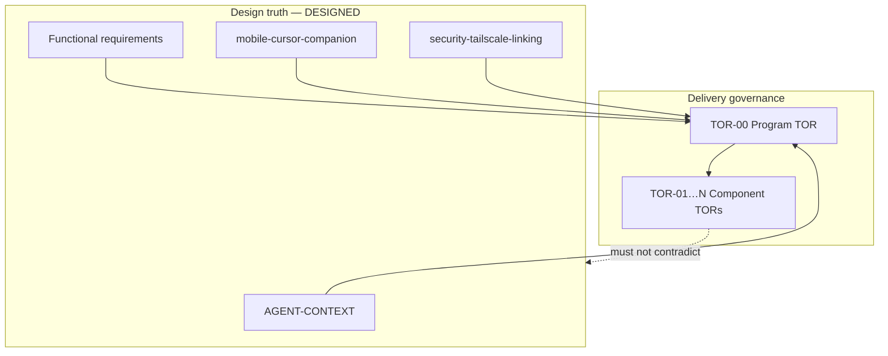

### 1.2 Status legend used throughout

| Mark | Meaning |
|------|---------|
| **DESIGNED** | Specified in accepted docs; contracts and UX described; **not implemented** |
| **NOT BUILT** | No runnable package, binary, or scaffold in-repo |
| **ACCEPTED DESIGN** | Product decision locked (2026-09-24) |
| **OUT OF SCOPE** | Explicitly excluded; must not appear as a delivery path |

---

## 2. Purpose of this TOR

### 2.1 Why a Program TOR exists

The repository currently holds an **accepted hybrid design** for a phone companion that remotes Composer for a project already open in Cursor on a PC. Application code is **not** started. Before scaffolding Hub/APK/adapters, delivery needs a single program instrument that:

1. States the **problem**, **goals**, and **SMART objectives** in contractual language.
2. Freezes **in-scope / out-of-scope** and **product locks** so later agents and implementers cannot soft-open cloud paths.
3. Assigns **stakeholders and RACI**.
4. Lists **assumptions, constraints, risks**, and **success criteria**.
5. Enumerates **program deliverables** and maps them to **work packages / phases 0–4**.
6. Defines how this TOR is **accepted** and how **subsequent TOR volumes** specialize it.

### 2.2 Audiences

| Audience | Use of TOR-00 |
|----------|---------------|
| Product owner / operator | Confirm locks, success criteria, day-to-day intent |
| Architects / agents updating design | Ensure changes stay inside program scope |
| Implementers (future) | Phase gates, deliverables, FR coverage before coding |
| Reviewers / auditors | Trace DESIGNED claims vs NOT BUILT reality |
| Authors of TOR-01…N | Inherit program constraints without re-negotiating cloud |

### 2.3 One-sentence program purpose

**Provide a sideloadable Android APK that remotes the Composer / agent loop for the project already open in Cursor on the user’s PC — continue live or local-history sessions, or create new sessions with model choice, workspace file attach, and PC-side tools under phone Approve/Deny — over Tailscale and device pairing, with CDP bound to `127.0.0.1` only, with no cloud Agents or Remote Control.**

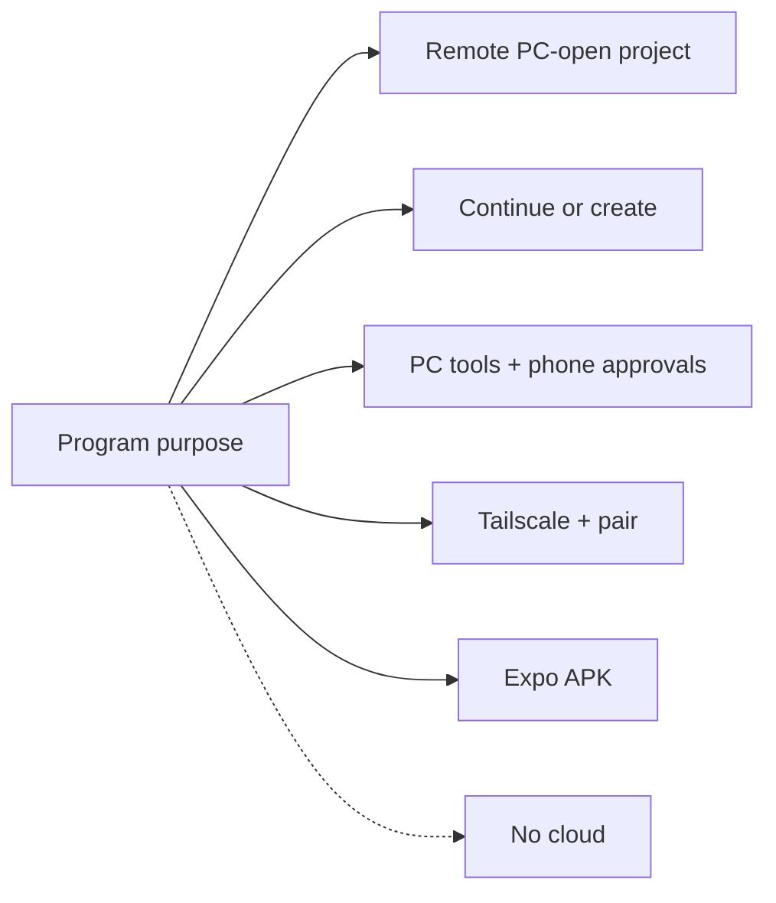

---

## 3. Background and context

### 3.1 Product context

Cursor Desktop already hosts Composer, models, MCP/tools/plugins, and local session storage on the PC. Official mobile paths that depend on **cloud Agents / Remote Control** are **rejected** as this program’s product path. Independent open-source patterns (live CDP control, local session indexing, daemon + Expo shell) each cover only part of the need.

### 3.2 Research and gap-closure background

Design work (2026-09-24) compared borrowable patterns and closed gaps without adopting cloud:

| Source pattern | Useful borrow | Gap for this program |
|----------------|---------------|----------------------|
| CursorRemote-class live CDP | Chat, approvals, prompts, multi-window ideas | Weak workspace banner; weak new-session model/files; tools often opaque DOM; browser-first |
| cursor-session-class history | Local past-session extract | Not a live control surface or mobile app |
| Paseo-class daemon + Expo APK | Hub + sideload APK shape | Not verified as Cursor Composer / PC-open workspace bind |
| Official Cursor iOS / Remote Control | — | Cloud agent loop — **OUT OF SCOPE** |

The accepted fix is a **hybrid Hub**: workspace bind + live adapter + local History Index + Expo APK + Tailscale pairing. Gap coverage is design-complete; code is not.

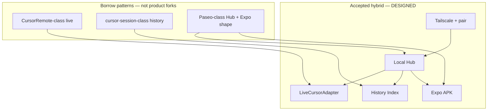

### 3.3 Current repository state (truth)

| Artifact | State |
|----------|-------|
| Architecture, FRs, features, security docs | **ACCEPTED DESIGN** |
| Gap-closure and operator narrative reports | Present |
| `apps/mobile`, `packages/hub`, `adapters/*` | **NOT BUILT** — intended layout only |
| Runnable install / `package.json` application tree | **None** |
| Designed Hub routes (`/workspace`, `/sessions`, `/pair/...`, etc.) | **DESIGNED only** |

### 3.4 Intended future layout (not claimed as existing)

```
apps/mobile/          # Expo Android APK — DESIGNED / NOT BUILT
packages/hub/         # Local Hub HTTP/WS — DESIGNED / NOT BUILT
adapters/live/        # LiveCursorAdapter (CDP) — DESIGNED / NOT BUILT
adapters/history/     # History Index — DESIGNED / NOT BUILT
docs/ · research/     # Present
```

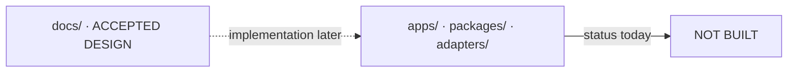

---

## 4. Problem statement

### 4.1 Core problem

Operators need to **continue or start** Composer/agent work for a project they already have open on a PC **from a phone**, without:

- sitting at the desk for every Approve/Deny and prompt,
- adopting a **cloud** agent loop or cloud session catalog,
- exposing Cursor’s CDP / DevTools beyond the PC loopback,
- turning the phone into an IDE that opens arbitrary folders or runs MCP/tools.

### 4.2 Problem decomposition

| Problem element | Description | Consequence if unsolved |
|-----------------|-------------|-------------------------|
| **Context honesty** | Phone must show the **same** PC-open project | Wrong-folder chats; silent wrong context |
| **Continue** | Live Composer and (later) local history for that project | Incomplete “all my sessions for this work” |
| **Create** | New session needs **model + attachments**, not prompt-only mirror | Weak mobile start vs desktop Composer |
| **Control vs execution** | Phone decides; PC executes tools/MCP | Phone cannot safely host tool runtimes |
| **Reachability** | Phone ↔ Hub over private mesh | LAN/public exposure of Hub/CDP |
| **Delivery form** | Sideload APK (not browser-only) | Friction and non-product UX |
| **Truthfulness of status** | Docs vs code | Claiming “done APIs” when only DESIGNED |

### 4.3 Problem statement (formal)

**There is no implemented, PC-local, Tailscale-paired Android companion that (a) binds exclusively to the Cursor workspace already open on the PC, (b) continues live Composer sessions with structured tool approvals, (c) creates new sessions with model and workspace file attach, (d) later lists project-local history and opens sessions on the PC, and (e) never exposes CDP beyond `127.0.0.1` or depends on Cursor Cloud Agents.**

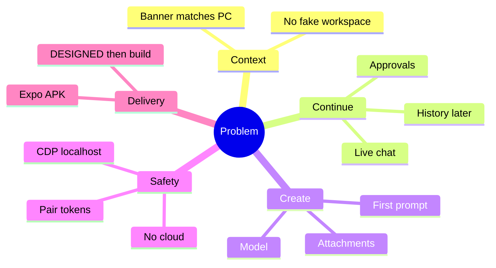

---

## 5. Program goals

Goals are product outcomes (G-1…G-6). They are **DESIGNED** targets; fulfillment requires future implementation against FRs.

| ID | Goal | Primary FR groups | Primary phase |
|----|------|-------------------|---------------|
| **G-1** | Remote the Composer/agent loop for the **PC-open** project | Workspace, Sessions | 0–1 |
| **G-2** | **Continue** live sessions and (phase 2) local project history | Continue live, History | 1–2 |
| **G-3** | **Create** session: model + workspace file attach + chat | New session | 1 |
| **G-4** | Tools / plugins / MCP run **on PC**; phone Approve/Deny only | Tools, Continue live | 1 |
| **G-5** | **Tailscale** + Hub device pairing; CDP stays localhost | Connectivity & pairing | 0 |
| **G-6** | Sideload **Expo EAS APK** (`android.buildType: apk`) | APK delivery | 1 |

### 5.1 Non-goals (program level)

| ID | Non-goal | Rationale |
|----|----------|-----------|
| **NG-1** | Cloud Agents / official Remote Control / cloud workers / cloud session lists | Product lock — PC-local only |
| **NG-2** | Opening / cloning arbitrary folders from the phone (v1) | Phone remotes open project; PC opens folders |
| **NG-3** | Running MCP/tools/plugins on the phone | Execution stays in Cursor on PC |
| **NG-4** | Exposing CDP beyond `127.0.0.1` | Threat model — full IDE control surface |
| **NG-5** | Cloud credentials or remote CDP URLs in the APK | APK is UI + Hub client only |
| **NG-6** | VNC-first / full remote desktop as the product path | Gap is session identity, transcript, approvals |
| **NG-7** | Controlling other machines’ Cursor instances via this Hub | One PC Hub ↔ paired phones for that PC |

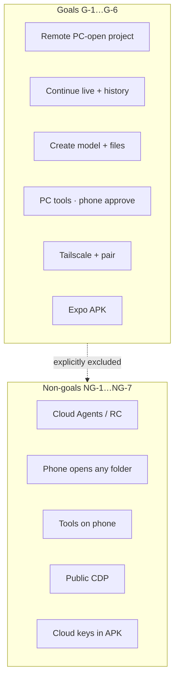

---

## 6. SMART objectives

Each objective is **Specific, Measurable, Achievable, Relevant, Time-bound** relative to phase gates. “Time-bound” here means **phase completion gates**, not calendar dates (implementation not started). Status of all objectives today: **DESIGNED / NOT ACHIEVED IN CODE**.

### 6.1 Objective register

| Obj ID | SMART statement | Measures | Phase gate | FR anchors |
|--------|-----------------|----------|------------|------------|
| **O-0.1** | Establish private Hub reachability and pairing so an unpaired phone cannot call workspace/session APIs | Pairing failure on protected routes; `/health` reachable over Tailscale | End of Phase 0 | FR-001–004 |
| **O-0.2** | Surface the Hub-bound PC-open workspace on the phone as an accurate banner; empty Cursor → blocking empty state | Banner name/path match open folder; no invented project | End of Phase 0 | FR-010–013 |
| **O-1.1** | Enable live continue: send/receive messages and Approve/Deny tool cards with Deny effective on PC | Round-trip chat; deny blocks PC approval path; no silent auto-approve | End of Phase 1 | FR-030–033, FR-060–062 |
| **O-1.2** | Enable new session creation with required model, optional attachments and prompt, scoped to bound `workspaceId` | Mismatched `workspaceId` rejected; model applied; attachments as workspace refs | End of Phase 1 | FR-050–054 |
| **O-1.3** | Deliver sideloadable Expo EAS APK implementing P0 screens (pair, banner, list, chat, approvals, create) | Installable `.apk`; screens cover FR-081 | End of Phase 1 | FR-080–081 |
| **O-2.1** | Enumerate all local history sessions for the bound project and support Open on PC → live | History rows for project only; open-on-pc yields live | End of Phase 2 | FR-023, FR-040–041 |
| **O-2.2** | Support multi-window / multi-workspace bind selection when multiple Cursor windows are open | User-selectable bind target | Phase 1–2 | FR-014 |
| **O-3.1** | Provide richer multi-root file/@-mention attach UX and optional editor browse mode | Picker usable across roots; editor attach-oriented | End of Phase 3 | FR-055, FR-070–071 |
| **O-4.1** | Harden reconnect and CDP selector resilience; optional offline queue | Reconnect without re-pair unless revoked; selector churn mitigated | End of Phase 4 | FR-090–091 |

### 6.2 Objective dependency graph

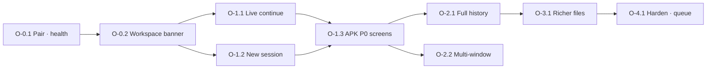

### 6.3 Achievability notes

| Factor | Note |
|--------|------|
| Achievable | Hybrid design reuses proven pattern classes (live CDP, local history index, Expo APK) |
| Risk to achievability | Cursor UI/CDP selector churn (mitigated in Phase 4; adapters must be version-tolerant) |
| Not achievable under this TOR | Cloud-equivalent “open any project / any machine from phone” in v1 |
| Relevance | Every objective maps to an accepted FR group and a gap-closure need |

---

## 7. Scope

### 7.1 In scope (v1 program)

| Area | In-scope content | Status |
|------|------------------|--------|
| Workspace binding | Detect PC-open project; `GET /workspace`; APK banner; reject wrong `workspaceId` | DESIGNED |
| Connectivity | Tailscale (or equivalent WireGuard mesh); device pairing; `GET /health` | DESIGNED |
| Live sessions | List/continue live; messages; WS events; attachments; approvals | DESIGNED |
| New sessions | Model list; file index; `POST /sessions`; tools summary informational | DESIGNED |
| Tools policy | Execute on PC; phone Approve/Deny; no silent approve | DESIGNED |
| History (Phase 2) | Local History Index filtered by workspace; Open on PC | DESIGNED |
| APK | Expo Android, EAS `android.buildType: apk`, sideload | DESIGNED |
| Security baseline | CDP `127.0.0.1`; Hub on private mesh; no Funnel/ngrok-as-default | DESIGNED |
| Documentation | Architecture, FRs, features, reports, this TOR series | Present / expanding |

### 7.2 Out of scope

| Area | Exclusion | Lock |
|------|-----------|------|
| Cloud Agents / Remote Control | Not a product path | NG-1 |
| Cloud session catalogs / cloud credentials in APK | Forbidden | NG-1, NG-5 |
| Public CDP / Hub on `0.0.0.0` | Forbidden baseline | NG-4 |
| Phone-hosted MCP / tool runtimes | Forbidden | NG-3 |
| Phone as primary clone/open-folder surface (v1) | Deferred / excluded | NG-2 |
| VNC-first remote desktop | Not the product | NG-6 |
| Multi-PC Hub federation | Single PC Hub | NG-7 |
| Claiming implemented APIs while only DESIGNED | Process rule | Docs ≠ code |

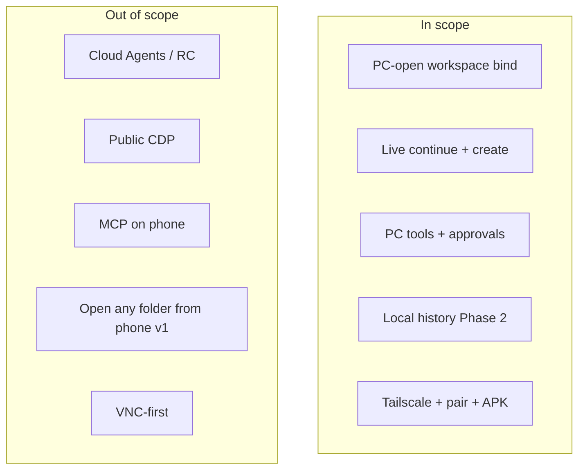

### 7.3 Scope change control

Any proposal that introduces cloud Agents, public CDP, phone-side tool execution, or “open arbitrary folders from phone” as v1 **requires explicit product-owner override of this TOR** and concurrent update of AGENT-CONTEXT, FRs, and gap-closure. Soft-opening those paths in plans or code comments is **not** permitted.

---

## 8. Product locks (non-negotiable)

Repeat in every plan, report, handoff, and subsequent TOR volume.

| Lock | Meaning | Implementation status |
|------|---------|----------------------|
| **PC-local only** | No Cursor Cloud Agents, no official Remote Control, no cloud workers, no cloud session catalogs | DESIGNED lock |
| **Open-project remote** | Phone remotes the project **already open** in Cursor on the PC — not arbitrary folders from the phone (v1) | DESIGNED |
| **Continue or create** | Continue live/history **or** new session: model + attach files + tools/plugins on PC with phone approvals | DESIGNED |
| **Tailscale + pairing** | Phone ↔ Hub over private mesh; device pairing required | DESIGNED |
| **CDP localhost** | CDP binds **`127.0.0.1` only**; phone never dials CDP | DESIGNED |
| **Expo sideload APK** | Android via Expo EAS `android.buildType: apk` | DESIGNED |
| **Docs ≠ code** | Architecture/FRs accepted; Hub/APK **not implemented** — do not invent “done” APIs | Enforced by this TOR |

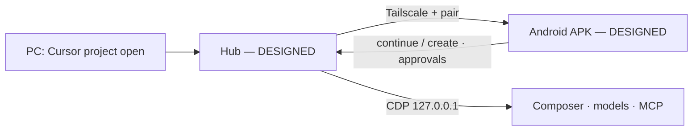

---

## 9. Stakeholders and RACI

### 9.1 Stakeholder register

| Stakeholder | Role | Interest |
|-------------|------|----------|
| **User / operator** | End user of PC Cursor + phone APK | Reliable remote Composer for open project |
| **Product owner** | Scope and lock authority | Keep PC-local; phase ordering |
| **Architect / design agents** | Maintain architecture & FRs | Coherent DESIGNED contracts |
| **Hub implementer** (future) | `packages/hub` | API, workspace bind, orchestration |
| **Live adapter implementer** (future) | `adapters/live` | CDP/DOM Composer control |
| **History implementer** (future) | `adapters/history` | Local History Index |
| **Mobile implementer** (future) | `apps/mobile` | Expo APK UX |
| **Security reviewer** | Mesh, pairing, CDP rules | No public CDP; revoke able |
| **Doc / TOR maintainers** | docs + TOR volumes | Docs ≠ code honesty |

### 9.2 Actors in the designed system

| Actor | Runtime | Responsibility |
|-------|---------|----------------|
| **User** | Human | Opens project on PC; pairs phone; chats; approves/denies |
| **Phone APK** | Android | UI only — pair, banner, sessions, chat, create, approvals |
| **Hub** | PC process | HTTP/WS API; bind; orchestrate adapters |
| **LiveCursorAdapter** | PC | CDP → Composer |
| **History Index** | PC | Local session store for project |
| **Cursor on PC** | IDE | Owns Composer, models, MCP/tools, local sessions |

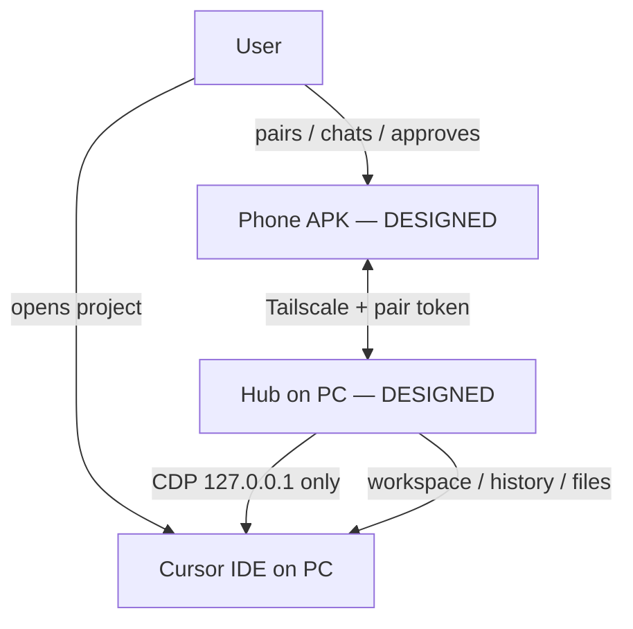

### 9.3 RACI matrix (program level)

**R** = Responsible · **A** = Accountable · **C** = Consulted · **I** = Informed

| Decision / deliverable | Product owner | Architect | Hub impl. | Live impl. | History impl. | Mobile impl. | Security | User |
|------------------------|---------------|-----------|-----------|------------|---------------|--------------|----------|------|
| Product locks / NG cloud | A | C | I | I | I | I | C | I |
| FR acceptance | A | R | C | C | C | C | C | I |
| Phase 0 pairing & health | A | C | R | C | I | R | R | C |
| Phase 0 workspace banner | A | C | R | C | I | R | C | C |
| Phase 1 live continue + approvals | A | C | R | R | I | R | C | C |
| Phase 1 new session | A | C | R | R | I | R | C | C |
| Phase 1 Expo APK shell | A | C | C | I | I | R | C | C |
| Phase 2 History Index + open-on-pc | A | C | R | C | R | R | C | C |
| Phase 3 richer files / editor | A | C | R | I | I | R | C | C |
| Phase 4 harden / offline queue | A | C | R | R | C | R | C | I |
| TOR-00 acceptance | A | R | I | I | I | I | C | I |
| Claiming “API done” | A | R | R | R | R | R | C | I |

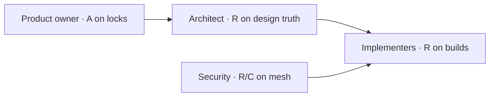

---

## 10. Assumptions

Assumptions are believed true for planning. If invalidated, re-plan the affected phase.

| ID | Assumption | If false |
|----|------------|----------|
| **A-1** | Operator can run Cursor on a PC with a project folder open | Program has no bind target — empty-state only |
| **A-2** | CDP or equivalent automation surface remains usable for Composer control (with selector maintenance) | Live adapter scope expands; Phase 4 critical |
| **A-3** | Local session artifacts exist on disk for History Index (Phase 2) | History incomplete; live-only product until alternative found |
| **A-4** | Phone and PC can join the same Tailscale tailnet (or equivalent mesh) | No secure baseline path; do not fall back to public CDP |
| **A-5** | Expo EAS can produce sideloadable APK with `android.buildType: apk` | Delivery form must be re-decided |
| **A-6** | Models and tools lists can be read from Cursor/local Hub context without cloud session APIs | Create/tools summary features blocked |
| **A-7** | User accepts Approve/Deny latency on phone for tool calls | UX expectations misaligned |
| **A-8** | Design docs remain single coherent set (no competing architecture) | TOR volumes diverge; enforce one source of truth |
| **A-9** | Implementation has not started; first code is greenfield scaffold under intended layout | — (currently true) |
| **A-10** | WireGuard self-hosted mesh is acceptable substitute if it matches Tailscale security properties | Document equivalent controls in security TOR |

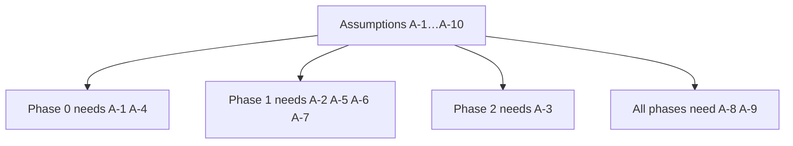

---

## 11. Constraints

### 11.1 Hard constraints (must not violate)

| ID | Constraint |
|----|------------|
| **C-1** | No cloud Agents / Remote Control / cloud workers as the product path |
| **C-2** | CDP bind address: `127.0.0.1` only; never in APK as remote URL |
| **C-3** | Phone never dials CDP; only Hub API/WS over mesh + pairing |
| **C-4** | Hub must not be designed as public internet service (no Funnel/ngrok-as-default) |
| **C-5** | `workspaceId` on create/list must match Hub-bound open project (v1) |
| **C-6** | No silent auto-approval of tool calls on the phone path |
| **C-7** | No Cursor/cloud API keys stored in APK design |
| **C-8** | Tools/MCP/plugins execute only inside Cursor on the PC |
| **C-9** | English only for code, comments, and docs |
| **C-10** | Do not claim Hub/APK APIs “done” until packages exist |

### 11.2 Soft constraints (preferred)

| ID | Constraint |
|----|------------|
| **C-11** | Prefer updating existing architecture docs over parallel conflicting designs |
| **C-12** | Prefer Phase 0→1 before history polish (Phase 2) |
| **C-13** | Prefer MagicDNS hostnames over raw Tailscale IPs in APK config |
| **C-14** | Prefer structured approval cards over opaque DOM-only tool UX |
| **C-15** | Scaffold application code only when explicitly requested |

### 11.3 Technical envelope (designed)

| Surface | Bind / reachability | Who connects |
|---------|---------------------|--------------|
| CDP | `127.0.0.1` | Hub only |
| Hub HTTP/WS | Tailscale IP / MagicDNS (or loopback + Serve to loopback) | Paired phone |
| APK | Client to Hub | User device |

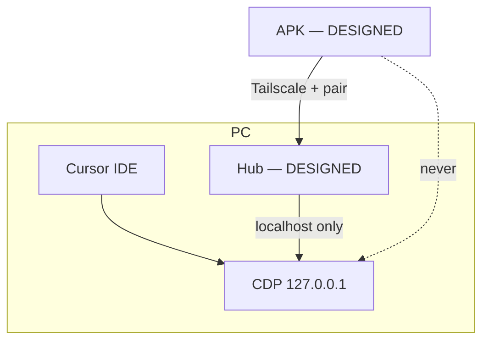

---

## 12. Risks and mitigations

| ID | Risk | Likelihood | Impact | Mitigation | Phase |
|----|------|------------|--------|------------|-------|
| **R-1** | Cursor UI/CDP selector churn breaks live adapter | High | High | Isolate selectors in LiveCursorAdapter; Phase 4 harden; version notes | 1, 4 |
| **R-2** | Operator enables public Hub/CDP “for convenience” | Medium | Critical | TOR locks; security doc; health/warnings; refuse Funnel baseline | 0 |
| **R-3** | Stolen phone reuses pairing token | Medium | High | Rotatable/revocable tokens; short-lived pairing codes; OS lock guidance | 0 |
| **R-4** | Wrong workspace bind / multi-window confusion | Medium | High | Banner always visible; FR-014 picker; reject mismatched create | 0–2 |
| **R-5** | History Index incomplete vs Cursor storage changes | Medium | Medium | Phase 2 spike; graceful degrade to live-only messaging | 2 |
| **R-6** | Scope creep toward cloud Remote Control | Medium | Critical | Product locks in every handoff; TOR acceptance gate | All |
| **R-7** | Docs claim “done” while NOT BUILT | High early | Medium | Status legend; AGENT-CONTEXT §9; this TOR §1.2 | All |
| **R-8** | Tailscale down → silent hang | Medium | Medium | FR-003 clear errors; `/health` distinguishes Hub vs CDP | 0 |
| **R-9** | Silent tool auto-approve introduced “to reduce friction” | Low | Critical | FR-033 hard rule; approval tests in later TOR | 1 |
| **R-10** | EAS APK pipeline delays | Low | Medium | Track FR-080 early in Phase 1; sideload test device ready | 1 |

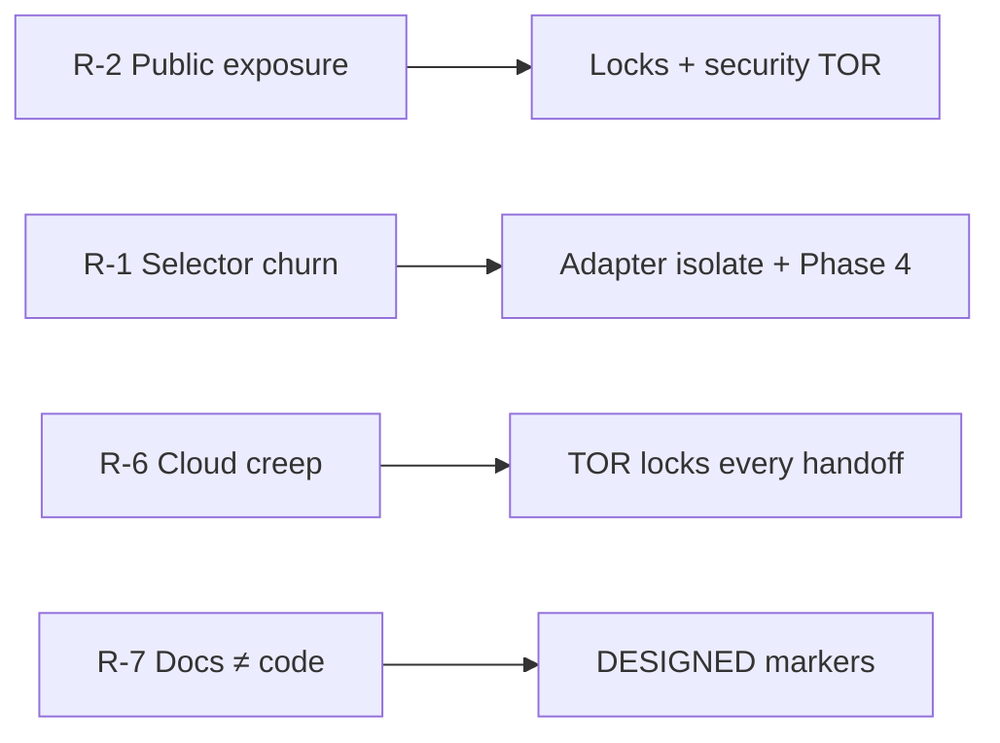

---

## 13. Success criteria

### 13.1 Program-level success (all must hold)

1. **Lock integrity:** No delivered path depends on Cloud Agents, Remote Control, cloud session lists, or public CDP.
2. **Bind honesty:** Phone banner matches PC-open project; empty Cursor yields blocking empty state.
3. **Continue value:** Live chat + Approve/Deny works for open Composer; Deny is effective on PC.
4. **Create value:** New session requires model; supports attachments from workspace roots; scoped to `workspaceId`.
5. **Execution boundary:** Tools/MCP run on PC only; phone is approvals + chat UI.
6. **Connectivity:** Pairing required; Tailscale (or equivalent) private path; `/health` actionable.
7. **Delivery form:** Sideloadable Expo APK covering P0 screens.
8. **History completeness (Phase 2 gate):** Local project history list + Open on PC.
9. **Status honesty:** Until code exists, all Hub/APK surfaces marked **DESIGNED / NOT BUILT**.

### 13.2 Acceptance criteria by FR group (summary)

| Group | Success snapshot |
|-------|------------------|
| Connectivity FR-001–004 | Unpaired phone blocked; CDP not on Tailscale; health distinguishes Hub vs CDP |
| Workspace FR-010–013 | Banner matches; empty state honest; mismatched create fails |
| Sessions FR-020–022 | This project only; modes labeled |
| Continue FR-030–033 | Round-trip chat; deny works; no silent approve |
| New session FR-050–054 | Model required; files + prompt optional; tools summary read-only |
| Tools FR-060–062 | PC execution; phone approvals |
| APK FR-080–081 | Installable APK with P0 screens |
| History FR-023, 040–041 | Phase 2: full local history + open-on-pc |
| Reliability FR-090–091 | Phase 4: reconnect / harden / queue |

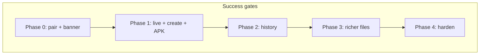

### 13.3 Non-success (explicit)

The program is **not** successful if it ships a cloud-dependent console, a VNC-only desktop mirror without session/approval identity, a browser-only demo without APK when APK was committed, or documentation that claims implemented Hub routes without packages in-repo.

---

## 14. Deliverables

All application deliverables below are **DESIGNED** targets unless noted. Documentation deliverables marked Present are already in-repo.

### 14.1 Documentation & governance deliverables

| ID | Deliverable | Status |
|----|-------------|--------|
| D-DOC-01 | AGENT-CONTEXT briefing pack | Present |
| D-DOC-02 | Architecture (`mobile-cursor-companion.md`) | Present |
| D-DOC-03 | Functional requirements | Present |
| D-DOC-04 | Security / Tailscale linking | Present |
| D-DOC-05 | Feature docs (sessions, new session, screens) | Present |
| D-DOC-06 | Gap-closure + how-we-work reports | Present |
| D-DOC-07 | **TOR-00 Program TOR** (this document) | This file |
| D-DOC-08 | Subsequent TOR volumes (TOR-01…N) | Planned |
| D-DOC-09 | Operator getting-started / configuration (planned path) | Present as planned docs |

### 14.2 Software deliverables (future implementation)

| ID | Deliverable | Planned location | Phase | Status |
|----|-------------|------------------|-------|--------|
| D-SW-01 | Hub HTTP/WS service | `packages/hub` | 0–1 | DESIGNED / NOT BUILT |
| D-SW-02 | LiveCursorAdapter | `adapters/live` | 1 | DESIGNED / NOT BUILT |
| D-SW-03 | History Index adapter | `adapters/history` | 2 | DESIGNED / NOT BUILT |
| D-SW-04 | Workspace file index support | Hub / adapters | 1–3 | DESIGNED / NOT BUILT |
| D-SW-05 | Expo Android APK | `apps/mobile` | 1 | DESIGNED / NOT BUILT |
| D-SW-06 | Pairing + token revoke flows | Hub + APK | 0 | DESIGNED / NOT BUILT |
| D-SW-07 | EAS APK build config (`buildType: apk`) | mobile app config | 1 | DESIGNED / NOT BUILT |

### 14.3 Designed Hub API surface (not implemented)

```
GET    /workspace
GET    /workspace/files?q=
GET    /workspace/models
GET    /workspace/tools
GET    /sessions?workspaceId=
POST   /sessions
POST   /sessions/:id/open-on-pc
POST   /sessions/:id/messages
POST   /sessions/:id/attachments
POST   /sessions/:id/approvals
WS     /ws
GET    /health
POST   /pair/...
```

**Status:** DESIGNED contracts only — **NOT BUILT**.

### 14.4 Deliverable dependency map

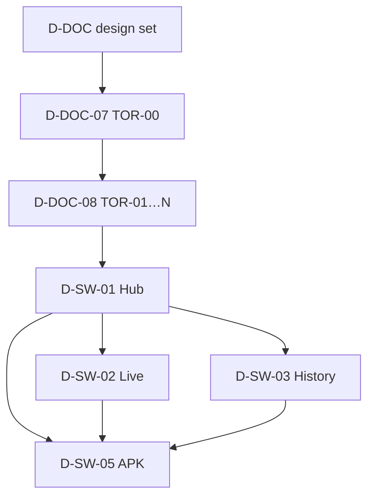

---

## 15. Work packages and phases 0–4

Phasing follows **trust first, then live control, then completeness, then polish**.

### 15.1 Phase overview

| Phase | Focus | Gate | Primary FRs | Status |
|-------|--------|------|-------------|--------|
| **0** | Pair, Tailscale, `/health`, active workspace banner | Bound to PC-open project only | FR-001–004, FR-010–013 | DESIGNED |
| **1** | Live continue + approvals + new session + APK shell | Tools on PC; phone approves | FR-020–022, 030–033, 050–054, 060–062, 080–081 | DESIGNED |
| **2** | Full local History Index + Open on PC | No cloud history | FR-023, 040–041, 014 | DESIGNED |
| **3** | Richer file picker / @-mentions; optional editor tab | Attachments from workspace roots | FR-055, 070–071 | DESIGNED |
| **4** | Harden CDP selectors; offline queue | Still no public CDP; still no cloud | FR-090–091 | DESIGNED |

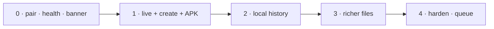

### 15.2 Work package dictionary

| WP ID | Name | Phase | Objectives | Key deliverables | Depends on |
|-------|------|-------|------------|------------------|------------|
| **WP-0A** | Mesh & Tailscale operator path | 0 | O-0.1 | Security runbook alignment; ACL guidance | — |
| **WP-0B** | Hub process skeleton + `/health` | 0 | O-0.1 | D-SW-01 (partial) | WP-0A |
| **WP-0C** | Device pairing QR/code + tokens | 0 | O-0.1 | D-SW-06 | WP-0B |
| **WP-0D** | Workspace detection + `GET /workspace` | 0 | O-0.2 | Hub workspace bind | WP-0B |
| **WP-0E** | APK pair + banner + empty states | 0 | O-0.2 | APK screens (partial) | WP-0C, WP-0D |
| **WP-1A** | LiveCursorAdapter MVP | 1 | O-1.1 | D-SW-02 | WP-0D |
| **WP-1B** | Messages + WS event stream | 1 | O-1.1 | Hub routes + APK chat | WP-1A, WP-0E |
| **WP-1C** | Approval cards Approve/Deny | 1 | O-1.1 | Approvals API + UI | WP-1B |
| **WP-1D** | Attachments on live session | 1 | O-1.1 | Attachments API | WP-1B, file index MVP |
| **WP-1E** | Models + files index + create sheet | 1 | O-1.2 | `POST /sessions` path | WP-1A, WP-0D |
| **WP-1F** | Tools summary informational | 1 | O-1.2 | `GET /workspace/tools` | WP-0D |
| **WP-1G** | Expo EAS APK P0 complete | 1 | O-1.3 | D-SW-05, D-SW-07 | WP-0E, WP-1B–1E |
| **WP-2A** | History Index for workspace | 2 | O-2.1 | D-SW-03 | WP-1G |
| **WP-2B** | History read UI + open-on-pc | 2 | O-2.1 | History mode UX | WP-2A, WP-1A |
| **WP-2C** | Multi-window bind picker | 2 | O-2.2 | FR-014 | WP-0D, WP-0E |
| **WP-3A** | Rich multi-root @-mention picker | 3 | O-3.1 | FR-055 | WP-1E |
| **WP-3B** | Optional editor browse mode | 3 | O-3.1 | FR-070–071 | WP-3A |
| **WP-4A** | Reconnect without re-pair | 4 | O-4.1 | FR-090 | WP-0C, WP-1B |
| **WP-4B** | CDP selector hardening | 4 | O-4.1 | Adapter resilience | WP-1A |
| **WP-4C** | Offline queue (optional polish) | 4 | O-4.1 | FR-091 | WP-4A |

### 15.3 Phase → WP mapping diagram

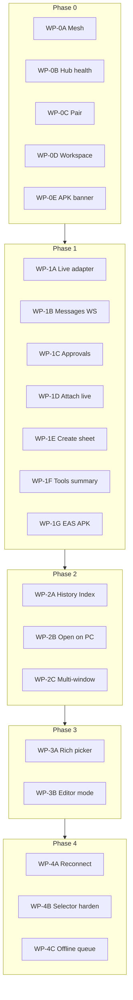

### 15.4 Day-in-the-life flow (program intent)

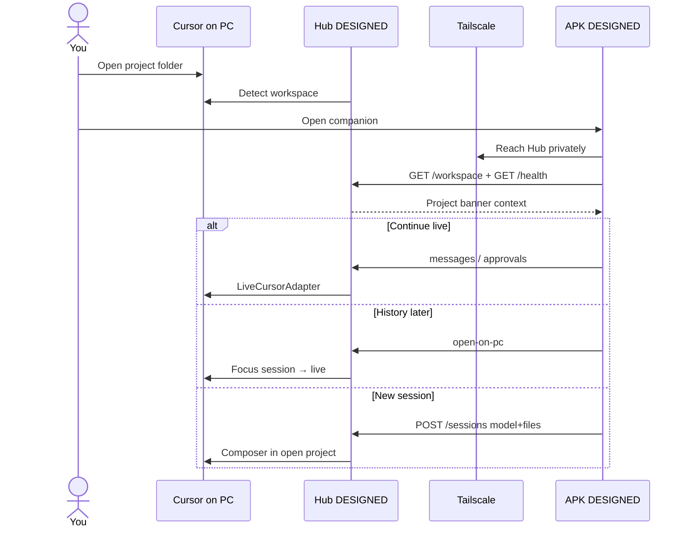

### 15.5 Session modes (designed)

| Mode | Meaning | Phone can | Phase |
|------|---------|-----------|-------|
| `live` | Open Composer/agent in this workspace | Chat, attach, approve, model if UI allows | 1 |
| `history` | Past local session for this project | Read; Open on PC → `live` | 2 |
| `editor` | Optional browse | Attach/view | 3+ |

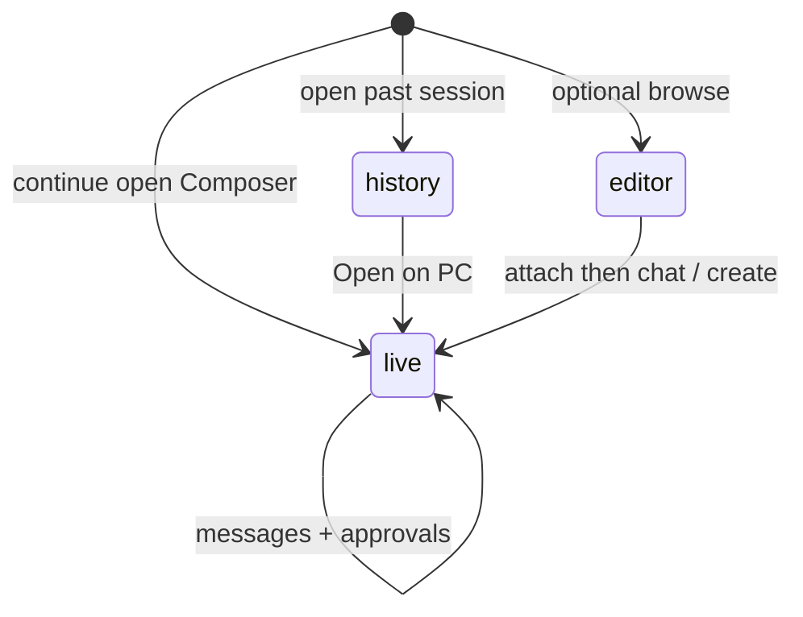

---

## 16. Component architecture (designed)

### 16.1 Component responsibilities

| Component | Planned path | Role | Status |
|-----------|--------------|------|--------|
| Android APK | `apps/mobile` | Pair, banner, sessions, chat, create, approvals — **no** tool runtime | DESIGNED / NOT BUILT |
| Hub | `packages/hub` | HTTP/WS; workspace bind; orchestrate create/open/messages/approvals | DESIGNED / NOT BUILT |
| LiveCursorAdapter | `adapters/live` | CDP/DOM → Composer | DESIGNED / NOT BUILT |
| History Index | `adapters/history` | Local sessions for project | DESIGNED / NOT BUILT |
| Tailscale | Phone ↔ PC | Private mesh; CDP never forwarded | Operator dependency |

```mermaid
flowchart LR
  APK["APK"] -->|Tailscale + pair| Hub["Hub"]
  Hub --> Live["Live adapter"]
  Hub --> Hist["History"]
  Hub --> Files["File index"]
  Live -->|"CDP 127.0.0.1"| Cursor["Cursor IDE"]
  Hist --> Cursor
  Files --> Cursor
```

### 16.2 New-session contract (designed)

```json
{
  "workspaceId": "...",
  "model": "composer-...|...",
  "attachments": ["src/a.ts"],
  "prompt": "optional first message",
  "agentMode": "agent|ask|..."
}
```

Hard rules: `workspaceId` must match bound project; models from local Cursor exposure; attachments under workspace roots; tools not started on phone.

```mermaid
sequenceDiagram
  participant U as User
  participant App as Phone APK
  participant Hub as Hub
  participant C as Cursor on PC

  U->>App: New session
  App->>Hub: GET /workspace/models
  U->>App: Pick model
  App->>Hub: GET /workspace/files?q=
  U->>App: Attach + optional prompt
  App->>Hub: POST /sessions
  Hub->>C: Focus Composer + model + @files
  Hub-->>App: sessionId live
  U->>App: Chat + Approve/Deny
```

---

## 17. Functional requirements traceability

### 17.1 P0 must-deliver (Phase 0–1)

| Group | P0 IDs | Must deliver |
|-------|--------|--------------|
| Connectivity & pairing | FR-001–004 | Private Hub path; pair; errors; `/health` |
| Workspace binding | FR-010–013 | Detect open project; banner; empty state; scope create |
| Sessions | FR-020–022 | List live (+ mode); this project only |
| Continue live | FR-030–033 | Messages; Approve/Deny; attachments; no silent approve |
| New session | FR-050–054 | Model; files; `POST /sessions`; tools summary info |
| Tools | FR-060–062 | Execute on PC; phone approvals only |
| APK | FR-080–081 | Expo sideload APK with P0 screens |

### 17.2 P1 / P2

| Priority | IDs | Phase |
|----------|-----|-------|
| P1 | FR-014, FR-023, FR-040–041, FR-090 | 2 / 4 |
| P2 | FR-055, FR-070–071, FR-091 | 3 / 4 |

### 17.3 Needs checklist (gap coverage)

| Need | Covered by | FR | Phase | Status |
|------|------------|----|-------|--------|
| Bound to PC-open project | `/workspace` + banner | FR-010–013 | 0 | DESIGNED |
| Pair + mesh + health | Tailscale + pair + `/health` | FR-001–004 | 0 | DESIGNED |
| Continue live | LiveCursorAdapter | FR-030–033 | 1 | DESIGNED |
| New session + model | Create sheet | FR-050–053 | 1 | DESIGNED |
| Attach files | File index | FR-051–052, 032 | 1–3 | DESIGNED |
| Tools on PC + approvals | Cursor + cards | FR-054, 060–062 | 1 | DESIGNED |
| APK | Expo EAS apk | FR-080–081 | 1 | DESIGNED |
| Local history | History Index | FR-023, 040–041 | 2 | DESIGNED |
| Cloud Agents | — | NG-1 | — | OUT OF SCOPE |

```mermaid
flowchart TB
  subgraph Covered["In-scope coverage — DESIGNED"]
    W["Workspace bind"]
    L["Live continue"]
    N["New model + files"]
    T["PC tools + approvals"]
    H["Local history"]
    A["Expo APK"]
    S["Tailscale + pair"]
  end
  subgraph Out["Excluded"]
    C["Cloud Agents / RC"]
    P["Public CDP"]
    M["MCP on phone"]
  end
  Covered -.->|"not this product"| Out
```

---

## 18. Security and connectivity baseline

Summary only; detailed controls belong in security architecture and TOR-05 (planned).

| Layer | Rule | Status |
|-------|------|--------|
| CDP | `127.0.0.1` only; Hub-mediated; never remote URL in APK | DESIGNED |
| Hub API | Tailscale IP / MagicDNS + pairing token | DESIGNED |
| Pairing | Short-lived QR/code → rotatable/revocable device token | DESIGNED |
| APK secrets | No Cursor/cloud API keys; no remote CDP | DESIGNED |
| Forbidden | Hub/CDP on `0.0.0.0`; Funnel; ngrok-as-default | DESIGNED lock |

```mermaid
flowchart LR
  Phone["Android APK"] --> TS["Tailscale mesh"]
  TS --> Hub["Hub on PC"]
  Hub --> CDP["LiveCursorAdapter / CDP"]
  Hub --> Hist["History Index"]
  CDP --> Cursor["Cursor · tools/MCP"]
  Hist --> Cursor
```

Threat highlights: LAN attacker, stolen phone, leaked QR/token, CDP exposure — mitigated by mesh-only Hub, pairing revoke, loopback CDP.

---

## 19. Acceptance of this TOR

### 19.1 Acceptance meaning

Acceptance of TOR-00 means stakeholders agree that:

1. Problem, goals, non-goals, and product locks are correct for the program.
2. SMART objectives and phase/WP mapping are the delivery backbone.
3. Subsequent TOR volumes and implementation plans **shall not** contradict §7–§8.
4. Implementation status remains **DESIGNED / NOT BUILT** until code exists.
5. Cloud / public-CDP paths remain **OUT OF SCOPE** without formal TOR amendment.

### 19.2 Acceptance checklist

| # | Criterion | Pass condition |
|---|-----------|----------------|
| 1 | Locks restated | §8 matches AGENT-CONTEXT |
| 2 | Goals/non-goals aligned | §5 matches FRs §1 |
| 3 | Phases 0–4 mapped to WPs | §15 complete |
| 4 | FRs traced | §17 covers P0–P2 |
| 5 | Risks listed with mitigations | §12 |
| 6 | Deliverables marked DESIGNED/Present | §14 |
| 7 | No cloud path endorsed | Explicit throughout |
| 8 | Companion TOR volume list defined | §21 |

### 19.3 Amendment process

1. Propose change with impact on locks, FRs, phases, or WPs.
2. Update canonical architecture/FR docs in the **same** turn if design truth changes.
3. Update TOR-00 (and affected TOR-0N) — do not leave truth only in a chat or ad-hoc report.
4. Re-run acceptance checklist §19.2.
5. Record change in §23 Document history.

### 19.4 Exit criteria to begin implementation (future)

Implementation may begin only when product owner explicitly requests scaffolding **and** TOR-00 remains accepted. First code must still honor Phase 0 gates before Phase 1 chat features.

```mermaid
flowchart LR
  Accept["TOR-00 accepted"] --> Request["Explicit implement request"]
  Request --> P0["Build Phase 0"]
  P0 --> Gate0{"Gate 0 pass?"}
  Gate0 -->|yes| P1["Build Phase 1"]
  Gate0 -->|no| Fix0["Fix pair/banner"]
```

---

## 20. Glossary

| Term | Definition |
|------|------------|
| **APK** | Android application package; here, Expo EAS sideload build |
| **Approve/Deny** | Phone UI actions that confirm or reject a PC-side tool/plugin/MCP call |
| **Banner** | APK header showing Hub-reported active project name/path |
| **CDP** | Chrome DevTools Protocol (or Cursor’s debugging port surface) used by LiveCursorAdapter; loopback only |
| **Composer** | Cursor’s agent/chat UI on the PC |
| **DESIGNED** | Specified and accepted in docs; not implemented in code |
| **History Index** | Local index of past sessions for the bound workspace |
| **Hub** | Local PC daemon exposing HTTP/WS to the phone |
| **LiveCursorAdapter** | Adapter driving live Composer via CDP/DOM |
| **MagicDNS** | Tailscale hostname resolution for stable Hub URLs |
| **Open on PC** | Action that reopens a history session in Cursor and transitions to `live` |
| **Pairing** | Device enrollment producing a revocable phone token |
| **PC-local** | All agent execution and session authority stay on the user’s PC (no cloud Agents path) |
| **Product lock** | Non-negotiable scope constraint |
| **Remote Control** | Official Cursor cloud remote product path — **out of scope** |
| **Tailscale** | Preferred WireGuard-based private mesh between phone and PC |
| **workspaceId** | Identifier of the Hub-bound open project; scopes list/create |
| **WP** | Work package within a phase |

---

## 21. References to other TOR volumes

Volume 00 is the parent. Subsequent volumes specialize components without reopening cloud scope. **Status of TOR-01… below: planned companion volumes** (create when authorized); they inherit all locks from TOR-00.

| Volume | Working title | Primary focus | Primary phases | Depends on |
|--------|---------------|---------------|----------------|------------|
| **TOR-00** | Program Terms of Reference | Charter, scope, RACI, phases, acceptance | All | Architecture + FRs |
| **TOR-01** | Hub Service TOR | `packages/hub`, routes, WS, orchestration | 0–1 | TOR-00 |
| **TOR-02** | LiveCursorAdapter TOR | CDP/DOM Composer control, approvals wiring | 1, 4 | TOR-00, TOR-01 |
| **TOR-03** | History Index TOR | Local history extract, open-on-pc | 2 | TOR-00, TOR-01 |
| **TOR-04** | Mobile APK & UX TOR | Expo screens, create sheet, approvals UI | 0–1, 3 | TOR-00, TOR-01 |
| **TOR-05** | Security & Tailscale TOR | Threat model, pairing, bind rules, revoke | 0, 4 | TOR-00 |
| **TOR-06** | Workspace Binding & Files TOR | `/workspace`, file index, multi-window | 0–3 | TOR-00, TOR-01 |
| **TOR-07** | Verification & Acceptance TOR | Test strategy vs FR acceptance criteria | 1–4 | TOR-00…06 |

```mermaid
flowchart TB
  TOR00["TOR-00 Program"]
  TOR00 --> TOR01["TOR-01 Hub"]
  TOR00 --> TOR05["TOR-05 Security"]
  TOR01 --> TOR02["TOR-02 Live adapter"]
  TOR01 --> TOR03["TOR-03 History"]
  TOR01 --> TOR04["TOR-04 APK UX"]
  TOR01 --> TOR06["TOR-06 Workspace/files"]
  TOR02 --> TOR07["TOR-07 Verification"]
  TOR03 --> TOR07
  TOR04 --> TOR07
  TOR05 --> TOR07
  TOR06 --> TOR07
```

### 21.1 Conflict rule

If a later TOR conflicts with TOR-00 product locks, **TOR-00 wins** until formally amended (§19.3). Component TORs may add detail but may not authorize cloud Agents, public CDP, or phone-side tool execution.

---

## 22. Related project documents

| Topic | Document |
|-------|----------|
| Briefing pack | [`docs/architecture/AGENT-CONTEXT.md`](../../architecture/AGENT-CONTEXT.md) |
| Full architecture | [`docs/architecture/mobile-cursor-companion.md`](../../architecture/mobile-cursor-companion.md) |
| Functional requirements | [`docs/architecture/functional-requirements.md`](../../architecture/functional-requirements.md) |
| Security / Tailscale | [`docs/architecture/security-tailscale-linking.md`](../../architecture/security-tailscale-linking.md) |
| Continue / history UX | [`docs/features/remote-sessions.md`](../../features/remote-sessions.md) |
| New session UX | [`docs/features/new-session-composer.md`](../../features/new-session-composer.md) |
| APK screens | [`docs/features/phone-apk-screens.md`](../../features/phone-apk-screens.md) |
| Gap closure | [`docs/reports/gap-closure-hybrid-system-2026-09-24.md`](../gap-closure-hybrid-system-2026-09-24.md) |
| Operator narrative | [`docs/reports/how-we-work-phone-pc-2026-09-24.md`](../how-we-work-phone-pc-2026-09-24.md) |
| Agent working rules | [`AGENTS.md`](../../../AGENTS.md) |
| Handoff protocol | [`docs/reports/agent-handoff-protocol.md`](../agent-handoff-protocol.md) |
| Doc index | [`docs/README.md`](../../README.md) |

---

## 23. Document history

| Version | Date | Authoring context | Change |
|---------|------|-------------------|--------|
| 0.1 | 2026-09-25 | gsd-doc-writer / program TOR creation | Initial exhaustive TOR-00 from accepted design (2026-09-24); all software marked DESIGNED / NOT BUILT |

---

## 24. Decision line

**Phone = remote Composer for the PC-open project.** Continue or create with model + files + PC tools/approvals. Tailscale + pairing. CDP localhost. Expo APK. **No cloud.** Architecture and this Program TOR are **accepted as DESIGNED**; Hub/APK/adapters are **not built**.

```mermaid
flowchart LR
  Decision["Decision"]
  Decision --> L1["PC-local only"]
  Decision --> L2["Open-project remote"]
  Decision --> L3["Continue or create"]
  Decision --> L4["Tailscale + pair"]
  Decision --> L5["CDP 127.0.0.1"]
  Decision --> L6["Expo APK"]
  Decision --> L7["DESIGNED ≠ shipped"]
```

---

*End of TOR-00 — Program Terms of Reference.*
