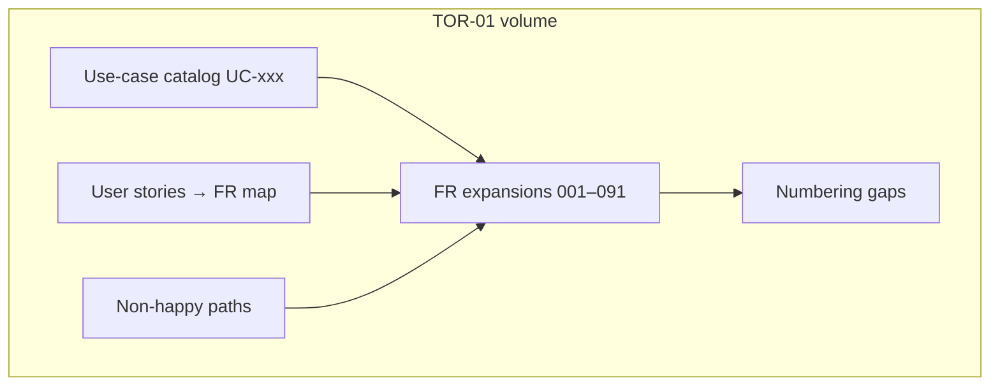
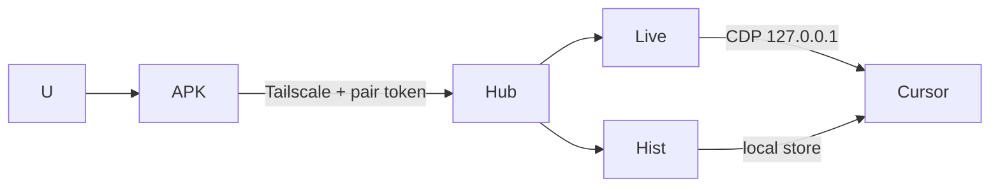
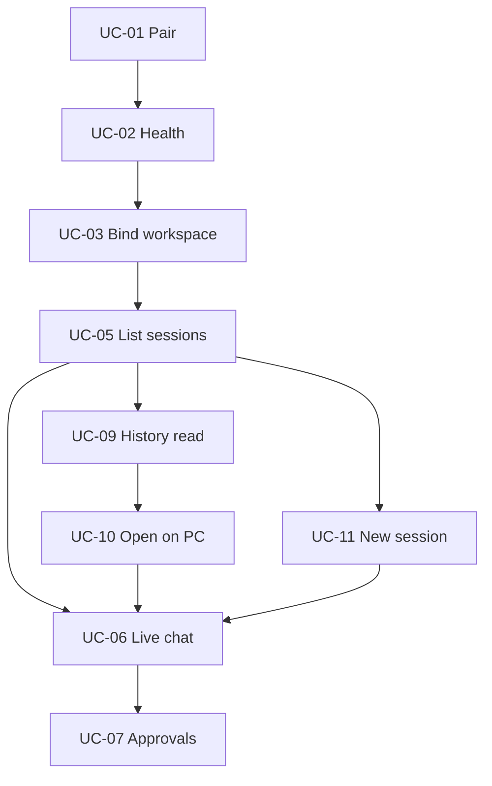
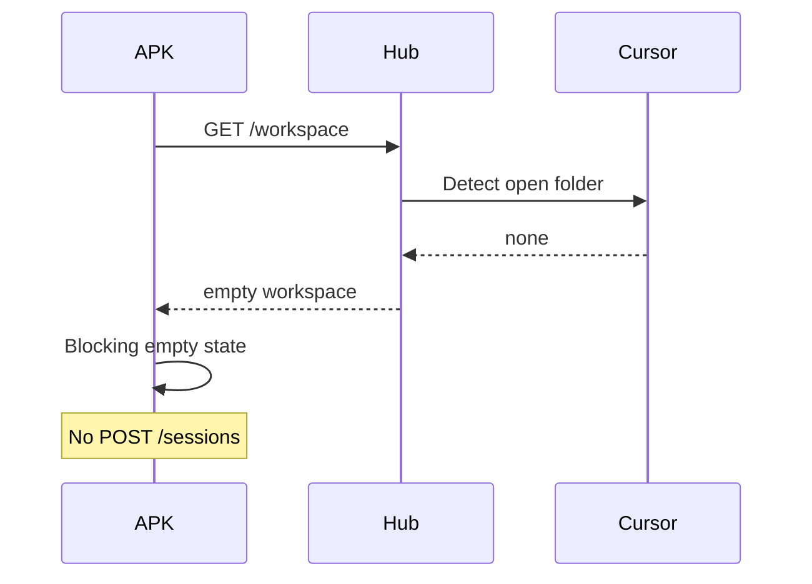
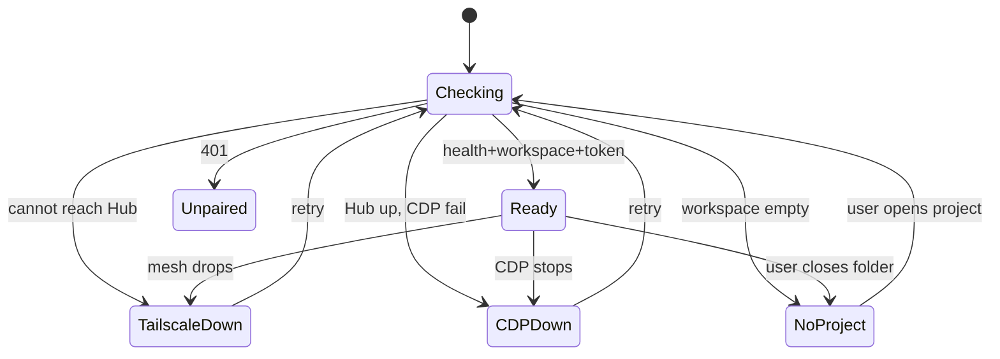
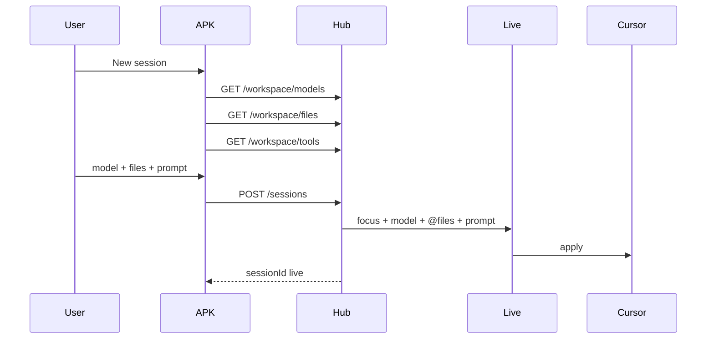
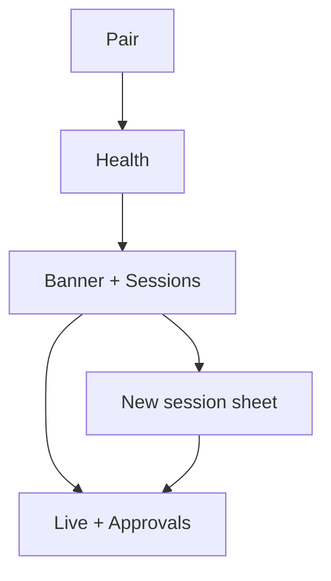

<!-- generated-by: gsd-doc-writer -->
# TOR-01 — Functional Requirements Expansion (FR-001–FR-091)

| Field | Value |
|-------|-------|
| **Document ID** | TOR-01 |
| **Type** | Terms of Reference — Functional Requirements Volume |
| **Status** | DESIGNED (not implemented) · Accepted design base 2026-09-24 |
| **Product** | PC-local Cursor companion Android APK |
| **Canonical FRs** | [`docs/architecture/functional-requirements.md`](../../architecture/functional-requirements.md) |
| **Related** | [`AGENT-CONTEXT.md`](../../architecture/AGENT-CONTEXT.md) · [`mobile-cursor-companion.md`](../../architecture/mobile-cursor-companion.md) · [`security-tailscale-linking.md`](../../architecture/security-tailscale-linking.md) · [`remote-sessions.md`](../../features/remote-sessions.md) · [`new-session-composer.md`](../../features/new-session-composer.md) · [`phone-apk-screens.md`](../../features/phone-apk-screens.md) |

**Product locks (non-negotiable):** PC-local only · open-project remote · continue or create · Tailscale + pairing · CDP `127.0.0.1` only · Expo sideload APK · Docs ≠ code.

**Coverage:** Every defined FR in the FR-001–FR-091 namespace is expanded below. Numbering gaps are listed in §9 as candidates (`FR-xxx` to add). Hub routes and responses are **designed contracts**, not shipped APIs.



---

## 1. Purpose and reading guide

This TOR expands each functional requirement into an implementation-ready specification for Hub, LiveCursorAdapter, History Index, and Phone APK designers. It does not authorize scaffolding application code.

**Per-FR template (applied to every defined ID):**

| Field | Meaning |
|-------|---------|
| Description | Normative shall-statement |
| Actors | Who participates |
| Preconditions | State required before the main flow |
| Main flow | Happy path steps |
| Alternate flows | Valid variants |
| Exception flows | Failures and recovery |
| Data in / out | Payloads and side effects |
| UI impact | APK / Cursor surfaces affected |
| Hub API touchpoints | Designed routes |
| Acceptance tests | Given / When / Then |
| Priority | P0 / P1 / P2 |
| Phase | 0–4 delivery gate |
| Dependencies | Other FRs / external conditions |

---

## 2. Actors

| Actor | Abbrev | Role |
|-------|--------|------|
| **User** | U | Opens project in Cursor on PC; pairs phone; continues/creates sessions; Approve/Deny tools |
| **Phone APK** | APK | Expo Android app: Pair, Health, banner, sessions, live chat, new-session sheet, approvals |
| **Hub** | Hub | Local PC daemon: Tailscale-facing HTTP/WS; pairing; workspace bind; orchestrates adapters |
| **LiveCursorAdapter** | Live | CDP/DOM control of Composer on `127.0.0.1` |
| **History Index** | Hist | Local PC session store filtered by workspace |
| **Cursor IDE on PC** | Cursor | Owns Composer, models, MCP/tools/plugins, open folder(s) |
| **Tailscale mesh** | Mesh | Private link phone ↔ PC; not a product actor but a precondition surface |



---

## 3. Use-case catalog (UC-xxx)

| UC ID | Name | Primary actors | FR coverage | Phase |
|-------|------|----------------|-------------|-------|
| UC-01 | Pair phone to Hub | U, APK, Hub | FR-002, FR-003, FR-081 | 0 |
| UC-02 | Verify health / readiness | U, APK, Hub, Live | FR-003, FR-004, FR-081 | 0 |
| UC-03 | Bind to PC-open workspace | Hub, Cursor, APK | FR-010–013 | 0 |
| UC-04 | Select multi-window workspace | U, APK, Hub | FR-014 | 1–2 (P1) |
| UC-05 | List sessions for bound project | U, APK, Hub, Live, Hist | FR-020–023 | 1 (live) / 2 (history) |
| UC-06 | Continue live chat | U, APK, Hub, Live, Cursor | FR-030, FR-032 | 1 |
| UC-07 | Approve or deny tool call | U, APK, Hub, Live, Cursor | FR-031, FR-033, FR-060–062 | 1 |
| UC-08 | Attach files to live session | U, APK, Hub, Live | FR-032, FR-051 | 1 |
| UC-09 | Read history session | U, APK, Hub, Hist | FR-040, FR-023 | 2 |
| UC-10 | Open history session on PC | U, APK, Hub, Hist, Live, Cursor | FR-041 | 2 |
| UC-11 | Create new session | U, APK, Hub, Live, Cursor | FR-050–054 | 1 |
| UC-12 | Richer @-mention / multi-root attach | U, APK, Hub | FR-055, FR-070–071 | 3 |
| UC-13 | Deliver / install sideload APK | U (operator) | FR-080–081 | 1 |
| UC-14 | Reconnect after transient drop | APK, Hub, Mesh | FR-090 | 2+ (P1) |
| UC-15 | Offline queue / hardened CDP | APK, Hub, Live | FR-091 | 4 |
| UC-16 | Recover from Tailscale down | U, APK, Mesh | FR-001, FR-003, FR-090 | 0–2 |
| UC-17 | Recover from CDP / Cursor down | U, APK, Hub, Live, Cursor | FR-003, FR-004 | 0–1 |
| UC-18 | Block when no project open | U, APK, Hub, Cursor | FR-012 | 0 |



---

## 4. User stories mapped to FRs

| Story ID | As a… | I want… | So that… | FRs | UC |
|----------|-------|---------|----------|-----|-----|
| US-01 | User | to pair my phone once to this PC Hub | only my device can call session APIs | FR-002, FR-001 | UC-01 |
| US-02 | User | clear errors when Tailscale, Hub, or pairing fails | I know what to fix | FR-003 | UC-16 |
| US-03 | User | to see Hub and CDP health | I know if Composer remoting will work | FR-004 | UC-02 |
| US-04 | User | an active project banner matching the PC folder | I always know which project I remoted | FR-010, FR-011 | UC-03 |
| US-05 | User | a blocking empty state when no folder is open | I open a project on the PC instead of a fake workspace | FR-012 | UC-18 |
| US-06 | User | sessions and creates scoped to the bound workspace | I cannot drive another folder by mistake | FR-013, FR-022 | UC-03, UC-05 |
| US-07 | User | to pick among multiple Cursor windows | I remote the intended workspace | FR-014 | UC-04 |
| US-08 | User | to list live (and later history) sessions for this project | I can continue the right chat | FR-020–023 | UC-05 |
| US-09 | User | to chat in a live Composer session from the phone | I continue work away from the keyboard | FR-030 | UC-06 |
| US-10 | User | to Approve/Deny tool calls on the phone | tools still run on PC under my control | FR-031, FR-033, FR-060–062 | UC-07 |
| US-11 | User | to attach project files mid-session | Composer has the right context | FR-032 | UC-08 |
| US-12 | User | to read past local sessions for this project | I can recall prior work without cloud | FR-040, FR-023 | UC-09 |
| US-13 | User | Open on PC to resume history as live | I continue in the same project | FR-041 | UC-10 |
| US-14 | User | to create a new session with model + files + optional prompt | I start work from the phone | FR-050–054 | UC-11 |
| US-15 | User | a tools summary that is informational only | I understand PC-side tooling without running it on phone | FR-054, FR-061 | UC-11 |
| US-16 | User | a richer multi-root @-picker later | attach UX matches desktop Composer | FR-055 | UC-12 |
| US-17 | User | optional light file browse on phone | I pick attachments without leaving the app | FR-070–071 | UC-12 |
| US-18 | Operator | a sideloadable Expo APK | I install without Play Store AAB-only path | FR-080–081 | UC-13 |
| US-19 | User | reconnect without re-pairing after blips | transient mesh drops do not reset trust | FR-090 | UC-14 |
| US-20 | User | offline queue and hardened selectors | Cursor UI churn and brief offline do not brick remoting | FR-091 | UC-15 |

---

## 5. Non-happy paths (cross-cutting)

These paths cut across many FRs. Individual FR exception flows reference this section.

### 5.1 No project open on PC

| Aspect | Specification |
|--------|---------------|
| Detection | `GET /workspace` returns empty / unavailable; health may still show Hub up |
| APK UI | Full-screen empty state: “Open a project in Cursor on the PC.” No fake banner, no invent project, no cloud picker |
| Blocked | Session list create CTA, `POST /sessions`, live send, Open on PC, file picker |
| Allowed | Pair, Health refresh, Tailscale diagnostics |
| FRs | FR-012 (primary), FR-010–011, FR-013, FR-050–053, FR-081 |
| UC | UC-18 |



### 5.2 CDP down / Cursor unreachable

| Aspect | Specification |
|--------|---------------|
| Detection | `GET /health` shows Hub up, `cdpAttached: false` (or equivalent designed field); live adapter attach fails |
| APK UI | “Cursor not reachable — is Cursor open? Enable localhost CDP on the PC.” Health red/yellow |
| Blocked | Live messages, approvals, create, open-on-PC, model/files reads that require CDP |
| Allowed | Pair (if Hub up), Health, read-only history metadata if Hist does not need CDP (Phase 2 design: prefer local index without CDP when possible) |
| FRs | FR-003, FR-004, FR-030–033, FR-041, FR-050–053, FR-091 |
| UC | UC-17 |

### 5.3 Tailscale / mesh down

| Aspect | Specification |
|--------|---------------|
| Detection | TCP/DNS to Hub MagicDNS or Tailscale IP fails before HTTP |
| APK UI | “Private network offline — open Tailscale and join the same network as your PC.” |
| Blocked | All Hub APIs |
| Allowed | Local Pair screen instructions; cached last-known banner (stale, labeled offline) optional |
| Reconnect | FR-090: on mesh restore, reuse device token; no re-pair unless revoked |
| FRs | FR-001, FR-003, FR-090 |
| UC | UC-16 |



### 5.4 Combined matrix

| Condition | Pair | Health | Banner | List | Live | Create | History | Open on PC |
|-----------|------|--------|--------|------|------|--------|---------|------------|
| Tailscale down | show err | fail | stale/offline | fail | fail | fail | fail | fail |
| Hub down (mesh OK) | show err | fail | — | fail | fail | fail | fail | fail |
| Unpaired | CTA | N/A | blocked | 401 | 401 | 401 | 401 | 401 |
| CDP down | OK | warn | may show last WS | hist maybe | fail | fail | read maybe | fail |
| No project | OK | warn | empty state | blocked | blocked | blocked | blocked | blocked |
| Ready | — | OK | match PC | OK | OK | OK | Phase 2 | Phase 2 |

---

## 6. Designed Hub API touchpoints (reference)

All routes below are **designed**, not implemented.

```
GET    /health
POST   /pair/...
GET    /workspace
GET    /workspace/files?q=
GET    /workspace/models
GET    /workspace/tools
GET    /sessions?workspaceId=
POST   /sessions
POST   /sessions/:id/open-on-pc
POST   /sessions/:id/messages
POST   /sessions/:id/attachments
POST   /sessions/:id/approvals
WS     /ws
```

**Auth rule:** Unpaired or invalid device token → `401` on workspace/session routes (FR-002). CDP never appears as a phone-reachable URL.

---

## 7. FR expansions — Connectivity & pairing (FR-001–004)

### FR-001 — Private Hub path; CDP localhost only

| Field | Content |
|-------|---------|
| **Description** | Hub shall listen for phone clients only on the private network path (Tailscale / configured private LAN). CDP shall bind to `127.0.0.1` on the PC and shall not be reachable from the phone. |
| **Actors** | Hub, Live, Mesh, APK |
| **Preconditions** | Hub process configured; Cursor CDP enabled on loopback; Tailscale (or private path) available for phone |
| **Main flow** | 1) Hub binds HTTP/WS to Tailscale IP / private interface. 2) Live attaches CDP at `127.0.0.1` only. 3) APK dials Hub MagicDNS/Tailscale IP. 4) APK never configures a CDP host. |
| **Alternate flows** | A1: Operator restricts Hub to Tailscale interface only (preferred). A2: Same-LAN private bind without Tailscale (dev only; not product default). |
| **Exception flows** | E1: CDP bound to `0.0.0.0` → operator/security failure; product forbids. E2: Phone attempts direct CDP → impossible by design (no URL in APK). E3: Funnel/ngrok as default → out of scope / rejected. |
| **Data in / out** | In: Hub bind config. Out: Hub reachable on mesh; CDP not published. |
| **UI impact** | Pair/Health copy: “Private network”; no CDP host field in APK settings. |
| **Hub API** | All phone-facing routes; no CDP proxy endpoint. |
| **Acceptance** | **Given** Hub and CDP running, **When** phone reaches Hub over Tailscale and a second host probes CDP port on PC LAN/Tailscale, **Then** Hub responds and CDP probe fails from non-localhost. |
| **Priority / Phase** | P0 / Phase 0 |
| **Dependencies** | Mesh setup; Cursor localhost CDP |

### FR-002 — Device pairing required

| Field | Content |
|-------|---------|
| **Description** | Hub shall support device pairing (`POST /pair/...`) so a phone must complete pairing before session or workspace APIs succeed. |
| **Actors** | U, APK, Hub |
| **Preconditions** | Hub reachable; U can read pair code/QR from PC Hub UI or console |
| **Main flow** | 1) U opens Pair screen. 2) Enters code / scans QR. 3) `POST /pair/...`. 4) Hub returns device token. 5) APK persists token. 6) Subsequent APIs send token. |
| **Alternate flows** | A1: Re-pair after revoke. A2: Rotate token from Hub without full re-QR if designed. |
| **Exception flows** | E1: Invalid code → stay on Pair with error. E2: Hub unreachable → Tailscale/Hub error (FR-003). E3: Expired code → request new code on PC. |
| **Data in / out** | In: pair code/QR payload. Out: device token (rotatable/revocable); PC identity label. |
| **UI impact** | Pair screen ([phone-apk-screens.md](../../features/phone-apk-screens.md) §1). No cloud OAuth. |
| **Hub API** | `POST /pair/...`; all `/workspace`, `/sessions`, `/ws` require token |
| **Acceptance** | **Given** unpaired APK, **When** it calls `GET /workspace`, **Then** Hub returns `401`. **Given** successful pair, **When** same call with token, **Then** succeeds (or empty workspace, not auth fail). |
| **Priority / Phase** | P0 / Phase 0 |
| **Dependencies** | FR-001 |

### FR-003 — Clear connectivity / pairing errors

| Field | Content |
|-------|---------|
| **Description** | Phone shall show clear errors when Tailscale/link is down, Hub unreachable, or pairing missing/invalid. |
| **Actors** | U, APK, Hub, Mesh |
| **Preconditions** | APK installed |
| **Main flow** | On each failure class, APK maps to explicit copy (see §5) and offers Retry / open Pair / open Health. |
| **Alternate flows** | A1: Mid-session mesh drop → banner connection state + disable send/approve. |
| **Exception flows** | E1: Ambiguous timeout → prefer Tailscale hint first, then Hub-down after mesh ping OK. |
| **Data in / out** | In: network errors, HTTP status. Out: user-visible error states. |
| **UI impact** | Pair, Health, Live header, Home health dot |
| **Hub API** | Indirect: `/health`, auth errors on any route |
| **Acceptance** | **Given** Tailscale stopped, **When** user opens app, **Then** Tailscale-down message (not silent spinner forever). **Given** revoked token, **When** API called, **Then** “Access revoked — pair again.” |
| **Priority / Phase** | P0 / Phase 0 |
| **Dependencies** | FR-001, FR-002, FR-004 |

### FR-004 — Health endpoint

| Field | Content |
|-------|---------|
| **Description** | Hub shall expose `GET /health` with enough status for the APK to show Hub up/down and CDP connectivity. |
| **Actors** | APK, Hub, Live |
| **Preconditions** | Hub process running (for success path) |
| **Main flow** | 1) APK `GET /health`. 2) Response includes Hub process OK + CDP attach boolean (and optional workspace presence flag). 3) Health screen renders checks. |
| **Alternate flows** | A1: Periodic poll while on Home. A2: Pull-to-refresh. |
| **Exception flows** | E1: Timeout → Hub/Tailscale down UI. E2: Hub up CDP false → CDP-down UI (§5.2). |
| **Data in / out** | Out (designed): `{ ok, cdpAttached, workspacePresent?, version?, ts }` <!-- VERIFY: exact JSON schema when Hub is implemented --> |
| **UI impact** | Health screen; Home health dot |
| **Hub API** | `GET /health` (may allow unauthenticated liveness or paired-only — design preference: liveness reachable to diagnose pair; detailed CDP may require token) |
| **Acceptance** | **Given** Hub up CDP attached, **When** `/health`, **Then** APK shows both healthy. **Given** Hub up CDP detached, **When** `/health`, **Then** Hub green / CDP red distinction visible. |
| **Priority / Phase** | P0 / Phase 0 |
| **Dependencies** | FR-001 |

---

## 8. FR expansions — Workspace binding (FR-010–014)

### FR-010 — Detect and expose open workspace(s)

| Field | Content |
|-------|---------|
| **Description** | Hub shall detect the workspace(s) currently open in Cursor on this PC and expose them via `GET /workspace` (name, path, roots, related context). |
| **Actors** | Hub, Live/Cursor APIs, APK |
| **Preconditions** | Paired; Cursor running; preferably a folder open |
| **Main flow** | Hub detects open folder(s) → returns `workspaceId`, name, path, roots[]. |
| **Alternate flows** | A1: Multi-window list for FR-014 selection. |
| **Exception flows** | E1: No folder → empty payload (FR-012). E2: CDP down → error or degraded empty with health flag. |
| **Data in / out** | Out: workspace descriptor(s). |
| **UI impact** | Feeds banner and all scoped calls |
| **Hub API** | `GET /workspace` |
| **Acceptance** | **Given** Cursor has `/data/proj` open, **When** `GET /workspace`, **Then** path/name match that folder. |
| **Priority / Phase** | P0 / Phase 0 |
| **Dependencies** | FR-002, FR-004 |

### FR-011 — Active project banner

| Field | Content |
|-------|---------|
| **Description** | Phone shall display an **active project banner** matching the Hub-reported workspace (name and path). |
| **Actors** | U, APK |
| **Preconditions** | Paired; non-empty `GET /workspace` |
| **Main flow** | Home chrome shows name + path; refresh with health/workspace pull. |
| **Alternate flows** | A1: Compact name on Live header. |
| **Exception flows** | E1: Empty workspace → FR-012 empty state replaces banner. E2: Stale cache while offline → labeled offline. |
| **Data in / out** | In: workspace name/path. |
| **UI impact** | Home banner ([phone-apk-screens.md](../../features/phone-apk-screens.md) §3) |
| **Hub API** | `GET /workspace` |
| **Acceptance** | **Given** Hub reports project X, **When** Home loads, **Then** banner shows X name and path. |
| **Priority / Phase** | P0 / Phase 0 |
| **Dependencies** | FR-010 |

### FR-012 — Empty workspace blocking state

| Field | Content |
|-------|---------|
| **Description** | When Cursor has **no** folder open, Hub shall report empty/unavailable workspace and the phone shall show “Open a project in Cursor on the PC” — no fake empty workspace. |
| **Actors** | U, APK, Hub, Cursor |
| **Preconditions** | Paired; Hub up; Cursor may be open without folder |
| **Main flow** | See §5.1 |
| **Alternate flows** | None that invent a project |
| **Exception flows** | E1: User opens folder → auto-refresh to FR-011 |
| **Data in / out** | Out: empty workspace; no synthetic `workspaceId` |
| **UI impact** | Full-screen empty; New session disabled |
| **Hub API** | `GET /workspace` empty; `POST /sessions` rejected if attempted |
| **Acceptance** | **Given** no open folder, **When** APK loads Home, **Then** blocking message and no session list for a fake id. |
| **Priority / Phase** | P0 / Phase 0 |
| **Dependencies** | FR-010, FR-011 |

### FR-013 — Scope sessions/create to bound workspaceId

| Field | Content |
|-------|---------|
| **Description** | Phone session list and create flows shall be scoped to the bound `workspaceId`; creating a session against a different folder is rejected (v1). |
| **Actors** | APK, Hub |
| **Preconditions** | Bound workspace present |
| **Main flow** | List/create carry/imply bound `workspaceId`; Hub validates equality with active PC workspace. |
| **Alternate flows** | A1: After FR-014 switch, new bind becomes the only valid id. |
| **Exception flows** | E1: Mismatched `workspaceId` on `POST /sessions` → error; APK refreshes `/workspace`. |
| **Data in / out** | In: `workspaceId` on create/list. Out: `4xx` on mismatch. |
| **UI impact** | Session list filter; create sheet header shows bound project |
| **Hub API** | `GET /sessions?workspaceId=`, `POST /sessions` |
| **Acceptance** | **Given** bound W1, **When** `POST /sessions` with W2, **Then** rejected. |
| **Priority / Phase** | P0 / Phase 0–1 |
| **Dependencies** | FR-010, FR-012 |

### FR-014 — Multi-window / multi-workspace selection

| Field | Content |
|-------|---------|
| **Description** | When multiple Cursor windows/workspaces are open, the user shall be able to select which window/workspace the Hub/phone binds to. |
| **Actors** | U, APK, Hub, Cursor |
| **Preconditions** | ≥2 open Cursor windows/workspaces detected |
| **Main flow** | 1) Hub lists candidates. 2) APK shows window picker on banner. 3) U selects. 4) Hub binds; sessions scoped to selection. |
| **Alternate flows** | A1: Single window → picker hidden. |
| **Exception flows** | E1: Selected window closed → re-prompt / fall back empty. |
| **Data in / out** | In: selection id. Out: updated bound workspace. |
| **UI impact** | Banner window picker |
| **Hub API** | `GET /workspace` (list); designed bind/select route or field on workspace API <!-- VERIFY: exact select endpoint when designed in Hub --> |
| **Acceptance** | **Given** two windows A/B, **When** user selects B, **Then** banner and `GET /sessions` reflect B only. |
| **Priority / Phase** | P1 / Phase 1–2 |
| **Dependencies** | FR-010–013 |

---

## 9. FR expansions — Session listing & modes (FR-020–023)

### FR-020 — List live ∪ history sessions

| Field | Content |
|-------|---------|
| **Description** | Hub shall list sessions for the bound workspace via `GET /sessions?workspaceId=` combining **live** and **history** sources. |
| **Actors** | Hub, Live, Hist, APK |
| **Preconditions** | Bound workspace; paired |
| **Main flow** | Hub queries Live for open Composer sessions + Hist for local past sessions → merged list for `workspaceId`. |
| **Alternate flows** | A1 Phase 1: live-only list acceptable; history stub empty. A2 Phase 2: full history. |
| **Exception flows** | E1: Live down → return history-only with warning. E2: Hist unavailable → live-only. |
| **Data in / out** | In: `workspaceId`. Out: session rows with mode. |
| **UI impact** | Session list Home body |
| **Hub API** | `GET /sessions?workspaceId=` |
| **Acceptance** | **Given** live session in open project, **When** list, **Then** it appears. **Given** Phase 2, **When** local history exists, **Then** those rows appear; no cloud list. |
| **Priority / Phase** | P0 (live) / P1 (full history) · Phase 1 / 2 |
| **Dependencies** | FR-013, FR-021 |

### FR-021 — Session mode field

| Field | Content |
|-------|---------|
| **Description** | Each listed session shall carry a mode: `live`, `history`, or (optional) `editor`. |
| **Actors** | Hub, APK |
| **Preconditions** | FR-020 list |
| **Main flow** | Each row includes `mode` enum; APK badges and routes taps by mode. |
| **Alternate flows** | A1: `editor` omitted until FR-070. |
| **Exception flows** | E1: Unknown mode → treat as non-interactive + log. |
| **Data in / out** | Out: `mode: live\|history\|editor` |
| **UI impact** | Mode badges; navigation targets |
| **Hub API** | `GET /sessions` payload |
| **Acceptance** | **Given** list response, **When** rendered, **Then** every row shows a valid mode badge. |
| **Priority / Phase** | P0 / Phase 1 |
| **Dependencies** | FR-020 |

### FR-022 — This project only

| Field | Content |
|-------|---------|
| **Description** | Phone shall present sessions for **this project only** (not unrelated PC projects or cloud lists). |
| **Actors** | APK, Hub |
| **Preconditions** | Bound workspace |
| **Main flow** | Filter/group strictly by `workspaceId`; UI never offers cloud Agents catalog. |
| **Alternate flows** | None |
| **Exception flows** | E1: Hub accidentally returns foreign session → APK must not display if workspace mismatch detectable. |
| **Data in / out** | Out: project-scoped list only |
| **UI impact** | Session list empty copy: “No sessions for this project yet” |
| **Hub API** | `GET /sessions?workspaceId=` |
| **Acceptance** | **Given** sessions exist for other folders, **When** bound to project A, **Then** only A’s sessions shown; no cloud UI. |
| **Priority / Phase** | P0 / Phase 1 |
| **Dependencies** | FR-013, FR-020 |

### FR-023 — Full local History Index for project

| Field | Content |
|-------|---------|
| **Description** | Phase 2 shall enumerate **all** local history sessions for the bound project (History Index filtered/grouped by workspace). |
| **Actors** | Hist, Hub, APK |
| **Preconditions** | Local Cursor session store readable; bound workspace |
| **Main flow** | Hist indexes/filter by workspace path/id → Hub merges into list → APK History section. |
| **Alternate flows** | A1: Pagination if large. |
| **Exception flows** | E1: Corrupt store entry → skip + warn. E2: Unsupported export shape → omit from Open on PC eligibility. |
| **Data in / out** | Out: complete local history set for workspace (not cloud). |
| **UI impact** | History filter/section |
| **Hub API** | `GET /sessions?workspaceId=` (history source) |
| **Acceptance** | **Given** N local past sessions for project, **When** Phase 2 list, **Then** all N appear without cloud credentials. |
| **Priority / Phase** | P1 / Phase 2 |
| **Dependencies** | FR-020–022, FR-040 |

---

## 10. FR expansions — Continue live session (FR-030–033)

### FR-030 — Live messages + WS stream

| Field | Content |
|-------|---------|
| **Description** | User shall open a `live` session on the phone and send/receive Composer messages via Hub (`POST /sessions/:id/messages`, `WS /ws`). |
| **Actors** | U, APK, Hub, Live, Cursor |
| **Preconditions** | Ready (§5); live session exists or just created; CDP attached |
| **Main flow** | Open live → subscribe WS → render transcript → send message → Live injects into Composer → stream reply to APK. |
| **Alternate flows** | A1: Resume after FR-090 reconnect. |
| **Exception flows** | E1: CDP down mid-send → error, input disabled. E2: Tailscale down → §5.3. E3: Session no longer live → force refresh list. |
| **Data in / out** | In: message text. Out: streamed assistant tokens/blocks. |
| **UI impact** | Live chat screen |
| **Hub API** | `POST /sessions/:id/messages`, `WS /ws` |
| **Acceptance** | **Given** open Composer on PC for bound project, **When** user sends from phone, **Then** message appears in Cursor and reply streams to phone. |
| **Priority / Phase** | P0 / Phase 1 |
| **Dependencies** | FR-001–004, FR-010–013, FR-020–021 |

### FR-031 — Approval / Deny cards

| Field | Content |
|-------|---------|
| **Description** | Live stream shall surface tool/plugin/MCP call cards; user shall **Approve** or **Deny** (`POST /sessions/:id/approvals`). Deny must take effect on the PC. |
| **Actors** | U, APK, Hub, Live, Cursor |
| **Preconditions** | Live session; tool call pending in Cursor UI |
| **Main flow** | Live detects pending tool → Hub emits WS event → APK card → U Approve/Deny → Hub/Live clicks confirm/cancel in Cursor → status updates. |
| **Alternate flows** | A1: Multiple stacked cards. |
| **Exception flows** | E1: Dialog gone / CDP lost → failure state, no silent success. E2: Deny fails to apply → error toast; do not mark denied falsely. |
| **Data in / out** | In: `{ approvalId, decision: approve\|deny }`. Out: PC tool continues or cancels. |
| **UI impact** | Inline approval cards in Live chat |
| **Hub API** | `POST /sessions/:id/approvals`, `WS /ws` events |
| **Acceptance** | **Given** pending tool on PC, **When** Deny on phone, **Then** PC does not continue that approval path. |
| **Priority / Phase** | P0 / Phase 1 |
| **Dependencies** | FR-030, FR-033, FR-060–062 |

### FR-032 — Attach files to live session

| Field | Content |
|-------|---------|
| **Description** | User shall attach additional project files to an existing live session (`POST /sessions/:id/attachments`) from workspace roots. |
| **Actors** | U, APK, Hub, Live |
| **Preconditions** | Live session; known roots |
| **Main flow** | Attach control → `GET /workspace/files?q=` → multi-select → `POST .../attachments` → Live injects @file refs. |
| **Alternate flows** | A1: Reuse richer picker when FR-055 ships. |
| **Exception flows** | E1: Path outside roots → reject. E2: CDP fail → attach error. |
| **Data in / out** | In: relative paths under roots. Out: refs in Composer context. |
| **UI impact** | Live attach control; chips |
| **Hub API** | `GET /workspace/files?q=`, `POST /sessions/:id/attachments` |
| **Acceptance** | **Given** live session, **When** attach `src/a.ts` under roots, **Then** Composer on PC shows file ref. |
| **Priority / Phase** | P0 / Phase 1 |
| **Dependencies** | FR-030, FR-051 |

### FR-033 — No silent auto-approval

| Field | Content |
|-------|---------|
| **Description** | No silent auto-approval of tool calls from the phone path. |
| **Actors** | APK, Hub, Live |
| **Preconditions** | Tool call pending |
| **Main flow** | Every phone-path tool call requires explicit Approve or Deny tap. |
| **Alternate flows** | None in v1 (no “always allow” unless later FR added). |
| **Exception flows** | E1: Timeout waiting for user → keep pending or fail visibly; never auto-approve. |
| **Data in / out** | No implicit approve events |
| **UI impact** | Buttons always required |
| **Hub API** | Approvals only via explicit `POST .../approvals` |
| **Acceptance** | **Given** tool pending, **When** user takes no action, **Then** tool does not auto-run via phone path. |
| **Priority / Phase** | P0 / Phase 1 |
| **Dependencies** | FR-031 |

---

## 11. FR expansions — History session (FR-040–041)

### FR-040 — Read-only history on phone

| Field | Content |
|-------|---------|
| **Description** | User shall open a `history` session in read-only form on the phone (transcript / metadata for that project). |
| **Actors** | U, APK, Hub, Hist |
| **Preconditions** | Phase 2 History Index; history row for bound workspace |
| **Main flow** | Tap history → load detail → show transcript + metadata (model, timestamps, path). No send. |
| **Alternate flows** | A1: Partial transcript if truncated. |
| **Exception flows** | E1: Load fail → error; no cloud fallback. |
| **Data in / out** | Out: read-only transcript + metadata |
| **UI impact** | History read screen; Open on PC CTA |
| **Hub API** | Session detail via designed `GET /sessions/:id` or list detail field <!-- VERIFY: exact detail route --> |
| **Acceptance** | **Given** history session, **When** opened, **Then** transcript visible and composer input absent/disabled. |
| **Priority / Phase** | P1 / Phase 2 |
| **Dependencies** | FR-023, FR-021 |

### FR-041 — Open on PC → live

| Field | Content |
|-------|---------|
| **Description** | User shall invoke **Open on PC** (`POST /sessions/:id/open-on-pc`) to reopen that session in Cursor for the same project and transition to `live`. |
| **Actors** | U, APK, Hub, Hist, Live, Cursor |
| **Preconditions** | History session; bound same project; CDP up |
| **Main flow** | Tap Open on PC → Hub focuses project + restores Composer context → mode becomes `live` → APK navigates to live chat. |
| **Alternate flows** | A1: Partial restore (best effort) still yields live session. |
| **Exception flows** | E1: Unsupported shape / window gone → clear error. E2: CDP down → §5.2. E3: workspace mismatch → reject. |
| **Data in / out** | In: session id. Out: live session id/mode. |
| **UI impact** | History → Live transition |
| **Hub API** | `POST /sessions/:id/open-on-pc` |
| **Acceptance** | **Given** history for project A, **When** Open on PC, **Then** Cursor focuses A and phone enters live for that session. |
| **Priority / Phase** | P1 / Phase 2 |
| **Dependencies** | FR-040, FR-013, FR-030 |

---

## 12. FR expansions — New session (FR-050–055)

### FR-050 — Model choice required

| Field | Content |
|-------|---------|
| **Description** | Phone shall offer a new-session flow that requires a model choice from `GET /workspace/models` (models Cursor exposes locally). |
| **Actors** | U, APK, Hub, Cursor |
| **Preconditions** | Bound workspace; CDP/models readable |
| **Main flow** | Open sheet → fetch models → U picks → Create enabled. |
| **Alternate flows** | A1: Refresh models. |
| **Exception flows** | E1: Empty models → disable Create; “No models available from Cursor on PC.” E2: No cloud model catalog fallback. |
| **Data in / out** | Out: `models[]` local only |
| **UI impact** | New session sheet model picker |
| **Hub API** | `GET /workspace/models` |
| **Acceptance** | **Given** local models M, **When** sheet opens, **Then** picker shows M and Create requires selection. |
| **Priority / Phase** | P0 / Phase 1 |
| **Dependencies** | FR-012, FR-013 |

### FR-051 — Attach files from workspace roots

| Field | Content |
|-------|---------|
| **Description** | User shall attach zero or more files from open workspace roots via `GET /workspace/files` (search/list under roots). |
| **Actors** | U, APK, Hub |
| **Preconditions** | Bound workspace with roots |
| **Main flow** | Add files → search/list → multi-select → chips on sheet → `attachments[]` on create. |
| **Alternate flows** | A1: Zero attachments allowed. A2: FR-055 richer UX later. |
| **Exception flows** | E1: Outside roots → reject at picker and Hub. |
| **Data in / out** | In: `q` query. Out: paths under roots. |
| **UI impact** | Attachment chips; file picker |
| **Hub API** | `GET /workspace/files?q=` |
| **Acceptance** | **Given** roots contain `src/a.ts`, **When** search, **Then** selectable; outside path not selectable. |
| **Priority / Phase** | P0 / Phase 1 |
| **Dependencies** | FR-010, FR-050 |

### FR-052 — Optional first prompt + POST /sessions

| Field | Content |
|-------|---------|
| **Description** | User may supply an optional first prompt; Hub creates via `POST /sessions` with `{ workspaceId, model, attachments[], prompt?, agentMode? }`. |
| **Actors** | U, APK, Hub |
| **Preconditions** | Model selected; workspace bound |
| **Main flow** | Optional prompt field → Create → POST body → receive `sessionId` live. |
| **Alternate flows** | A1: Empty prompt + empty attachments → still create with model only. A2: `agentMode` when Cursor exposes. |
| **Exception flows** | E1: Validation fail → toast + stay on sheet. |
| **Data in / out** | Body as architecture contract (see FR doc §6). |
| **UI impact** | Sheet footer Create |
| **Hub API** | `POST /sessions` |
| **Acceptance** | **Given** valid body, **When** POST, **Then** live `sessionId` returned and APK opens live chat. |
| **Priority / Phase** | P0 / Phase 1 |
| **Dependencies** | FR-050, FR-051, FR-013 |

### FR-053 — Hub applies create on open PC project

| Field | Content |
|-------|---------|
| **Description** | Hub shall open/focus Composer in the **already open** project, apply model and file refs, and send the optional first prompt. |
| **Actors** | Hub, Live, Cursor |
| **Preconditions** | Valid create request; CDP up |
| **Main flow** | Validate workspaceId → focus Composer → set model → inject @files → optional prompt → return live session. |
| **Alternate flows** | A1: Model apply best-effort if UI partially supports. |
| **Exception flows** | E1: CDP/UI fail → error to APK with health hint. E2: Mismatch workspace → reject. |
| **Data in / out** | Side effect: Composer state on PC |
| **UI impact** | Cursor Composer reflects create; APK navigates live |
| **Hub API** | `POST /sessions` implementation via Live |
| **Acceptance** | **Given** create with model+files+prompt, **When** Hub completes, **Then** PC Composer shows them and phone is live. |
| **Priority / Phase** | P0 / Phase 1 |
| **Dependencies** | FR-052, FR-001 |

### FR-054 — Tools summary informational only

| Field | Content |
|-------|---------|
| **Description** | Phone shall show tools/plugins summary from `GET /workspace/tools` as informational only; execution remains on the PC. |
| **Actors** | APK, Hub, Cursor |
| **Preconditions** | Sheet open |
| **Main flow** | Fetch tools summary → show names/counts + “Runs on PC”. |
| **Alternate flows** | A1: Empty summary → still allow create. |
| **Exception flows** | E1: Fetch fail → “No tool summary from PC”; create still allowed. |
| **Data in / out** | Out: read-only tools/MCP summary |
| **UI impact** | Tools info region on sheet |
| **Hub API** | `GET /workspace/tools` |
| **Acceptance** | **Given** tools summary, **When** displayed, **Then** no start/stop MCP controls on phone. |
| **Priority / Phase** | P0 / Phase 1 |
| **Dependencies** | FR-060–061 |

### FR-055 — Richer multi-root @-mention picker

| Field | Content |
|-------|---------|
| **Description** | Richer multi-root @-mention picker and polished attach UX. |
| **Actors** | U, APK, Hub |
| **Preconditions** | Phase 3; basic attach (FR-051) exists |
| **Main flow** | Multi-root labeled picker; @-style search; polished chips. |
| **Alternate flows** | A1: Editor mode FR-070 feeds picker. |
| **Exception flows** | Same root validation as FR-051 |
| **Data in / out** | Same path contracts; richer UX only |
| **UI impact** | Enhanced picker in sheet and live attach |
| **Hub API** | `GET /workspace/files?q=` (+ possible root facets) |
| **Acceptance** | **Given** multi-root workspace, **When** picking files, **Then** roots are labeled and selection still under roots. |
| **Priority / Phase** | P2 / Phase 3 |
| **Dependencies** | FR-051, FR-032 |



---

## 13. FR expansions — Tools, plugins, MCP (FR-060–062)

### FR-060 — Execute on PC inside Cursor

| Field | Content |
|-------|---------|
| **Description** | Tools, plugins, and MCP servers used by sessions shall run **inside Cursor on the PC**. |
| **Actors** | Cursor, Hub (orchestrates only), APK (UI only) |
| **Preconditions** | Tools configured in Cursor on PC |
| **Main flow** | Agent loop on PC invokes tools; Hub never rehosts MCP. |
| **Alternate flows** | None |
| **Exception flows** | E1: Attempt to design phone MCP → forbidden (NG-3). |
| **Data in / out** | Tool I/O stays on PC |
| **UI impact** | Copy: runs on PC |
| **Hub API** | No phone tool-exec API |
| **Acceptance** | **Given** MCP call, **When** observed, **Then** process/runtime is on PC, not APK. |
| **Priority / Phase** | P0 / Phase 1 |
| **Dependencies** | Product lock G-4 |

### FR-061 — Phone shall not host MCP/tool runtimes

| Field | Content |
|-------|---------|
| **Description** | Phone shall not host MCP servers or execute tool runtimes. |
| **Actors** | APK |
| **Preconditions** | APK build |
| **Main flow** | APK binary contains no MCP server host; no tool executor. |
| **Alternate flows** | None |
| **Exception flows** | E1: Third-party lib attempting local tool exec → out of scope / reject in design review. |
| **Data in / out** | N/A |
| **UI impact** | No “start MCP” screens |
| **Hub API** | N/A |
| **Acceptance** | **Given** APK design/spec, **When** reviewed, **Then** no MCP host module in mobile app scope. |
| **Priority / Phase** | P0 / Phase 1 |
| **Dependencies** | FR-060 |

### FR-062 — Approval UI covers observed tool/plugin calls

| Field | Content |
|-------|---------|
| **Description** | Approval UI shall cover tool/plugin calls observed through the live adapter (CursorRemote-class behavior). |
| **Actors** | Live, Hub, APK, U |
| **Preconditions** | Live session; adapter can observe pending approvals |
| **Main flow** | Same as FR-031 for all observed tool/plugin/MCP pending UIs. |
| **Alternate flows** | A1: Unknown tool type → still show card with best-effort name/args. |
| **Exception flows** | E1: Unobservable dialog → health/error; no silent skip-as-approved. |
| **Data in / out** | Approval events |
| **UI impact** | Approval cards |
| **Hub API** | `POST .../approvals`, WS |
| **Acceptance** | **Given** plugin/MCP pending UI on PC, **When** streamed, **Then** phone shows Approve/Deny. |
| **Priority / Phase** | P0 / Phase 1 |
| **Dependencies** | FR-031, FR-033, FR-060 |

---

## 14. FR expansions — Optional editor mode (FR-070–071)

### FR-070 — Optional editor browse mode

| Field | Content |
|-------|---------|
| **Description** | Optional `editor` mode: browse project files on the phone for attachment picking / light viewing. |
| **Actors** | U, APK, Hub |
| **Preconditions** | Phase 3+; bound workspace |
| **Main flow** | Enter editor mode → browse under roots → view/pick → attach to create/live. |
| **Alternate flows** | A1: Entry from New session sheet. |
| **Exception flows** | E1: Outside roots blocked. E2: No project → FR-012. |
| **Data in / out** | File tree/list under roots; optional file preview bytes via Hub |
| **UI impact** | Optional editor tab/screen |
| **Hub API** | `GET /workspace/files` (+ designed file content route if needed) <!-- VERIFY: preview endpoint --> |
| **Acceptance** | **Given** editor mode enabled, **When** browse, **Then** only workspace roots visible. |
| **Priority / Phase** | P2 / Phase 3 |
| **Dependencies** | FR-051, FR-055, FR-021 |

### FR-071 — Editor does not replace PC project open

| Field | Content |
|-------|---------|
| **Description** | Editor mode shall not replace opening the project on the PC and shall stay read/attach-oriented in v1 scope of this FR. |
| **Actors** | APK, Hub |
| **Preconditions** | FR-070 |
| **Main flow** | No clone/open-folder-from-phone; no write/edit-as-IDE in this FR scope. |
| **Alternate flows** | None in scope |
| **Exception flows** | E1: User expects full IDE → messaging clarifies companion role. |
| **Data in / out** | Read/attach only |
| **UI impact** | Copy / disabled write actions |
| **Hub API** | No project-open-from-phone API in v1 |
| **Acceptance** | **Given** editor mode, **When** user attempts open arbitrary folder, **Then** not offered; PC-open remains source of truth. |
| **Priority / Phase** | P2 / Phase 3 |
| **Dependencies** | FR-070, FR-012, NG-2 |

---

## 15. FR expansions — APK delivery (FR-080–081)

### FR-080 — Expo EAS sideload APK

| Field | Content |
|-------|---------|
| **Description** | Android companion shall be an Expo app deliverable as a sideloadable APK via EAS with `android.buildType: apk` (not AAB-only). |
| **Actors** | Operator, build pipeline |
| **Preconditions** | Expo project exists (future `apps/mobile`); EAS configured |
| **Main flow** | EAS build with `android.buildType: apk` → artifact `.apk` → sideload install. |
| **Alternate flows** | A1: Internal distribution link. |
| **Exception flows** | E1: AAB-only config → fails FR; must produce APK. |
| **Data in / out** | Build artifact `.apk` |
| **UI impact** | Installable app on device |
| **Hub API** | N/A |
| **Acceptance** | **Given** EAS config, **When** build completes, **Then** installable `.apk` exists (not AAB-only). |
| **Priority / Phase** | P0 / Phase 1 |
| **Dependencies** | None (delivery) |

### FR-081 — APK implements P0 surfaces

| Field | Content |
|-------|---------|
| **Description** | APK shall implement pair, workspace banner, session list, live chat, approvals, and new-session sheet for P0 FRs. |
| **Actors** | APK, U |
| **Preconditions** | FR-080 artifact; Hub designed endpoints available when code exists |
| **Main flow** | Navigation map: Pair → Health → Home (banner+list) → Live / New / (History Phase 2). |
| **Alternate flows** | Per screen docs |
| **Exception flows** | All §5 non-happy paths surfaced |
| **Data in / out** | Uses all P0 Hub APIs |
| **UI impact** | Full P0 screen set ([phone-apk-screens.md](../../features/phone-apk-screens.md)) |
| **Hub API** | Pair, health, workspace, sessions, messages, attachments, approvals, WS, models, files, tools, POST sessions |
| **Acceptance** | **Given** installed APK + Ready Hub, **When** user walks Pair→banner→live→approve→new session, **Then** all complete without cloud login. |
| **Priority / Phase** | P0 / Phase 1 |
| **Dependencies** | FR-001–004, FR-010–013, FR-020–022, FR-030–033, FR-050–054, FR-060–062, FR-080 |



---

## 16. FR expansions — Reliability (FR-090–091)

### FR-090 — Reconnect without re-pair

| Field | Content |
|-------|---------|
| **Description** | Phone and Hub shall support reconnect after transient Tailscale/Hub disconnect without requiring re-pairing unless credentials were revoked. |
| **Actors** | APK, Hub, Mesh |
| **Preconditions** | Previously paired; token not revoked |
| **Main flow** | Disconnect → surface offline → mesh/Hub returns → reuse token → resubscribe WS → resume live if session still valid. |
| **Alternate flows** | A1: Session ended on PC → return to list with message. |
| **Exception flows** | E1: Revoked → Pair screen. E2: Token expired/rotated → re-pair or refresh grant. |
| **Data in / out** | Persisted device token |
| **UI impact** | Connection state on Live/Home; Retry |
| **Hub API** | `/health`, `WS /ws` resume; auth header reuse |
| **Acceptance** | **Given** paired session, **When** Tailscale toggled off/on, **Then** APK reconnects without Pair screen. |
| **Priority / Phase** | P1 / Phase 2+ |
| **Dependencies** | FR-001–003 |

### FR-091 — Offline queue / harden CDP selectors

| Field | Content |
|-------|---------|
| **Description** | Offline queue / harden CDP selectors against Cursor UI churn. |
| **Actors** | APK, Hub, Live |
| **Preconditions** | Phase 4; live path exists |
| **Main flow** | Queue outbound messages/approvals while briefly offline; flush on Ready; Live selectors versioned/hardened against UI changes. |
| **Alternate flows** | A1: Drop queue on revoke/session end with user notice. |
| **Exception flows** | E1: Selector break → actionable “Cursor UI changed” + health; no cloud bypass. |
| **Data in / out** | Queued actions; selector config |
| **UI impact** | Queued indicator; reduced false CDP failures |
| **Hub API** | WS + message/approval POSTs; adapter internals |
| **Acceptance** | **Given** brief offline with queued send, **When** reconnect, **Then** message delivers once. **Given** minor UI churn, **When** approve, **Then** selectors still locate controls or fail loudly. |
| **Priority / Phase** | P2 / Phase 4 |
| **Dependencies** | FR-030–031, FR-090 |

---

## 17. Numbering gaps and candidate FRs (FR-xxx to add)

Defined IDs in FR-001–091 namespace: **34**. Gaps below are **not** requirements until accepted into [`functional-requirements.md`](../../architecture/functional-requirements.md).

| Gap range | Suggested candidates (optional future) | Rationale |
|-----------|----------------------------------------|-----------|
| FR-005–009 | FR-005 Device revoke on Hub; FR-006 Token rotation; FR-007 Hub bind interface policy; FR-008 MagicDNS discovery UX; FR-009 Pair code TTL | Pairing/security depth beyond FR-002 |
| FR-015–019 | FR-015 Workspace refresh interval; FR-016 Roots change detection; FR-017 Workspace rename handling; FR-018 Hub multi-user conflict; FR-019 Read-only guest device | Binding edge cases |
| FR-024–029 | FR-024 Session search; FR-025 Session archive/hide; FR-026 Sort/filter prefs; FR-027 Unread/live indicators; FR-028 Session title edit; FR-029 Deduplicate live∪history | List UX polish |
| FR-034–039 | FR-034 Change model mid-live; FR-035 Stop/cancel agent; FR-036 Typing indicators; FR-037 Message edit/resend; FR-038 Image/binary attach policy; FR-039 Rate-limit send | Live chat depth |
| FR-042–049 | FR-042 History search; FR-043 Export transcript; FR-044 Delete local history (PC); FR-045 History pagination; FR-046 Stale history purge; FR-047 Partial open-on-PC; FR-048 History without CDP; FR-049 Conflict if live already open | History depth |
| FR-056–059 | FR-056 agentMode matrix; FR-057 Create idempotency; FR-058 Create progress states; FR-059 Cancel in-flight create | New-session depth |
| FR-063–069 | FR-063 Approval timeout policy; FR-064 Argument redaction; FR-065 Batch approvals; FR-066 Per-tool remember deny (session); FR-067 Audit log of approvals; FR-068 Hub-side approval relay failures; FR-069 Plugin-only vs MCP cards | Approvals depth |
| FR-072–079 | FR-072 File preview size limits; FR-073 Syntax highlight view; FR-074 Multi-select from editor; FR-075 Bookmark paths; FR-076–079 reserved | Editor depth |
| FR-082–089 | FR-082 APK update channel; FR-083 Min Hub version gate; FR-084 Deep link pair; FR-085 Accessibility; FR-086 Localization; FR-087 Secure storage of token; FR-088 Screenshot privacy; FR-089 Crash reporting (no secrets) | APK productization |
| *(within 090–091)* | — | FR-090–091 defined; no gap |

**Recommended first adds if expanding the FR set:** FR-005 (revoke), FR-006 (rotation), FR-034 (stop agent), FR-063 (approval timeout), FR-083 (Hub/APK version gate), FR-087 (secure token storage).

---

## 18. Traceability matrices

### 18.1 FR → Phase → Priority

| FR | Priority | Phase | Group |
|----|----------|-------|-------|
| FR-001 | P0 | 0 | Connectivity |
| FR-002 | P0 | 0 | Connectivity |
| FR-003 | P0 | 0 | Connectivity |
| FR-004 | P0 | 0 | Connectivity |
| FR-010 | P0 | 0 | Workspace |
| FR-011 | P0 | 0 | Workspace |
| FR-012 | P0 | 0 | Workspace |
| FR-013 | P0 | 0–1 | Workspace |
| FR-014 | P1 | 1–2 | Workspace |
| FR-020 | P0/P1 | 1/2 | Sessions |
| FR-021 | P0 | 1 | Sessions |
| FR-022 | P0 | 1 | Sessions |
| FR-023 | P1 | 2 | Sessions |
| FR-030 | P0 | 1 | Live |
| FR-031 | P0 | 1 | Live |
| FR-032 | P0 | 1 | Live |
| FR-033 | P0 | 1 | Live |
| FR-040 | P1 | 2 | History |
| FR-041 | P1 | 2 | History |
| FR-050 | P0 | 1 | New session |
| FR-051 | P0 | 1 | New session |
| FR-052 | P0 | 1 | New session |
| FR-053 | P0 | 1 | New session |
| FR-054 | P0 | 1 | New session |
| FR-055 | P2 | 3 | New session |
| FR-060 | P0 | 1 | Tools |
| FR-061 | P0 | 1 | Tools |
| FR-062 | P0 | 1 | Tools |
| FR-070 | P2 | 3 | Editor |
| FR-071 | P2 | 3 | Editor |
| FR-080 | P0 | 1 | APK |
| FR-081 | P0 | 1 | APK |
| FR-090 | P1 | 2+ | Reliability |
| FR-091 | P2 | 4 | Reliability |

### 18.2 UC → FR

| UC | FRs |
|----|-----|
| UC-01 | FR-002, FR-003, FR-081 |
| UC-02 | FR-003, FR-004, FR-081 |
| UC-03 | FR-010–013 |
| UC-04 | FR-014 |
| UC-05 | FR-020–023 |
| UC-06 | FR-030, FR-032 |
| UC-07 | FR-031, FR-033, FR-060–062 |
| UC-08 | FR-032, FR-051 |
| UC-09 | FR-040, FR-023 |
| UC-10 | FR-041 |
| UC-11 | FR-050–054 |
| UC-12 | FR-055, FR-070–071 |
| UC-13 | FR-080–081 |
| UC-14 | FR-090 |
| UC-15 | FR-091 |
| UC-16 | FR-001, FR-003, FR-090 |
| UC-17 | FR-003, FR-004 |
| UC-18 | FR-012 |

### 18.3 Goals coverage

| Goal | FRs |
|------|-----|
| G-1 Remote open PC project | FR-010–014, FR-022, FR-081 |
| G-2 Continue live + history | FR-020–023, FR-030–033, FR-040–041 |
| G-3 Create model+files+chat | FR-050–055 |
| G-4 Tools on PC; phone approvals | FR-031, FR-033, FR-054, FR-060–062 |
| G-5 Tailscale + pair; CDP localhost | FR-001–004, FR-090 |
| G-6 Expo APK | FR-080–081 |

---

## 19. Out of scope (TOR reminder)

Aligned with NG-1–NG-5 and architecture out-of-scope:

- Cursor Cloud Agents / official Remote Control / cloud workers / cloud session catalogs  
- Public or Tailscale-exposed CDP  
- Phone-hosted MCP / tool execution  
- Opening/cloning arbitrary folders from the phone (v1)  
- Controlling other machines’ Cursor from this Hub  

---

## 20. Document control

| Metric | Count |
|--------|-------|
| Defined FRs fully expanded (FR-001–091 namespace) | **34** |
| Numbering gap slots noted | FR-005–009, 015–019, 024–029, 034–039, 042–049, 056–059, 063–069, 072–079, 082–089 |
| Use cases (UC) | **18** |
| User stories (US) | **20** |
| Non-happy path packs | **3** (no-project, CDP-down, Tailscale-down) + combined matrix |

**Implementation status:** DESIGNED only — Hub/APK/adapters **not scaffolded** in this repository.

**Done (this volume):** Exhaustive expansion of every accepted FR; UC/US maps; non-happy paths; gap candidates.  
**Next agent:** Prefer implementation planning from Phase 0 FRs (FR-001–004, FR-010–013) when coding is explicitly requested; keep Hub routes marked designed until code exists.

**Product locks still true?** Yes.
