<!-- generated-by: gsd-doc-writer -->
# TOR-02 — System Architecture

**Document type:** Terms of Reference (architecture) · **Status:** DESIGNED (accepted 2026-09-24)  
**Product:** PC-local Cursor companion Android APK  
**Scope lock:** PC-local only — **no** Cursor Cloud Agents, Remote Control, cloud workers, or cloud session catalogs  
**Code status:** Documentation only — Hub / APK / adapters **not scaffolded** (`apps/`, `packages/`, `package.json` absent)  
**Canonical design:** [`../../architecture/AGENT-CONTEXT.md`](../../architecture/AGENT-CONTEXT.md) · [`../../architecture/mobile-cursor-companion.md`](../../architecture/mobile-cursor-companion.md)  
**Related:** [`../../architecture/functional-requirements.md`](../../architecture/functional-requirements.md) · [`../../architecture/security-tailscale-linking.md`](../../architecture/security-tailscale-linking.md) · [`../../CONFIGURATION.md`](../../CONFIGURATION.md)

---

## 1. Purpose and scope of this TOR

This TOR freezes the **system architecture** for the Cursor mobile companion: what runs where, how containers and components relate, how continue / create / open-on-PC flows execute, what fails independently, which technologies are chosen and why, how the repo will be laid out, how versions evolve, and which ADR-style decisions are locked.

| In this TOR | Out of this TOR |
|-------------|-----------------|
| C4 context / container / component views | Detailed FR tables (see functional-requirements) |
| Deployment on PC + phone + Tailscale | Operator install runbooks beyond designed knobs |
| Sequence diagrams for core session flows | UI pixel/copy specs (see features/) |
| Failure domains and technology rationale | Cloud / Remote Control product paths |
| Repo layout, versioning, extension points | Implemented APIs or package versions (none exist yet) |
| ADR-001 … ADR-010 (and decision index) | Scaffolded application source |

**Product one-liner:** The phone APK remotes **Composer for the project already open in Cursor on the PC** — continue live/history sessions or create new ones (model + file attach + PC tools with phone approvals) over **Tailscale + device pairing**. CDP stays on `127.0.0.1`. No cloud.

---

## 2. Architectural drivers

| Driver | Implication |
|--------|-------------|
| **PC-local trust** | Agent loop, models, MCP/tools, and session store remain on the PC; phone is a remote control surface |
| **Open-project remote (v1)** | Hub binds to the workspace Cursor already has open; phone cannot open/clone arbitrary folders |
| **Private mesh** | Phone ↔ Hub only over Tailscale (or equivalent WireGuard mesh); no public Hub/CDP |
| **CDP locality** | LiveCursorAdapter talks CDP on loopback only; APK never holds a remote CDP URL |
| **Continue or create** | Live CDP + local History Index; create applies model + attachments inside the bound workspace |
| **Approvals on phone, execution on PC** | Structured Approve/Deny cards; no silent approvals; no phone-side tool runtime |
| **Sideload APK** | Expo EAS `android.buildType: apk` — not Play-only AAB as the delivery path |
| **Docs ≠ code** | Routes and packages below are **designed**; do not treat as shipped |

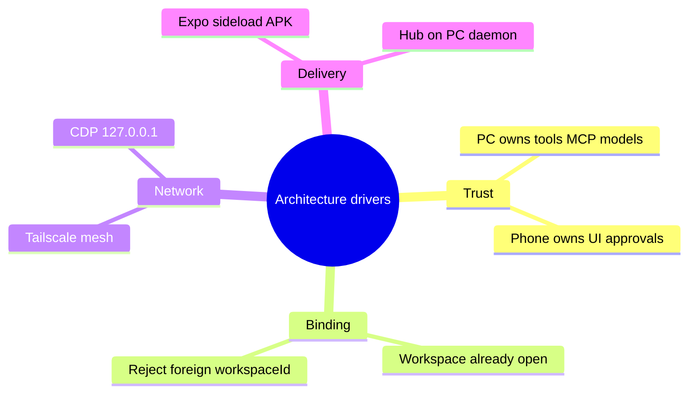

---

## 3. C4 Level 1 — System context

### 3.1 Context diagram

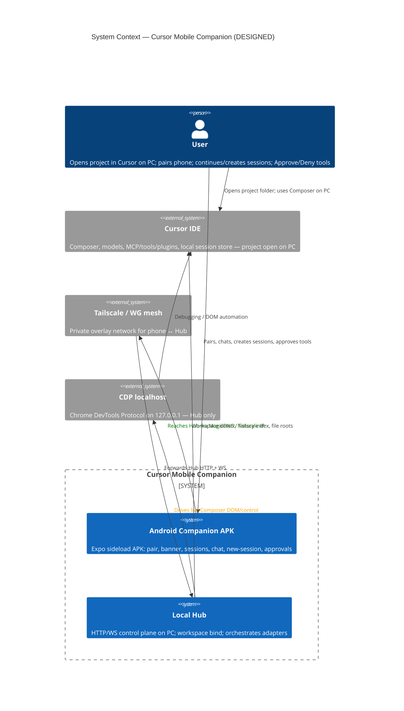

### 3.2 Context narrative (ASCII fallback)

```
                    ┌─────────────────────────────────────┐
                    │           User                      │
                    └───┬─────────────────────┬───────────┘
                        │ opens project       │ pairs / chat / Approve
                        ▼                     ▼
              ┌──────────────────┐   ┌────────────────────┐
              │  Cursor IDE (PC) │   │ Android Companion  │
              │  Composer·MCP·   │   │ APK (Expo)         │
              │  models·history  │   └─────────┬──────────┘
              └────────▲─────────┘             │ Tailscale mesh
                       │                       ▼
                       │              ┌────────────────────┐
                       │   CDP        │   Local Hub (PC)   │
                       │ 127.0.0.1    │   HTTP + WS API    │
                       └──────────────┤   adapters         │
                                      └────────────────────┘
```

### 3.3 External actors and systems

| Entity | Type | Interaction |
|--------|------|-------------|
| **User** | Person | Opens PC project; pairs phone; continues/creates; approves tools |
| **Android Companion APK** | Software system (ours) | UI only; never runs MCP/tools |
| **Local Hub** | Software system (ours) | Single control plane phone ↔ PC |
| **Cursor IDE** | External | Owns Composer, models, tools, session store |
| **Tailscale** | External infrastructure | Private reachability phone → Hub |
| **CDP** | External protocol surface | Localhost debugging endpoint for Cursor |

**Explicitly not in context:** Cursor Cloud Agents, official Remote Control, ngrok/Funnel as baseline, cloud session catalogs, phone-hosted MCP.

---

## 4. C4 Level 2 — Container diagram

### 4.1 Containers

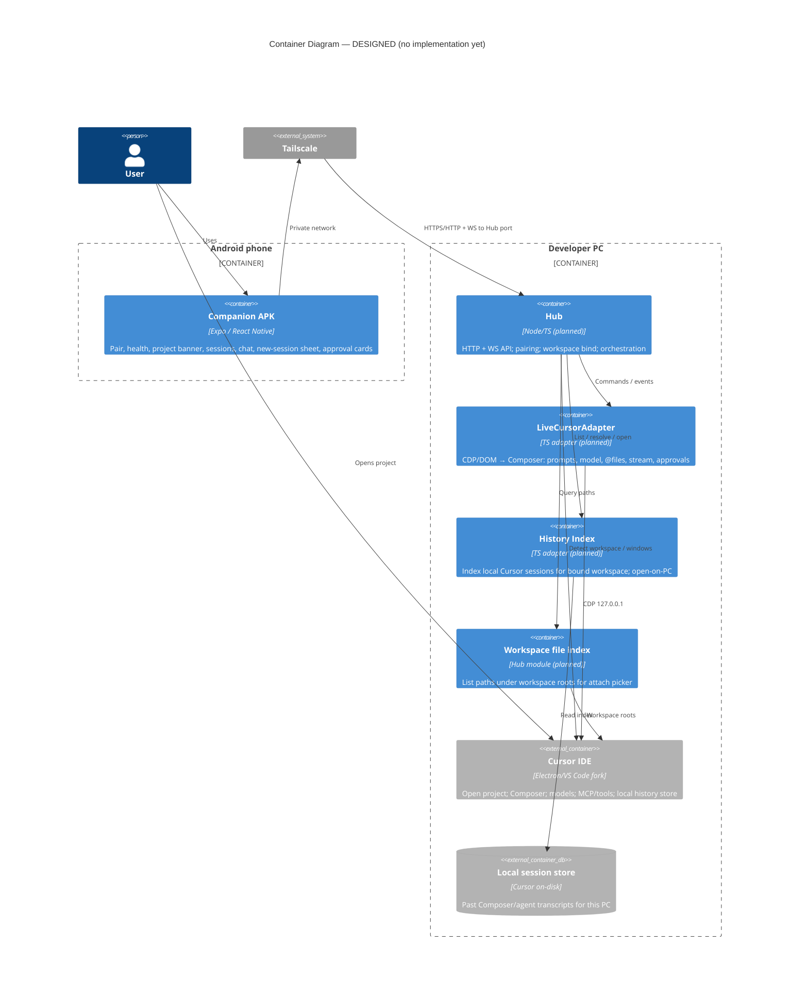

### 4.2 Container responsibilities

| Container | Planned path | Runs on | Responsibility | Does not |
|-----------|--------------|---------|----------------|----------|
| **Companion APK** | `apps/mobile` | Phone | Pairing UI, health, banner, session list, live chat, new-session, Approve/Deny | Execute MCP/tools; hold Cursor API keys; dial CDP |
| **Hub** | `packages/hub` | PC | Auth pair tokens; bind workspace; expose designed routes; fan-in adapters; WS fan-out | Expose CDP; run agent loop itself |
| **LiveCursorAdapter** | `adapters/live` | PC | CursorRemote-class live control via CDP | Index history; serve HTTP to phone |
| **History Index** | `adapters/history` | PC | cursor-session-class local history for workspace; support open-on-PC | Live token streaming |
| **Workspace file index** | Inside Hub (planned) | PC | Path listing under roots for attach | Accept paths outside roots |
| **Cursor IDE** | External | PC | Composer, models, MCP, plugins, session persistence | Reach phone |

### 4.3 Designed Hub API surface (containers’ contract)

All routes are **DESIGNED** — not implemented.

| Method | Path | Purpose |
|--------|------|---------|
| `GET` | `/health` | Hub up + CDP connectivity summary |
| `POST` | `/pair/...` | Device pairing (QR/code → device token) |
| `GET` | `/workspace` | Active PC-open project(s): name, path, roots, `workspaceId` |
| `GET` | `/workspace/files?q=` | Attach picker paths under roots |
| `GET` | `/workspace/models` | Models Cursor exposes locally |
| `GET` | `/workspace/tools` | MCP/tools/plugins summary (read-only) |
| `GET` | `/sessions?workspaceId=` | Unified live ∪ history rows for bound project |
| `POST` | `/sessions` | Create: model + attachments + optional prompt |
| `POST` | `/sessions/:id/open-on-pc` | History → live in same workspace |
| `POST` | `/sessions/:id/messages` | Continue: inject user message |
| `POST` | `/sessions/:id/attachments` | Attach more files to live session |
| `POST` | `/sessions/:id/approvals` | Approve / Deny tool cards |
| `WS` | `/ws` | Stream tokens, tool cards, health/workspace events |

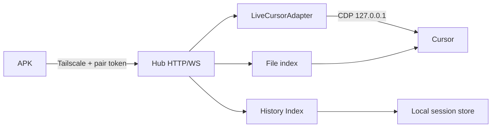

---

## 5. C4 Level 3 — Component diagrams

### 5.1 Hub components (designed)

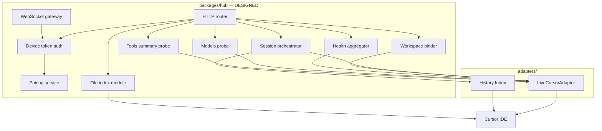

| Hub component | Role |
|---------------|------|
| **HTTP router** | Maps designed REST routes to services |
| **WebSocket gateway** | Authenticated event stream to APK |
| **Pairing service** | Short-lived QR/code; issues rotatable device tokens |
| **Device token auth** | Rejects unpaired clients on session/workspace routes |
| **Workspace binder** | Detects PC-open project; enforces `workspaceId` match |
| **Session orchestrator** | Create / messages / approvals / open-on-pc fan-out |
| **Health aggregator** | Hub process + CDP reachability + bind state |
| **File / models / tools modules** | Read-only projections from Cursor/workspace |

### 5.2 LiveCursorAdapter components (designed)

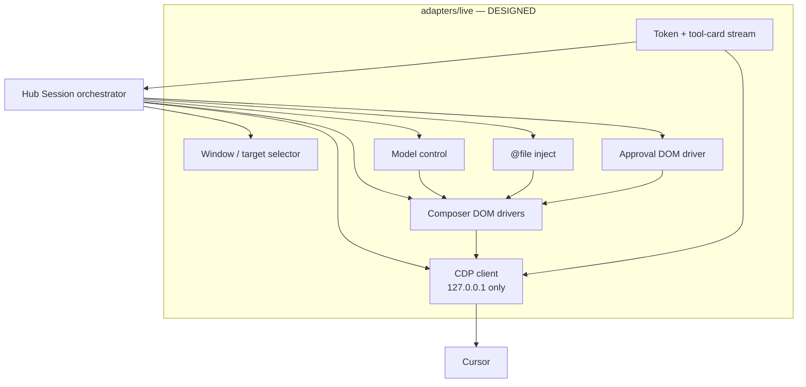

| Component | Responsibility |
|-----------|----------------|
| **CDP client** | Connect only to designed `CDP_URL` (default `http://127.0.0.1:9222`) |
| **Window selector** | Multi-window pick (Phase 1+ / FR-014) |
| **Composer DOM drivers** | Focus Composer, inject prompts (CursorRemote-class) |
| **Model control** | Set model when Cursor UI allows |
| **@file inject** | Map attachment paths to Composer mentions |
| **Stream** | Forward assistant tokens + structured tool-call cards to Hub |
| **Approval driver** | Apply Approve/Deny on PC tool UI |

### 5.3 History Index components (designed)

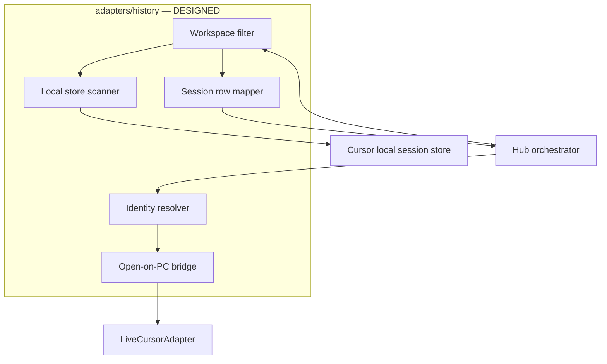

| Component | Responsibility |
|-----------|----------------|
| **Scanner** | Discover local session artifacts (cursor-session-class) |
| **Workspace filter** | Keep rows for bound `workspaceId` / path only |
| **Session row mapper** | Normalize to unified list shape (`mode: history`) |
| **Identity resolver** | Map Hub session id → local Cursor session identity |
| **Open-on-PC bridge** | Hand off to LiveCursorAdapter to reopen in same project |

### 5.4 APK components (designed)

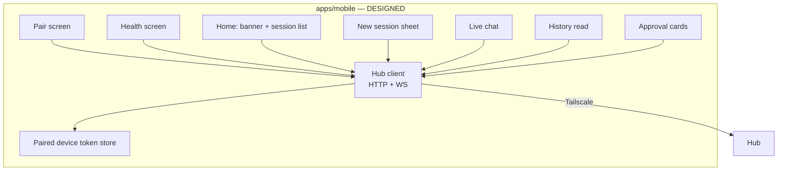

| Screen / module | Purpose |
|-----------------|--------|
| **Pair** | QR/code → `POST /pair/...`; persist device token |
| **Health** | `GET /health` + connectivity errors (Tailscale/Hub/CDP) |
| **Home** | Active project banner + `GET /sessions?workspaceId=` |
| **New session sheet** | Model, files, tools info, prompt → `POST /sessions` |
| **Live chat** | Messages + WS stream |
| **History read** | Read-only past session; CTA Open on PC |
| **Approval cards** | Inline Approve/Deny → `POST .../approvals` |
| **Hub client** | Authenticated HTTP/WS; no CDP URL config |

Navigation (designed):

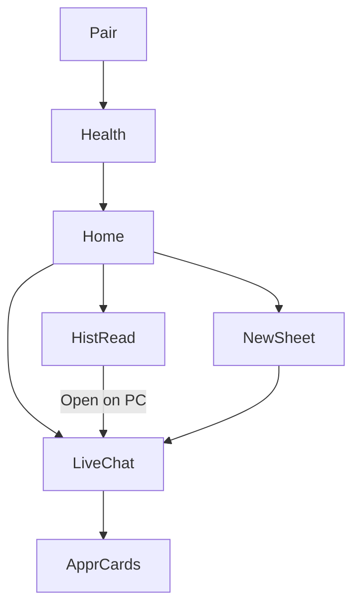

---

## 6. Deployment architecture (PC + phone + Tailscale)

### 6.1 Deployment diagram

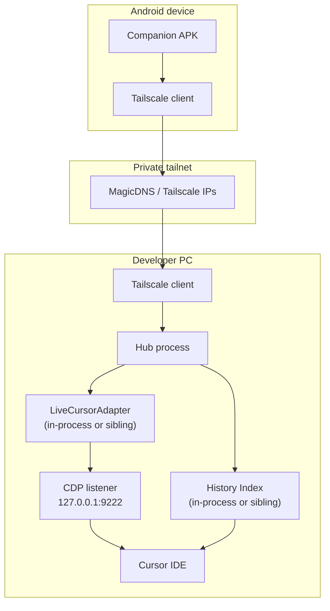

### 6.2 Bind and reachability rules

| Surface | Bind / address | Reachable by |
|---------|----------------|--------------|
| **CDP** | `127.0.0.1` only (designed default port `9222`) | Hub / LiveCursorAdapter on same PC |
| **Hub HTTP + WS** | Tailscale IP / MagicDNS (or loopback + Tailscale Serve to loopback) | Paired APK over mesh |
| **APK → CDP** | — | **Forbidden** |
| **Hub / CDP on `0.0.0.0`** | — | **Forbidden** baseline |
| **Tailscale Funnel / ngrok as default** | — | **Forbidden** baseline |

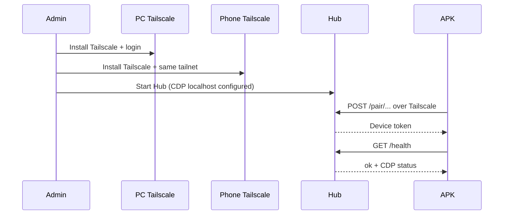

### 6.3 Designed configuration knobs

From [`CONFIGURATION.md`](../../CONFIGURATION.md) — all **DESIGNED**:

| Variable | Role |
|----------|------|
| `TAILSCALE_HOSTNAME` | PC MagicDNS for APK |
| `HUB_HOST` / `HUB_PORT` | Hub listen (private path) |
| `CDP_URL` | Default `http://127.0.0.1:9222` |
| `PAIRING_TOKEN_TTL` / `PAIRING_REQUIRED` | Pairing policy |
| `WORKSPACE_POLL_MS` | Workspace refresh |
| `EXPO_PUBLIC_HUB_URL` | APK Hub base URL |

Expo EAS profile (designed): `android.buildType: apk` for sideload.

---

## 7. Session modes and data model (designed)

| Mode | Meaning | Phone capabilities |
|------|---------|-------------------|
| `live` | Open Composer/agent in bound workspace | Chat, attach, Approve/Deny, model if UI allows |
| `history` | Past local session for project | Read; **Open on PC** → `live` |
| `editor` | Optional later (Phase 3+) | Browse/attach |

**Create body (designed):**

```json
{
  "workspaceId": "...",
  "model": "composer-...|...",
  "attachments": ["src/a.ts"],
  "prompt": "optional first message",
  "agentMode": "agent|ask|..."
}
```

Hub **rejects** create when `workspaceId` ≠ PC-open bound project.

---

## 8. Sequence diagrams — core flows

### 8.1 Continue live session

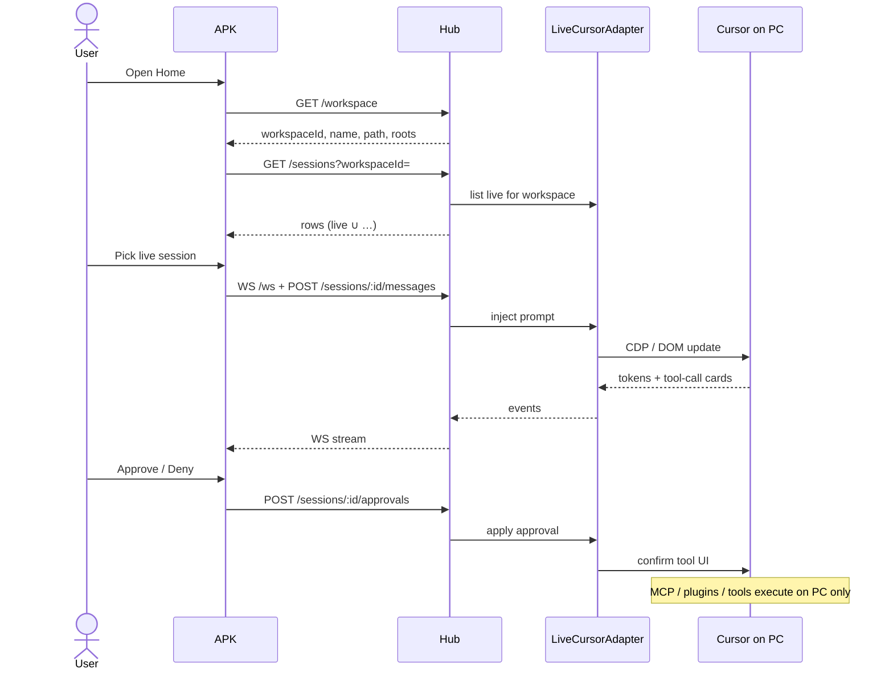

### 8.2 Create new session (model + files + tools)

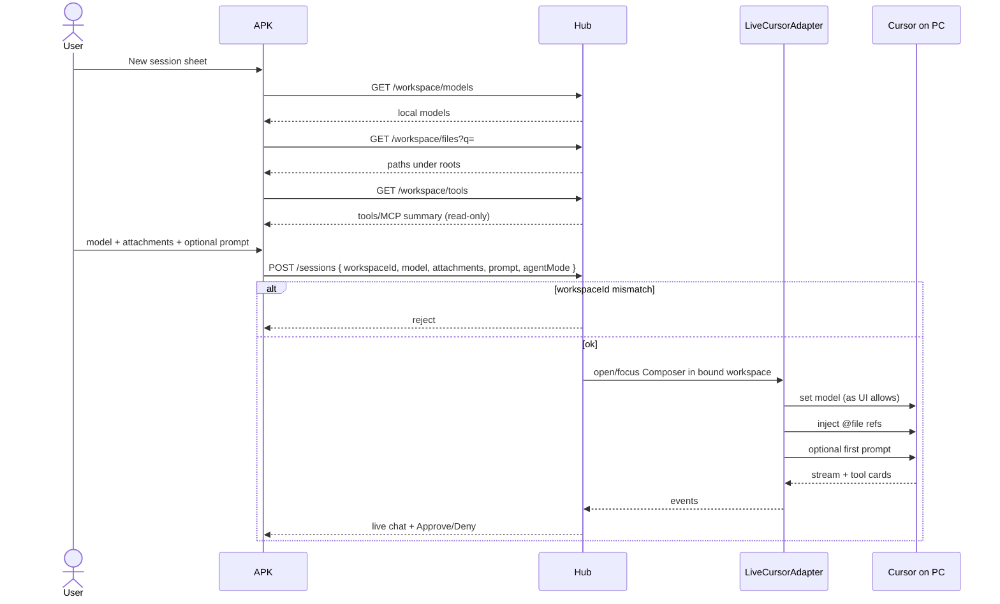

### 8.3 Open on PC (history → live)

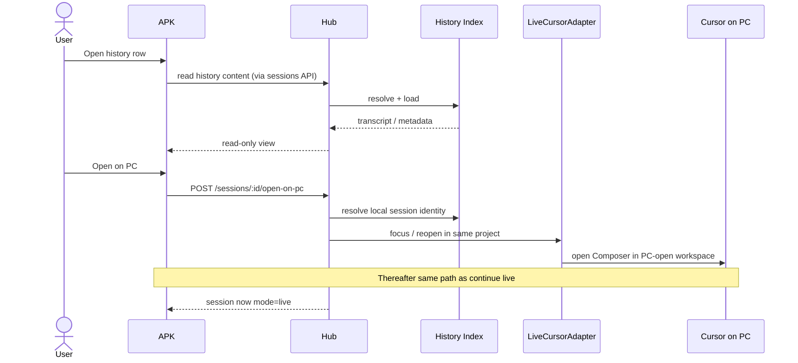

### 8.4 Workspace binding and empty state

```mermaid
sequenceDiagram
  participant User
  participant Cursor as Cursor on PC
  participant Hub
  participant APK

  alt Project open
    User->>Cursor: Open folder
    Hub->>Cursor: Detect workspace (CDP / VS Code API)
    APK->>Hub: GET /workspace
    Hub-->>APK: name, path, roots, workspaceId
    APK->>APK: Show project banner
  else No folder open
    Hub->>Cursor: Detect — empty
    APK->>Hub: GET /workspace
    Hub-->>APK: unavailable
    APK->>APK: Block: "Open a project in Cursor on the PC"
    Note over APK: No fake workspace; no cloud fallback
  end
```

---

## 9. Failure domains

Failures are isolated so a single domain does not silently widen trust or invent cloud fallbacks.

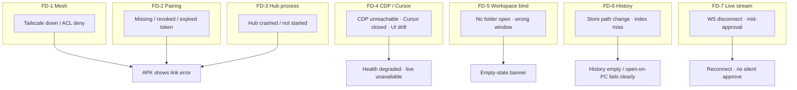

| Domain | Symptoms | Designed behavior | Must not happen |
|--------|----------|-------------------|-----------------|
| **FD-1 Mesh** | Timeouts to Hub | Clear “Tailscale/link down” | Fall back to public tunnel automatically |
| **FD-2 Pairing** | 401 on APIs | Force Pair screen | Accept unpaired session control |
| **FD-3 Hub** | `/health` fail | Offline Hub UI | APK dial CDP directly |
| **FD-4 CDP/Cursor** | Health: CDP bad | Live create/continue disabled; history may still list | Fabricate live sessions |
| **FD-5 Bind** | Empty workspace | Blocking empty state | Fake empty project / cloud list |
| **FD-6 History** | Index miss | Error on open-on-PC | Open unrelated workspace |
| **FD-7 Stream** | WS drop | Reconnect (FR-090 Phase 2+); pending approval stays explicit | Silent Approve |

**Blast radius principle:** Compromised phone with valid token can drive Hub APIs for the paired PC — mitigate with revoke, short TTL, OS lock (see security doc). Compromised LAN without mesh membership should not reach Hub/CDP under baseline rules.

---

## 10. Technology choices and rationale

| Choice | Selected (designed) | Rationale | Rejected alternatives |
|--------|---------------------|-----------|----------------------|
| **Transport phone↔Hub** | Tailscale / WireGuard mesh | Authenticated private overlay; MagicDNS; ACL-able | Raw LAN, Hub on `0.0.0.0`, ngrok/Funnel as default |
| **Live control** | CDP + DOM adapter (CursorRemote-class) | No official PC-local remote Composer API; CDP already used by OSS companions | Cloud Agents API; reverse-engineering undocumented cloud RPC as product path |
| **History** | Local History Index (cursor-session-class) | Full project past chats stay on PC | Cloud session catalog |
| **Mobile shell** | Expo → EAS **APK** sideload | Matches Paseo-style companion; sideload without Play dependency for v1 | Browser-only remote; iOS-first cloud Remote Control |
| **Hub runtime** | Local process on PC (Node/TS planned) | Same machine as Cursor/CDP; simple orchestration | Cloud workers; phone-hosted hub |
| **AuthZ to Hub** | Device pairing token after QR/code | Tailnet membership ≠ user approval of this phone | Open Hub to entire tailnet without pair |
| **Tool execution** | Cursor MCP/tools on PC | Correct security boundary; reuse existing plugins | Reimplement tools on phone |
| **CDP bind** | `127.0.0.1` only | CDP = full IDE control surface | Remote CDP URL in APK |
| **Workspace scope** | Bind to PC-open project | Matches “day in the life”; avoids phone as VCS remote | Phone opens arbitrary folders (v1 out) |

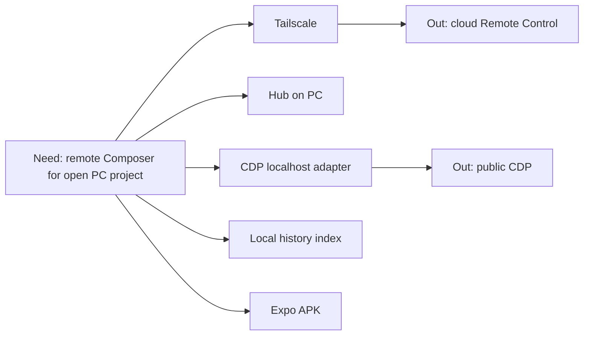

**Borrow map (patterns, not vendored products as dependencies yet):**

| Source | Borrow for |
|--------|------------|
| [CursorRemote](https://github.com/len5ky/CursorRemote) | Live chat, approvals, prompts, multi-window |
| [cursor-session](https://github.com/iksnae/cursor-session) | Local past sessions |
| [Paseo](https://github.com/getpaseo/paseo) | Daemon + Expo APK shape |

---

## 11. Intended repository layout

**Truth:** These directories do **not** exist yet. Layout is the accepted target from AGENTS.md / architecture.

```
cursor_mobile/
├── apps/
│   └── mobile/              # Expo Android APK — UI, pairing, chat, approvals
├── packages/
│   └── hub/                 # Local Hub HTTP/WS, workspace bind, orchestration
├── adapters/
│   ├── live/                # LiveCursorAdapter — CDP/Composer (CursorRemote-class)
│   └── history/             # History Index — local sessions (cursor-session-class)
├── docs/
│   ├── architecture/        # AGENT-CONTEXT, companion, FRs, security
│   ├── features/            # remote-sessions, new-session, phone-apk-screens
│   ├── reports/             # jobs, audits, handoffs, TOR/
│   ├── GETTING-STARTED.md
│   ├── CONFIGURATION.md
│   └── README.md
├── research/                # Raw external research dumps
├── AGENTS.md
└── README.md
```

| Path | Owns | Boundary |
|------|------|----------|
| `apps/mobile` | APK surfaces | Never hosts tools or Cursor |
| `packages/hub` | Control plane | Enforces workspace bind + pairing |
| `adapters/live` | Live path into Cursor | CDP localhost only |
| `adapters/history` | Local discovery + open-on-PC | No cloud history |
| `docs/` | Canonical design truth | Prefer update over parallel architectures |
| `research/` | Historical inputs | Not active scope when locks conflict |

---

## 12. Versioning and compatibility (designed policy)

No packages are published yet. The following policy applies when code lands:

| Artifact | Versioning | Compatibility notes |
|----------|------------|---------------------|
| **Hub API** | SemVer on Hub package; document breaking route/schema changes | APK must declare min Hub API version in health handshake (designed) |
| **WS event schema** | Version field on envelopes (e.g. `v: 1`) | Unknown event types ignored by APK; Hub must not require unacked unknown client events |
| **Device token** | Opaque; rotatable | Revoke invalidates without bumping API major |
| **LiveCursorAdapter selectors** | Adapter semver; may lag Cursor IDE UI changes | Phase 4 hardens selectors; treat UI drift as FD-4 |
| **History Index** | Adapter semver | Cursor on-disk format changes may require adapter bump without Hub major if API stable |
| **APK** | Expo app version + Android `versionCode` | Sideload APK; pair again if token storage cleared |
| **Docs / TOR** | Date + status banner (`DESIGNED` / accepted) | Docs can lead code; never claim routes shipped until packages exist |

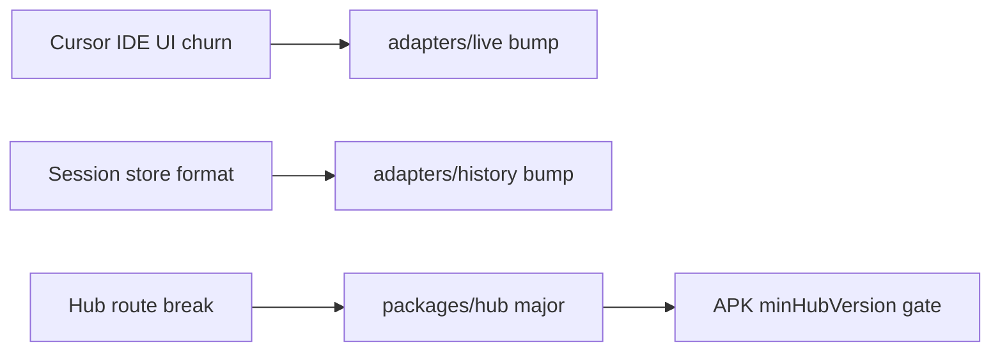

---

## 13. Extension points

Designed seams for later phases without breaking product locks:

| Extension point | Mechanism | Allowed evolution | Forbidden evolution |
|-----------------|-----------|-------------------|---------------------|
| **Adapters** | Hub → adapter interface | Swap CDP strategy; improve selectors | Move adapter execution to phone |
| **Session modes** | `live` / `history` / `editor` | Add `editor` tab (Phase 3) | Add `cloud` mode |
| **Multi-window** | Window selector in live adapter | FR-014 pick window | Bind to remote machine workspace |
| **File picker** | `/workspace/files` | Richer search, @-mentions (Phase 3) | Attach arbitrary phone FS as workspace root (v1) |
| **Offline queue** | APK/Hub queue (Phase 4) | Queue messages while WS down | Queue silent approvals |
| **Mesh** | Tailscale first | Equivalent WireGuard mesh with same properties | Public Funnel as default |
| **Auth** | Pairing tokens | Rotate/revoke; optional ACL tags | Embed Cursor cloud API keys in APK |
| **Tools summary** | `/workspace/tools` | Richer metadata for cards | Execute tools inside APK |

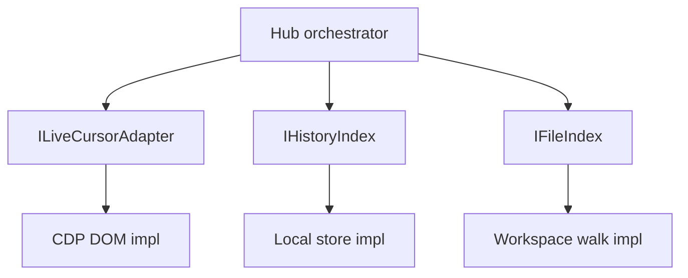

---

## 14. Phased delivery mapping (architecture view)

Every phase remains **this PC + Tailscale**. Architecture does not open cloud paths between phases.

| Phase | Architecture deliverable | Gate |
|-------|--------------------------|------|
| **0** | Pair, Tailscale path, `/health`, workspace binder + APK banner | Bound to PC-open project only |
| **1** | Live continue + approvals + `POST /sessions` + APK shell | Tools on PC; phone approves |
| **2** | Full History Index + open-on-PC | Local history only |
| **3** | Richer file index / optional editor mode | Attachments from workspace roots |
| **4** | Selector hardening, offline queue | Still no public CDP; still no cloud |

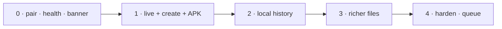

---

## 15. Architecture Decision Records (ADR)

### ADR index

| ID | Title | Status |
|----|-------|--------|
| ADR-001 | PC-local only — no cloud agent path | Accepted |
| ADR-002 | Open-project remote (v1) — bind to PC-open workspace | Accepted |
| ADR-003 | Tailscale (or WG mesh) as required first hop | Accepted |
| ADR-004 | CDP binds to 127.0.0.1; Hub-mediated only | Accepted |
| ADR-005 | Dual adapters: Live CDP + local History Index | Accepted |
| ADR-006 | Tools/MCP execute on PC; phone Approve/Deny only | Accepted |
| ADR-007 | Expo EAS sideload APK delivery | Accepted |
| ADR-008 | Device pairing tokens beyond mesh membership | Accepted |
| ADR-009 | Unified Hub session API (`live` ∪ `history`) | Accepted |
| ADR-010 | Docs-first; designed APIs ≠ shipped code | Accepted |

---

### ADR-001 — PC-local only — no cloud agent path

- **Status:** Accepted (2026-09-24)
- **Context:** Official Cursor mobile/cloud paths center on Cloud Agents / Remote Control. Research also surfaces “cloud optional” diagrams.
- **Decision:** Product is a **PC-local companion** only. No Cloud Agents, no official Remote Control, no cloud workers, no cloud session catalogs in scope.
- **Consequences:** Hub and adapters always run beside Cursor on the user’s PC; APK never embeds cloud agent credentials; architecture docs must not soft-open cloud modes.

---

### ADR-002 — Open-project remote (v1)

- **Status:** Accepted
- **Context:** Users already open folders in Cursor on the PC. Phone-first clone/open would duplicate IDE workspace management and widen attack surface.
- **Decision:** Phone remotes the **project already open** on the PC. `workspaceId` on create/list must match Hub binding; empty Cursor folder → blocking empty state.
- **Consequences:** v1 cannot open arbitrary folders from the phone; multi-root/multi-window selection is additive (FR-014), not “browse all machines.”

---

### ADR-003 — Tailscale (or equivalent WireGuard mesh) first hop

- **Status:** Accepted
- **Context:** Hub and CDP are high-value. LAN Wi‑Fi and public tunnels are hostile or add a public front door.
- **Decision:** Phone reaches Hub only over **Tailscale** (or WG mesh with same properties). Funnel/ngrok are not the secure baseline.
- **Consequences:** Phase 0 requires mesh setup before pairing; MagicDNS preferred; optional ACLs phone→Hub.

---

### ADR-004 — CDP localhost; Hub-mediated

- **Status:** Accepted
- **Context:** CDP grants full IDE control. Exposing it remotely is a critical vulnerability pattern in companion tools.
- **Decision:** CDP binds **`127.0.0.1` only**. APK never dials CDP and never stores a remote CDP URL. Only Hub/LiveCursorAdapter connects.
- **Consequences:** Live features require Hub+Cursor on same PC; cannot “just port-forward 9222” through Tailscale Serve.

---

### ADR-005 — Dual adapters (live + history)

- **Status:** Accepted
- **Context:** Live Composer control (CDP/DOM) and past session discovery (on-disk store) are different failure domains and OSS patterns (CursorRemote vs cursor-session).
- **Decision:** Split **LiveCursorAdapter** and **History Index**; Hub aggregates into one session list filtered by workspace.
- **Consequences:** Open-on-PC is an explicit bridge history→live; history can work when live CDP is down (list/read), but open-on-PC still needs live adapter.

---

### ADR-006 — Tools on PC; approvals on phone

- **Status:** Accepted
- **Context:** MCP/plugins need PC filesystem, credentials, and Cursor’s tool host. Phone execution would fork security and capability.
- **Decision:** Tools/plugins/MCP run **only in Cursor on the PC**. Phone streams structured cards and **Approve/Deny**; no silent approvals.
- **Consequences:** `/workspace/tools` is read-only summary; approval API is mandatory for tool continuation.

---

### ADR-007 — Expo EAS sideload APK

- **Status:** Accepted
- **Context:** Need an installable Android client without requiring Play-only AAB as the sole path; Paseo-like daemon+APK shape fits.
- **Decision:** Ship **Expo** Android app with EAS `android.buildType: apk` for sideload.
- **Consequences:** Operator installs APK manually; iOS not required for v1 architecture; browser-only UI is insufficient as the product client.

---

### ADR-008 — Device pairing beyond mesh membership

- **Status:** Accepted
- **Context:** Any device on the user’s tailnet could otherwise call Hub if only mesh ACLs applied.
- **Decision:** Require **pairing** (`POST /pair/...`) issuing rotatable/revocable **device tokens** before workspace/session APIs.
- **Consequences:** Stolen phone → revoke token; leaked QR → short-lived codes; Tailscale ACL is defense-in-depth, not sole authZ.

---

### ADR-009 — Unified Hub session API

- **Status:** Accepted
- **Context:** Phone UX needs one list for “this project,” mixing live and history without teaching two backends.
- **Decision:** `GET /sessions?workspaceId=` returns unified rows with `mode`; mutations via `/messages`, `/approvals`, `/open-on-pc`, `POST /sessions`.
- **Consequences:** Hub owns aggregation; adapters stay internal; API stays stable if adapter implementations change.

---

### ADR-010 — Docs-first; designed ≠ shipped

- **Status:** Accepted
- **Context:** Architecture/FRs accepted before monorepo scaffold. Agents risk inventing “done” install steps and APIs.
- **Decision:** Document designed contracts explicitly; **AGENTS.md** forbids claiming Hub/APK APIs as implemented until code exists; prefer updating canonical docs over parallel architectures.
- **Consequences:** TOR-02 and CONFIGURATION use DESIGNED banners; no `package.json` scripts until scaffold; handoffs must restate locks.

---

## 16. Security architecture summary (pointer)

Full threat model: [`../../architecture/security-tailscale-linking.md`](../../architecture/security-tailscale-linking.md).

| Asset | Primary control |
|-------|-----------------|
| CDP | Loopback only; Hub-mediated |
| Hub API | Tailscale + pairing token |
| Device token | Short-lived / rotatable / revocable |
| Cursor/cloud keys | Remain on PC; never in APK |
| Workspace files | Paths constrained to roots |

---

## 17. Non-goals (architecture)

- Cloud mode / Cloud Agents / Remote Control as product path  
- Opening/cloning arbitrary projects from the phone (v1)  
- Running MCP servers or tool runtimes on the phone  
- Exposing CDP beyond localhost  
- Competing second architecture doc that softens the above  

---

## 18. Traceability

| Architecture element | Primary FR groups | Feature docs |
|----------------------|-------------------|--------------|
| Pair + health + mesh | FR-001–004 | phone-apk-screens (Pair, Health) |
| Workspace bind + banner | FR-010–013 | remote-sessions |
| Session list / modes | FR-020–022 | remote-sessions |
| Continue live + approvals | FR-030–033, FR-060–062 | remote-sessions |
| New session | FR-050–054 | new-session-composer |
| History + open-on-PC | FR-040–041 (P1) | remote-sessions |
| APK shell | FR-080–081 | phone-apk-screens |

---

## 19. Decision line

**Phone = remote Composer for the PC-open project.** Hub on PC orchestrates LiveCursorAdapter + History Index over Tailscale + pairing. CDP stays on `127.0.0.1`. Expo sideload APK. Tools on PC; approvals on phone. **No cloud. DESIGNED — code not scaffolded.**
