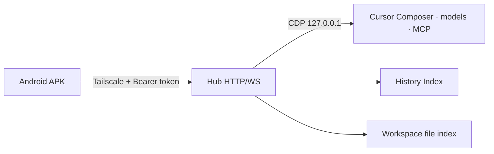
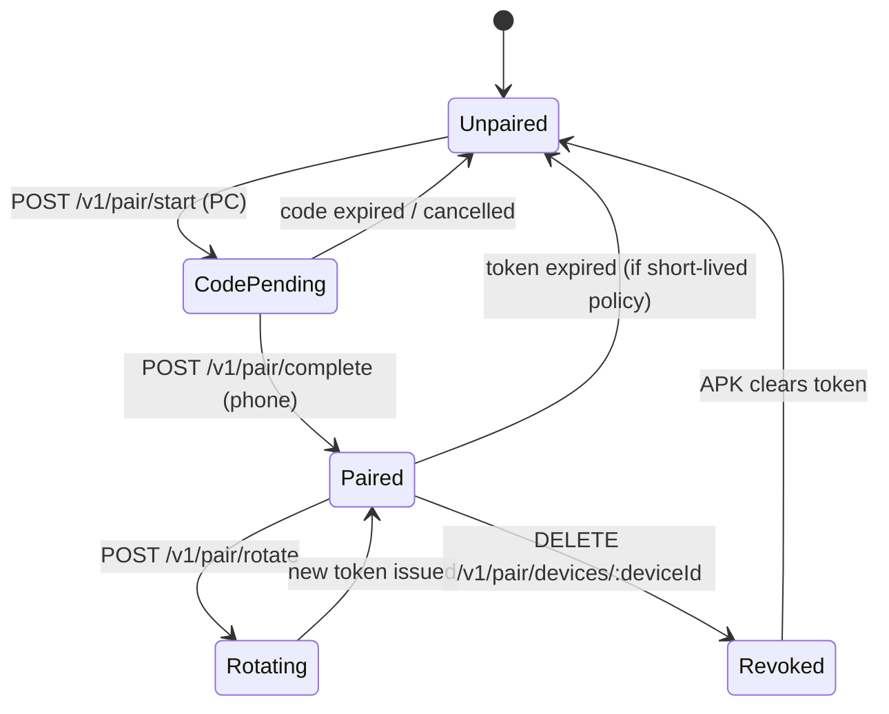
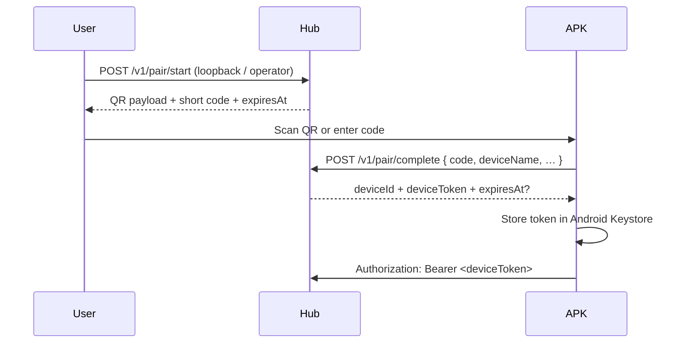
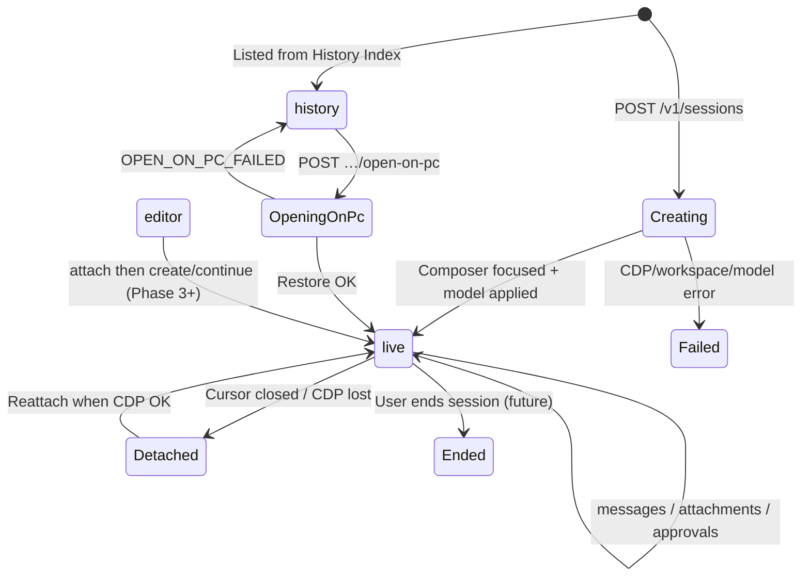
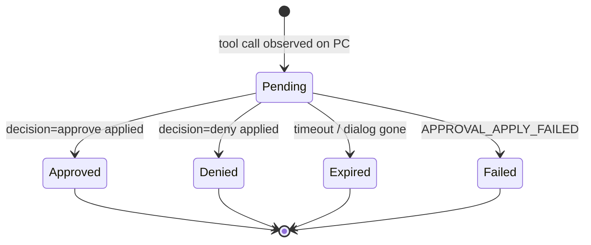
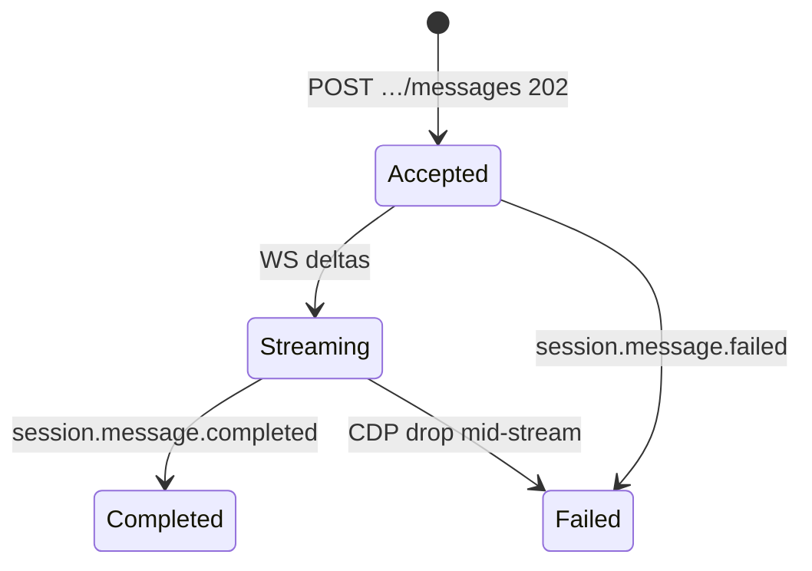
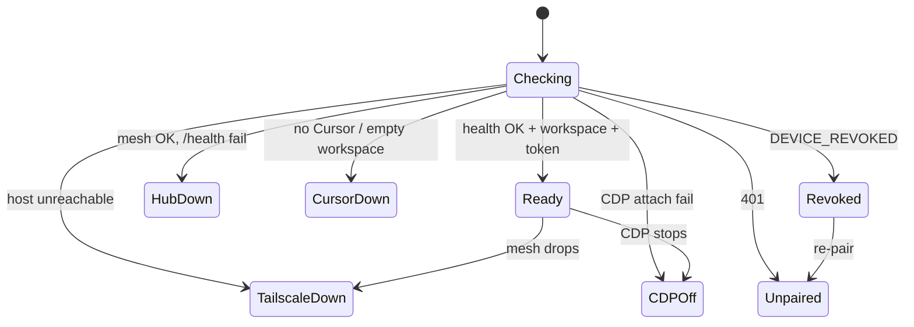

<!-- generated-by: gsd-doc-writer -->
# TOR-03 — Hub & API Specification

**Status:** DESIGNED — **not implemented.** No Hub package, OpenAPI artifact, or runtime routes exist in this repository yet. All paths, schemas, codes, and limits below are the accepted contract for future scaffolding.

**Product:** PC-local Cursor companion (Android APK ↔ local Hub).  
**Sources:** [`AGENT-CONTEXT.md`](../../architecture/AGENT-CONTEXT.md) · [`mobile-cursor-companion.md`](../../architecture/mobile-cursor-companion.md) · [`functional-requirements.md`](../../architecture/functional-requirements.md) · [`security-tailscale-linking.md`](../../architecture/security-tailscale-linking.md) · [`remote-sessions.md`](../../features/remote-sessions.md) · [`new-session-composer.md`](../../features/new-session-composer.md) · [`phone-apk-screens.md`](../../features/phone-apk-screens.md) · [`CONFIGURATION.md`](../../CONFIGURATION.md)

---

## Product locks (non-negotiable)

| Lock | Meaning for this API |
|------|----------------------|
| **PC-local only** | No Cloud Agents endpoints, no cloud session catalogs, no official Remote Control |
| **Open-project remote** | All session/workspace ops bind to the project **already open** in Cursor on the PC |
| **Continue or create** | Continue live/history **or** create with model + attachments + tools/approvals on PC |
| **Tailscale + pairing** | Hub reachable on private mesh; device pairing token required for protected routes |
| **CDP localhost** | CDP binds `127.0.0.1` only; phone never dials CDP; Hub alone talks to CDP |
| **Expo sideload APK** | Client is Android APK; API is Hub HTTP/WS only |
| **Docs ≠ code** | This TOR is designed; treat as contract until `packages/hub` exists |



---

## 1. Scope and goals

### In scope

- Complete designed REST surface for health, pairing, workspace, models, files, tools, sessions, messages, attachments, approvals, open-on-pc
- WebSocket `/ws` connection contract and event catalog
- Auth model, error envelope, idempotency, designed rate limits
- Session lifecycle state machines
- API versioning strategy

### Out of scope

- Cloud Agents / Remote Control / public CDP
- Phone-side MCP/tool execution
- Scaffolding Hub/APK application code (this document only)
- Editor-mode deep browse (Phase 3+; noted where relevant)

---

## 2. Base URL, transport, and conventions

| Item | Designed value |
|------|----------------|
| Base URL | `http://{TAILSCALE_HOSTNAME}:{HUB_PORT}` (HTTPS only if Tailscale Serve / TLS termination is configured later) |
| HTTP API prefix | `/v1` (see [§14 Versioning](#14-versioning-strategy)) |
| WebSocket | `ws://{TAILSCALE_HOSTNAME}:{HUB_PORT}/v1/ws` |
| Content-Type | `application/json; charset=utf-8` |
| Time format | ISO-8601 UTC (`2026-09-25T18:00:00.000Z`) |
| IDs | Opaque strings (`ws_…`, `sess_…`, `dev_…`, `apr_…`, `msg_…`) |
| Path params | `:id` = session id unless noted |

**Auth header (paired routes):**

```http
Authorization: Bearer <device_token>
```

**Optional request headers:**

| Header | Required | Purpose |
|--------|----------|---------|
| `Authorization` | Yes on protected routes | Device token |
| `Idempotency-Key` | Yes on mutating POSTs listed below | Deduplicate retries |
| `X-Client-Id` | Optional | Stable APK install id (non-secret) for logs |
| `X-API-Version` | Optional | Client-declared major (`1`); Hub may echo |

Unpaired allow-list: `GET /v1/health`, `POST /v1/pair/complete` (and PC-local `POST /v1/pair/start` — see pairing).

---

## 3. Authentication and pairing

### 3.1 Auth model

| Layer | Rule |
|-------|------|
| Network | Phone reaches Hub only via Tailscale (or equivalent private mesh) |
| Application | Device Bearer token after pairing |
| CDP | Never exposed; never sent to phone |

Tailscale membership is **necessary but not sufficient** — unpaired callers on the tailnet receive `401`.

### 3.2 Pairing state machine



### 3.3 Pairing sequence



---

## 4. Common schemas

### 4.1 Error envelope

Every non-2xx JSON body:

```json
{
  "error": {
    "code": "WORKSPACE_MISMATCH",
    "message": "workspaceId does not match the PC-open project",
    "details": { "expectedWorkspaceId": "ws_abc", "got": "ws_other" },
    "requestId": "req_…"
  }
}
```

| Field | Type | Description |
|-------|------|-------------|
| `error.code` | string enum | Machine-readable code ([§13](#13-error-codes)) |
| `error.message` | string | Human-readable; safe for APK toasts |
| `error.details` | object \| null | Structured extras (paths rejected, etc.) |
| `error.requestId` | string | Correlation id |

### 4.2 Pagination (list endpoints)

Query: `?limit=50&cursor=<opaque>`

```json
{
  "items": [],
  "nextCursor": "cur_…|null"
}
```

### 4.3 Session mode enum

| Value | Meaning |
|-------|---------|
| `live` | Open Composer/agent in Cursor for bound workspace |
| `history` | Past local session; read-only until open-on-pc |
| `editor` | Optional later — browse/attach (Phase 3+) |

---

## 5. Rate limits (designed)

Hub applies per-device-token buckets (not per IP alone). Limits are **designed**; not enforced in code yet.

| Bucket | Limit | Window | Applies to |
|--------|-------|--------|------------|
| `default` | 120 req | 1 min | Most GET/POST |
| `pair` | 10 req | 15 min | `/pair/*` |
| `messages` | 60 req | 1 min | `POST …/messages` |
| `approvals` | 60 req | 1 min | `POST …/approvals` |
| `create_session` | 20 req | 1 min | `POST /sessions` |
| `files_search` | 90 req | 1 min | `GET /workspace/files` |
| `ws_connect` | 30 | 1 min | New WS handshakes |

**429 response** includes:

```http
Retry-After: 12
```

```json
{
  "error": {
    "code": "RATE_LIMITED",
    "message": "Too many requests",
    "details": { "bucket": "messages", "retryAfterSec": 12 },
    "requestId": "req_…"
  }
}
```

---

## 6. Idempotency (designed)

| Method + path | Idempotency-Key | Behavior |
|---------------|-----------------|----------|
| `POST /v1/pair/complete` | Recommended | Same key + same code → same device token response |
| `POST /v1/sessions` | **Required** | Same key → same `sessionId` (no double Composer) |
| `POST /v1/sessions/:id/messages` | **Required** | Same key → same `messageId` |
| `POST /v1/sessions/:id/attachments` | **Required** | Same key → same attachment set applied once |
| `POST /v1/sessions/:id/approvals` | **Required** | Same key → same approval outcome recorded once |
| `POST /v1/sessions/:id/open-on-pc` | **Required** | Same key → same live transition |
| `POST /v1/pair/rotate` | Recommended | Same key → same rotated token |
| GETs | N/A | Safe/retryable without key |

Keys: client-generated UUID; Hub retains ≥24h. Replay with different body → `409 IDEMPOTENCY_KEY_REUSE`.

---

## 7. REST endpoints (OpenAPI-style)

**Endpoint count (REST):** 18  
**WebSocket endpoints:** 1 (`GET` upgrade `/v1/ws`)  
**Total transport endpoints:** 19

Auth column: `public` = no Bearer · `paired` = Bearer required · `local` = PC loopback / operator console only (not for APK over Tailscale).

---

### 7.1 Health

#### `GET /v1/health`

| | |
|--|--|
| **Auth** | `public` (APK may call before pair to diagnose reachability) |
| **Idempotent** | Yes (GET) |
| **Rate limit** | `default` |

**Response `200`:**

```json
{
  "ok": true,
  "version": "0.0.0-designed",
  "apiVersion": "1",
  "time": "2026-09-25T18:00:00.000Z",
  "hub": {
    "status": "up",
    "uptimeSec": 3600
  },
  "cdp": {
    "status": "connected",
    "urlConfigured": "http://127.0.0.1:9222",
    "lastAttachAt": "2026-09-25T17:59:50.000Z",
    "error": null
  },
  "cursor": {
    "status": "running",
    "windowsDetected": 1
  },
  "workspace": {
    "bound": true,
    "workspaceId": "ws_abc",
    "name": "cursor_mobile",
    "path": "/data/projects/cursor_mobile"
  },
  "pairing": {
    "required": true,
    "devicesPaired": 1
  }
}
```

| Field | Type | Description |
|-------|------|-------------|
| `ok` | boolean | `true` when Hub process is healthy enough to answer (CDP may still be down) |
| `hub.status` | `"up"` | Hub HTTP up |
| `cdp.status` | `"connected"` \| `"disconnected"` \| `"error"` | Adapter attach to localhost CDP |
| `cdp.urlConfigured` | string | Always loopback form; never a public host |
| `cursor.status` | `"running"` \| `"not_detected"` | Best-effort |
| `workspace.bound` | boolean | Whether an open project is bound |
| `workspace.*` | object \| null | Banner fields when bound; null/`bound:false` when empty |

**Designed status combinations for APK Health screen:**

| Condition | `ok` | `cdp.status` | `workspace.bound` |
|-----------|------|--------------|-------------------|
| Ready | true | connected | true |
| Hub up, no project | true | connected | false |
| CDP off | true | disconnected/error | * | 
| Hub process dying | N/A (TCP fail) | — | — |

---

### 7.2 Pairing

#### `POST /v1/pair/start`

| | |
|--|--|
| **Auth** | `local` (PC operator / Hub UI on loopback) |
| **Idempotent** | No (new code each call unless key used) |
| **Rate limit** | `pair` |

**Request:**

```json
{
  "ttlSec": 300,
  "label": "Desk PC"
}
```

| Field | Type | Required | Description |
|-------|------|----------|-------------|
| `ttlSec` | number | no | Code lifetime; designed default `300` |
| `label` | string | no | Shown on phone after pair |

**Response `201`:**

```json
{
  "pairId": "pair_…",
  "code": "482913",
  "qrPayload": "cursor-companion://pair?host=pc.tailnet.ts.net&port=8787&code=482913&pairId=pair_…",
  "expiresAt": "2026-09-25T18:05:00.000Z"
}
```

---

#### `POST /v1/pair/complete`

| | |
|--|--|
| **Auth** | `public` (code proves proximity) |
| **Idempotency-Key** | Recommended |
| **Rate limit** | `pair` |

**Request:**

```json
{
  "code": "482913",
  "pairId": "pair_…",
  "deviceName": "Pixel 8",
  "platform": "android",
  "appVersion": "0.1.0",
  "clientPublicKey": null
}
```

| Field | Type | Required | Description |
|-------|------|----------|-------------|
| `code` | string | yes | Short code from QR / Hub UI |
| `pairId` | string | no | From QR payload; binds code to start session |
| `deviceName` | string | yes | Display name in Hub device list |
| `platform` | `"android"` | yes | v1 Android only |
| `appVersion` | string | yes | APK version |
| `clientPublicKey` | string \| null | no | Reserved for future mTLS |

**Response `201`:**

```json
{
  "deviceId": "dev_…",
  "deviceToken": "<secret>",
  "tokenType": "Bearer",
  "expiresAt": null,
  "hub": {
    "displayName": "Desk PC",
    "baseUrlHint": "http://pc.tailnet.ts.net:8787"
  }
}
```

| Error code | HTTP | When |
|------------|------|------|
| `PAIR_CODE_INVALID` | 400 | Wrong code |
| `PAIR_CODE_EXPIRED` | 410 | TTL elapsed |
| `PAIR_CODE_USED` | 409 | Single-use consumed |
| `RATE_LIMITED` | 429 | Pair bucket |

---

#### `POST /v1/pair/rotate`

| | |
|--|--|
| **Auth** | `paired` |
| **Idempotency-Key** | Recommended |
| **Rate limit** | `pair` |

**Request:** `{}` or `{ "reason": "periodic" }`

**Response `200`:**

```json
{
  "deviceId": "dev_…",
  "deviceToken": "<new-secret>",
  "tokenType": "Bearer",
  "expiresAt": null,
  "previousTokenInvalidAt": "2026-09-25T18:00:30.000Z"
}
```

Grace period designed: previous token accepted ≤30s after rotate.

---

#### `GET /v1/pair/devices`

| | |
|--|--|
| **Auth** | `local` (operator) **or** `paired` with elevated Hub policy (designed: local-only in v1) |
| **Rate limit** | `default` |

**Response `200`:**

```json
{
  "items": [
    {
      "deviceId": "dev_…",
      "deviceName": "Pixel 8",
      "platform": "android",
      "pairedAt": "2026-09-24T12:00:00.000Z",
      "lastSeenAt": "2026-09-25T17:00:00.000Z",
      "revoked": false
    }
  ]
}
```

---

#### `DELETE /v1/pair/devices/{deviceId}`

| | |
|--|--|
| **Auth** | `local` |
| **Rate limit** | `pair` |

**Response `204`** empty body.

Subsequent APK calls → `401 DEVICE_REVOKED`.

---

### 7.3 Workspace

#### `GET /v1/workspace`

| | |
|--|--|
| **Auth** | `paired` |
| **Rate limit** | `default` |

**Response `200` (project open):**

```json
{
  "workspaceId": "ws_abc",
  "name": "cursor_mobile",
  "path": "/data/projects/cursor_mobile",
  "roots": [
    { "name": "cursor_mobile", "path": "/data/projects/cursor_mobile" }
  ],
  "windowId": "win_1",
  "windows": [
    {
      "windowId": "win_1",
      "title": "cursor_mobile",
      "workspaceId": "ws_abc",
      "path": "/data/projects/cursor_mobile",
      "selected": true
    }
  ],
  "updatedAt": "2026-09-25T17:59:00.000Z"
}
```

**Response `200` (no folder open):**

```json
{
  "workspaceId": null,
  "name": null,
  "path": null,
  "roots": [],
  "windowId": null,
  "windows": [],
  "updatedAt": "2026-09-25T17:59:00.000Z",
  "emptyReason": "NO_FOLDER_OPEN"
}
```

APK must show “Open a project in Cursor on the PC” — never invent a fake workspace.

---

#### `POST /v1/workspace/select`

| | |
|--|--|
| **Auth** | `paired` |
| **Phase** | P1 (multi-window) |
| **Idempotency-Key** | Recommended |
| **Rate limit** | `default` |

**Request:**

```json
{
  "windowId": "win_2",
  "workspaceId": "ws_other"
}
```

**Response `200`:** same shape as `GET /v1/workspace` for newly selected binding.

| Error | HTTP | When |
|-------|------|------|
| `WINDOW_NOT_FOUND` | 404 | Unknown window |
| `WORKSPACE_UNAVAILABLE` | 409 | Window closed mid-select |

---

#### `GET /v1/workspace/models`

| | |
|--|--|
| **Auth** | `paired` |
| **Rate limit** | `default` |

**Query:** none required; optional `?refresh=true` to force CDP re-read.

**Response `200`:**

```json
{
  "workspaceId": "ws_abc",
  "models": [
    {
      "id": "composer-…",
      "label": "Composer",
      "family": "composer",
      "available": true,
      "default": true
    }
  ],
  "source": "cursor_local",
  "updatedAt": "2026-09-25T17:59:00.000Z"
}
```

Empty `models[]` → APK disables Create (no cloud catalog fallback).

---

#### `GET /v1/workspace/files`

| | |
|--|--|
| **Auth** | `paired` |
| **Rate limit** | `files_search` |

**Query:**

| Param | Type | Required | Description |
|-------|------|----------|-------------|
| `q` | string | no | Substring / fuzzy search |
| `root` | string | no | Limit to one root path |
| `limit` | number | no | Default 50, max 200 |
| `cursor` | string | no | Pagination |

**Response `200`:**

```json
{
  "workspaceId": "ws_abc",
  "items": [
    {
      "path": "docs/architecture/AGENT-CONTEXT.md",
      "rootPath": "/data/projects/cursor_mobile",
      "kind": "file",
      "sizeBytes": 12000
    }
  ],
  "nextCursor": null
}
```

Only paths under reported roots. Outside-root paths never returned.

---

#### `GET /v1/workspace/tools`

| | |
|--|--|
| **Auth** | `paired` |
| **Rate limit** | `default` |

**Response `200`:**

```json
{
  "workspaceId": "ws_abc",
  "summary": {
    "mcpServers": [
      { "name": "filesystem", "enabled": true, "toolCount": 12 }
    ],
    "plugins": [
      { "name": "example-plugin", "enabled": true }
    ],
    "note": "Tools execute on the PC inside Cursor; phone approves only."
  },
  "updatedAt": "2026-09-25T17:59:00.000Z"
}
```

Informational only (FR-054). Empty summary still allows session create.

---

### 7.4 Sessions

#### `GET /v1/sessions`

| | |
|--|--|
| **Auth** | `paired` |
| **Rate limit** | `default` |

**Query:**

| Param | Type | Required | Description |
|-------|------|----------|-------------|
| `workspaceId` | string | **yes** | Must match bound workspace |
| `mode` | `live` \| `history` \| `editor` \| `all` | no | Default `all` |
| `limit` | number | no | Default 50 |
| `cursor` | string | no | Pagination |

**Response `200`:**

```json
{
  "workspaceId": "ws_abc",
  "items": [
    {
      "id": "sess_live_1",
      "workspaceId": "ws_abc",
      "mode": "live",
      "title": "Wire Hub health",
      "preview": "Continue from last message…",
      "model": "composer-…",
      "updatedAt": "2026-09-25T17:50:00.000Z",
      "createdAt": "2026-09-25T16:00:00.000Z",
      "pendingApprovals": 1
    },
    {
      "id": "sess_hist_9",
      "workspaceId": "ws_abc",
      "mode": "history",
      "title": "Yesterday refactor",
      "preview": "…",
      "model": "composer-…",
      "updatedAt": "2026-09-24T10:00:00.000Z",
      "createdAt": "2026-09-24T09:00:00.000Z",
      "pendingApprovals": 0
    }
  ],
  "nextCursor": null
}
```

| Error | HTTP | When |
|-------|------|------|
| `WORKSPACE_MISMATCH` | 400 | Query `workspaceId` ≠ bound |
| `WORKSPACE_EMPTY` | 409 | No PC project open |

Phase note: live list P0; full history list P1 (FR-020 / FR-023).

---

#### `GET /v1/sessions/{id}`

| | |
|--|--|
| **Auth** | `paired` |
| **Rate limit** | `default` |

**Response `200`:**

```json
{
  "id": "sess_hist_9",
  "workspaceId": "ws_abc",
  "mode": "history",
  "title": "Yesterday refactor",
  "model": "composer-…",
  "agentMode": "agent",
  "createdAt": "2026-09-24T09:00:00.000Z",
  "updatedAt": "2026-09-24T10:00:00.000Z",
  "attachments": ["src/a.ts"],
  "transcript": {
    "messages": [
      {
        "id": "msg_1",
        "role": "user",
        "content": "Refactor auth",
        "createdAt": "2026-09-24T09:01:00.000Z"
      },
      {
        "id": "msg_2",
        "role": "assistant",
        "content": "…",
        "createdAt": "2026-09-24T09:02:00.000Z"
      }
    ],
    "truncated": false,
    "nextCursor": null
  },
  "capabilities": {
    "canMessage": false,
    "canApprove": false,
    "canAttach": false,
    "canOpenOnPc": true
  }
}
```

For `live`, `capabilities.canMessage|canApprove|canAttach` true; `canOpenOnPc` false.

---

#### `POST /v1/sessions`

| | |
|--|--|
| **Auth** | `paired` |
| **Idempotency-Key** | **Required** |
| **Rate limit** | `create_session` |

**Request:**

```json
{
  "workspaceId": "ws_abc",
  "model": "composer-…",
  "attachments": ["src/a.ts", "docs/x.md"],
  "prompt": "optional first message",
  "agentMode": "agent"
}
```

| Field | Type | Required | Description |
|-------|------|----------|-------------|
| `workspaceId` | string | yes | Must equal Hub-bound PC-open project |
| `model` | string | yes | From `GET /workspace/models` |
| `attachments` | string[] | no | Paths under roots; default `[]` |
| `prompt` | string | no | First user message; omit/empty allowed |
| `agentMode` | string | no | As Cursor exposes (`agent` \| `ask` \| …) |

**Response `201`:**

```json
{
  "id": "sess_live_new",
  "workspaceId": "ws_abc",
  "mode": "live",
  "title": "optional first message",
  "model": "composer-…",
  "agentMode": "agent",
  "attachments": ["src/a.ts", "docs/x.md"],
  "createdAt": "2026-09-25T18:00:00.000Z",
  "updatedAt": "2026-09-25T18:00:00.000Z"
}
```

Hub behavior (designed): validate workspace + paths → focus Composer → apply model + @files → optional prompt → return `live` id.

| Error | HTTP | When |
|-------|------|------|
| `WORKSPACE_MISMATCH` | 400 | Wrong `workspaceId` |
| `WORKSPACE_EMPTY` | 409 | No project open |
| `MODEL_UNAVAILABLE` | 400 | Model not in local list |
| `ATTACHMENT_OUTSIDE_ROOTS` | 400 | Illegal path(s) in `details.paths` |
| `CDP_UNAVAILABLE` | 503 | Cannot drive Cursor UI |
| `IDEMPOTENCY_KEY_MISSING` | 400 | No key |
| `IDEMPOTENCY_KEY_REUSE` | 409 | Same key, different body |

---

#### `POST /v1/sessions/{id}/messages`

| | |
|--|--|
| **Auth** | `paired` |
| **Idempotency-Key** | **Required** |
| **Rate limit** | `messages` |
| **Mode** | `live` only |

**Request:**

```json
{
  "content": "Ship the health endpoint next",
  "clientMessageId": "cmsg_…"
}
```

| Field | Type | Required | Description |
|-------|------|----------|-------------|
| `content` | string | yes | Non-empty user text |
| `clientMessageId` | string | no | Extra client dedupe aid |

**Response `202`:**

```json
{
  "messageId": "msg_…",
  "sessionId": "sess_live_1",
  "role": "user",
  "content": "Ship the health endpoint next",
  "status": "accepted",
  "createdAt": "2026-09-25T18:01:00.000Z"
}
```

Streaming assistant tokens arrive on WS (`session.message.delta` / `session.message.completed`).

| Error | HTTP | When |
|-------|------|------|
| `SESSION_NOT_LIVE` | 409 | history/editor |
| `SESSION_NOT_FOUND` | 404 | Unknown id |
| `CDP_UNAVAILABLE` | 503 | Adapter down |

---

#### `POST /v1/sessions/{id}/attachments`

| | |
|--|--|
| **Auth** | `paired` |
| **Idempotency-Key** | **Required** |
| **Rate limit** | `default` |
| **Mode** | `live` only |

**Request:**

```json
{
  "attachments": ["packages/hub/src/index.ts"],
  "mode": "add"
}
```

| Field | Type | Required | Description |
|-------|------|----------|-------------|
| `attachments` | string[] | yes | Paths under roots |
| `mode` | `"add"` | yes | v1 add-only |

**Response `200`:**

```json
{
  "sessionId": "sess_live_1",
  "attachments": ["src/a.ts", "packages/hub/src/index.ts"],
  "added": ["packages/hub/src/index.ts"]
}
```

| Error | HTTP | When |
|-------|------|------|
| `ATTACHMENT_OUTSIDE_ROOTS` | 400 | Path not under roots |
| `SESSION_NOT_LIVE` | 409 | Not live |

---

#### `POST /v1/sessions/{id}/approvals`

| | |
|--|--|
| **Auth** | `paired` |
| **Idempotency-Key** | **Required** |
| **Rate limit** | `approvals` |
| **Mode** | `live` only |

**Request:**

```json
{
  "approvalId": "apr_…",
  "decision": "approve"
}
```

| Field | Type | Required | Description |
|-------|------|----------|-------------|
| `approvalId` | string | yes | From WS `session.approval.requested` |
| `decision` | `"approve"` \| `"deny"` | yes | No silent auto-approve (FR-033) |

**Response `200`:**

```json
{
  "approvalId": "apr_…",
  "sessionId": "sess_live_1",
  "decision": "deny",
  "status": "applied",
  "appliedAt": "2026-09-25T18:02:00.000Z"
}
```

Deny must cancel the PC-side pending tool path.

| Error | HTTP | When |
|-------|------|------|
| `APPROVAL_NOT_FOUND` | 404 | Unknown / expired card |
| `APPROVAL_ALREADY_RESOLVED` | 409 | Already decided |
| `APPROVAL_APPLY_FAILED` | 502 | CDP click failed |
| `SESSION_NOT_LIVE` | 409 | Not live |

---

#### `POST /v1/sessions/{id}/open-on-pc`

| | |
|--|--|
| **Auth** | `paired` |
| **Idempotency-Key** | **Required** |
| **Rate limit** | `default` |
| **Phase** | P1 (FR-041) |
| **Mode** | `history` → `live` |

**Request:**

```json
{
  "workspaceId": "ws_abc"
}
```

| Field | Type | Required | Description |
|-------|------|----------|-------------|
| `workspaceId` | string | yes | Must match bound project |

**Response `200`:**

```json
{
  "id": "sess_hist_9",
  "workspaceId": "ws_abc",
  "mode": "live",
  "previousMode": "history",
  "openedAt": "2026-09-25T18:03:00.000Z"
}
```

| Error | HTTP | When |
|-------|------|------|
| `WORKSPACE_MISMATCH` | 400 | Wrong project |
| `OPEN_ON_PC_FAILED` | 502 | Cannot restore Composer context |
| `SESSION_NOT_HISTORY` | 409 | Already live / wrong mode |

No cloud resume path if restore fails.

---

## 8. WebSocket API

### 8.1 Connection

| | |
|--|--|
| **URL** | `GET /v1/ws` (Upgrade) |
| **Auth** | `paired` — `Authorization: Bearer` **or** `?access_token=` (designed; prefer header) |
| **Subprotocol** | none required |
| **Rate limit** | `ws_connect` |

**Client → server hello (first text frame after open):**

```json
{
  "type": "client.hello",
  "apiVersion": 1,
  "subscriptions": {
    "workspace": true,
    "sessions": ["sess_live_1"],
    "health": true
  }
}
```

**Server → client ack:**

```json
{
  "type": "server.hello",
  "connectionId": "conn_…",
  "serverTime": "2026-09-25T18:00:00.000Z",
  "apiVersion": 1
}
```

**Heartbeat:** client `ping` / server `pong` every 25s; miss 2 → close `1001`.

**Reconnect (FR-090):** new WS; re-send `client.hello` with same subscriptions; no re-pair unless revoked.

### 8.2 Client → server event types

| `type` | Payload fields | Purpose |
|--------|----------------|---------|
| `client.hello` | `apiVersion`, `subscriptions` | Initial subscribe |
| `client.subscribe` | `sessions[]`, `workspace?`, `health?` | Add subscriptions |
| `client.unsubscribe` | `sessions[]` | Drop session streams |
| `ping` | `ts` | Keepalive |

### 8.3 Server → client event types

| `type` | When | Key payload fields |
|--------|------|--------------------|
| `server.hello` | After connect | `connectionId`, `apiVersion` |
| `pong` | Reply to ping | `ts` |
| `health.changed` | CDP/workspace/hub status shift | Same shape as health subset |
| `workspace.changed` | Bound project/window change | `workspaceId`, `name`, `path`, `roots`, `emptyReason?` |
| `session.updated` | Title/mode/pendingApprovals | Session list row fields |
| `session.message.delta` | Streaming assistant tokens | `sessionId`, `messageId`, `delta` |
| `session.message.completed` | Message finished | `sessionId`, `message` object |
| `session.message.failed` | Inject/stream failed | `sessionId`, `error` |
| `session.approval.requested` | Tool/plugin/MCP pending | `approvalId`, `sessionId`, `tool`, `summary`, `argsPreview`, `createdAt`, `expiresAt?` |
| `session.approval.resolved` | After POST approvals or PC UI | `approvalId`, `decision`, `status` |
| `session.mode.changed` | e.g. history→live | `sessionId`, `mode`, `previousMode` |
| `error` | Non-fatal stream error | `code`, `message`, `sessionId?` |

**Example — approval requested:**

```json
{
  "type": "session.approval.requested",
  "approvalId": "apr_…",
  "sessionId": "sess_live_1",
  "tool": {
    "name": "run_terminal_cmd",
    "server": "mcp:…",
    "kind": "mcp"
  },
  "summary": "Run npm test",
  "argsPreview": { "command": "npm test" },
  "createdAt": "2026-09-25T18:04:00.000Z",
  "expiresAt": "2026-09-25T18:09:00.000Z"
}
```

**Example — message delta:**

```json
{
  "type": "session.message.delta",
  "sessionId": "sess_live_1",
  "messageId": "msg_…",
  "role": "assistant",
  "delta": "Next, expose "
}
```

### 8.4 WS event count

| Direction | Event type count |
|-----------|------------------|
| Client → server | 4 |
| Server → client | 12 |
| **Total named WS event types** | **16** |

---

## 9. Session lifecycle state machines

### 9.1 Session mode lifecycle



### 9.2 Approval lifecycle



### 9.3 Live message lifecycle



### 9.4 APK connectivity states (API-relevant)



---

## 10. Endpoint summary tables

### 10.1 REST catalog

| Method | Path | Auth | Idempotency-Key | Rate bucket | Phase |
|--------|------|------|-----------------|-------------|-------|
| GET | `/v1/health` | public | — | default | 0 |
| POST | `/v1/pair/start` | local | optional | pair | 0 |
| POST | `/v1/pair/complete` | public | recommended | pair | 0 |
| POST | `/v1/pair/rotate` | paired | recommended | pair | 0 |
| GET | `/v1/pair/devices` | local | — | default | 0 |
| DELETE | `/v1/pair/devices/{deviceId}` | local | — | pair | 0 |
| GET | `/v1/workspace` | paired | — | default | 0 |
| POST | `/v1/workspace/select` | paired | recommended | default | 1 (P1) |
| GET | `/v1/workspace/models` | paired | — | default | 1 |
| GET | `/v1/workspace/files` | paired | — | files_search | 1 |
| GET | `/v1/workspace/tools` | paired | — | default | 1 |
| GET | `/v1/sessions` | paired | — | default | 1 live / 2 history |
| GET | `/v1/sessions/{id}` | paired | — | default | 1–2 |
| POST | `/v1/sessions` | paired | **required** | create_session | 1 |
| POST | `/v1/sessions/{id}/messages` | paired | **required** | messages | 1 |
| POST | `/v1/sessions/{id}/attachments` | paired | **required** | default | 1 |
| POST | `/v1/sessions/{id}/approvals` | paired | **required** | approvals | 1 |
| POST | `/v1/sessions/{id}/open-on-pc` | paired | **required** | default | 2 |

### 10.2 Screen → API map

| APK screen | Primary calls |
|------------|---------------|
| Pair | `POST /pair/complete` (+ PC `pair/start`) |
| Health | `GET /health`, optionally `GET /workspace` |
| Project banner | `GET /workspace` (+ WS `workspace.changed`) |
| Session list | `GET /sessions?workspaceId=` |
| Live chat | `WS /ws`, `POST …/messages`, `POST …/attachments` |
| Approvals | `POST …/approvals` + WS approval events |
| New session | `GET …/models`, `…/files`, `…/tools`, `POST /sessions` |
| History → live | `GET /sessions/{id}`, `POST …/open-on-pc` |

---

## 11. Cross-cutting validation rules

1. `workspaceId` on create / list / open-on-pc must equal Hub-bound PC-open project (FR-013).
2. Attachments must be under `roots[]` paths; reject outside with `ATTACHMENT_OUTSIDE_ROOTS`.
3. Models only from local Cursor exposure — no cloud catalog (FR-050).
4. Tools run on PC; phone never hosts MCP (FR-060–061).
5. No silent auto-approve (FR-033).
6. Empty workspace → no fake project; blocking empty state (FR-012).
7. CDP URL never returned as a remote dialable endpoint to the APK (loopback string in health is informational for PC ops only).

---

## 12. Designed OpenAPI skeleton

Illustrative fragment (not a shipped file):

```yaml
openapi: 3.1.0
info:
  title: Cursor Companion Hub API
  version: 1.0.0-designed
  description: PC-local Hub — designed, not implemented
servers:
  - url: http://{tailscaleHost}:{hubPort}/v1
paths:
  /health:
    get:
      security: []
      responses:
        "200":
          description: Health payload
  /sessions:
    get:
      security: [{ bearerAuth: [] }]
      parameters:
        - name: workspaceId
          in: query
          required: true
          schema: { type: string }
    post:
      security: [{ bearerAuth: [] }]
      parameters:
        - name: Idempotency-Key
          in: header
          required: true
          schema: { type: string }
components:
  securitySchemes:
    bearerAuth:
      type: http
      scheme: bearer
```

When code lands, generate `packages/hub/openapi.yaml` from this TOR and keep them in sync.

---

## 13. Error codes

| Code | HTTP | Meaning |
|------|------|---------|
| `UNAUTHORIZED` | 401 | Missing/invalid Bearer |
| `DEVICE_REVOKED` | 401 | Token revoked |
| `FORBIDDEN` | 403 | Local-only route called remotely |
| `NOT_FOUND` | 404 | Generic missing resource |
| `SESSION_NOT_FOUND` | 404 | Unknown session |
| `APPROVAL_NOT_FOUND` | 404 | Unknown approval |
| `WINDOW_NOT_FOUND` | 404 | Multi-window select miss |
| `PAIR_CODE_INVALID` | 400 | Bad pair code |
| `PAIR_CODE_EXPIRED` | 410 | Pair TTL elapsed |
| `PAIR_CODE_USED` | 409 | Code already consumed |
| `WORKSPACE_MISMATCH` | 400 | workspaceId ≠ bound |
| `WORKSPACE_EMPTY` | 409 | No folder open on PC |
| `WORKSPACE_UNAVAILABLE` | 409 | Window/workspace gone |
| `MODEL_UNAVAILABLE` | 400 | Model not in local list |
| `ATTACHMENT_OUTSIDE_ROOTS` | 400 | Illegal attachment path |
| `SESSION_NOT_LIVE` | 409 | Mutation requires live |
| `SESSION_NOT_HISTORY` | 409 | open-on-pc requires history |
| `APPROVAL_ALREADY_RESOLVED` | 409 | Duplicate decision |
| `APPROVAL_APPLY_FAILED` | 502 | CDP could not apply |
| `OPEN_ON_PC_FAILED` | 502 | History restore failed |
| `CDP_UNAVAILABLE` | 503 | Local CDP/adapter down |
| `CURSOR_UNAVAILABLE` | 503 | Cursor not detected |
| `RATE_LIMITED` | 429 | Bucket exceeded |
| `IDEMPOTENCY_KEY_MISSING` | 400 | Required key absent |
| `IDEMPOTENCY_KEY_REUSE` | 409 | Key reused with different body |
| `VALIDATION_ERROR` | 400 | Schema/validation failure |
| `INTERNAL` | 500 | Unexpected Hub fault |

---

## 14. Versioning strategy

| Rule | Design |
|------|--------|
| URL major | Prefix `/v1` on all routes including `/ws` |
| Compatibility | Additive fields OK within `v1`; removals/renames require `/v2` |
| Deprecation | Response header `Deprecation: true` + `Sunset` date on retiring fields |
| Client header | Optional `X-API-Version: 1`; Hub rejects unsupported majors with `400` |
| WS | `client.hello.apiVersion` must match HTTP major; mismatch → close `1002` |
| Docs | This TOR is source of truth until OpenAPI ships; bump TOR revision note on breaking drafts |

**Non-goals for v1:** GraphQL, public internet base URL, cloud agent path aliases.

---

## 15. Security notes (API-facing)

| Topic | Rule |
|-------|------|
| Bind | Hub on Tailscale interface / private path only — not `0.0.0.0` as product default |
| Secrets | Device tokens never in logs, crash reports, or git |
| APK | No Cursor API keys; no remote CDP URL as dial target |
| Pairing | Short-lived single-use codes; rotatable/revocable tokens |
| Health | Public enough to diagnose mesh; does not leak transcripts or tokens |

Detail: [`security-tailscale-linking.md`](../../architecture/security-tailscale-linking.md).

---

## 16. Implementation mapping (future)

| Concern | Intended package |
|---------|------------------|
| HTTP/WS router, auth, rate limits | `packages/hub` |
| Live messages / approvals | `adapters/live` (LiveCursorAdapter) |
| History list / open-on-pc | `adapters/history` |
| File search under roots | Hub workspace file index |
| APK client | `apps/mobile` |

Until those directories exist, treat every table in this TOR as **designed contract only**.

---

## 17. Counts and checklist

| Category | Count |
|----------|-------|
| REST endpoints | **18** |
| WebSocket endpoints | **1** (`/v1/ws`) |
| **Total transport endpoints** | **19** |
| WS event types (client+server) | **16** |
| Named error codes | **26** |
| Rate-limit buckets | **7** |

**Acceptance when implementing:**

- [ ] Unpaired phone cannot call workspace/session routes (`401`)
- [ ] `GET /health` distinguishes Hub up vs CDP attach
- [ ] `POST /sessions` rejects mismatched `workspaceId`
- [ ] Approvals require explicit `approve`/`deny`; deny applies on PC
- [ ] No cloud session or model catalog endpoints
- [ ] OpenAPI artifact generated from this TOR

---

## Related documents

- Architecture: [`mobile-cursor-companion.md`](../../architecture/mobile-cursor-companion.md)
- FRs: [`functional-requirements.md`](../../architecture/functional-requirements.md)
- Security: [`security-tailscale-linking.md`](../../architecture/security-tailscale-linking.md)
- Features: [`remote-sessions.md`](../../features/remote-sessions.md) · [`new-session-composer.md`](../../features/new-session-composer.md) · [`phone-apk-screens.md`](../../features/phone-apk-screens.md)
- Config knobs: [`CONFIGURATION.md`](../../CONFIGURATION.md)
