<!-- generated-by: gsd-doc-writer -->
# TOR-04 — Mobile APK and UX (Terms of Reference)

| Field | Value |
|-------|-------|
| **Volume** | TOR-04 |
| **Status** | **Phase 0–1 UI scaffolded** in `apps/mobile` (Pair / Health / Home / Live chat / New session / Approvals). Hub live routes + WS still DESIGNED / landing with sibling adapter work |
| **Product locks** | PC-local only · open-project remote · Tailscale + pairing · CDP `127.0.0.1` · Expo EAS APK · **no cloud** |
| **Canonical feature sources** | [phone-apk-screens.md](../../features/phone-apk-screens.md) · [new-session-composer.md](../../features/new-session-composer.md) · [remote-sessions.md](../../features/remote-sessions.md) |
| **Architecture** | [mobile-cursor-companion.md](../../architecture/mobile-cursor-companion.md) · [security-tailscale-linking.md](../../architecture/security-tailscale-linking.md) · [CONFIGURATION.md](../../CONFIGURATION.md) |
| **Intended package** | `apps/mobile` (Expo Android APK) |
| **FR coverage** | FR-001–004, FR-010–014, FR-020–033, FR-040–041, FR-050–055, FR-060–062, FR-070–071 (optional), FR-080–081, FR-090–091 |

**One-line charter:** Specify every phone surface so implementers can build a sideload Expo APK that remotes Composer for the **project already open on the PC** — continue, create, approve — with zero cloud agents, zero phone-side tools, and tokens-only local storage.

---

## 1. Purpose and scope

### 1.1 Purpose

This volume is the exhaustive UX and client-engineering TOR for the Android companion. It defines stack choices, navigation, screen-by-screen wireframes-in-prose, shared components, state matrices, accessibility, offline behavior, secure storage, EAS APK delivery, copy, and optional analytics — all marked **DESIGNED** until code lands.

### 1.2 In scope

| Area | Coverage |
|------|----------|
| Expo / React Native stack | Packages, navigation library, secure storage, networking |
| Navigation graph | Pair → Health → Home → Live / History / New session |
| Every primary screen + sheets | Wireframe-in-prose, regions, CTAs, APIs |
| New session sheet | Full control detail (model, attach, tools info, prompt, create) |
| Approvals | Inline cards + stacked modal rules |
| Empty / loading / error | Per-screen matrices aligned to security failure modes |
| Accessibility | Labels, focus, contrast, dynamic type, TalkBack |
| Offline / reconnect | FR-090 / FR-091 phone-side behavior |
| Local storage | Device token + Hub URL only; no Cursor secrets |
| EAS APK | `android.buildType: apk`, signing, sideload |
| Copy deck | User-visible English strings |
| Analytics | Optional, local/privacy-preserving event catalog |

### 1.3 Out of scope

| Excluded | Why |
|----------|-----|
| Cloud Agents / Remote Control / cloud session browsers | Product lock NG-1 / NG-5 |
| Opening arbitrary folders from the phone (v1) | Open-project remote only |
| Running MCP / tools / plugins on the phone | Tools stay on PC |
| iOS / web clients | v1 is Android APK |
| Hub API schema internals | See TOR-03 |
| CDP / LiveCursorAdapter internals | See TOR-06 |
| History Index storage on PC | See TOR-07 |
| Implementing application code in this turn | Docs-only repo until scaffold requested |

### 1.4 Implementation status legend

| Marker | Meaning |
|--------|---------|
| **DESIGNED** | Accepted product intent; no runnable code in repo |
| **Phase N** | Delivery gate from architecture (0–4) |
| `<!-- VERIFY: … -->` | Infrastructure claim not verifiable from repo contents alone |

---

## 2. Product locks (non-negotiable)

Repeat on every mobile implementation PR and review:

1. **PC-local only** — no Cursor Cloud Agents, no official Remote Control, no cloud workers, no cloud session catalogs.
2. **Open-project remote** — phone remotes the project **already open** in Cursor on the PC; no arbitrary folder open from phone in v1.
3. **Continue or create** — continue live/history **or** new session: model + attach files + tools/plugins on PC with phone approvals.
4. **Tailscale + pairing** — phone ↔ Hub over private mesh; device pairing required before session APIs.
5. **CDP localhost** — CDP binds `127.0.0.1` only; phone never dials CDP; never store CDP URL in APK settings as a remote endpoint.
6. **Expo sideload APK** — EAS `android.buildType: apk`.
7. **Docs ≠ code** — Hub routes and screens below are **designed**, not shipped.

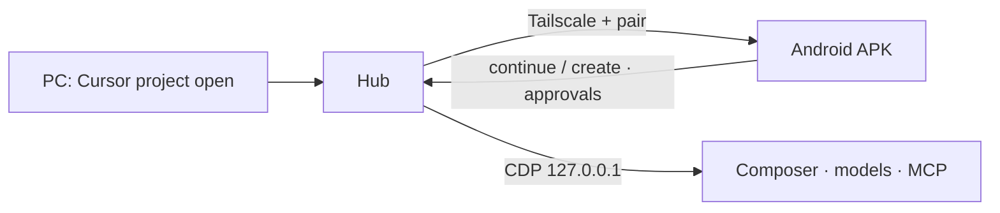

---

## 3. Expo stack (designed)

### 3.1 Runtime and layout

| Item | Designed choice | Notes |
|------|-----------------|-------|
| Framework | **Expo** (managed or Expo + custom native as needed) | Paseo-style daemon + Expo APK shape |
| Platform | **Android only** for v1 | Sideload APK; Play AAB optional later, not the primary artifact |
| Language | TypeScript | Match future Hub TS monorepo |
| Package path | `apps/mobile` | Per architecture repo layout |
| Entry | Expo Router **or** React Navigation root | Either is acceptable; **route names below are canonical** |

### 3.2 Recommended dependency map (designed — not pinned until scaffold)

| Concern | Designed library class | Role |
|---------|------------------------|------|
| UI | React Native + Expo components | Screens and sheets |
| Navigation | Expo Router **or** `@react-navigation/native` + native-stack + bottom-sheet | Graph in §4 |
| HTTP | `fetch` / Expo networking | Hub REST |
| WebSocket | RN WebSocket or equivalent | `WS /ws` live stream |
| Secure storage | `expo-secure-store` (Keystore-backed) | Device pairing token |
| Preferences (non-secret) | `expo-secure-store` for Hub URL **or** AsyncStorage for non-secret Hub MagicDNS only | Prefer SecureStore for Hub URL if treated as sensitive topology |
| QR scan | `expo-camera` / `expo-barcode-scanner` class | Pair screen |
| Safe area / keyboard | `react-native-safe-area-context`, KeyboardAvoidingView | Chat + sheets |
| Markdown / chat | Lightweight markdown renderer (designed) | Assistant bubbles |
| Haptics | Expo Haptics (optional) | Approve / Deny feedback |

Exact versions: **TBD at scaffold** — do not invent lockfile versions here.

### 3.3 What the APK must never contain

| Forbidden in binary / config | Reason |
|------------------------------|--------|
| Cursor API keys / cloud agent keys | Belong on PC Cursor login |
| Remote CDP URL / port as dialable endpoint | CDP is Hub-only on loopback |
| Hard-coded shared pairing secrets | One leak owns every install |
| Cloud analytics keys that upload transcripts | Transcripts stay on PC mesh path |
| Tool / MCP runtime | Tools execute on PC only |

Allowed: Tailscale connectivity (OS), Hub MagicDNS/base URL (user/config), ephemeral pair code, **device token** in secure storage.

### 3.4 Environment / build knobs

| Variable | Required | Description | Status |
|----------|----------|-------------|--------|
| `EXPO_PUBLIC_HUB_URL` | Optional | Build-time default Hub base URL | DESIGNED |
| Runtime Hub URL | Yes (ops) | Set/overridden on Pair screen from MagicDNS | DESIGNED |
| EAS secrets | Yes (release) | Android keystore for signed APK | DESIGNED <!-- VERIFY: EAS project id and keystore names when created --> |

See [CONFIGURATION.md](../../CONFIGURATION.md).

---

## 4. Navigation map

### 4.1 Route catalog

| Route id | Type | Phase | Purpose |
|----------|------|-------|---------|
| `Pair` | Full screen | 0 | Trust phone ↔ Hub |
| `Health` | Full screen | 0 | Prove Hub + CDP + workspace |
| `Home` | Full screen | 0–2 | Project banner + session list |
| `LiveChat` | Full screen | 1 | Continue / post-create live Composer |
| `HistoryRead` | Full screen | 2 | Read-only past session |
| `NewSession` | Modal sheet | 1 | Create session in bound project |
| `FilePicker` | Nested sheet | 1 (basic) / 3 (rich) | Select paths under workspace roots |
| `Approvals` | Inline cards (± stacked modal) | 1 | Approve / Deny PC tool calls |
| `WindowPicker` | Overlay / action sheet | 0–1 | Multi-window workspace select |
| `Editor` | Optional tab / screen | 3 | Browse/attach (FR-070) |

**Screen / surface count (designed): 10** — 5 full screens + 4 overlays/sheets + 1 optional Phase-3 editor.

### 4.2 Mermaid navigation graph

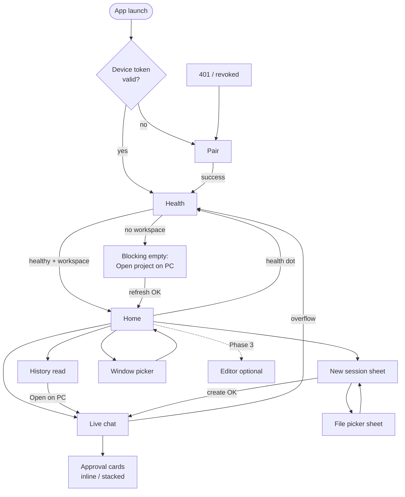

### 4.3 Auth gate

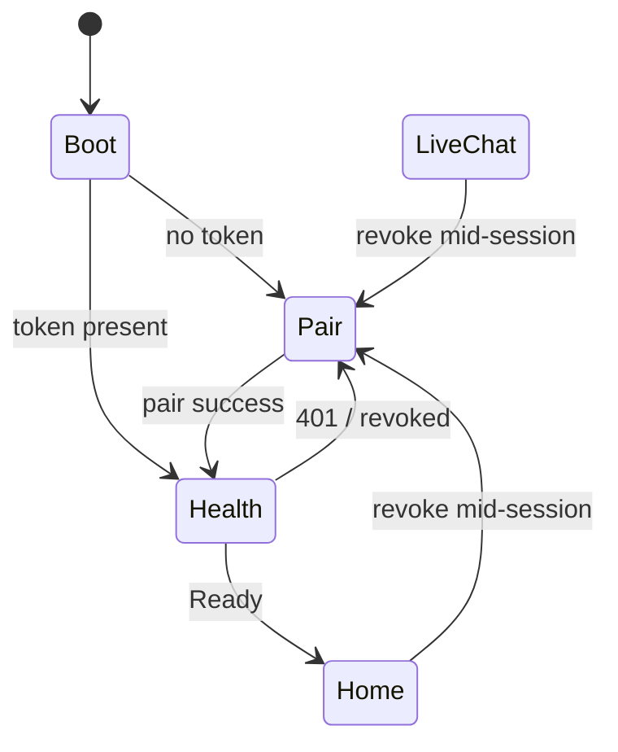

### 4.4 Deep links (designed)

| Link (designed) | Behavior |
|-----------------|----------|
| None required for v1 | No public deep-link scheme for cloud resume |
| Optional later `cursorcompanion://pair?…` | Only over local/QR payload — never embeds CDP |

---

## 5. Shared components

| Component | Used on | Behavior |
|-----------|---------|----------|
| `ProjectBanner` | Home chrome; compact on Live/History headers | Name, path, health dot, optional window chip |
| `HealthDot` | Banner, Health list | Green / yellow / red → tap opens Health |
| `SessionRow` | Home list | Title/preview, relative time, mode badge, optional model |
| `ModeBadge` | SessionRow | `live` \| `history` \| `editor` |
| `ChatBubble` | Live, History | User / assistant / system; streaming cursor on live |
| `ComposerBar` | Live | Text + attach + send; disabled with reason |
| `ApprovalCard` | Live (inline) | Tool name, arg summary, Approve / Deny, status |
| `AttachmentChip` | New session, Live | Relative path; remove on sheet |
| `ToolsSummary` | New session | Read-only “Runs on PC” summary |
| `ModelPicker` | New session | List from `GET /workspace/models` |
| `EmptyState` | Home, Pair, Health, lists | Title, body, primary CTA |
| `ErrorBanner` | Any | Actionable mesh/Hub/CDP/pair errors |
| `LoadingSkeleton` | Lists, chat | Non-blocking placeholders |
| `PrimaryButton` / `SecondaryButton` | Global | Pair, Create, Open on PC, etc. |
| `SheetChrome` | New session, File picker | Grabber, title, Cancel |

Rules:

- Every main surface shows **PC project binding** (banner or header) except Pair (pre-bind) and pure Health diagnostics.
- No component offers “cloud agents,” “remote workers,” or “sign in with Cursor cloud.”

---

## 6. Screen-by-screen wireframes (prose)

### 6.1 Pair — Phase 0

**Purpose:** One-time (or re-pair) trust between this phone and this PC Hub.

**Layout (top → bottom):**

1. **App title** — product name (e.g. “Cursor Companion”) — not a cloud brand login.
2. **Instructions** — Hub must be running on the PC; phone on Tailscale (same private network).
3. **Hub URL field** — MagicDNS hostname + port (prefill from `EXPO_PUBLIC_HUB_URL` if set).
4. **Pair code field** — short code entry.
5. **QR scan control** — secondary path; same `POST /pair/...` payload as code.
6. **Primary CTA:** **Pair**.
7. **After success:** show PC identity label (hostname / Hub name) — not a cloud account — then navigate to Health (or offer “Continue to Health”).

**Does not show:** Cloud login, Cursor OAuth, worker regions, CDP URL field.

**APIs:** `POST /pair/...` → persist device token → optional `GET /health`.

**Empty / loading / error:**

| State | UI |
|-------|-----|
| Loading | Disable Pair; spinner on CTA |
| Invalid code | Inline error; stay on Pair |
| Hub unreachable | “Companion Hub is not reachable — check Tailscale and Hub” |
| Tailscale down | Security copy: private network offline |
| Success | Persist token; go Health |

```mermaid
sequenceDiagram
  participant User
  participant App as APK Pair
  participant Hub
  User->>App: Enter Hub URL + code / scan QR
  App->>Hub: POST /pair/...
  Hub-->>App: Device token
  App->>App: SecureStore token; navigate Health
```

---

### 6.2 Health — Phase 0

**Purpose:** Prove reachability and Cursor automation before chatting.

**Layout:**

1. Title: **Connection health**
2. Checklist rows (see table)
3. **Last refreshed** timestamp + **Refresh**
4. CTA healthy: **Continue to sessions**
5. CTA no workspace: message only — **no** cloud/project picker inventing a folder

| Check | Healthy | Unhealthy copy (designed) |
|-------|---------|---------------------------|
| Hub reachability | `GET /health` OK | “Companion Hub is not running on the PC” |
| Tailscale / network | Private IP reachable | “Private network offline — open Tailscale and join the same network as your PC” |
| CDP / Cursor adapter | Adapter connected | “Cursor not reachable — is Cursor open?” / enable localhost debugging |
| Workspace | Project path present | “Open a project in Cursor on the PC” |
| Pairing | Token accepted | “Pair this phone” / “Access revoked on PC — pair again” |

**APIs:** `GET /health`, `GET /workspace`.

---

### 6.3 Home — Project banner + Session list — Phase 0–2

#### 6.3.1 Project banner (chrome)

**Purpose:** Always answer “which PC project am I in?”

**Shows:**

- Project **name** and **path** from `GET /workspace`
- Optional **roots count** / multi-window control → Window picker
- Compact **HealthDot** (green / yellow / red) → Health
- Pull-to-refresh → reload workspace + sessions

**Edge:** No workspace → **full-screen empty** instead of fake banner: “Open a project in Cursor on the PC.”

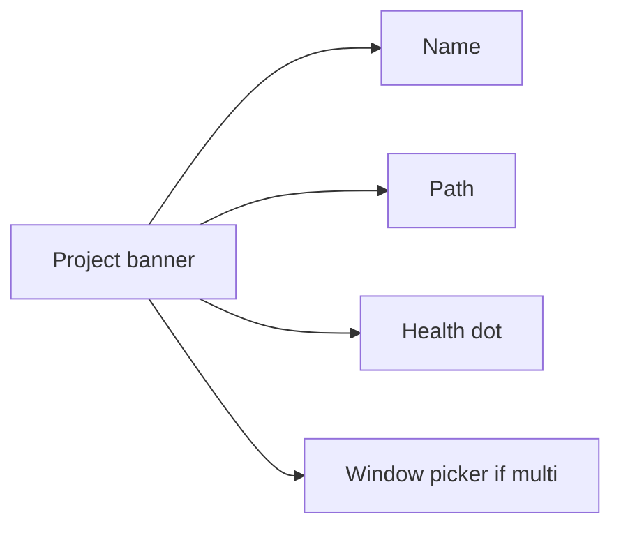

#### 6.3.2 Session list (body)

**Purpose:** List **live** and **history** sessions for the **bound project only**.

**Shows:**

- Sections or filter chips: **Live** | **History** (or unified list with mode badges)
- Row: title/preview, relative time, mode badge, optional model label
- FAB or top button: **New session**
- Tap live → Live chat
- Tap history → History read (with **Open on PC**)

**Does not show:** Cloud Agents list, other machines, sessions from unrelated folders.

**APIs:** `GET /sessions?workspaceId=`, `GET /workspace`.

| State | UI |
|-------|-----|
| Loading | Skeleton rows |
| Empty | “No sessions for this project yet” + New session CTA |
| Error | ErrorBanner + Retry |
| No workspace | Blocking empty (above) |
| Hub yellow/red | Banner still shows last known project if any; disable create when unhealthy |

---

### 6.4 Live chat — Phase 1

**Purpose:** Continue a `live` Composer session on the PC from the phone.

**Layout:**

1. **Header:** short project name · session title · connection state chip
2. **Transcript:** user / assistant messages; streaming indicator on last assistant bubble
3. **Inline ApprovalCards** when tools fire (see §6.7)
4. **ComposerBar:** text field · Attach · Send
5. **Overflow:** Refresh · Jump to Health · End/detach (if Hub supports)

**Input disabled when:** Hub disconnected, CDP down, or session no longer live — show reason text under bar.

**APIs:** `WS /ws`, `GET` transcript (as Hub defines), `POST /sessions/:id/messages`, `POST /sessions/:id/attachments`, `POST /sessions/:id/approvals`.

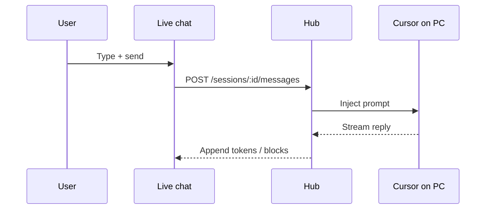

| State | UI |
|-------|-----|
| Loading transcript | Skeleton bubbles |
| Streaming | Trailing cursor / “Thinking…” |
| Reconnecting | Yellow banner; queue outgoing if Phase 4 offline queue; else block send |
| Approval pending | Card(s); composer may stay enabled for text but approvals require explicit tap |
| Session dead | Disable input; offer return Home |

---

### 6.5 History read — Phase 2

**Purpose:** Read a past **local** project session; optionally bring it live on the PC.

**Layout:**

1. Header: project · session title · `history` badge
2. Metadata strip: model used, timestamps, workspace path
3. Read-only transcript (no composer)
4. Sticky CTA: **Open on PC**

**APIs:** session detail GET (Hub/History Index), `POST /sessions/:id/open-on-pc` → navigate to Live chat on success.

| State | UI |
|-------|-----|
| Loading | Skeleton |
| Open-on-PC in progress | Disable CTA; spinner |
| Open-on-PC fail | Actionable error — **no** cloud resume path |
| Empty transcript | “No messages in this session” |

---

### 6.6 New session sheet — Phase 1 (full detail)

**Purpose:** Create a Composer session in the **same PC-open project**. Canonical feature: [new-session-composer.md](../../features/new-session-composer.md).

#### 6.6.1 Regions

| Region | Content |
|--------|---------|
| Header | “New session” + bound project name |
| Model | Required picker from `GET /workspace/models` |
| Attachments | Chips + **Add files** → File picker |
| Tools info | Read-only `GET /workspace/tools` — copy: “Runs on PC” |
| Agent mode | If Cursor exposes more than one (`agent` / `ask` / …) |
| First prompt | Optional multiline |
| Footer | **Cancel** · **Create** |

#### 6.6.2 Validation / enable Create

Create enabled only when:

- Workspace bound and healthy enough for create
- Model selected from current list
- Paths (if any) under roots
- Not currently submitting

**Blocked when:** no workspace, Hub unhealthy, or models failed to load.

#### 6.6.3 Create contract (client)

```json
{
  "workspaceId": "<must match GET /workspace>",
  "model": "<from GET /workspace/models>",
  "attachments": ["src/a.ts", "docs/x.md"],
  "prompt": "optional first message",
  "agentMode": "agent"
}
```

**On success:** dismiss sheet → Live chat for new `sessionId` (`mode=live`).

#### 6.6.4 Edge cases (sheet)

| Case | Expected UI |
|------|-------------|
| No project open | Sheet blocked / CTA disabled; “Open a project in Cursor on the PC” |
| Models empty/stale | “No models available from Cursor on PC”; disable Create until refresh |
| Model unavailable at submit | Toast; force re-pick — **never** fall back to cloud model |
| File outside roots | Reject in picker + Hub error listing paths |
| workspaceId mismatch | Error; refresh `/workspace`; abort |
| CDP / Cursor down | Actionable health error; link Health |
| Empty attachments + empty prompt | **Allowed** — opens live Composer with model only |
| Tools summary empty | Allow create; “No tool summary from PC” |
| Multi-window | Must select correct window before create |

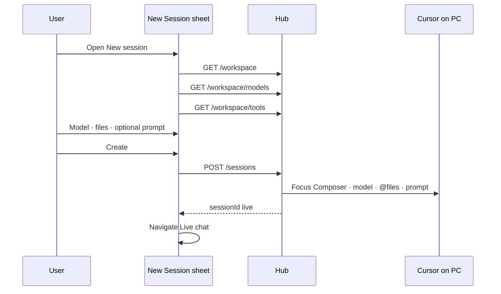

---

### 6.7 Approvals — Phase 1

**Purpose:** Explicit Approve / Deny for tool, plugin, and MCP calls running **on the PC**.

**Presentation:**

- Default: **inline cards** in Live chat transcript stream
- If multiple pending: **stacked modal** or queue of cards — still no silent auto-approve

**Card content:**

- Tool / server name
- Short argument summary (as Hub/adapter provides)
- Status: pending / approved / denied / failed-timeout
- Buttons: **Approve** | **Deny**

**Rules:**

- No silent auto-approve in v1
- Deny must cancel PC-side pending action via `POST /sessions/:id/approvals`
- Timeout / CDP loss → failure state — do not pretend cloud handled it
- Optional “always deny this session” — **not** required in v1

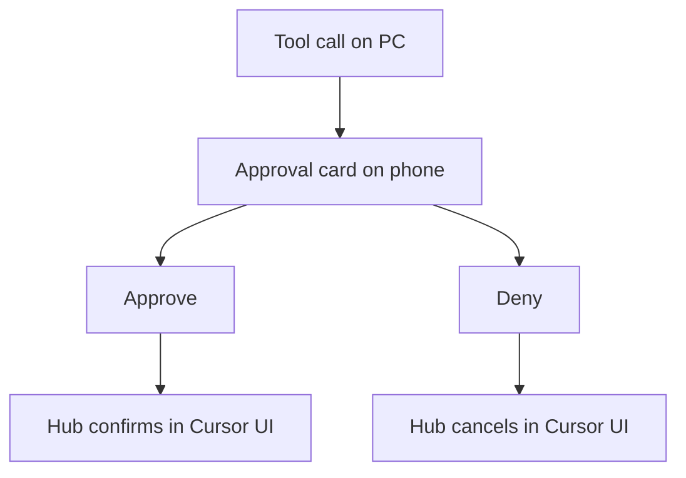

---

### 6.8 File picker sheet — Phase 1 basic / Phase 3 rich

**Purpose:** Multi-select paths under Hub-reported workspace roots for attach.

**Layout:**

1. Search field → `GET /workspace/files?q=`
2. List of relative paths (root label when multi-root)
3. Multi-select checkmarks
4. **Add** → return chips to New session (or Live attach)

**Forbidden:** Phone camera roll as workspace files in v1; rewriting to absolute phone paths.

---

### 6.9 Window picker — Phase 0–1

**Purpose:** When Hub reports multiple Cursor windows/workspaces, user selects which bind applies.

**UI:** Action sheet / radio list of window labels + paths; confirm updates banner and subsequent `workspaceId`.

---

### 6.10 Editor (optional) — Phase 3 · FR-070

**Purpose:** Light browse/attach of project files — **not** a replacement for opening the project on the PC.

**Shows:** Tree or searchable list under roots; open-as-attach or read-only preview.

**Does not:** Edit/save as primary IDE; clone repos; cloud sync.

---

## 7. Empty / loading / error matrix (global)

Aligned with [security-tailscale-linking.md](../../architecture/security-tailscale-linking.md) failure modes:

| Condition | Detection | User-visible state |
|-----------|-----------|-------------------|
| Tailscale down / wrong tailnet | DNS/TCP to Hub fails | Private network offline copy |
| Hub down | Mesh OK; `/health` fail | Hub not running |
| Cursor down | Hub up; attach fail | Open Cursor on the PC |
| No project open | `GET /workspace` empty | Open a project in Cursor on the PC |
| CDP off | Hub cannot attach | Enable remote debugging (localhost only) |
| Unpaired | No token / 401 | Pair this phone |
| Revoked | Token rejected | Access revoked — pair again |
| Ready | health + workspace + auth | Banner + sessions |

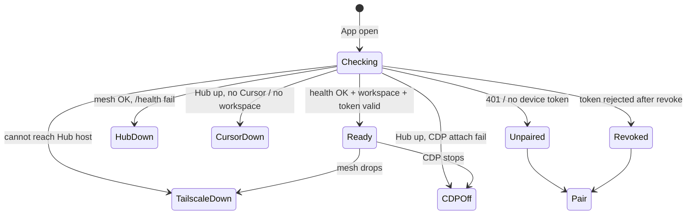

**Never:** silent approval failure; fake empty workspace; cloud fallback CTAs.

---

## 8. Accessibility (designed)

| Requirement | Spec |
|-------------|------|
| TalkBack | All CTAs, chips, badges, health rows have accessible names |
| Approval cards | Announce tool name + “pending approval”; Approve/Deny as buttons |
| Contrast | Text/icons meet WCAG AA against theme backgrounds |
| Dynamic type | Layouts reflow; chat bubbles do not clip critical actions |
| Touch targets | Minimum ~48dp for Pair, Create, Approve, Deny, Send |
| Focus order | Sheet: header → fields → Cancel/Create; Chat: transcript → composer → send |
| Reduced motion | Respect OS setting for sheet animations where feasible |
| Status colors | HealthDot not color-only — include text/label on Health screen |
| Errors | Associated with fields via accessibility hints; not toast-only for Pair |

---

## 9. Offline and reconnect behavior

| Phase | Behavior |
|-------|----------|
| 0–1 | Detect disconnect; show ErrorBanner; disable send/create/approvals that need Hub; **reconnect without re-pair** if token still valid (FR-090) |
| 2 | History read may show last fetched transcript if cached in memory for the session view; no durable offline history DB required on phone |
| 4 | **Offline queue** (FR-091): queue outbound messages/approvals when mesh blips; flush on Ready; never auto-approve while queued |

Phone does **not** run tools offline. Approvals blocked until Hub/CDP Ready again.

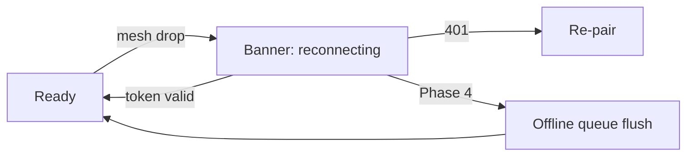

---

## 10. Local storage (tokens only)

| Key | Store | Contents | Lifetime |
|-----|-------|----------|----------|
| `deviceToken` | SecureStore / Keystore | Hub-issued bearer | Until revoke / rotate / clear |
| `hubBaseUrl` | SecureStore or preferences | MagicDNS + port | Until user changes |
| `lastWorkspaceId` | Optional memory/prefs | UX hint only — **must** revalidate with `GET /workspace` | Ephemeral |
| Pair code | Memory only | Never persist | Seconds |

**Must not persist:** transcripts as source of truth, Cursor secrets, CDP URLs, cloud credentials, approval auto-approve flags (none in v1).

On revoke / logout / “Forget this PC”: delete SecureStore keys → Pair.

---

## 11. EAS APK build and signing (designed)

### 11.1 Artifact requirement

| Requirement | Spec |
|-------------|------|
| FR-080 | Expo app deliverable as **sideloadable APK** via EAS |
| Profile | `eas.json` build profile with `"android": { "buildType": "apk" }` |
| Not sufficient alone | AAB-only Play upload without an APK profile |

Designed `eas.json` fragment (from CONFIGURATION.md):

```json
{
  "build": {
    "apk": {
      "android": {
        "buildType": "apk"
      }
    }
  }
}
```

### 11.2 Signing

| Item | Designed practice |
|------|-------------------|
| Keystore | EAS-managed or local upload to EAS secrets |
| Debug vs release | Separate profiles; release signed for sideload |
| CI | Optional later — not required for first operator sideload |
| Versioning | `version` + `android.versionCode` in app config |

<!-- VERIFY: EAS project ID, package name (applicationId), and keystore alias when scaffolded -->

### 11.3 Operator install path

1. `eas build -p android --profile apk` (designed command)
2. Download `.apk`
3. Enable unknown sources as required by Android version
4. Sideload → open → Pair

See [GETTING-STARTED.md](../../GETTING-STARTED.md).

---

## 12. Notifications (designed)

| Capability | v1 decision |
|------------|-------------|
| Push notifications (FCM / Expo push) | **Not required** — avoid cloud push dependency for core path |
| Local notification when approval pending in background | **Optional Phase 4+** — if implemented, must not include tool args secrets in notification body; tap opens Live chat |
| Sound / heads-up for Approve | Prefer in-app card + optional haptic while foregrounded |

**Default for P0–P2:** foreground/in-app approval cards only. No cloud notification service in the product path.

---

## 13. Copy deck (English strings)

Canonical user-facing copy. Implementers should reuse these keys; wording may be lightly edited for length but not for meaning (no cloud language).

### 13.1 Pair

| Key | String |
|-----|--------|
| `pair.title` | Pair with your PC |
| `pair.instructions` | Start the Companion Hub on your PC. Connect this phone to the same Tailscale network, then enter the pair code or scan the QR. |
| `pair.hubUrl` | Hub address |
| `pair.code` | Pair code |
| `pair.cta` | Pair |
| `pair.scanQr` | Scan QR |
| `pair.successPc` | Paired with {hubName} |
| `pair.errorInvalid` | Invalid or expired code. Try again. |
| `pair.errorUnreachable` | Companion Hub is not reachable — check Tailscale and Hub. |

### 13.2 Health / connectivity

| Key | String |
|-----|--------|
| `health.title` | Connection health |
| `health.refresh` | Refresh |
| `health.continue` | Continue to sessions |
| `health.hubOk` | Hub reachable |
| `health.hubFail` | Companion Hub is not running on the PC |
| `health.tsFail` | Private network offline — open Tailscale and join the same network as your PC |
| `health.cdpFail` | Cursor not reachable — is Cursor open? |
| `health.cdpDebug` | Enable remote debugging on this PC (localhost only) |
| `health.noWorkspace` | Open a project in Cursor on the PC |
| `health.unpaired` | Pair this phone |
| `health.revoked` | Access revoked on PC — pair again |

### 13.3 Home / sessions

| Key | String |
|-----|--------|
| `home.emptySessions` | No sessions for this project yet |
| `home.newSession` | New session |
| `home.filterLive` | Live |
| `home.filterHistory` | History |
| `home.badgeLive` | live |
| `home.badgeHistory` | history |
| `banner.noWorkspace` | Open a project in Cursor on the PC |

### 13.4 Live chat / approvals

| Key | String |
|-----|--------|
| `chat.send` | Send |
| `chat.attach` | Attach |
| `chat.inputDisabled` | Cannot send — {reason} |
| `chat.reconnecting` | Reconnecting to Hub… |
| `approval.approve` | Approve |
| `approval.deny` | Deny |
| `approval.pending` | Waiting for your approval |
| `approval.timeout` | Approval timed out — check Cursor on the PC |
| `approval.runsOnPc` | This runs on your PC inside Cursor |

### 13.5 New session

| Key | String |
|-----|--------|
| `new.title` | New session |
| `new.model` | Model |
| `new.modelEmpty` | No models available from Cursor on PC |
| `new.addFiles` | Add files |
| `new.toolsHeader` | Tools & plugins |
| `new.toolsHint` | Runs on PC — you will approve calls on this phone |
| `new.toolsEmpty` | No tool summary from PC |
| `new.prompt` | First prompt (optional) |
| `new.agentMode` | Mode |
| `new.cancel` | Cancel |
| `new.create` | Create |
| `new.blockedNoWs` | Open a project in Cursor on the PC before creating a session |
| `new.errorMismatch` | Workspace changed on the PC — refresh and try again |
| `new.errorOutsideRoots` | Some files are outside the project roots |

### 13.6 History

| Key | String |
|-----|--------|
| `history.openOnPc` | Open on PC |
| `history.openFail` | Could not open this session on the PC |
| `history.readOnly` | Read-only history |

### 13.7 Forbidden marketing copy

Do **not** ship strings that imply: “Cloud Agents,” “Resume in cloud,” “Sign in to Cursor account,” “Pick a remote worker,” “Expose CDP,” “ngrok URL.”

---

## 14. Analytics events (optional · designed)

**Policy:** Optional, privacy-first, **no transcript bodies**, **no cloud product analytics required**. If enabled, prefer local debug logs or Hub-side counters; any phone telemetry must stay off by default.

| Event id | When | Properties (allowed) |
|----------|------|----------------------|
| `pair_success` | Pair OK | — |
| `pair_fail` | Pair error | `reason_class` (invalid_code \| unreachable \| other) |
| `health_refresh` | User taps Refresh | `hub_ok`, `cdp_ok`, `has_workspace` (booleans) |
| `session_open_live` | Open live row | — |
| `session_open_history` | Open history row | — |
| `session_create` | Create success | `has_attachments`, `has_prompt` (booleans only) |
| `session_create_fail` | Create fail | `reason_class` |
| `message_send` | Send OK | — |
| `approval_approve` | Approve tapped | — |
| `approval_deny` | Deny tapped | — |
| `open_on_pc` | History → live OK | — |
| `open_on_pc_fail` | Open on PC fail | `reason_class` |
| `reconnect` | Mesh recovered | — |

**Never log:** message text, file contents, tool argument payloads, device token, pair codes.

---

## 15. Screen → API cheat sheet

| Screen / surface | Primary APIs |
|------------------|--------------|
| Pair | `POST /pair/...` |
| Health | `GET /health`, `GET /workspace` |
| Project banner | `GET /workspace` |
| Session list | `GET /sessions?workspaceId=` |
| Live chat | `WS /ws`, `POST .../messages`, `POST .../attachments` |
| Approvals | `POST .../approvals` (+ WS events) |
| New session sheet | `GET /workspace/models`, `/files`, `/tools`, `POST /sessions` |
| History → live | `POST /sessions/:id/open-on-pc` |
| Window picker | `GET /workspace` (multi-window payload as Hub defines) |

---

## 16. Delivery phases (APK surfaces)

| Surface | Phase |
|---------|-------|
| Pair, Health, Project banner | 0 |
| Live chat, Approvals, New session sheet, Session list (live), APK shell | 1 |
| History + Open on PC in list | 2 |
| Richer file picker / optional Editor | 3 |
| Offline queue, hardened reconnect UX | 4 |

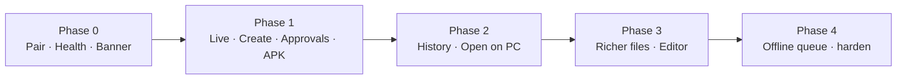

---

## 17. Success criteria (mobile TOR)

- [ ] Every main screen makes the **PC project** binding obvious (banner or header).
- [ ] No screen offers cloud agents or cloud session resume.
- [ ] Approvals are visible and require an explicit tap (no silent auto-approve).
- [ ] New session sheet cannot create against a non-open workspace.
- [ ] SecureStore holds device token; no Cursor/CDP secrets in the APK.
- [ ] EAS profile emits installable `.apk` (`buildType: apk`).
- [ ] Empty/error/loading states match the connectivity matrix (§7).
- [ ] Accessibility labels cover Pair, approvals, and Create.
- [ ] Copy deck contains no cloud marketing language.

---

## 18. Related volumes and handoff

| Volume | Relationship |
|--------|--------------|
| TOR-00 Program | Overall scope |
| TOR-01 Functional | FR expansion |
| TOR-02 Architecture | Containers / C4 |
| TOR-03 Hub & API | Exact JSON schemas |
| TOR-05 Security | Pairing crypto, Tailscale |
| TOR-06 Live adapter | CDP / approvals execution |
| TOR-07 History | Local index backing History read |
| TOR-08 NFR / UAT | Perf, battery, acceptance cases |

**Next agent (when implementing):** Scaffold `apps/mobile` Expo app with Pair → Health → Home shell only (Phase 0), SecureStore token, Tailscale Hub URL — do not invent cloud paths.

**Product locks still true?** Yes.

---

## Appendix A — Capability map (phone)

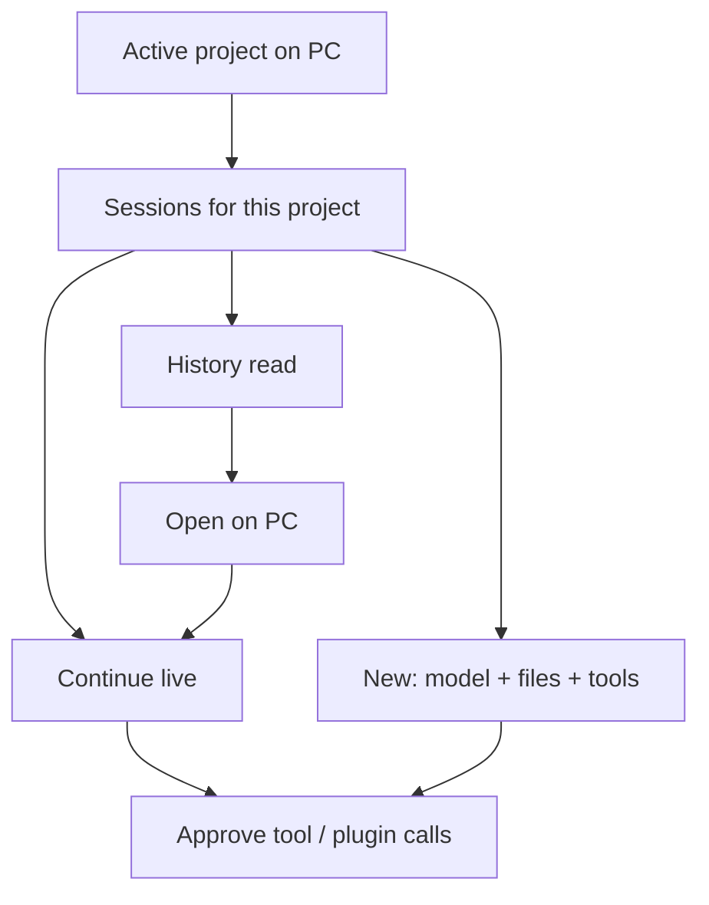

## Appendix B — Intended app tree (future)

```
apps/mobile/
├── app/ or src/navigation/   # routes: Pair, Health, Home, Live, History
├── src/screens/
├── src/components/           # Banner, SessionRow, ApprovalCard, …
├── src/api/                  # Hub REST + WS client
├── src/storage/              # SecureStore wrappers
├── app.json / app.config.ts
└── eas.json                  # apk profile
```

Until this tree exists, this TOR is design-only.
