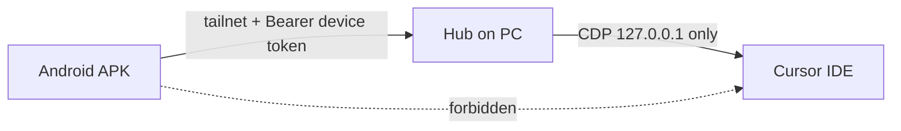
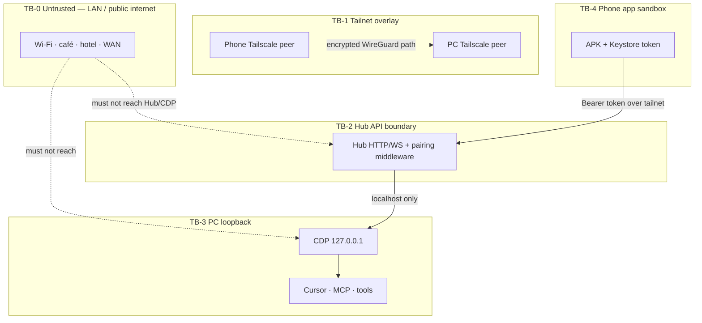
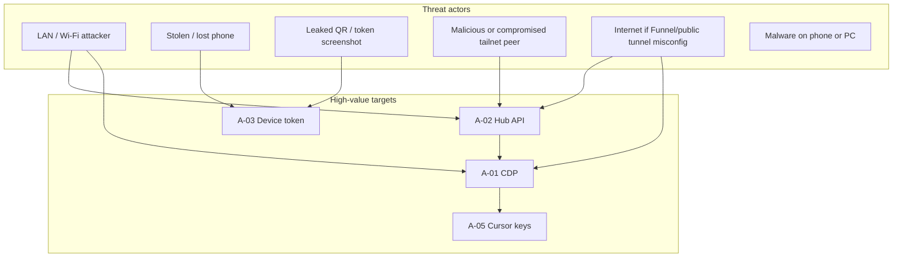
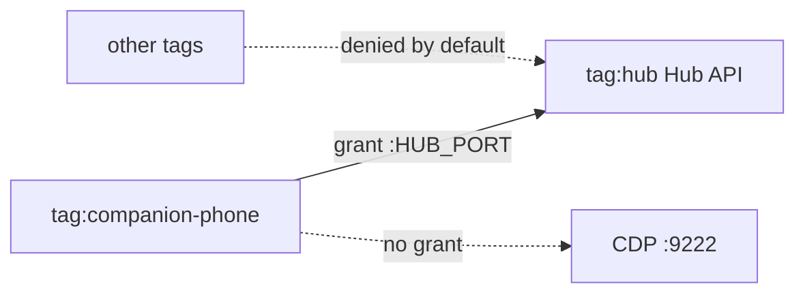
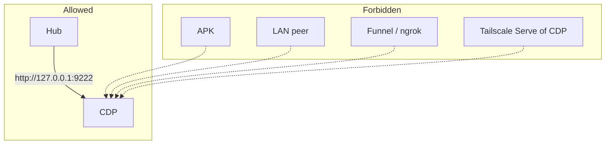
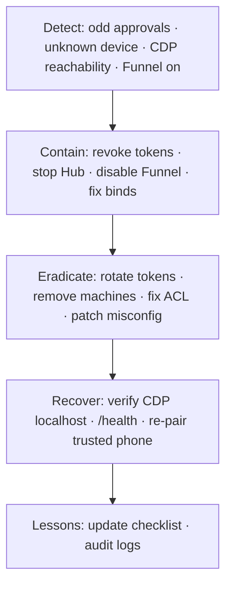
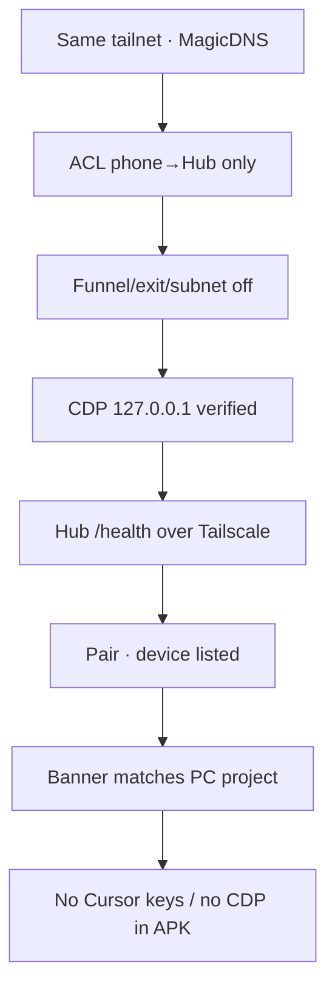

<!-- generated-by: gsd-doc-writer -->
# TOR-05 — Security and Tailscale

**Status:** DESIGNED (not implemented) · **Date:** 2026-09-25  
**Type:** Terms of Reference — security, mesh, pairing, CDP isolation  
**Canonical architecture:** [`docs/architecture/security-tailscale-linking.md`](../../architecture/security-tailscale-linking.md)  
**Research input:** [`docs/reports/tailscale-linking-research-2026-09-24.md`](../tailscale-linking-research-2026-09-24.md)  
**Product locks:** PC-local only · open-project remote · Tailscale + device pairing · CDP `127.0.0.1` only · Expo sideload APK · **no** Cursor Cloud Agents / official Remote Control / public Hub or CDP

This TOR specifies the **designed** security baseline for the PC-local Cursor companion: how the Android APK reaches the Hub over a private Tailscale **tailnet**, how device pairing and tokens work, what must never be exposed, and how operators respond to incidents. Hub/APK code is **not scaffolded**; treat routes, TTLs, and ports as design contracts until implementation lands.

---

## Purpose and scope

| In scope | Out of scope |
|----------|--------------|
| Phone ↔ Hub path over Tailscale (or equivalent WireGuard mesh) | Hardening a fully compromised PC OS |
| Hub auth via pairing + device tokens | Making the APK work without a private mesh |
| CDP bound to loopback; Hub-mediated only | Public tunnels (ngrok, Cloudflare Tunnel, Tailscale **Funnel**) as the product baseline |
| ACLs/grants, revoke, secrets handling, IR | Cloud session catalogs or cloud credentials in the APK |
| Personal / self-hosted operator compliance notes | Multi-tenant SaaS compliance (SOC2 product certification, etc.) |



---

## Assets

| Asset ID | Asset | Sensitivity | Location (designed) |
|----------|-------|-------------|---------------------|
| A-01 | CDP / DevTools endpoint | Critical — full IDE / DOM control | PC loopback only (`127.0.0.1`) |
| A-02 | Hub HTTP + WebSocket API | Critical — sessions, approvals, files | Tailscale IP / MagicDNS + auth |
| A-03 | Device pairing token | High — proves approved phone | Hub store + Android Keystore / EncryptedSharedPreferences |
| A-04 | One-time pairing code / QR payload | High — short-lived enrollment secret | Hub pending store; phone ephemerally |
| A-05 | Cursor / cloud API keys & CLI auth | Critical — account & billing | PC / Cursor login only — **never** APK |
| A-06 | Open workspace contents | High — source, secrets in repo | PC disk; Hub may stream metadata/content under auth |
| A-07 | Tool/plugin/MCP execution surface | Critical — arbitrary PC actions | Cursor on PC; phone Approve/Deny only |
| A-08 | Tailscale machine identity / auth key | High — mesh membership | Tailscale clients + admin console |
| A-09 | Hub paired-device registry | High — revoke source of truth | Hub on PC |
| A-10 | APK Hub base URL (MagicDNS) | Low–medium — locator, not a secret | APK config / pair UI |
| A-11 | Session transcripts (live / history) | High — code + prompts | PC History Index / Cursor; Hub API under auth |
| A-12 | Operator Tailscale admin account | High — ACL and machine control | Tailscale identity provider |

---

## Trust boundaries



| Boundary | What may cross | What must not cross |
|----------|----------------|---------------------|
| TB-0 → TB-1 | Nothing for Hub/CDP (no public publish) | Inbound Hub/CDP from WAN/LAN without Tailscale |
| TB-1 → TB-2 | Authenticated Hub clients (paired tokens) | Unpaired tailnet guests calling session APIs |
| TB-2 → TB-3 | Hub process only → CDP | Phone, other peers, Docker `0.0.0.0` publishes |
| TB-4 | Device token, MagicDNS Hub URL, ephemeral pair material | Cursor API keys, remote CDP URL/port as dialable endpoint |

**Design rule:** Tailscale membership is **necessary but not sufficient**. A compromised guest on the same tailnet must still fail Hub auth without a valid device token ([security-tailscale-linking.md](../../architecture/security-tailscale-linking.md)).

---

## Threat model (STRIDE)

Threat IDs are stable for implementation tracking. Severity: **C**ritical / **H**igh / **M**edium / **L**ow. Controls are **designed** until code exists.



### Spoofing (S)

| ID | Threat | Severity | Primary control (designed) |
|----|--------|----------|----------------------------|
| T-S01 | Attacker on LAN spoofs or scans Hub bound to `0.0.0.0` / LAN IP | C | Hub only on Tailscale IP / MagicDNS path; never public bind |
| T-S02 | Attacker dials CDP as if Hub (remote DevTools) | C | CDP `127.0.0.1` only; never forwarded |
| T-S03 | Stolen phone reuses stored device token | H | Revoke on Hub; OS screen lock; rotatable tokens |
| T-S04 | Leaked QR / pairing code used to enroll attacker device | H | Short TTL, single-use codes; show pending device; operator confirm |
| T-S05 | Tailnet peer without pairing calls Hub as a “paired” phone | H | `PAIRING_REQUIRED=true`; Bearer token on all session APIs |
| T-S06 | APK points at attacker-controlled “Hub” hostname | M | Prefer MagicDNS names operator verified; pin known hostname after pair |
| T-S07 | Stale/cloned Tailscale machine presents duplicate `100.x` identity | M | Re-auth / remove stale machines in admin console |

### Tampering (T)

| ID | Threat | Severity | Primary control (designed) |
|----|--------|----------|----------------------------|
| T-T01 | MITM of Hub traffic on hostile LAN | H | Tailscale WireGuard overlay encrypts peer path; do not use raw LAN |
| T-T02 | Tamper approval payloads (Approve flipped to Deny or reverse) | H | Authenticated API; Hub is source of truth applying approvals on PC |
| T-T03 | Modify attachment paths to escape workspace roots | H | Hub enforces workspace root allowlist on attach |
| T-T04 | Inject CDP commands if CDP reachable off-host | C | Loopback bind; Hub sole CDP client |
| T-T05 | Rewrite pairing pending state on Hub disk | M | PC OS integrity; Hub file permissions; operator-only Hub control plane |
| T-T06 | Downgrade Hub URL from HTTPS-assumed path to cleartext on public path | M | No public path; mesh-only; optional TLS later without changing topology |

### Repudiation (R)

| ID | Threat | Severity | Primary control (designed) |
|----|--------|----------|----------------------------|
| T-R01 | Tool approval/deny without audit trail | M | Hub logs approval events with device id + timestamp (designed) |
| T-R02 | Pairing / revoke without durable record | M | Paired-device registry + revoke audit entries |
| T-R03 | Operator disputes which phone approved a destructive tool | M | Device display name + token id on approval records |
| T-R04 | Silent reconnect after revoke appears as “still paired” | H | Immediate token reject; APK `Revoked` state; re-pair required |

### Information disclosure (I)

| ID | Threat | Severity | Primary control (designed) |
|----|--------|----------|----------------------------|
| T-I01 | CDP exposure leaks IDE state, files, cookies, keys | C | `127.0.0.1` only; ban Serve/SSH/Docker publish of CDP |
| T-I02 | Hub on LAN exposes sessions, files, approvals | C | Tailscale-only reachability |
| T-I03 | Cursor API keys shipped in APK or client config | C | Keys stay on PC; APK never stores them |
| T-I04 | Device tokens in git, CI logs, crash reports | H | Secure storage; redact logs; no tokens in analytics |
| T-I05 | Screenshot / photo of pairing QR | H | Short TTL; single-use; revoke pending codes |
| T-I06 | Unpaired guest on tailnet reads `/workspace` or files | H | Auth gate before workspace/session routes |
| T-I07 | MagicDNS / Hub URL in public issue tracker with live tokens | M | Treat tokens as secrets; URLs alone are locators |
| T-I08 | History transcripts over Hub to wrong device | H | Per-device auth; workspace scoping |
| T-I09 | Funnel / public URL indexes Hub | C | Funnel disabled for Hub/CDP; checklist gate |

### Denial of service (D)

| ID | Threat | Severity | Primary control (designed) |
|----|--------|----------|----------------------------|
| T-D01 | Flood Hub HTTP/WS from compromised phone or peer | M | Rate limits (designed); Tailscale ACL shrinks source set |
| T-D02 | Pairing code brute-force / exhaustion | M | Short codes + rate limit + lockout; single-use |
| T-D03 | Tailscale VPN killed by battery optimizer | M | Document Always-on VPN / whitelist; clear APK error state |
| T-D04 | Exit node enabled drains battery / breaks overlay assumptions | L | Exit node **None** for this use case |
| T-D05 | CDP attach flapping blocks live sessions | M | `/health` distinguishes Hub vs CDP; explicit APK state |
| T-D06 | ACL misconfig blocks legitimate phone | L | Verify grants before go-live; keep admin escape hatch on PC |

### Elevation of privilege (E)

| ID | Threat | Severity | Primary control (designed) |
|----|--------|----------|----------------------------|
| T-E01 | Default allow-all ACL lets any tagged machine hit Hub ports | H | Replace default with least-privilege grants (phone → Hub port) |
| T-E02 | Enabling Tailscale Funnel elevates attacker set to the internet | C | Funnel forbidden for Hub/CDP |
| T-E03 | Subnet router advertises LAN; Hub accidentally reachable beyond peers | H | Skip subnet router for phone+PC both on Tailscale |
| T-E04 | Unpaired access if `PAIRING_REQUIRED=false` | C | Default pairing required |
| T-E05 | Phone token holder approves destructive MCP/tools | H | No silent auto-approve (FR-033); clear approval UX |
| T-E06 | Port-forward CDP via `ssh -L` to another host | C | Operational ban; never document as supported |
| T-E07 | Docker publish CDP/Hub as `0.0.0.0:port` | C | Bind rules + go-live checklist |
| T-E08 | Stolen admin Tailscale account changes ACLs / adds machines | H | MFA on Tailscale identity; machine approval where enabled |

**Threat count:** **40** discrete threats (T-S01–S07, T-T01–T06, T-R01–R04, T-I01–I09, T-D01–D06, T-E01–E08).

### Residual risk (accepted)

| Residual | Why accepted |
|----------|--------------|
| Compromised PC OS | Attacker already has CDP, Cursor, and keys; companion cannot fix host compromise |
| Compromised phone with valid token before revoke | Operator must revoke promptly; OS lock reduces window |
| Operator enables Funnel/ngrok contrary to baseline | Process/checklist + docs; not a soft “cloud optional” product path |

---

## Tailscale setup SOP (step-by-step)

Perform **before** installing or pairing the APK. Both ends must join the **same tailnet**. Prefer [MagicDNS](https://tailscale.com/kb/1081/magicdns) hostnames over raw CGNAT `100.x` addresses. **Subnet routers** and **exit nodes** are not required for Phone → Hub → localhost CDP → Cursor when both devices run Tailscale.

```mermaid
sequenceDiagram
  participant Op as Operator
  participant PC as PC Tailscale
  participant Phone as Phone Tailscale
  participant Admin as Tailnet admin console
  participant Hub as Hub process

  Op->>PC: Install client + sign in
  Op->>Phone: Install client + sign in (same identity/tailnet)
  PC->>Admin: Machine appears
  Phone->>Admin: Machine appears
  Op->>Admin: Enable/confirm MagicDNS; optional tags + ACL/grants
  Op->>Admin: Confirm Funnel off for Hub/CDP
  Phone->>PC: ping MagicDNS / Tailscale IP
  Op->>Hub: Start Hub on Tailscale-reachable bind
  Phone->>Hub: curl GET /health
  Note over Phone,Hub: Only then configure APK Hub URL and pair
```

### Step 1 — Create or use a Tailscale account

1. Use an existing Tailscale account or create one.
2. Prefer MFA on the identity provider used for Tailscale login.
3. Note the admin console: Machines, DNS, Access controls.

### Step 2 — Install Tailscale on the PC

1. Install from [tailscale.com/download](https://tailscale.com/download) (or Linux install script, then `sudo tailscale up`).
2. Sign in to the intended tailnet.
3. Confirm the machine is **Connected** and listed under Machines.
4. Record: MagicDNS name (e.g. `dev-pc` or `dev-pc.<tailnet>.ts.net`) and `tailscale ip -4`.

### Step 3 — Install Tailscale on the Android phone

1. Install Tailscale from Play Store / official download.
2. Sign in to the **same** tailnet / identity.
3. Grant VPN permission; confirm **Connected**.
4. Leave **Exit Node** set to **None** (overlay-only is enough; exit nodes hurt battery and are unrelated to Hub reachability).

### Step 4 — Approve machines (if required)

1. If the tailnet requires machine approval, approve PC and phone in the admin console.
2. Remove stale/cloned machines that may cause duplicate `100.x` issues.

### Step 5 — MagicDNS and DNS preferences

1. Confirm MagicDNS is enabled (on by default for tailnets created on/after 2022-10-20; else enable on DNS admin page).
2. On clients, keep Tailscale DNS accepted (`--accept-dns=true` / OS preference) so MagicDNS resolves.
3. Prefer MagicDNS names in APK Hub URL config for stability across IP churn.

### Step 6 — Optional tags and least-privilege ACL/grants

1. Tag PC as Hub host (e.g. `tag:hub`) and phone as companion (e.g. `tag:companion-phone` or `tag:phone`).
2. Replace default allow-all policy with grants that allow only phone → Hub port (see [ACL examples](#acl-examples)).
3. Do **not** open Hub ports to `autogroup:internet` or Funnel destinations.

### Step 7 — Verify mesh reachability

On PC:

```bash
tailscale status
tailscale ip -4
# optional:
tailscale ping <phone-magicdns-or-ip>
```

From phone (Termux / network tools) or another tailnet node:

```bash
ping <pc-magicdns-or-tailscale-ip>
# After Hub is running:
curl -sS http://<pc-magicdns-or-tailscale-ip>:<hub-port>/health
```

### Step 8 — Explicit bans before APK config

- [ ] Tailscale **Funnel** not enabled for Hub or CDP.
- [ ] No ngrok / Cloudflare Tunnel as the product path.
- [ ] No subnet router required (both ends run Tailscale).
- [ ] Exit node **None** on the phone.
- [ ] CDP not advertised via Tailscale Serve to other devices.

### Step 9 — Only then configure APK and pair

1. Set Hub base URL to MagicDNS + `HUB_PORT`.
2. Complete pairing (QR/code) over Tailscale.
3. Confirm workspace banner matches PC-open project.

**WireGuard self-hosted mesh** is acceptable if it provides: authenticated peer membership, no Hub/CDP on the public internet, and stable private addressing — same security properties as the Tailscale baseline.

---

## ACL examples

Tailscale [ACLs](https://tailscale.com/kb/1018/acls) and [grants](https://tailscale.com/docs/features/grants) are deny-by-default once you replace the default allow-all policy. Prefer **grants** with tags. Edit via Access controls in the admin console. Routes and ACLs are separate: traffic needs both a route and an allow rule.

### Example A — Grants (preferred shape)

Illustrative — replace `8080` with the designed Hub port when scaffolded:

```json
{
  "tagOwners": {
    "tag:companion-phone": ["autogroup:admin"],
    "tag:hub": ["autogroup:admin"]
  },
  "grants": [
    {
      "src": ["tag:companion-phone"],
      "dst": ["tag:hub"],
      "ip": ["8080"]
    }
  ]
}
```

### Example B — Classic ACL stanza (equivalent intent)

```json
{
  "tagOwners": {
    "tag:companion-phone": ["autogroup:admin"],
    "tag:hub": ["autogroup:admin"]
  },
  "acls": [
    {
      "action": "accept",
      "src": ["tag:companion-phone"],
      "dst": ["tag:hub:8080"]
    }
  ]
}
```

### Example C — Explicit denials / hygiene (policy comments)

| Intent | Guidance |
|--------|----------|
| Deny Hub from other tags | Omit grants for `tag:laptop-guest`, IoT, etc. |
| Deny CDP ports on PC from all peers | Do **not** grant `9222` (or CDP port) to any `src`; CDP stays loopback |
| Deny Funnel | Do not add Funnel/HTTPS ingress for Hub |
| Admin break-glass | Keep local console access on PC; Hub control plane is on-host |



---

## Pairing crypto and token lifecycle

Pairing proves “this phone was approved at the PC,” not “anyone on the tailnet.” Designed Hub surface: `POST /pair/...` (Phase 0). Exact crypto primitives (e.g. opaque random tokens vs JWT) are **DESIGNED** — implementers must meet the properties below.

```mermaid
stateDiagram-v2
  [*] --> Unpaired
  Unpaired --> CodePending: Operator starts pair (QR/code)
  CodePending --> Paired: POST /pair success → device token issued
  CodePending --> Unpaired: Code expired / reused / cancelled
  Paired --> Rotating: Token rotation
  Rotating --> Paired: New token active; old invalidated
  Paired --> Revoked: Operator revoke
  Revoked --> Unpaired: APK clears token; re-pair required
```

### Lifecycle stages

| Stage | Hub behavior (designed) | Phone behavior (designed) |
|-------|-------------------------|---------------------------|
| Start pair | Create pending device id + one-time code; render QR | Open pair screen |
| Present code | Code TTL = minutes; single-use | Scan QR or type code |
| Complete pair | Validate code over Tailscale; issue device token; invalidate code | Store token in Keystore / EncryptedSharedPreferences |
| Authenticated use | Require `Authorization: Bearer <device-token>` on workspace/session/WS (except health/pair as designed) | Attach Bearer on API calls |
| Rotation | Issue new token; invalidate previous without full reinstall | Replace stored token |
| Revoke | Mark device revoked; reject token immediately | Show “Access revoked — pair again” |
| Reconnect | FR-090: reconnect without re-pair unless revoked | Retry mesh; keep token if still valid |

### Cryptographic / token properties (requirements)

| Property | Requirement |
|----------|-------------|
| Pairing code entropy | High enough to resist online guessing under rate limits; not a shared static secret |
| Pairing code TTL | Short-lived (minutes); expire unused codes |
| Pairing code use | Single-use; replay rejected |
| Device token | Hub-issued; unpredictable; stored hashed/at-rest protected on Hub |
| Transport | Pair and API only over Tailscale to Hub (same as normal API) |
| Phone storage | Android Keystore-backed / EncryptedSharedPreferences — never plaintext prefs, source, or logs |
| Channel binding | Tailscale membership ≠ authorization; token still required |
| Logging | Never log full tokens or pairing codes; redact `Authorization` |

### Designed API sketch (not implemented)

```http
POST /pair/start          → { pendingDeviceId, expiresAt, qrPayload }
POST /pair/complete       → { deviceId, deviceToken, tokenExpiresAt? }
POST /pair/rotate         → { deviceToken }   # authenticated
POST /pair/revoke         → 204               # operator/local control plane
GET  /pair/devices        → [{ deviceId, name, createdAt, revokedAt? }]
```

Exact paths may nest under `POST /pair/...` as in the architecture; properties above are normative.

---

## CDP exposure bans

CDP is the highest-impact surface: remote debugging equals IDE control.

| Ban | Rationale |
|-----|-----------|
| CDP bind on `0.0.0.0` or LAN IP | Any LAN peer can abuse DevTools |
| Tailscale Serve / Funnel publishing CDP | Elevates CDP to mesh or public |
| `ssh -L` / reverse tunnels of CDP to other hosts | Breaks localhost isolation |
| Docker/publish CDP as host `0.0.0.0:9222` | Same as LAN bind |
| Putting CDP URL/port in APK as a remote endpoint | Phone must never dial CDP |
| ngrok / Cloudflare Tunnel to CDP | Explicitly out of secure baseline |
| Documenting “for convenience” public CDP | Violates product locks |



**Designed default CDP URL:** `http://127.0.0.1:9222` ([CONFIGURATION.md](../../CONFIGURATION.md)). Hub alone opens CDP; phone talks only to Hub (`/health`, `/workspace`, `/sessions`, `/ws`, `/pair/...`).

---

## Secure defaults

| Knob | Designed default | Fail-closed behavior |
|------|------------------|----------------------|
| Mesh | Tailscale (or WG mesh) required | No public / raw-LAN Hub |
| Hub bind | Tailscale IP / MagicDNS-reachable private path | Not `0.0.0.0` |
| CDP bind | `127.0.0.1` only | Live features unavailable if misbound (detect in health) |
| `PAIRING_REQUIRED` | `true` | Unpaired clients get `401` on protected routes |
| Pairing code TTL | Short (minutes) | Expired codes rejected |
| Device token | Rotatable + revocable | Revoked → immediate reject |
| Auto tool approve | Off | Explicit Approve/Deny only (FR-033) |
| Exit node | None | Overlay-only |
| Funnel | Off | Checklist failure |
| Subnet router | Not used for baseline | Phone + PC both run Tailscale |
| APK secrets | No Cursor keys; no remote CDP | Build/review gate |
| Health UX | Explicit states | Never silent failure mid-approval |

---

## Secrets handling

| Secret | Store where | Never store where |
|--------|-------------|-------------------|
| Cursor / cloud API keys | PC Cursor login / OS secret store | APK, git, Expo public env, crash reports |
| Device token | Android Keystore / EncryptedSharedPreferences; Hub hashed registry | Plaintext logs, screenshots, issue trackers |
| Pairing code | Hub pending store (TTL); phone memory during pair | Git, shared hard-coded constants across installs |
| Tailscale auth keys (if used for headless) | Operator secret manager | APK, public docs |
| Hub operator admin actions | Local PC only | Remote unauthenticated HTTP |

**Rules:**

1. No hard-coded pairing secrets shared across installs (one leak owns every user).
2. Redact `Authorization` and pair payloads in Hub and APK logs.
3. CI must not print device tokens or pairing codes.
4. Allowed on phone: MagicDNS Hub URL, ephemeral pair material, issued device token (secure storage only).

---

## Device revoke

```mermaid
sequenceDiagram
  participant Op as Operator on PC
  participant Hub
  participant APK

  Op->>Hub: List paired devices
  Op->>Hub: Revoke deviceId
  Hub-->>Hub: Invalidate token immediately
  APK->>Hub: API call with old Bearer
  Hub-->>APK: 401 Revoked
  APK-->>APK: Clear token; show re-pair
  Note over Op,APK: Optional: rotate all tokens if phone theft suspected
```

| Scenario | Operator action |
|----------|-----------------|
| Lost / stolen phone | Revoke that device on Hub; optionally rotate all tokens; enable Find My Device / wipe if available |
| Leaked QR before complete | Cancel pending pair / expire codes; do not leave pending open |
| Suspected token exfil | Revoke device; rotate; review approval audit log |
| Replaced phone | Revoke old device; pair new phone |
| Tailnet guest misbehavior | Tighten ACL/grants; revoke Hub devices; remove guest machine from tailnet |

APK must surface **Revoked** distinctly from generic Unpaired (see failure states in architecture security doc).

---

## Incident response



### Severity triage

| Severity | Examples | Immediate actions |
|----------|----------|-------------------|
| Sev-1 | CDP reachable off-host; Funnel/public Hub; active unknown approvals | Stop Hub if needed; bind-fix CDP; disable Funnel; revoke all devices; rotate tokens |
| Sev-2 | Stolen phone; leaked token; unpaired access bug | Revoke device(s); force re-pair; review recent approvals |
| Sev-3 | ACL too open; MagicDNS confusion; exit node left on | Tighten grants; correct DNS/VPN settings; document |

### Playbook snippets

1. **Suspected CDP exposure:** From another host, confirm CDP port is unreachable; fix Cursor launch bind; restart Hub; verify `GET /health` CDP status.
2. **Stolen phone:** Hub revoke → confirm `401` → optional wipe phone → re-pair replacement.
3. **Leaked pairing QR:** Invalidate pending codes; review whether pair completed; revoke if a strange device enrolled.
4. **Malicious tailnet peer:** Remove machine; tighten grants to `tag:companion-phone` only; audit Hub access logs.

---

## Checklist for go-live

Use for every new PC or phone before relying on the companion for real work.



### Mesh and ACL

- [ ] Tailscale installed and logged in on **PC** and **phone** (same tailnet).
- [ ] Machines approved (if required); no duplicate/stale nodes.
- [ ] MagicDNS resolves; `ping` / Tailscale ping OK.
- [ ] Grants/ACL: only companion phone tag → Hub port; CDP ports not granted to peers.
- [ ] Funnel **off** for Hub/CDP; exit node **None** on phone; subnet router not required.

### Host and CDP

- [ ] Cursor running with intended **project open**.
- [ ] CDP listening on **`127.0.0.1` only** (not reachable from another host).
- [ ] Hub started; Hub attaches to CDP on localhost only.
- [ ] No Docker/`0.0.0.0` publish of Hub or CDP.

### Auth and APK

- [ ] `GET /health` succeeds from phone **over Tailscale** (not LAN IP).
- [ ] Pairing completed; device appears in Hub paired-device list.
- [ ] APK shows **active workspace** banner matching PC project.
- [ ] Unpaired test client cannot call session APIs (`401`).
- [ ] Revoke test: revoked device rejected; APK shows re-pair.
- [ ] Confirmed: no Cursor/cloud keys and no remote CDP URL in APK settings.
- [ ] Tool approvals require explicit Approve/Deny (no silent auto-approve).

---

## Compliance notes (self-hosted personal use)

This product is designed for **personal / self-hosted** operators remoting their own PC over a private mesh — not a multi-tenant cloud service.

| Topic | Designed posture |
|-------|------------------|
| Data residency | Session content and workspace files stay on the operator’s PC; phone receives only what Hub API returns over the tailnet |
| Processor roles | Operator is controller of their own machine; Tailscale is a mesh connectivity provider for overlay networking |
| Credentials | No Cursor cloud credentials in the APK; reduces third-party credential sprawl on mobile |
| Encryption in transit | Tailscale uses WireGuard-based encryption between peers for the overlay path |
| Encryption at rest | Device tokens in platform secure storage (designed); Hub registry on PC disk under OS user permissions |
| Access control | Dual control: tailnet membership **and** Hub device pairing/revoke |
| Logging / retention | Local Hub audit of pair/revoke/approvals (designed); operator-managed retention — no cloud session catalog |
| Breach notification | Personal use: operator-driven IR playbook above; no automated regulatory filing implied by this TOR |
| Third-party subprocessors | Avoid adding public tunnel vendors to the baseline path |
| Not a compliance certification | This TOR does **not** claim SOC 2, ISO 27001, HIPAA, or GDPR “adequacy” for a commercial SaaS — it is an engineering baseline for private personal deployment |

Operators in regulated environments should treat the companion as **remote access to a development workstation** and apply their own endpoint, MDM, and data-handling policies on top of this baseline.

---

## Failure modes (security-relevant UX)

Aligns with FR-003 and architecture failure states:

| Condition | Security relevance | APK state (designed) |
|-----------|--------------------|----------------------|
| Tailscale down / wrong tailnet | No Hub path | Private network offline |
| Hub down | No auth surface | Companion Hub not running |
| Unpaired / bad token | Auth gate working | Pair this phone |
| Revoked | Containment succeeded | Access revoked — pair again |
| CDP off / not localhost | Prevents unsafe fallback to remote CDP | Enable localhost debugging on PC |

Never fail silently on approvals if mesh or CDP drops mid-session — block or queue until `Ready`.

---

## References

| Document | Role |
|----------|------|
| [security-tailscale-linking.md](../../architecture/security-tailscale-linking.md) | Accepted security architecture |
| [tailscale-linking-research-2026-09-24.md](../tailscale-linking-research-2026-09-24.md) | Tailscale install, MagicDNS, ACL, exit/subnet guidance |
| [AGENT-CONTEXT.md](../../architecture/AGENT-CONTEXT.md) | Product locks and Hub API sketch |
| [functional-requirements.md](../../architecture/functional-requirements.md) | FR-001–004, FR-033, FR-090 |
| [CONFIGURATION.md](../../CONFIGURATION.md) | Designed env knobs (`CDP_URL`, pairing) |
| [GETTING-STARTED.md](../../GETTING-STARTED.md) | Operator order of operations |
| [Tailscale MagicDNS](https://tailscale.com/kb/1081/magicdns) | Stable hostnames |
| [Tailscale ACLs](https://tailscale.com/kb/1018/acls) | Access policy |
| [Tailscale grants](https://tailscale.com/docs/features/grants) | Preferred allow rules |
| [Tailscale subnet routers](https://tailscale.com/kb/1019/subnets) | Usually not needed here |
| [Tailscale exit nodes](https://tailscale.com/kb/1103/exit-nodes) | Not required; battery cost on mobile |

---

## Decision line

**Phone reaches Hub only over a private Tailscale (or WireGuard) mesh with device pairing tokens; CDP never leaves `127.0.0.1`; Funnel/public tunnels/LAN binds are forbidden; revoke and explicit approvals are mandatory. Status: DESIGNED — not implemented.**
