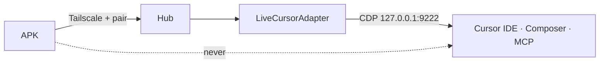
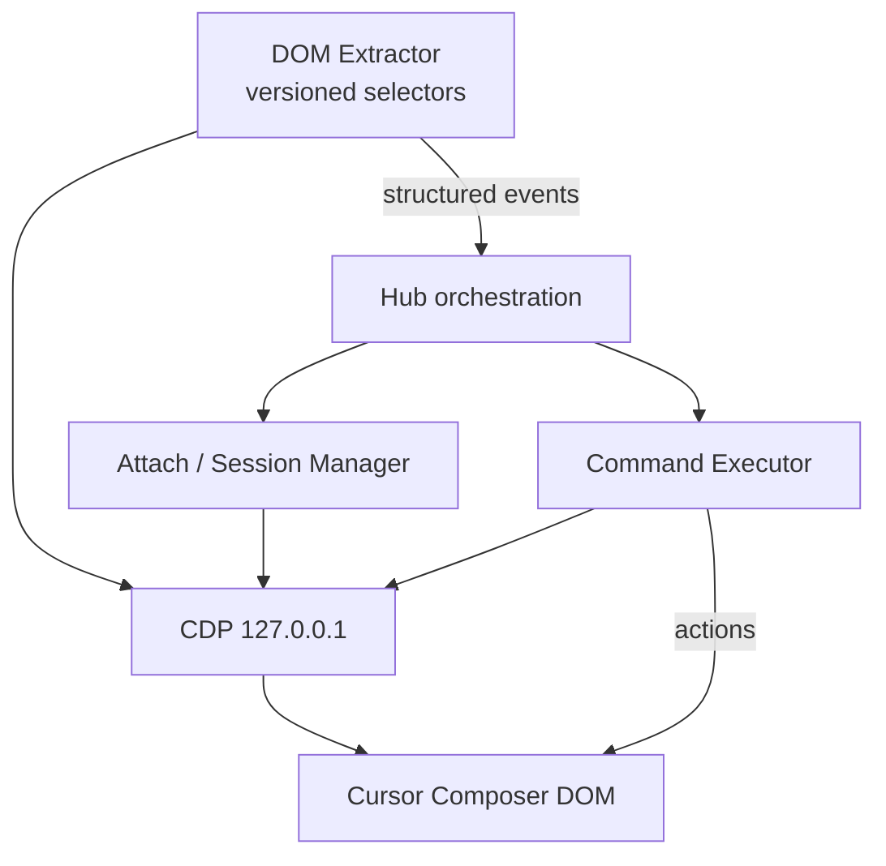
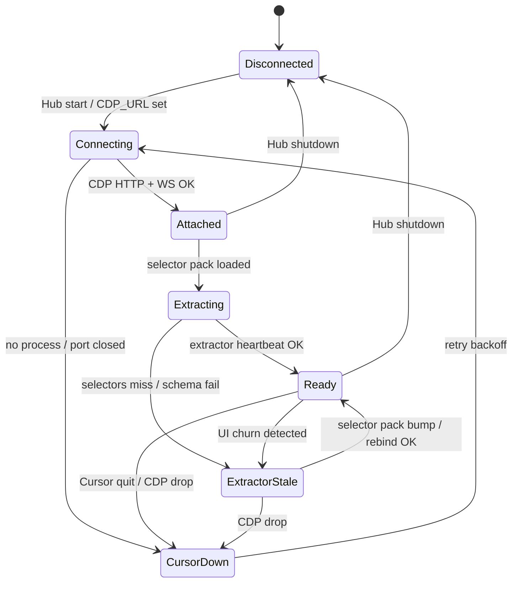
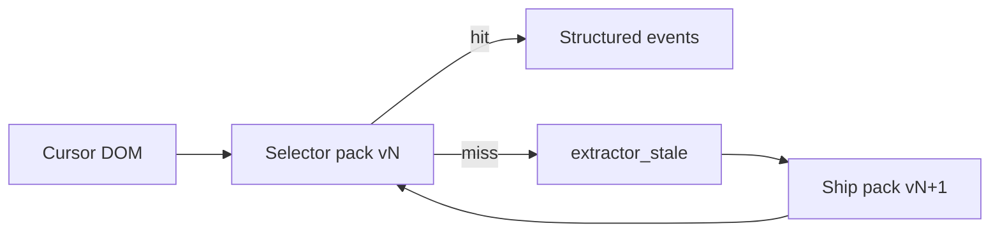
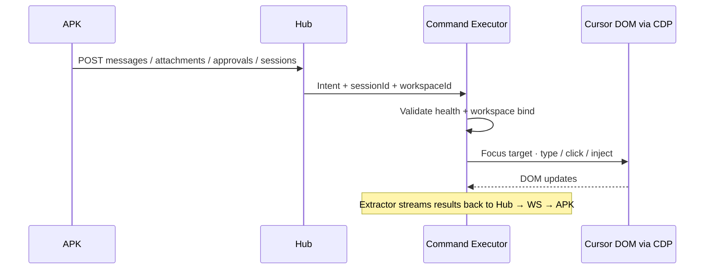
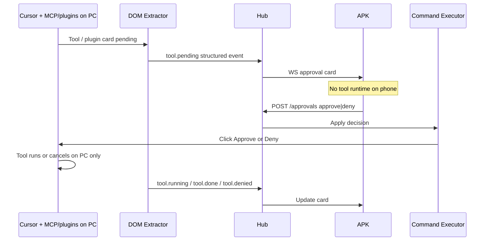
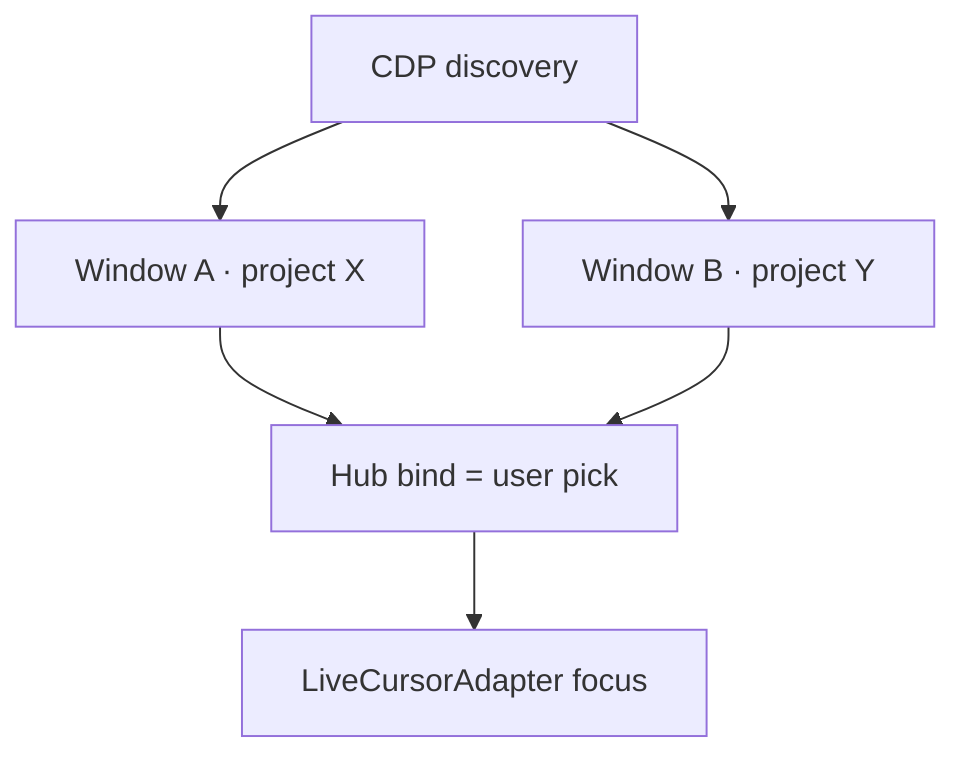
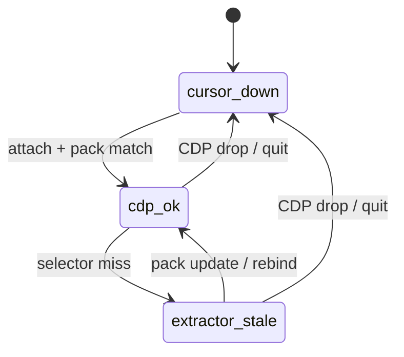
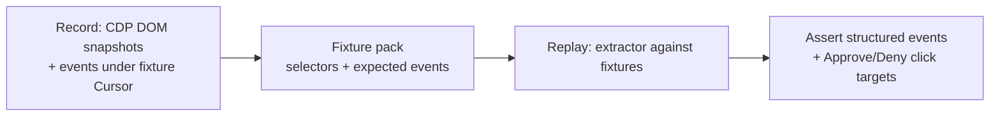
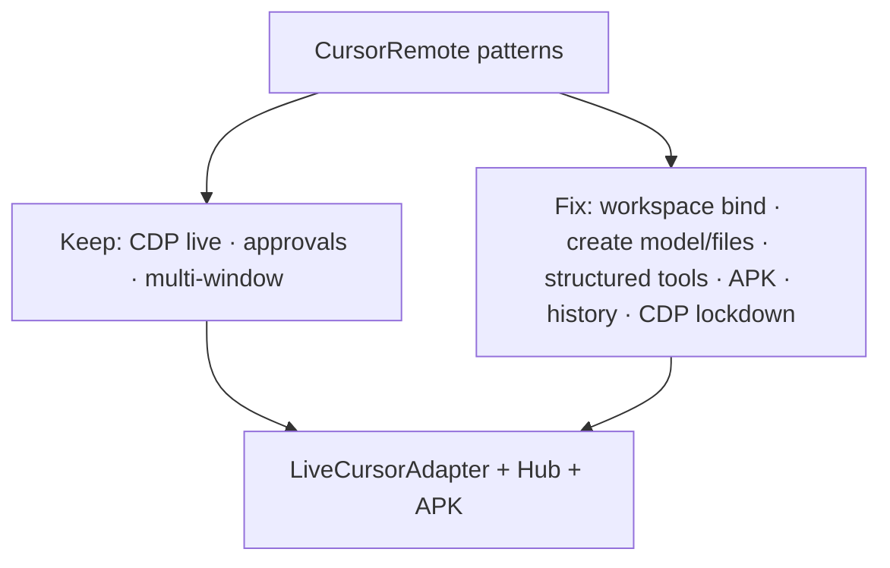

<!-- generated-by: gsd-doc-writer -->
# TOR-06 — LiveCursorAdapter (CDP · selectors · approvals)

**Volume:** 06 of 00–08 · **Owner role:** Live Adapter Engineer  
**Status:** **DESIGNED** — no `adapters/live/` package in repo · docs ≠ code  
**Locks:** PC-local only · open-project remote · tools/plugins on PC · phone Approve/Deny · CDP `127.0.0.1` only · Tailscale + pairing · Expo APK  

**Canonical compact design:** [`../../architecture/mobile-cursor-companion.md`](../../architecture/mobile-cursor-companion.md) · [`../../architecture/AGENT-CONTEXT.md`](../../architecture/AGENT-CONTEXT.md)  
**Gap matrix:** [`../gap-closure-hybrid-system-2026-09-24.md`](../gap-closure-hybrid-system-2026-09-24.md) · **Research:** [`../../../research/cursor-mobile-remote-ide-oss.md`](../../../research/cursor-mobile-remote-ide-oss.md)  
**Upstream pattern (borrow, do not fork as product):** [CursorRemote](https://github.com/len5ky/CursorRemote)

---

## Purpose

This TOR specifies the **LiveCursorAdapter** — the PC-side component that attaches to Cursor via Chrome DevTools Protocol (CDP), extracts Composer/agent UI state from the DOM, and executes Hub commands (send message, model select, file-attach injection, Approve/Deny for tools/plugins/MCP).

The phone never dials CDP. The Hub is the only process allowed to open `http://127.0.0.1:9222` (designed default). LiveCursorAdapter is the Hub’s exclusive client of that loopback endpoint.



---

## Scope and non-scope

| In scope (DESIGNED) | Out of scope |
|---------------------|--------------|
| CDP attach to Cursor on this PC | Phone → CDP, public CDP, ngrok/Funnel to CDP |
| DOM extract + versioned selectors for Composer | Reimplementing MCP/tools on the phone |
| Command executor: message, model, attach, Approve/Deny | Cloud Agents / official Remote Control |
| Multi-window discovery and bind to Hub workspace | Opening arbitrary folders from the phone (v1) |
| Health: `cdp_ok` / `extractor_stale` / `cursor_down` | History Index (see TOR-07) |
| Record/replay harness for selectors (designed) | Shipping a Telegram/browser client as the product UI |

---

## CDP prerequisites

### Launch requirement

Cursor must be started with remote debugging enabled. Designed default:

| Item | Designed value |
|------|----------------|
| Flag | `--remote-debugging-port=9222` |
| Bind | **Loopback only** (`127.0.0.1`) — never `0.0.0.0` / LAN |
| Hub config | `CDP_URL=http://127.0.0.1:9222` ([`CONFIGURATION.md`](../../CONFIGURATION.md)) |

```bash
# DESIGNED operator sketch — exact Cursor binary/flags TBD at scaffold
# Confirm listeners are loopback-only before pairing phones
# CDP URL: http://127.0.0.1:9222
```

<!-- VERIFY: Exact Cursor desktop launch flags per OS (Linux/macOS/Windows) at scaffold time -->

### Preconditions before attach

1. Cursor process is running with CDP listening on loopback.
2. At least one window exists; for product use, a **folder/workspace is open** (Hub workspace bind — Phase 0).
3. Hub can open a TCP connection to `CDP_URL` without leaving the PC.
4. CDP is **not** published on Tailscale Serve, SSH remote forward to other hosts, or Docker `0.0.0.0`.

### Security invariants (cross-ref TOR-05 / security doc)

| Rule | Meaning |
|------|---------|
| CDP localhost only | Full IDE remote-debug power stays on the PC |
| Hub-mediated | APK never stores or dials a remote CDP URL |
| Mesh for Hub only | Phone ↔ Hub over Tailscale; Hub ↔ CDP on loopback |

Detail: [`../../architecture/security-tailscale-linking.md`](../../architecture/security-tailscale-linking.md).

---

## Component architecture

LiveCursorAdapter (planned path: `adapters/live/`) splits into three designed layers:

| Layer | Responsibility |
|-------|----------------|
| **Attach / Session Manager** | CDP connect, target discovery, window bind, reconnect, health emission |
| **DOM Extractor** | Poll/observe Composer DOM; emit structured events (messages, tool cards, model, plan) via **versioned selectors** |
| **Command Executor** | Apply Hub intents: type/send prompt, Approve/Deny, model select, inject `@file` refs |



Hub maps HTTP/WS routes to adapter methods (designed):

| Hub surface | Adapter responsibility |
|-------------|------------------------|
| `GET /health` (CDP slice) | Report attach + extractor health |
| `GET /workspace` | Resolve bound window → path/roots |
| `GET /sessions?workspaceId=` (live) | List live Composer/agent tabs for workspace |
| `POST /sessions` | Create/focus Composer; model + attach + optional prompt |
| `POST /sessions/:id/messages` | Inject user message |
| `POST /sessions/:id/attachments` | Inject additional `@file` refs |
| `POST /sessions/:id/approvals` | Click Approve or Deny on pending tool UI |
| `POST /sessions/:id/open-on-pc` | Focus/reopen Composer context (with History Index) |
| `WS /ws` | Stream extractor events to APK |

---

## Attach lifecycle



### Designed steps

1. **Resolve endpoint** — Read `CDP_URL` (default `http://127.0.0.1:9222`).
2. **Probe** — `GET /json/version` (or equivalent CDP discovery). Failure → `cursor_down`.
3. **List targets** — Discover Cursor windows / pages (CursorRemote-class: parallel window monitor).
4. **Bind workspace** — Match Hub’s bound `workspaceId` / open folder; reject create/continue against other folders (v1).
5. **Attach debugger** — Open CDP session to the chosen target.
6. **Load selector pack** — Activate versioned extractor schema for current Cursor UI generation.
7. **Subscribe** — Start DOM observation / polling; emit live session rows + stream events.
8. **Command gate** — Accept Hub commands only while health allows (see [Health states](#health-states)).
9. **Detach** — On Hub stop or Cursor exit: close CDP sockets; clear live session maps; surface health to APK.

### Reconnect (designed)

- Transient CDP blip: exponential backoff reconnect **without** forcing phone re-pair (FR-090).
- After reconnect: re-discover windows, re-bind workspace, re-attach extractor; do not invent transcript from cloud.
- Pending approvals: **block** auto-apply until `Ready`; never silent-approve (FR-033).

---

## DOM extractor responsibilities

The extractor turns Cursor’s Composer/agent DOM into **structured Hub events**. It does not forward raw HTML to the phone.

### Event classes (designed)

| Event | Meaning | Hub / APK use |
|-------|---------|---------------|
| `message.user` / `message.assistant` | Chat turns (streaming deltas allowed) | Live transcript |
| `tool.pending` | Tool / plugin / MCP call awaiting decision | Approval card |
| `tool.running` / `tool.done` / `tool.denied` | Lifecycle after decision | Status on card |
| `model.current` | Active model label as UI exposes | Banner / create confirmation |
| `plan.*` | Plan modal / steps if present | Optional rich card (Phase 1+) |
| `session.meta` | Tab/session identity, title | Session list |
| `extractor.health` | Pack version, match confidence | `/health` |

### Versioned selectors (DESIGNED)

Selectors are a **versioned pack**, not hard-coded one-off strings in call sites.

| Concept | Designed rule |
|---------|---------------|
| Pack id | e.g. `cursor-ui@YYYY.MM` or semver tied to observed Cursor build |
| Contents | CSS / ARIA / role / text heuristics per target (composer input, send, model picker, tool Approve/Deny, attach chip, window title) |
| Fallback chain | Prefer stable ARIA/role → data attributes → structural CSS → last-resort text |
| Stale detection | Required nodes missing N consecutive polls → `extractor_stale` |
| Update path | Ship new pack without Hub API break; Phase 4 hardens packs (FR-091) |



### Workspace / window metadata

Extractor (with Session Manager) must surface enough for Hub bind:

- Window id / CDP target id  
- Workspace path / name / roots (as discoverable via CDP or VS Code API bridge)  
- Live Composer/agent tab identities for that workspace  

If no folder is open → Hub empty state; adapter must not fabricate a workspace.

---

## Command executor

All mutations go through the executor. Phone intents arrive only via Hub.



### Send message

| Step | Designed behavior |
|------|-------------------|
| Input | `POST /sessions/:id/messages` body text |
| Preconditions | Health `cdp_ok` + extractor not blocking commands; session live; workspace match |
| Actions | Focus Composer input → set value (CDP `Input` / DOM) → trigger Send |
| Failure | Return actionable error; do not partial-send silently |

### Model select

| Step | Designed behavior |
|------|-------------------|
| Input | Create body `model` or live change when UI allows |
| Source list | `GET /workspace/models` (models Cursor exposes locally) |
| Actions | Open model picker → select matching option |
| Limits | If UI cannot change mid-session, report capability; never substitute a cloud model |

### File attach injection

| Step | Designed behavior |
|------|-------------------|
| Input | `attachments[]` on create or `POST /sessions/:id/attachments` |
| Validation | Paths under Hub-reported workspace roots only |
| Actions | Inject `@path` refs (or Cursor’s current attach UX equivalent) into Composer |
| Rejection | Paths outside roots rejected at Hub and again at executor |

### Approve / Deny (tools · plugins · MCP)

See [PC tools and plugin approvals](#pc-tools-and-plugin-approvals) for the full contract. Executor maps:

| Hub body (designed) | DOM action |
|---------------------|------------|
| `{ decision: "approve", toolCallId }` | Activate Approve / Continue control for that card |
| `{ decision: "deny", toolCallId }` | Activate Deny / Cancel; **must** take effect on PC (FR-031) |

No executor path may auto-approve because the phone is offline or reconnecting.

### Create / focus Composer

| Step | Designed behavior |
|------|-------------------|
| Input | `POST /sessions` with `{ workspaceId, model, attachments[], prompt?, agentMode? }` |
| Actions | Focus bound window → open/focus Composer → set agent mode if exposed → model → attach → optional first prompt |
| Reject | `workspaceId` ≠ PC-open project |

---

## PC tools and plugin approvals

**Product lock:** Tools, plugins, and MCP servers run **inside Cursor on the PC**. The phone is chat + **Approve / Deny** only (FR-060–062, FR-033).

### Informational vs execution

| Phase | Surface | Adapter role |
|-------|---------|--------------|
| Before create | `GET /workspace/tools` summary | Best-effort detect enabled MCP/tools/plugins for read-only sheet |
| After create / live | Structured `tool.pending` events | Extract tool name, args summary, risk cues from DOM — **not** opaque HTML dump |
| Decision | `POST /sessions/:id/approvals` | Click PC UI Approve or Deny |



### Structured approval card (DESIGNED fields)

| Field | Purpose |
|-------|---------|
| `toolCallId` | Stable id for Approve/Deny round-trip |
| `name` | Tool / MCP / plugin display name |
| `summary` | Short human-readable args / plan step |
| `source` | `tool` \| `mcp` \| `plugin` (as detectable) |
| `sessionId` / `workspaceId` | Scope guards |
| `status` | `pending` \| `running` \| `done` \| `denied` \| `error` |

This is the gap-closure fix vs CursorRemote’s **opaque DOM** tool presentation ([gap-closure](../gap-closure-hybrid-system-2026-09-24.md)).

### Hard rules

1. **No silent auto-approval** on the phone path (FR-033).  
2. **Deny must affect the PC** — executor verifies UI advanced past the pending state.  
3. **If `extractor_stale` or `cursor_down`**, queue or block approvals with explicit UX — do not guess.  
4. **Phone never hosts MCP** or plugin hosts (FR-061).  
5. Tools summary empty still allows create; approvals appear when tools fire later.

---

## Multi-window

CursorRemote monitors multiple windows via separate CDP connections. We borrow that pattern; we add **workspace bind**.

| Behavior | Designed |
|----------|----------|
| Discovery | List all Cursor CDP targets / windows in parallel |
| Selection | User (or Hub default) picks window/workspace for bind (FR-014 P1; usable in Phase 1–2) |
| Filtering | Live sessions listed only for selected bound workspace |
| Switch | Changing window rebinds Hub `/workspace` banner; in-flight commands target the new bind |
| Safety | Never merge chats across unrelated folders into one list |



---

## Health states

Adapter contributes a CDP/extractor slice to `GET /health` (FR-004). Designed enum for the live path:

| State | Meaning | Commands | APK UX (designed) |
|-------|---------|----------|-------------------|
| **`cdp_ok`** | CDP attached; selector pack matching; stream healthy | Allowed | Live chat + approvals enabled |
| **`extractor_stale`** | CDP up but selectors miss / schema drift | Mutations blocked or degraded read-only | “Cursor UI changed — update companion / wait for selector pack” |
| **`cursor_down`** | No Cursor process, CDP port closed, or attach failed | Blocked | “Open Cursor on the PC” / “Enable remote debugging (localhost only)” |



Hub may compose broader UX states (Tailscale down, Hub down, unpaired) around this slice — see security linking doc. Live adapter **owns** only CDP/extractor/cursor process signals.

Designed `/health` fragment (illustrative):

```json
{
  "liveAdapter": {
    "state": "cdp_ok",
    "cdpUrl": "http://127.0.0.1:9222",
    "selectorPack": "cursor-ui@2026.09",
    "windowId": "...",
    "workspaceId": "..."
  }
}
```

---

## Resilience to Cursor UI changes

CDP/DOM relay is inherently brittle. Designed mitigations:

| Mitigation | Phase |
|------------|-------|
| Versioned selector packs + explicit `extractor_stale` | 1 (basic) · 4 (harden) |
| Prefer ARIA/role over fragile CSS | 1+ |
| Record/replay fixtures for pack CI | Designed (below) |
| Feature capability flags (e.g. model-change unsupported) | 1 |
| Never fail open on approvals | Always |
| Offline / command queue when mesh/CDP blips | FR-091 Phase 4 |
| Document operator recovery: update Hub/adapter, restart Cursor with CDP | Ops |

Out of scope as primary strategy: full VNC mirroring (product gap is session identity + approvals, not whole IDE pixels).

---

## Testing — record / replay (DESIGNED)

No live Cursor required for every CI run. Designed harness:



| Mode | Purpose |
|------|---------|
| **Record** | Against a known Cursor build: capture DOM slices for composer, tool cards, model picker, multi-window titles |
| **Replay** | Unit/integration tests load fixtures; extractor must emit expected structured events |
| **Command dry-run** | Executor maps intents to expected click/type sequences against recorded targets (no live IDE) |
| **Live smoke** | Manual/Phase gate: real CDP on loopback only |

Selector pack PRs must update fixtures when Cursor UI drifts. Failing replay → `extractor_stale` behavior in production if pack mismatch detected at runtime.

---

## Risks of CDP

| Risk | Impact | Designed control |
|------|--------|------------------|
| **Full IDE control if exposed** | Remote attacker drives Cursor like a debugger | Bind `127.0.0.1` only; never Tailscale-forward CDP; APK has no CDP URL |
| **DOM selector churn** | Live path breaks after Cursor update | Versioned packs; `extractor_stale`; Phase 4 harden; record/replay |
| **Incorrect Approve click** | Wrong tool runs or deny ignored | Structured `toolCallId`; verify post-click state; no silent approve |
| **Cross-window mix-up** | Prompt/approval hits wrong project | Explicit window bind + workspaceId checks |
| **Transcript incompleteness** | Missed messages vs on-PC UI | Heartbeat + stale detection; do not claim cloud completeness |
| **Performance / polling load** | High CPU from multi-window poll | Tunable poll; prefer mutation observers where possible |
| **Unsupported Electron quirks** | CDP attach flaky per OS | Documented smoke matrix; clear `cursor_down` |
| **False sense of “API”** | Treating DOM as stable contract | TOR + FR-091 acknowledge fragility; packs are first-class artifacts |

---

## Comparison to CursorRemote — strengths we keep · weaknesses we fix

Research baseline: CursorRemote runs Cursor with `--remote-debugging-port=9222`, CDP relay extracts agent chat from the DOM, window monitor polls in parallel, browser/Telegram clients send prompts and approve steps ([research](../../../research/cursor-mobile-remote-ide-oss.md), [gap-closure](../gap-closure-hybrid-system-2026-09-24.md)).

### Strengths we borrow

| CursorRemote strength | Our use |
|-----------------------|---------|
| CDP/DOM live Composer control | LiveCursorAdapter core |
| Prompt send + streaming chat | Messages + WS |
| Approve/reject tool steps | Structured approvals on PC tools |
| Multi-window via parallel CDP | Window discovery + bind |
| Local-only agent loop (no cloud required for live) | Aligns with PC-local lock |

### Weaknesses we fix

| CursorRemote weak point | Our designed fix | FR / phase |
|-------------------------|------------------|------------|
| No strong project banner / workspace bind | `GET /workspace` + APK banner; reject mismatched `workspaceId` | FR-010–013 · 0 |
| Weak new-session (model / files) | Explicit create: model + attachments + prompt via executor | FR-050–053 · 1 |
| Tools often opaque DOM | Structured approval cards + `GET /workspace/tools` summary | FR-031, 054, 062 · 1 |
| Browser / Telegram first | Expo sideload APK | FR-080–081 · 1 |
| No full project history | History Index (TOR-07) + Open on PC | FR-023, 040–041 · 2 |
| CDP exposure risk if misconfigured | Hard lock: CDP loopback; Hub-only; Tailscale for Hub | FR-001 · 0 |
| Selector fragility implicit | Versioned packs + `extractor_stale` + record/replay | FR-091 · 4 |



We **do not** productize Telegram or a public browser relay. We **do not** treat CursorRemote as the shipped app — it is a pattern reference for `adapters/live`.

---

## FR and phase mapping

| Capability | FRs | Phase |
|------------|-----|-------|
| CDP localhost + health slice | FR-001, FR-004 | 0 |
| Workspace detection via CDP | FR-010–013 | 0 |
| Live list + messages + WS | FR-020–022, FR-030 | 1 |
| Approvals Approve/Deny | FR-031, FR-033, FR-060–062 | 1 |
| Attachments mid-session | FR-032 | 1 |
| Create model + attach + prompt | FR-050–054 | 1 |
| Multi-window picker | FR-014 | 1–2 |
| Open on PC (with history) | FR-041 | 2 |
| Selector harden + offline queue | FR-090–091 | 4 |

---

## Acceptance criteria (adapter-level, DESIGNED)

1. With Cursor on `--remote-debugging-port=9222` loopback, Hub reports `liveAdapter.state = cdp_ok`.  
2. Quitting Cursor flips health to `cursor_down` within a bounded poll interval.  
3. Breaking selector fixtures in test (or live miss) yields `extractor_stale`, not silent wrong clicks.  
4. Message send appears in PC Composer and streams back to APK.  
5. Tool card → phone Deny → PC tool does not continue.  
6. Create with model + `@file` under roots applies on PC; illegal paths rejected.  
7. Phone network capture shows **no** CDP port traffic — only Hub over Tailscale.  
8. Multi-window: switching bind changes `/workspace` and live session set accordingly.

---

## Open gaps (implementation time)

| Gap | Note |
|-----|------|
| Exact Cursor launch flags per OS | Marked VERIFY above; fill at scaffold |
| Concrete selector pack for current Cursor | Pack `cursor-ui@2026.09-candidate` + synthetic fixtures landed; **all actions still CANDIDATE** until manual UI verify (see CONFIGURATION.md) |
| VS Code API vs pure DOM for workspace roots | Prefer more stable API if available without leaving PC-local locks |
| `HUB_PORT` / package layout | Not in repo yet (`adapters/live/` planned) |

---

## References

- [`../../architecture/AGENT-CONTEXT.md`](../../architecture/AGENT-CONTEXT.md)  
- [`../../architecture/mobile-cursor-companion.md`](../../architecture/mobile-cursor-companion.md)  
- [`../../architecture/functional-requirements.md`](../../architecture/functional-requirements.md)  
- [`../../architecture/security-tailscale-linking.md`](../../architecture/security-tailscale-linking.md)  
- [`../../features/remote-sessions.md`](../../features/remote-sessions.md)  
- [`../../features/new-session-composer.md`](../../features/new-session-composer.md)  
- [`../gap-closure-hybrid-system-2026-09-24.md`](../gap-closure-hybrid-system-2026-09-24.md)  
- [`../how-we-work-phone-pc-2026-09-24.md`](../how-we-work-phone-pc-2026-09-24.md)  
- [`../../../research/cursor-mobile-remote-ide-oss.md`](../../../research/cursor-mobile-remote-ide-oss.md)  
- [CursorRemote](https://github.com/len5ky/CursorRemote)  

---

## Decision line

**LiveCursorAdapter = Hub-owned CDP/DOM bridge to Cursor Composer on this PC.** Versioned extractors, structured tool approvals, workspace-bound multi-window, health triad `cdp_ok` / `extractor_stale` / `cursor_down`, record/replay for UI churn. Phone never dials CDP; tools never run on the phone. **DESIGNED — not implemented.**
